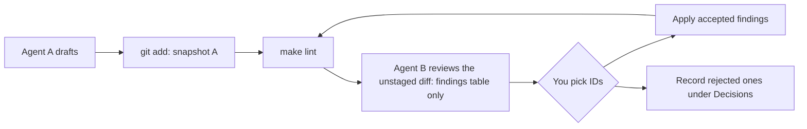

# Agent rules and review workflow

---

[toc]

---

This folder holds the repository's rules for AI agents and the contract for reviewing their work. Every agent reads the same files, so a rule written once applies in Claude Code, Codex, and Cursor alike. The prompts below are copy-ready; replace the paths and finding IDs with your own.

## How each tool finds the rules

| Tool            | Loads automatically                    | Reusable commands                                          |
| --------------- | -------------------------------------- | ---------------------------------------------------------- |
| **Claude Code** | `CLAUDE.md`, which imports `AGENTS.md` | `/review-changes` and `/apply-review` in `.claude/skills/` |
| **Codex**       | `AGENTS.md`                            | None in the repository; name `review.md` in the prompt     |
| **Cursor**      | `AGENTS.md`                            | None in the repository; attach files with `@`              |

`AGENTS.md` only indexes the rule files, so agents read a specific rule file when the task touches it. Name the rule file in a prompt whenever you want to be sure it is loaded.

## Workflow



1. Let agent A write or edit, then stage the result with `git add`. The staged version is now A's snapshot.
2. Run `make lint` and fix what it reports.
3. Ask agent B for a review. B **must not** edit files; it returns a numbered findings table of the unstaged diff against the staged snapshot.
4. Answer with a selection. The applying agent changes only those spans and proposes `## Decisions` entries for the findings you rejected.

If an agent edited files anyway, `git diff --word-diff` shows the changes word by word, and `git restore -p <file>` discards the hunks you do not want.

## Claude Code

Create or edit with the rules loaded:

```text
Add a lesson section to docs/arm/05-functions-and-the-stack.md on saving LR in nested calls, with an asm example. Follow .agents/rules/prose.md and assembly.md, then run make lint.
```

Review the unstaged diff, the staged diff, the last commit, or specific files:

```text
/review-changes
/review-changes --staged
/review-changes --last-commit
/review-changes docs/arm/04-branches-loops-and-conditions.md docs/images/cpulator/arm-24-length-sum.png
```

Apply a selection:

```text
/apply-review accept 1,3,5; 4 but keep "goes and gets"; reject rest
```

Record a preference directly:

```text
Add to the Decisions section of .agents/rules/prose.md: keep "run off the end" rather than "fall through" for code that executes past the last instruction. Reason: it matches the CPUlator lesson wording.
```

## Codex

Codex reads `AGENTS.md` at the start of every session in the repository. In the TUI (`codex`) or non-interactively (`codex exec "…"`):

```text
Read .agents/rules/prose.md and .agents/rules/assembly.md, then rewrite the loop explanation in docs/arm/04-branches-loops-and-conditions.md so it traces R0 and R1 through each iteration. Run make lint before finishing.
```

```text
Follow .agents/rules/review.md exactly. Review the unstaged diff (git diff --word-diff). Do not edit any file; output only the findings table and summary.
```

```text
Follow the "Applying a review" section of .agents/rules/review.md for the findings table above: accept 2,4; 6 but keep "literal pool"; reject rest.
```

> [!NOTE]
> Codex's built-in `/review` command uses its own format, **not** this contract. Use the prompt above when you want the findings table.

## Cursor

Cursor's agent reads `AGENTS.md` automatically. Attach rule files with `@` so they are in context for certain:

```text
@.agents/rules/review.md @.agents/rules/prose.md Review my unstaged changes to @docs/riscv/05-c-elf-and-disassembly.md. Do not edit; output the findings table.
```

```text
@.agents/rules/review.md Apply findings 1 and 3 from the table above with the smallest edits, then run make lint in the terminal.
```

```text
@.agents/rules/images.md @docs/images/cpulator/arm-26-pop-pc-before.png Does this capture match codes/arm/05-preserve-registers.s and its README entry?
```

To keep a review read-only, run it in Ask mode rather than Agent mode.

## Cross-agent review

The same contract works when one tool reviews another tool's work. For example, Cursor drafts, then you run `git add -A` and ask Codex or Claude Code for the review using the prompts above. Because the review is a table of quoted spans rather than an edited file, the reviewer's model never overwrites the author's wording; you choose what to keep.

## Adding a rule

- Put judgment rules in the matching rule file under `## Rules`, and settled wording choices under `## Decisions` with a date and reason.
- When a rule can be checked mechanically, add it to `tools/lint_docs.py` and mark it in the rule file with _(lint: `rule-id`)_.
- Add a new rule file only for a new kind of work, then list it in `AGENTS.md` and in the scope table in `review.md`.
