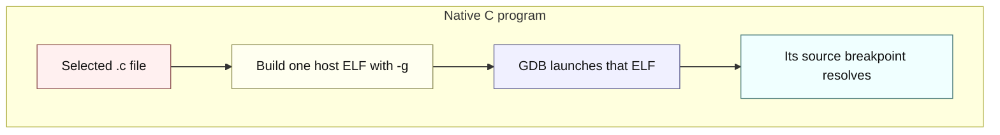
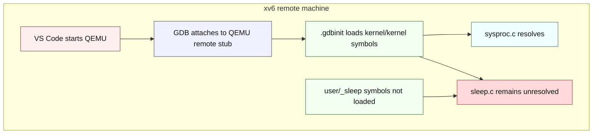

# Debugging xv6: symbols, address spaces, and harts

---

[toc]

---

**Source breakpoints depend on the ELF symbols GDB has loaded.** This guide covers:

- **VS Code source resolution:** why `kernel/sysproc.c` resolves while `user/sleep.c` remains unresolved.
- **Native versus remote debugging:** why programs under `/home/wahsieh/personal/c-programming/notes` behave differently.
- **User-program debugging:** how to load one xv6 program's symbols manually.
- **Hart selection:** when one emulated hart makes a trace easier.

Use [04-terminology.md](04-terminology.md) for term lookup and [02-build-boot-and-usage.md](02-build-boot-and-usage.md#debug-xv6-with-console-output-gdb-and-qemu) for the basic kernel-debugger workflow.

## Source breakpoints require symbols from the correct ELF

A source breakpoint becomes usable when **a loaded symbol file maps its source line to an address**. The directory containing the C file does not decide that.

| Session            | Loaded ELF                                                 | Source resolution                                                                      |
| ------------------ | ---------------------------------------------------------- | -------------------------------------------------------------------------------------- |
| **Native C notes** | The selected program, built and launched for the exercise. | That ELF supplies the selected source's symbols.                                       |
| **xv6**            | Only `kernel/kernel`, attached to the emulated machine.    | `kernel/sysproc.c` resolves; `user/sleep.c` belongs to the separate `user/_sleep` ELF. |

> [!IMPORTANT]
> The `program` value in this repository's `.vscode/launch.json` names `kernel/kernel` for symbols. The configuration does not ask the host operating system to execute that RISC-V file: `.gdbinit` attaches to QEMU's already-running remote target, and `launchCompleteCommand: "None"` prevents a host-style `run` command.

## Native process launch versus QEMU remote attachment





The colors label request, processing, routing, data, successful resolution, and unresolved state; every node also states its meaning so the diagram remains readable in monochrome.

| Layer                            | Native C notes                          | This xv6 session                                                                       |
| -------------------------------- | --------------------------------------- | -------------------------------------------------------------------------------------- |
| **Debug target**                 | The selected host process.              | QEMU's emulated RISC-V machine, exposed through the remote debugging stub.             |
| **Host-side process**            | The selected compiled program itself.   | QEMU; GDB controls its emulated CPUs rather than debugging QEMU's host implementation. |
| **Machine executing the C code** | The host machine.                       | QEMU's emulated RISC-V machine.                                                        |
| **Initial symbol file**          | The selected program's ELF.             | `kernel/kernel`.                                                                       |
| **Source covered initially**     | Sources linked into the selected ELF.   | Sources linked into the kernel ELF.                                                    |
| **Other executable code**        | Usually outside the exercise's process. | Separate user ELFs such as `user/_sleep`, loaded later from `fs.img`.                  |

## VS Code evidence: sys_pause breakpoint and decoded argument


_VS Code paused on the verified `sys_pause` breakpoint while the `sleep.c` breakpoint remains gray. The filled red breakpoint in `kernel/sysproc.c` has an address from `kernel/kernel`; the gray `user/sleep.c` entry has no address in the currently loaded symbols._


_After `argint(0, &n)` executes, the debugger can show `n = 10`. The stack remains `sys_pause` → `syscall` → `usertrap`, so this is kernel-side evidence about the request rather than a stop in `sleep.c:main`._

## kernel/kernel symbols do not cover user/\_sleep

**Both ELFs contain debug information; only the kernel ELF is loaded initially.** The Makefile's `-ggdb` supplies DWARF source mappings in the independent RISC-V files `kernel/kernel` and `user/_sleep`.

The generated `.gdbinit` contains `symbol-file kernel/kernel` and no `add-symbol-file user/_sleep`. GDB therefore maps `sysproc.c` lines to kernel virtual addresses but has no source-to-address translation for `sleep.c`.

`fs.img` does not solve that symbol problem. It stores the linked `sleep` executable for xv6 to load with `exec`; it is not a GDB symbol container, and QEMU's remote stub does not understand the xv6 filesystem or process table. The stub reports machine state—registers, memory, and emulated CPUs—while GDB relies on the ELF files supplied by the human or debugger configuration to label that state.

<a id="debug-usersleep-manually-with-add-symbol-file-and-hbreak"></a>

## Debug user/\_sleep manually with add-symbol-file and hbreak

The following recipe adds `user/_sleep` to the existing kernel-debugging session without changing `.vscode`. It is deliberately manual because the symbol file is meaningful only while the intended xv6 process occupies that user address space.

1. Start the normal one-hart QEMU debug target in terminal 1:

    ```bash
    make CPUS=1 qemu-gdb
    ```

2. Attach from terminal 2 and continue through boot:

    ```bash
    gdb-multiarch -q -x .gdbinit kernel/kernel
    ```

    ```gdb
    (gdb) continue
    ```

    GDB prints `Continuing.` and then shows no further `(gdb)` prompt; that is expected, because the target is running and GDB only prompts again once it stops.

3. Wait for the `$ ` prompt in terminal 1, then press `Ctrl-C` in terminal 2. Stopping after the shell is ready matters because every xv6 user ELF is linked at virtual address zero; installing an address-zero breakpoint during boot could stop in `init` or `sh` before `sleep` runs.

4. Load the user ELF's symbols, set a source-qualified hardware breakpoint, and continue:

    ```gdb
    (gdb) add-symbol-file user/_sleep 0
    add symbol table from file "user/_sleep" at
        .text_addr = 0x0
    (gdb) hbreak -source sleep.c -function main
    Hardware assisted breakpoint 1 at 0x0: file user/sleep.c, line 7.
    (gdb) info breakpoints
    (gdb) continue
    ```

5. Enter the command in terminal 1:

    ```text
    $ sleep 10
    ```

6. Confirm that GDB stopped in the user program and inspect its arguments:

    ```gdb
    Breakpoint 1, main (argc=2, argv=0x4fc0) at user/sleep.c:7
    (gdb) info source
    Current source file is user/sleep.c
    (gdb) print argc
    $1 = 2
    (gdb) x/s argv[1]
    0x4fe0: "10"
    ```

    Stack and string addresses vary after a rebuild, but the source file, argument count, and argument text should agree. A user backtrace is reliable through `main` and `start`; **do not** interpret frames beyond the saved entry context as kernel callers because the user-to-kernel transition happens only when the program executes a system-call stub.

7. Remove the temporary breakpoint and user symbols before returning to kernel-only debugging:

    ```gdb
    (gdb) delete 1
    (gdb) remove-symbol-file -a 0
    (gdb) detach
    (gdb) quit
    ```

> [!WARNING]
> `add-symbol-file` teaches GDB how to label addresses; it does not teach GDB which xv6 process owns the current page table. xv6 links user programs at the same virtual addresses, so `user/_sleep` labels become wrong when another user program runs. Load them for a focused stop, then remove them.

The hardware breakpoint is purposeful. It asks QEMU to stop when a hart executes the address instead of having GDB patch a breakpoint instruction into a guest text page. The repository's VS Code configuration likewise requires hardware breakpoints.

## Why use `CPUS=1`

**`CPUS` selects emulated harts, independently of the host CPU count.** The Makefile defaults to `CPUS := 3`, passes it to QEMU's `-smp`, and accepts a command-line override. The `fs` lab is the branch that forces `CPUS := 1`; each virtual CPU in this machine is a RISC-V hart.

| Setting              | Best use                                                                                                     | Execution differences                                                                  |
| -------------------- | ------------------------------------------------------------------------------------------------------------ | -------------------------------------------------------------------------------------- |
| `CPUS=1`             | Trace one causal path, single-step, inspect one call stack, or use the QEMU monitor without choosing a hart. | Removes cross-hart execution, lock contention, and many interleavings.                 |
| **Default `CPUS=3`** | Reproduce multicore failures and run final correctness checks after a focused trace.                         | Exercises concurrent paths that can expose races, deadlocks, and ordering assumptions. |

**One hart is simpler, not fully deterministic:** timer interrupts and xv6 scheduling still occur. With three harts, console order and the currently stopped hart are less predictable; those interleavings can reveal failures the single-hart trace hides.

QEMU exposes the emulated harts to GDB as debugger threads. Those entries are execution contexts of virtual CPUs, not xv6 processes and not user-level software threads. `info threads` answers “which hart did QEMU report?”, while `myproc()` and `p->state` in xv6 answer “which process is this hart running?”

> [!IMPORTANT]
> `CPUS=1` is a debugging lens, not a fix. A change is not concurrency-safe until it also survives the repository's normal multi-hart tests.

## GDB troubleshooting: symbols, reused addresses, and harts

| Observation                                                               | Likely cause                                                                                                                 | Check or correction                                                                                                                                  |
| ------------------------------------------------------------------------- | ---------------------------------------------------------------------------------------------------------------------------- | ---------------------------------------------------------------------------------------------------------------------------------------------------- |
| **A breakpoint is gray or hollow**                                        | No loaded symbol file maps that source line to an address.                                                                   | Run `info sources` and `info files`; load the correct ELF rather than moving the breakpoint randomly.                                                |
| **`continue` prints `Continuing.` and no further `(gdb)` prompt appears** | The target is running; GDB does not prompt again until it stops.                                                             | Watch terminal 1 for the `$ ` prompt, then press `Ctrl-C` in terminal 2 to regain the `(gdb)` prompt, as in step 3 of the recipe above.              |
| **`sleep.c` resolves but execution stops in another user program**        | Several xv6 user ELFs reuse virtual address zero, and the breakpoint was installed before `sleep` owned the user page table. | Continue to the shell first, interrupt GDB, then add the symbols and hardware breakpoint immediately before running `sleep`.                         |
| **GDB cannot insert the breakpoint**                                      | The requested breakpoint type or address is unavailable in the current target state.                                         | Confirm the QEMU remote connection, use `hbreak`, and check `info breakpoints`; do not replace it with a software breakpoint in read-only user text. |
| **A local is `<optimized out>` or nonsensical**                           | The compiler optimized it or the stop is before its initialization.                                                          | Check the highlighted source line and step past the assignment before printing the value.                                                            |
| **The GDB port is already in use**                                        | A previous QEMU instance still owns the per-user port.                                                                       | Run `pgrep -af qemu-system-riscv64`, identify the stale instance, and terminate only that process.                                                   |
| **`exec sleep failed` appears**                                           | The running guest's `fs.img` does not contain the linked user program.                                                       | Quit QEMU, rebuild the image, boot again, and confirm the xv6 shell's `ls` output includes `sleep` before debugging source behavior.                 |
| **The bug disappears with `CPUS=1`**                                      | The failure depends on cross-hart concurrency.                                                                               | Treat the single-hart trace as partial evidence and reproduce with the default three harts.                                                          |

## Assembly, GDB, ELF, and sleep exercise references

- [Assembly practice: stepping instructions and inspecting memory](../../assembly-language/docs/riscv/00-tools-and-first-run.md)
- [Assembly practice: observing ra across a nested call](../../assembly-language/docs/riscv/04-functions-and-stacks.md#gdb-observe-ra-change-across-the-nested-call)

- [Build, boot, and basic GDB usage](02-build-boot-and-usage.md#debug-xv6-with-console-output-gdb-and-qemu)
- [Terminology lookup](04-terminology.md)
- [ELF and build artifacts](06-build-artifacts.md#elf-headers-segments-and-load-addresses)
- [The util `sleep` exercise](labs/01-util-sleep.md)
