# Debugging xv6 with GDB: sessions, crashes, symbols, and harts

---

[toc]

---

**This is the canonical GDB guide for this tree.** Lab notes and other documents keep only their exercise-specific breakpoints and observations and link here for setup, controls, crash lookup, backtraces, and pitfalls.

**Screenshots and transcripts describe their recorded builds.** The teaching comment in `kernel/syscall.c` now puts the `a7` load on line 156 and the handler call on line 162, rather than lines 150 and 156 shown in older captures. Locate statements by text and take instruction addresses from the binary you are running.

| Task                                                              | Section                                                                                                                                                                                                                                 |
| ----------------------------------------------------------------- | --------------------------------------------------------------------------------------------------------------------------------------------------------------------------------------------------------------------------------------- |
| **Attach GDB to the emulated machine**                            | [Run a GDB session](#start-a-kernel-gdb-session-qemu-gdb-and-gdbinit)                                                                                                                                                                   |
| **See a whole session end to end, with screenshots**              | [Follow a system call into `sys_pause`](#follow-a-system-call-into-syspause)                                                                                                                                                            |
| **Look up a command: `next`, `finish`, `p/x`, `bt`, `layout`, …** | [GDB command reference](#gdb-command-reference-run-control-breakpoints-inspection-and-harts)                                                                                                                                            |
| **Use VS Code instead of a terminal**                             | [Debug with VS Code](#debug-with-vs-code-launch-configuration-and-evidence): [kernel stop](#vs-code-kernel-stop-syspause), [user stop](#vs-code-user-stop-sleepcmain), or [panic stop](#vs-code-panic-stop-panic-and-the-faulting-sepc) |
| **Turn a panic's `sepc` into a source line**                      | [Find where the kernel crashed](#find-where-the-kernel-crashed-sepc-kernelasm-and-addr2line)                                                                                                                                            |
| **Get a backtrace from a panic or a hang**                        | [Backtraces](#backtraces-panics-kernel-mode-faults-and-hangs)                                                                                                                                                                           |
| **Decide whether a register value is the user's or the kernel's** | [Live CSRs versus saved user registers](#live-csrs-versus-saved-user-registers)                                                                                                                                                         |
| **Read the page table or CSRs without GDB**                       | [QEMU monitor](#inspect-the-machine-through-the-qemu-monitor)                                                                                                                                                                           |
| **Stop inside a user program**                                    | [Debug user programs](#debug-user-programs-load-symbols-from-the-right-elf), then [the `add-symbol-file` recipe](#debug-usersleep-manually-with-add-symbol-file-and-hbreak)                                                             |
| **Choose a hart count**                                           | [Why use `CPUS=1`](#why-use-cpus1)                                                                                                                                                                                                      |
| **Fix a misbehaving session**                                     | [GDB troubleshooting](#gdb-troubleshooting-symbols-reused-addresses-and-harts)                                                                                                                                                          |

Console output comes first: [02-build-boot-and-usage.md](02-build-boot-and-usage.md#debug-xv6-with-console-output-gdb-and-qemu) owns `printf` tracing and saving a console log with `script`. For register stepping on a tiny bare-metal program, start with [the assembly course's QEMU/GDB exercise](../../assembly-language/docs/riscv/00-tools-and-first-run.md#qemu-and-gdb-run-and-step-the-first-example). Use [04-terminology.md](04-terminology.md) for term lookup.

Kernel bugs rarely announce themselves clearly. MIT's [lab guidance](https://pdos.csail.mit.edu/6.1810/2026/labs/guidance.html) says learning these tools is well worth the time, and the sections below turn most "it just hangs" sessions into a short investigation.

<a id="start-a-kernel-gdb-session-qemu-gdb-and-gdbinit"></a>

## Run a GDB session: `qemu-gdb`, kernel stops, and user stops

**Every session starts the same way; only the stop differs.** The setup and [the two-terminal handoff](#the-two-terminal-handoff-which-terminal-acts-next) below are shared by both walkthroughs:

| Walkthrough                                                                                  | Where it stops                | Symbols it needs                        |
| -------------------------------------------------------------------------------------------- | ----------------------------- | --------------------------------------- |
| **[Kernel stop in `sys_pause`](#follow-a-system-call-into-syspause)**                        | `kernel/sysproc.c`, in S-mode | `kernel/kernel`, loaded by `.gdbinit`   |
| **[User stop in `sleep.c:main`](#debug-usersleep-manually-with-add-symbol-file-and-hbreak)** | `user/sleep.c`, in U-mode     | `user/_sleep`, added by hand after boot |

### Start QEMU halted and attach GDB

Use two terminals. In the first, start one emulated hart to remove cross-hart interleavings while you trace one path; timer interrupts and xv6 process scheduling still occur:

```bash
make CPUS=1 qemu-gdb
```

The `qemu-gdb` recipe adds `-S`, which stops the hart at the reset vector before its first instruction, and `-gdb tcp::<port>`, which exposes QEMU's remote GDB stub. The Makefile derives the port from the host uid and generates `.gdbinit` with that value, the RISC-V architecture, `kernel/kernel` as the symbol file, and compressed-breakpoint support.

In the second terminal, from the repository root, explicitly source that generated file:

```bash
gdb-multiarch -x .gdbinit kernel/kernel
```

If that binary is not installed, `riscv64-linux-gnu-gdb` or `riscv64-unknown-elf-gdb` works identically — any of the three can debug a RISC-V target. Plain `gdb` on an x86 host usually cannot; [troubleshooting](#gdb-troubleshooting-symbols-reused-addresses-and-harts) lists its symptom.

The explicit `-x` works even when GDB declines to auto-load a repository-local `.gdbinit`. To use the shorter `gdb-multiarch kernel/kernel` command, trust this one repository by adding the exact absolute path GDB prints to the user-init file named in its diagnostic, which may be `~/.config/gdb/gdbinit` or `~/.gdbinit`:

> [!NOTE]
> Add only repositories you trust. A local `.gdbinit` executes debugger commands, so globally disabling `auto-load safe-path` would also trust files in unrelated repositories.
>
> ```gdb
> add-auto-load-safe-path /absolute/path/to/xv6-riscv/.gdbinit
> ```

### The two-terminal handoff: which terminal acts next

**After `continue`, GDB's prompt disappears until the kernel stops, and the next action is usually in QEMU's terminal.** QEMU starts halted, GDB releases it, xv6 boots in terminal 1, and only the code path you trigger there brings the `(gdb)` prompt back in terminal 2:

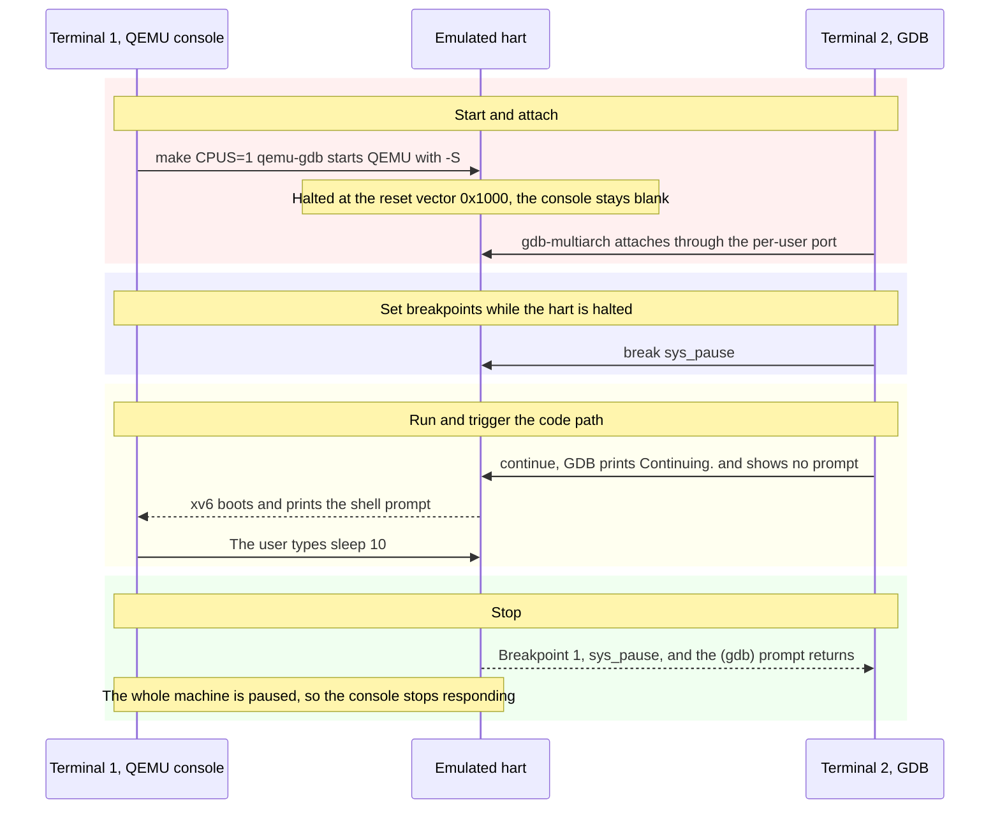

_Legend: request red-white for starting and attaching, routing blue for setting breakpoints, processing yellow for running, and data green for the stop report returning to GDB. Every band also carries a text title._

Use this table to decide what a silent terminal means:

| Where you are waiting                                 | What it means                                                                 | Next action                                                                                                |
| ----------------------------------------------------- | ----------------------------------------------------------------------------- | ---------------------------------------------------------------------------------------------------------- |
| **Terminal 1 is blank after `make qemu-gdb`**         | `-S` halted the hart before its first instruction; QEMU waits for a debugger. | Attach GDB in terminal 2.                                                                                  |
| **Terminal 2 shows `Continuing.` and no prompt**      | The kernel is running; GDB prompts again only when the target stops.          | Look at terminal 1: wait for the boot output, then trigger the code path, or press `Ctrl-C` in terminal 2. |
| **Terminal 1 shows `$ ` and terminal 2 stays silent** | The breakpoint's code has not run yet.                                        | Type the command that reaches it, such as `sleep 10`.                                                      |
| **Terminal 1 stops responding mid-command**           | A breakpoint hit, and every hart is paused.                                   | Switch to terminal 2, where the `(gdb)` prompt is back.                                                    |

**A breakpoint on a path the kernel takes during boot fires without any typing.** `b syscall`, for example, stops on the first system call before the shell prints `$ `, so terminal 1 shows only the boot banner.

<a id="follow-a-system-call-into-syspause"></a>

### Kernel stop: follow a system call into `sys_pause`

**One session, end to end:** stop the kernel in the handler for `sleep 10`, read the decoded argument, then read the user's saved registers one frame up. Each step names the terminal it happens in; [the handoff](#the-two-terminal-handoff-which-terminal-acts-next) explains the waits between them.

1. **Terminal 1:** run `make CPUS=1 qemu-gdb`. It prints `*** Now run 'gdb' in another window.` and the QEMU command line, then stays blank: the hart is halted.
2. **Terminal 2:** run `gdb-multiarch -x .gdbinit kernel/kernel`. GDB reports `0x0000000000001000 in ?? ()`, the reset vector, and shows `(gdb)`.
3. **Terminal 2:** run `break sys_pause`. GDB prints `Breakpoint 1 at 0x80001e98: file kernel/sysproc.c, line 94.`
4. **Terminal 2:** run `continue`. GDB prints `Continuing.` and **no prompt**. This is not a hang: the kernel is running, and the next step happens in terminal 1.
5. **Terminal 1:** wait for `xv6 kernel is booting`, `init: starting sh`, and the `$ ` prompt, then type `sleep 10` and press Enter. The shell does not return, because the breakpoint pauses the whole machine.
6. **Terminal 2:** the prompt is back after `Breakpoint 1, sys_pause () at kernel/sysproc.c:94`, the handler's opening brace, before local `n` has a value.
7. **Terminal 2:** run `next 3`, then `print n`. GDB stops on line 101, `acquire(&tickslock)`, and prints `$1 = 10`: `argint(0, &n)` has copied the user's argument into `n` from `sleep 10`.
8. **Terminal 2:** run `backtrace` to see `sys_pause()`, `syscall()`, and `usertrap()`. Frame pointers in the kernel build make that trace available; [reading the backtrace](#reading-the-syspause-backtrace-stack-frames-and-callers) explains the order.
9. **Terminal 2:** run `frame 1` to select `syscall`, where `p` is in scope, then `print p->trapframe->a0` and `print p->trapframe->a7` to read the **saved** user registers.
10. **Terminal 2:** run `detach`, then `quit`. In terminal 1, the kernel resumes, `sleep` finishes, and `$ ` returns; exit QEMU with `Ctrl-a x`.

This tree's session printed the following; addresses change after a rebuild, and line 94 is the handler's opening brace:

```text
Breakpoint 1 at 0x80001e98: file kernel/sysproc.c, line 94.
Breakpoint 1, sys_pause () at kernel/sysproc.c:94
94      {
(gdb) next 3
101       acquire(&tickslock);
(gdb) print n
$1 = 10
(gdb) backtrace
#0  sys_pause () at kernel/sysproc.c:101
#1  0x0000000080001d82 in syscall () at kernel/syscall.c:156
#2  0x0000000080001b02 in usertrap () at kernel/trap.c:76
#3  0x0000003ffffff09c in ?? ()
(gdb) frame 1
#1  0x0000000080001d82 in syscall () at kernel/syscall.c:156
(gdb) print p->trapframe->a0
$3 = 10
(gdb) print p->trapframe->a7
$4 = 13
```

**Frame `#3` is not a kernel caller.** `0x3ffffff09c` is in the trampoline page that `uservec` runs from, and the unwinder **cannot** continue past it into user code; [reading the backtrace](#reading-the-syspause-backtrace-stack-frames-and-callers) explains why. `13` is `SYS_pause` in `kernel/syscall.h`.

> [!WARNING]
> `info registers a0 a7` prints the hart's **live** registers, not the trapframe. In this session they happened to read 10 and 13 as well, but nothing preserves them once the kernel runs; see [Live CSRs versus saved user registers](#live-csrs-versus-saved-user-registers).

#### Why `next 3` stops on line 101 and `print n` shows 10

**The two `n`s are different things.** In `n 3`, `n` is GDB's abbreviation for `next` and `3` is a repeat count; in `print n`, `n` is the C local `int n` declared in `sys_pause`.

| Command       | What GDB parses             | Result in this session                          |
| ------------- | --------------------------- | ----------------------------------------------- |
| **`n 3`**     | Run `next` three times      | Stops on line 101, not on line 94 + 3           |
| **`print n`** | Evaluate the C variable `n` | `10`, the argument `sleep 10` passed to `pause` |

**`next` counts executed source lines, not line numbers.** Lines that generate no code, such as declarations and blank lines, are never a stop, and a skipped branch body is never reached:

| `next` | Stops on line | Why that line                                                    |
| ------ | ------------- | ---------------------------------------------------------------- |
| start  | 94 `{`        | The breakpoint sits on the prologue, before `n` is assigned.     |
| 1      | 98            | `int n;` and `uint ticks0;` on lines 95–96 emit no instructions. |
| 2      | 99            | `argint(0, &n)` has run, so `n` is now 10.                       |
| 3      | 101           | `n < 0` is false, so line 100, `n = 0`, is skipped.              |

Another build or another argument can change that path, so read the highlighted line rather than trusting the count. `print` takes a C expression, so its `n` can only be a variable in the selected frame.

<a id="reading-the-syspause-backtrace-stack-frames-and-callers"></a>

#### Reading the `sys_pause` backtrace: stack frames and callers

**A stack frame is one active function call's record on the kernel stack:** its saved return address, saved frame pointer, and locals. `backtrace` lists one line per active call, the innermost first:

- **Frame `#0`:** the function that is running.
- **Each higher frame number:** the caller of the preceding frame.

The trace is a snapshot of who is waiting for whom, not a history of every function that ran.

**`sys_pause` does not call `syscall`; `syscall` calls `sys_pause`.** `kernel/sysproc.c` has no call to `syscall()`, because the call goes the other way, through the function-pointer table in `kernel/syscall.c`:

```c
    p->trapframe->a0 = syscalls[num]();
```

_From `syscall()` in `kernel/syscall.c`._ With `num` equal to 13, `syscalls[13]` is `sys_pause`, so that indirect call creates frame `#0`. Read the backtrace from the bottom up to follow time forward:

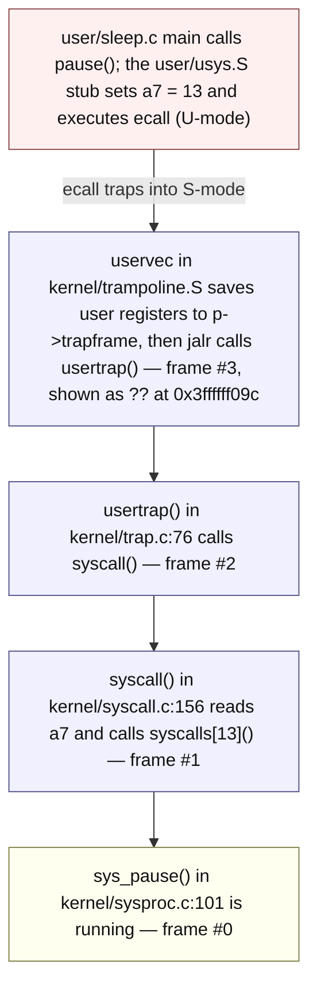

_Legend: request red-white for the user-mode request, routing blue for trap entry and dispatch, processing yellow for the handler doing the work. U-mode is user mode and S-mode is supervisor mode; see [04-terminology.md](04-terminology.md)._

**Frame `#3` has no name because of where it runs.** `jalr t0` in `uservec` left `ra` pointing at `userret`, which runs from the trampoline page's high virtual address rather than the address `kernel/kernel` links it at, so GDB has no symbol for it. The `ecall` before it is a trap, not a call, so no frame links back into `sleep.c`.

**Selecting a frame changes scope, not execution.** The hart stays stopped in `sys_pause` while you inspect its callers:

| Interface                                                             | Select the caller                                  | Effect on inspection                                                                                                       |
| --------------------------------------------------------------------- | -------------------------------------------------- | -------------------------------------------------------------------------------------------------------------------------- |
| **GDB prompt**                                                        | `frame 1` or `up`; return with `frame 0` or `down` | `print` evaluates in `syscall`: `p` prints, but `num` is `<optimized out>`; [see why](#why-print-num-shows-optimized-out). |
| **VS Code**                                                           | Click `syscall` in **Call Stack**                  | Variables and Debug Console use that frame, just as with `frame 1`.                                                        |
| **[GDB TUI](#the-same-stop-in-gdbs-tui-layout-src-and-layout-split)** | Select the frame at the prompt                     | Both panes jump to the selected frame's line.                                                                              |

<a id="why-print-num-shows-optimized-out"></a>

#### Why `print num` shows `<optimized out>` in the `syscall` frame

**GDB has no location for `num` while the handler call is active.** The kernel is built with `-O` (`CFLAGS` in the `Makefile`), so the compiler keeps `num` in register `a3` instead of a stack slot. `info scope syscall` gives its DWARF locations in this build:

```gdb
(gdb) info scope syscall
Symbol num is multi-location:
  Range 0x80001d66-0x80001d81: a variable in $a3
  Range 0x80001d88-0x80001d99: a variable in $a3
```

Frame `#1`'s PC is the return address `0x80001d82`, which falls outside both ranges. `a3` is a caller-saved register: `sys_pause` may overwrite it, so the compiler records no location there and GDB reports `<optimized out>`. `p` survives because it lives in `s1`, a callee-saved register GDB can recover while unwinding.

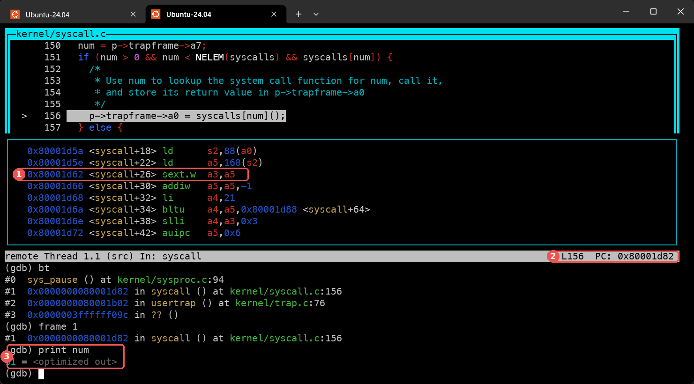

_**1** `sext.w a3,a5` at `0x80001d62` puts `num` in `a3`; its first location range starts at the following instruction, `0x80001d66`. **2** The selected frame's PC, `0x80001d82`, is past the `jalr` and outside the range. **3** GDB therefore has no location to read._

| To see `num`                               | Command                                                                                                |
| ------------------------------------------ | ------------------------------------------------------------------------------------------------------ |
| **Stop inside its range, before the call** | `b *0x80001d66`, then `p num`: this build printed `15` at boot.                                        |
| **Read the value it was loaded from**      | Select the `syscall` frame, then `p p->trapframe->a7`; `p` is in scope there.                          |
| **Reduce optimization for inspection**     | Rebuild with `-O0` in `CFLAGS`, then check `info scope syscall`; addresses and line mappings may move. |

#### The same stop in GDB's TUI: `layout src` and `layout split`

`layout src` keeps the source beside the prompt, so each `next` moves a visible marker instead of printing one line at a time. **Leave the TUI with `tui disable` or `Ctrl-x a`**; the session keeps running, and `Ctrl-x a` again or any `layout` command brings it back. If the screen is garbled afterwards, press `Ctrl-l`:


_`layout src` after three `next` commands. **1** The `>` row is the next line to execute, not the last one executed. **2** The status bar names the selected hart (`Thread 1.1`), the function, the line, and the PC. **3** `print n` reads the local after `argint(0, &n)` has filled it._

`layout split` adds the disassembly. Selecting `frame 1` moves both panes to the caller, which is how to see where `sys_pause` will return:


_`layout split` after `frame 1`. **1** Line 156 calls through `syscalls[num]` and stores the result. **2** The selected frame's PC is the instruction after `jalr a5`: the `sd` that writes the return value into `p->trapframe->a0`. **3** That store has not run, so the saved `a0` still holds the argument 10. **4** The saved `a7` is 13, `SYS_pause`._

**`jalr a5` is the indirect call that `syscalls[num]()` compiles to.** `JALR` is Jump And Link Register: it jumps to the address held in `a5`, the `sys_pause` pointer loaded from the table, and writes the return address into `ra`.

**This call occupies 2 bytes.** In `kernel/kernel.asm` it is the compressed form `9782` at `0x80001d80`, so the return address is `0x80001d82`, not `pc + 4`; that is the address `backtrace` prints for frame `#1`.

The [assembly course's `JALR` section](../../assembly-language/docs/riscv/04-functions-and-stacks.md#indirect-calls-jalr-forms-and-pseudoinstructions) covers its other spellings, `JR` and `RET`, and the ARM and x86 counterparts.

##### TUI layouts: what `src`, `asm`, `split`, and `regs` show

**A layout names which windows sit above the `(gdb)` command window.** The [GDB TUI command reference](https://sourceware.org/gdb/current/onlinedocs/gdb.html/TUI-Commands.html) defines the layouts; assembly views help when a stop has no C source:

| Command        | Windows shown above the command window                        | Use it when                                                                             |
| -------------- | ------------------------------------------------------------- | --------------------------------------------------------------------------------------- |
| `layout src`   | Source only                                                   | Stepping C with `next` and `step`.                                                      |
| `layout asm`   | Disassembly only                                              | Stepping `kernel/trampoline.S`, `kernel/entry.S`, or code without debug info; use `si`. |
| `layout split` | Source and disassembly                                        | Matching a C line to its instructions, as in the `jalr a5` stop above.                  |
| `layout regs`  | A register window above the current source or assembly window | Watching `a0`–`a7`, `sp`, and `ra` change; `tui reg csr` swaps in CSRs such as `sepc`.  |
| `layout next`  | The next available layout, including user-defined layouts     | Flipping views without typing a name; `layout prev` goes backwards.                     |

**`layout regs` chooses source or assembly from the current layout.** From `src`, it shows registers and source; from `asm` or `split`, it shows registers and assembly. In the `split` case, the source pane is removed.

- **Choose registers:** `tui reg general`, `tui reg csr`, or `tui reg all`; `maint print reggroups` lists the available groups for RISC-V.
- **Choose scroll focus:** `focus regs` gives the arrow keys to the register window; `focus cmd` returns them to command history.

The two views below continue the same `sys_pause` stop: after `print n`, run `layout asm` and `stepi` twice, then `layout regs` and `print &tickslock`.

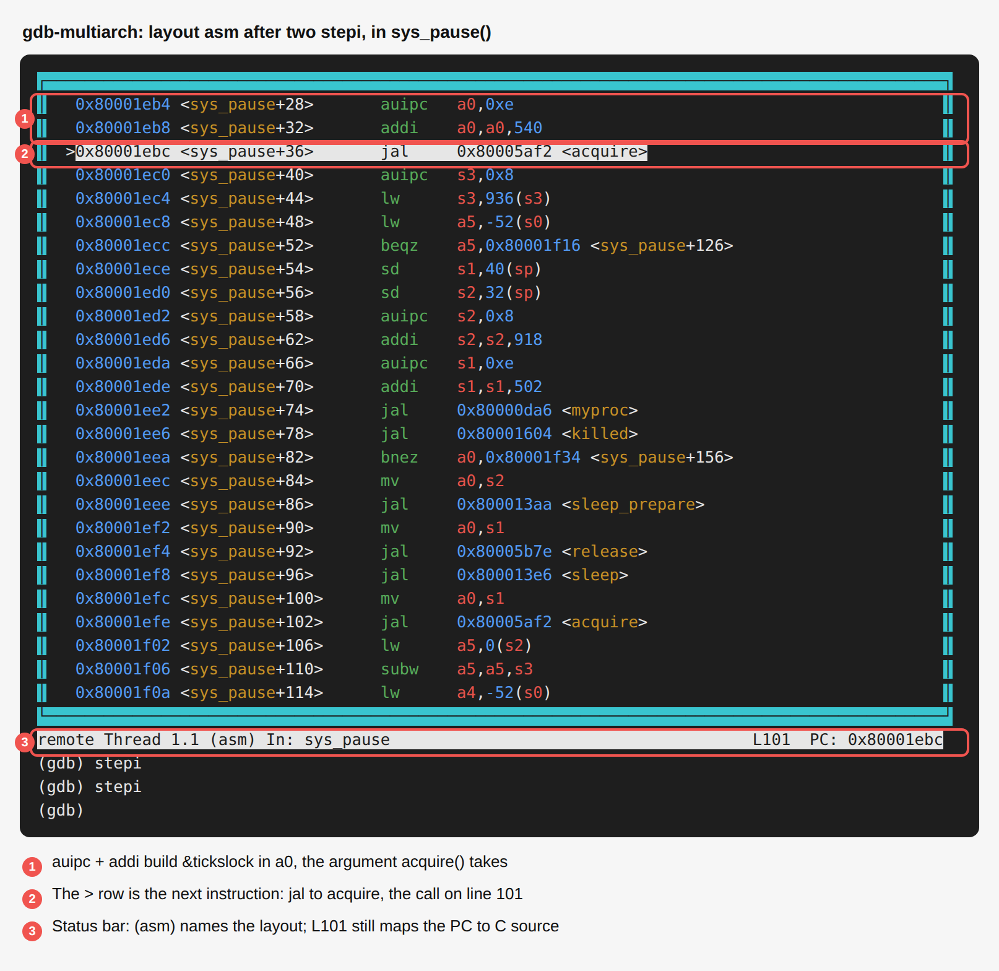

_`layout asm` two `stepi` commands after line 101. **1** `auipc` and `addi` build `&tickslock` in `a0`, the argument register. **2** The `>` row is the next instruction, `jal` to `acquire`, which is the call line 101 compiles to. **3** The status bar names the layout as `(asm)` and still maps the PC to `L101`, so stepping instructions does not lose the C line._

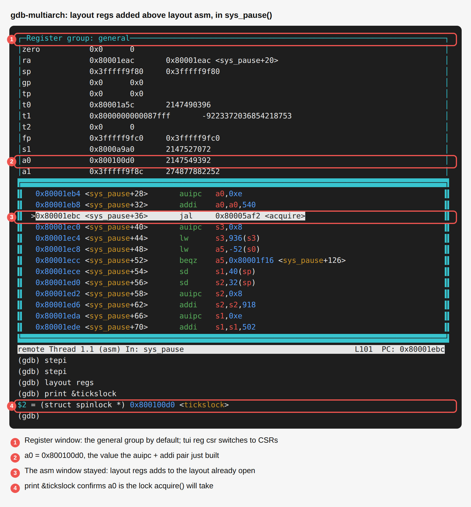

_`layout regs` typed while `layout asm` was open. **1** The register window shows the `general` group; `tui reg csr` swaps in CSRs. **2** `a0` is `0x800100d0`, the value the `auipc` and `addi` pair built. **3** The disassembly window stayed, because `layout regs` adds to the open layout instead of replacing it. **4** `print &tickslock` returns `0x800100d0`, so `a0` is the lock `acquire` is about to take._

The [sleep note](labs/01-util-sleep.md#inspecting-the-argument-the-grader-does-not-check) records what this stop does and does not prove about the exercise.

<a id="debug-usersleep-manually-with-add-symbol-file-and-hbreak"></a>

### User stop: break in `user/_sleep` with `add-symbol-file` and `hbreak`

**Same start, different stop:** attach exactly as for the kernel stop, but load `user/_sleep`'s symbols after the shell is ready and stop on `sleep.c:main` with a hardware breakpoint. [Why the kernel symbols do not cover `sleep.c`](#kernelkernel-symbols-do-not-cover-usersleep) explains why the extra symbol file is needed. [The VS Code user stop](#vs-code-user-stop-sleepcmain) runs the same recipe without changing `.vscode`.

1. **Terminals 1 and 2:** start QEMU and attach GDB as in [steps 1–2 of the kernel stop](#follow-a-system-call-into-syspause). The `-q` flag in `gdb-multiarch -q -x .gdbinit kernel/kernel` only hides GDB's banner.
2. **Terminal 2:** run `continue` **without** setting a breakpoint. GDB prints `Continuing.` and no prompt; see [the handoff](#the-two-terminal-handoff-which-terminal-acts-next).
3. **Terminal 1:** wait for the `$ ` prompt. **Terminal 2:** press `Ctrl-C` to get `(gdb)` back.
4. **Terminal 2:** load the user ELF's symbols at its link address, set a source-qualified hardware breakpoint, and continue:

    ```gdb
    (gdb) add-symbol-file user/_sleep 0
    add symbol table from file "user/_sleep" at
        .text_addr = 0x0
    (gdb) hbreak -source sleep.c -function main
    Hardware assisted breakpoint 1 at 0x0: file user/sleep.c, line 10.
    (gdb) info breakpoints
    (gdb) continue
    ```

5. **Terminal 1:** type `sleep 10` and press Enter.
6. **Terminal 2:** confirm that GDB stopped in the user program and inspect its arguments:

    ```gdb
    Breakpoint 1, main (argc=2, argv=0x3fc0) at user/sleep.c:10
    (gdb) info source
    Current source file is user/sleep.c
    (gdb) print argc
    $1 = 2
    (gdb) x/s argv[1]
    0x3fe0: "10"
    ```

7. **Terminal 2:** remove the breakpoint and the user symbols, then leave as before:

    ```gdb
    (gdb) delete 1
    (gdb) remove-symbol-file -a 0
    (gdb) detach
    (gdb) quit
    ```

Stack and string addresses vary after a rebuild, but the source file, argument count, and argument text should agree.

**Setting the breakpoint before loading symbols also works, and it is what VS Code does.** With `set breakpoint pending on`, `hbreak user/sleep.c:15` before step 2 stays pending until `add-symbol-file` gives GDB an address for it:

```gdb
(gdb) set breakpoint pending on
(gdb) hbreak user/sleep.c:15
No source file named user/sleep.c.
Hardware assisted breakpoint 1 (user/sleep.c:15) pending.
```

Continue to the shell, interrupt GDB with `Ctrl-C`, and load `user/_sleep` as in steps 3–4. `info breakpoints` then shows the resolved address, `0x8` in the recorded build. After running `sleep 10`, the stop has `argc = 2` and `argv[1] = "10"`.

**VS Code uses the interrupt task for this handoff.** Follow the [VS Code user stop](#vs-code-user-stop-sleepcmain) for its actual screenshots and Debug Console commands; the Pause button does not interrupt the recorded launch setup.

<a id="break-source-versus-hbreak"></a>

#### `break -source sleep.c -function main` versus `hbreak`

**`break -source sleep.c -function main` also stops here under QEMU.** `-source` and `-function` are GDB's explicit-location options, accepted by `break`, `tbreak`, and `hbreak`; `break sleep.c:main` is the equivalent linespec.

In a run with both set, the software `break` at `0x0` stopped first on line 10, and an `hbreak` on line 15 at `0x8` stopped next.

**QEMU's GDB stub does not patch guest memory for either kind.** Its TCG emulator matches the virtual PC for both requests:

| GDB command | Remote packet |
| ----------- | ------------- |
| `break`     | `Z0`          |
| `hbreak`    | `Z1`          |

That is why the software breakpoint inserted without error while the hart was in `scheduler()` on the kernel page table, where virtual address 0 is unmapped.

**The recipe keeps `hbreak` for portability.** After `Ctrl-C` the hart is usually running the kernel or the shell. A target that implements software breakpoints by writing an `ebreak` into memory, such as a debug probe on real hardware, would find address 0 unmapped or patch the wrong process's page; `exec` would then give `sleep` fresh pages without the breakpoint.

A hardware breakpoint compares the PC whichever page backs it. The repository's VS Code configuration requests hardware breakpoints for the same reason.

> [!WARNING]
> **Delete the user breakpoint before continuing in step 7.** Both kinds fire in any process that executes the address; after `sleep` exits, `sh` calls `getcmd`, which is also linked at `0x0`.

The false hit uses `sleep`'s labels and has nonsense arguments:

```text
Breakpoint 2, main (argc=8224, argv=0x64 <strcmp+6>) at user/sleep.c:10
```

**Do not call kernel functions from a user-mode stop.** For example, `print myproc()->name` runs the call at the user privilege level, so the instruction fetch faults and xv6 kills the current process with `usertrap(): unexpected scause 0xc`.

| Step that differs from the kernel stop    | Why it differs                                                                                                                                        |
| ----------------------------------------- | ----------------------------------------------------------------------------------------------------------------------------------------------------- |
| **Breakpoint set after boot, not before** | Every xv6 user ELF is linked at virtual address 0, so a breakpoint there during boot stops in `init` or `sh` instead of `sleep`.                      |
| **`add-symbol-file`, then removal**       | `.gdbinit` loads only `kernel/kernel`; the user labels are correct only while `sleep` owns the user page table.                                       |
| **`hbreak` instead of `break`**           | Both work under QEMU, which matches either by PC; `hbreak` also works on targets that patch memory for software breakpoints.                          |
| **A short user backtrace**                | `bt` is reliable through `main` and `start`; nothing above them is a kernel caller, because user code enters the kernel only through an `ecall` stub. |

> [!WARNING]
> `add-symbol-file` teaches GDB how to label addresses; it does not teach GDB which xv6 process owns the current page table. xv6 links user programs at the same virtual addresses, so `user/_sleep` labels become wrong when another user program runs. Load them for a focused stop, then remove them.

## GDB command reference: run control, breakpoints, inspection, and harts

**Most xv6 sessions need about twenty commands.** Each table groups commands by the question they answer; the short form is what GDB accepts at the prompt, and the examples come from this tree. Pressing Enter on an empty line repeats the previous command, and after `x` it continues from the next address.

### Run control: `continue`, `next`, `step`, and `finish`

| Command               | Short form  | What it does in an xv6 session                                                                                   |
| --------------------- | ----------- | ---------------------------------------------------------------------------------------------------------------- |
| **`continue`**        | `c`         | Runs every hart until a breakpoint, a watchpoint, or `Ctrl-C`.                                                   |
| **`next`**            | `n`         | Runs to the next source line of the current function, stepping **over** calls such as `argint()`.                |
| **`step`**            | `s`         | Runs to the next source line, stepping **into** calls: from `sys_pause` it stops inside `argint()`.              |
| **`finish`**          | `fin`       | Runs until the current function returns and prints `Value returned`; from `sys_pause` that waits the full ticks. |
| **`stepi` / `nexti`** | `si` / `ni` | Executes one machine instruction; `ni` steps over a `jal`.                                                       |
| **`Ctrl-C`**          | —           | Interrupts the running target and returns the `(gdb)` prompt; the way to inspect a hang.                         |

### Breakpoints: `break`, `tbreak`, `hbreak`, and `watch`

| Command                                 | Short form | What it does in an xv6 session                                                                                                                |
| --------------------------------------- | ---------- | --------------------------------------------------------------------------------------------------------------------------------------------- |
| **`break FUNC` or `break FILE:LINE`**   | `b`        | Sets a breakpoint by symbol; it resolves only through a loaded ELF, normally `kernel/kernel`.                                                 |
| **`break *0xADDR`**                     | `b *0x…`   | `*` makes the location an instruction address, not a function or line: `b *0x80001d58` stops at a panic's `sepc`. Keep `0x`.                  |
| **`break FUNC if EXPR`**                | `b … if …` | Stops only when the condition holds, for example `b argint if n == 1`; prefer variables over function calls in the condition.                 |
| **`tbreak FUNC`**                       | `tb`       | A one-shot breakpoint: GDB deletes it after the first hit.                                                                                    |
| **`hbreak`**                            | —          | Requests a hardware breakpoint; the [user-stop recipe](#debug-usersleep-manually-with-add-symbol-file-and-hbreak) prefers it for portability. |
| **`watch EXPR`**                        | —          | Stops when the value of a variable or memory location changes, for example `watch ticks`.                                                     |
| **`info breakpoints`**                  | `i b`      | Lists numbers, addresses, hit counts, and whether each breakpoint is enabled.                                                                 |
| **`delete N`, `disable N`, `enable N`** | `d N`      | Removes or pauses breakpoint `N`; `delete` with no number removes them all.                                                                   |

### Inspect values, memory, and registers: `print`, `x`, and `info`

| Command                        | Short form | What it does in an xv6 session                                                                                                                       |
| ------------------------------ | ---------- | ---------------------------------------------------------------------------------------------------------------------------------------------------- |
| **`print EXPR`**               | `p`        | Evaluates a C expression in the selected frame: `p n`, `p p->trapframe->a7`, `p p->name`, `p *p`.                                                    |
| **`print/x EXPR`**             | `p/x`      | Prints in hex; use it for addresses and CSRs, such as `p/x $sstatus` or `p/x $satp`.                                                                 |
| **`x/Ni ADDR`**                | —          | Disassembles `N` instructions: `x/4i $pc` shows the instruction about to run.                                                                        |
| **`x/s ADDR`, `x/Ngx ADDR`**   | —          | Reads memory as a string or as `N` 8-byte hex words.                                                                                                 |
| **`info registers [REG…]`**    | `i r`      | Prints registers for the selected stack frame; select `frame 0` for live registers; see [live versus saved](#live-csrs-versus-saved-user-registers). |
| **`info locals`, `info args`** | `i lo`     | Lists the selected frame's variables; `<optimized out>` means the compiler kept no copy at this PC.                                                  |
| **`info symbol ADDR`**         | —          | Names the function containing an address: `info symbol $pc` printed `sys_pause + 20 in section .text`.                                               |
| **`display EXPR`**             | —          | Reprints the expression after every stop inside the function where it was set.                                                                       |
| **`list`**                     | `l`        | Prints source around the current line, for sessions without the TUI.                                                                                 |

### Stack frames and harts: `backtrace`, `frame`, and `thread`

| Command            | Short form | What it does in an xv6 session                                                                        |
| ------------------ | ---------- | ----------------------------------------------------------------------------------------------------- |
| **`backtrace`**    | `bt`       | Lists the call chain on the selected hart; in the kernel it ends at the trap entry, not in user code. |
| **`frame N`**      | `f N`      | Selects frame `N`, which changes the scope that `print` and `info locals` use.                        |
| **`up` / `down`**  | —          | Moves one frame toward the caller or back toward the stop.                                            |
| **`info threads`** | `i th`     | Lists QEMU's harts as threads: `Thread 1.1 (CPU#0 [running])`. They are CPUs, not xv6 processes.      |
| **`thread N`**     | `t N`      | Selects hart `N`; combine with `bt` to see where every core is during a hang.                         |

### GDB and QEMU session controls

| Focus or intended outcome                     | Control                                                                                                                         |
| --------------------------------------------- | ------------------------------------------------------------------------------------------------------------------------------- |
| **Show source or assembly beside the prompt** | `layout src`, `layout asm`, `layout split`, or `layout regs`; see [TUI layouts](#tui-layouts-what-src-asm-split-and-regs-show). |
| **Leave the TUI**                             | `Ctrl-x a` or `tui disable`.                                                                                                    |
| **Scroll command history instead of source**  | `focus cmd`; `focus src` gives the arrow keys back to the source pane.                                                          |
| **Redraw a garbled TUI**                      | `Ctrl-l` or `refresh` after a terminal resize or stray output.                                                                  |
| **Interrupt the target from GDB**             | `Ctrl-C` returns to the GDB prompt.                                                                                             |
| **Leave GDB while QEMU keeps running**        | Use `detach` before `quit`.                                                                                                     |
| **Exit QEMU from its terminal**               | `Ctrl-a x` exits the emulator.                                                                                                  |

Otherwise, exit QEMU after leaving GDB so its per-user GDB port and `fs.img` are not left occupied.

## Debug with VS Code: launch configuration and evidence

**Two launch configurations serve three walkthroughs.** Both start QEMU and attach GDB; they differ only in the breakpoint `launch.json` sets. **xv6: debug sys_pause** sets a breakpoint on `sys_pause`, and the user stop adds `user/_sleep`'s symbols later from the Debug Console. **xv6: debug kernel panic** sets one on `panic`:

| VS Code walkthrough                                               | Configuration and breakpoint                 | Extra step                                                                             |
| ----------------------------------------------------------------- | -------------------------------------------- | -------------------------------------------------------------------------------------- |
| **[Kernel stop in `sys_pause`](#vs-code-kernel-stop-syspause)**   | **xv6: debug sys_pause**, `sys_pause`        | None                                                                                   |
| **[User stop in `sleep.c:main`](#vs-code-user-stop-sleepcmain)**  | **xv6: debug sys_pause**, a `sleep.c` gutter | At the `$ ` prompt, run the interrupt task, then `-exec add-symbol-file user/_sleep 0` |
| **[Panic stop](#vs-code-panic-stop-panic-and-the-faulting-sepc)** | **xv6: debug kernel panic**, `panic`         | Read `$sepc` in the Debug Console, then add a gutter breakpoint on the faulting line   |

The checked-in `.vscode/launch.json` and `.vscode/tasks.json` automate the same two-terminal setup. They require `gdb-multiarch` and Microsoft's C/C++ extension, whose extension identifier is `ms-vscode.cpptools`:

```bash
code --install-extension ms-vscode.cpptools
```

The launch configuration leaves the initial target stopped instead of issuing `run`, because `kernel/kernel` is not a host executable: GDB controls an already-created remote machine. If startup fails, run the [terminal workflow](#start-a-kernel-gdb-session-qemu-gdb-and-gdbinit) first; it exposes GDB safe-path diagnostics, an occupied port, a missing `gdb-multiarch`, or a QEMU build failure directly.

<a id="vs-code-launch-breakpoints-why-break-insert-f"></a>

**`-break-insert -f` preserves the launch breakpoint until symbols load.** In the observed cppdbg startup, `setupCommands` runs before `-file-exec-and-symbols` loads `kernel/kernel`:

1. **Symbols absent:** GDB reports `No symbol table is loaded`. With `.gdbinit`'s `set confirm off`, a plain `break sys_pause` creates no breakpoint even though the MI command returns `^done`.
2. **Breakpoint pending:** `-break-insert -f sys_pause` records the unresolved name. The `-f` option permits a pending breakpoint; see [GDB's MI breakpoint reference](https://www.sourceware.org/gdb/current/onlinedocs/gdb.html/GDB_002fMI-Breakpoint-Commands.html).
3. **Symbols loaded:** GDB resolves the name to an address. The `panic` configuration uses the same mechanism.

**Launch breakpoints are managed in GDB.** They do not appear in VS Code's Breakpoints pane, and the observed stop is reported as **Exception has occurred. Hit breakpoint 1**. Use `-exec info breakpoints` to find their numbers, then `-exec disable N` or `-exec enable N` to control them.

<a id="vs-code-pause-does-not-interrupt-qemu-use-the-interrupt-task"></a>

> [!WARNING]
> **If Pause (F6) leaves Call Stack at Running, use Terminal → Run Task → xv6: interrupt GDB (Pause).** This is the observed behavior with the checked-in configuration, where `.gdbinit` attaches the remote target.

In that launch, cppdbg sends no `-exec-interrupt` for Pause. The task sends `SIGINT` to the matching `gdb-multiarch` process, which interrupts QEMU as `Ctrl-C` does in a terminal; VS Code reports **Exception has occurred. Interrupt**. This workaround depends on the process command line in `.vscode/tasks.json`; if it reports no matching session, check that the active launch uses this workspace's `.gdbinit`.

> [!IMPORTANT]
> The `program` value in this repository's `.vscode/launch.json` names `kernel/kernel` for symbols. The configuration does not ask the host operating system to execute that RISC-V file: `.gdbinit` attaches to QEMU's already-running remote target, and `launchCompleteCommand: "None"` prevents a host-style `run` command.

<a id="vs-code-kernel-stop-syspause"></a>

### VS Code kernel stop: `sys_pause` and its argument

1. Open the repository root in VS Code and select **xv6: debug sys_pause** in Run and Debug.
2. Press F5. The pre-launch task runs `make CPUS=1 qemu-gdb` in a dedicated terminal, and `cppdbg` invokes `gdb-multiarch` with the generated `.gdbinit` explicitly sourced. This obtains the per-user port without hard-coding it in `launch.json`.
3. The debugger connects at QEMU's reset vector with a breakpoint already set on `sys_pause`. Press Continue once and wait for xv6's `$ ` prompt in the QEMU terminal.
4. Enter `sleep 10` in that terminal. VS Code stops in `kernel/sysproc.c`; step past `argint(0, &n)`, then inspect `n` in Variables or the Debug Console, the kernel path in Call Stack, and the saved user registers through `p->trapframe` in the `syscall` frame.
5. Press Stop when finished. The post-debug task terminates the QEMU process using this user's generated GDB port, freeing both the port and disk image for the next run.


_VS Code paused on the verified `sys_pause` breakpoint while the `sleep.c` breakpoint remains gray. The filled red breakpoint in `kernel/sysproc.c` has an address from `kernel/kernel`; the gray `user/sleep.c` entry has no address in the currently loaded symbols._


_After `argint(0, &n)` executes, the debugger can show `n = 10`. The stack remains `sys_pause` → `syscall` → `usertrap`, so this is kernel-side evidence about the request rather than a stop in `sleep.c:main`._

<a id="vs-code-user-stop-sleepcmain"></a>

### VS Code user stop: `sleep.c:main` after `add-symbol-file`

**The gray `sleep.c` breakpoint in the first screenshot is pending, not broken.** VS Code sends it to GDB as a pending hardware breakpoint (`-break-insert -h -f`), and GDB resolves it as soon as `user/_sleep`'s symbols are loaded. This follows the [terminal user stop](#debug-usersleep-manually-with-add-symbol-file-and-hbreak) step for step:

1. Open `user/sleep.c` and click the gutter on line 15, `if (argc != 2) {`. The breakpoint stays gray: `kernel/kernel` has no `sleep.c` addresses.
2. Start **xv6: debug sys_pause** with F5, press Continue once, and wait for the `$ ` prompt in the QEMU terminal.
3. Run the task **xv6: interrupt GDB (Pause)**; [Pause does not work here](#vs-code-pause-does-not-interrupt-qemu-use-the-interrupt-task). VS Code stops wherever the hart is, usually `scheduler()` in `kernel/proc.c`.
4. In the Debug Console, run `-exec add-symbol-file user/_sleep 0`. The `-exec` prefix passes a command to GDB unchanged; `.gdbinit`'s `set confirm off` suppresses the confirmation prompt. GDB resolves the pending breakpoint at `0x8`, `main at user/sleep.c:15`, and the gutter marker turns red:

    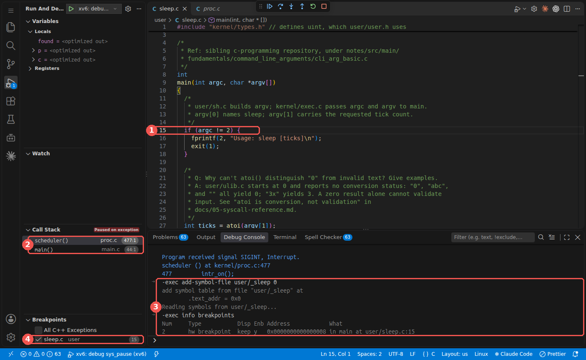

    _After step 4. **1** Line 15's breakpoint is filled red. **2** Call Stack: the interrupt stopped the hart in `scheduler()`, still kernel code. **3** `info breakpoints` shows the hardware breakpoint at `0x8`, `main at user/sleep.c:15`. **4** The Breakpoints pane shows the same red marker._

5. Press Continue and type `sleep 10` in the QEMU terminal. VS Code stops on line 15 in `sleep.c`. Variables shows `argc = 2`, and `-exec x/s argv[1]` in the Debug Console prints `"10"`:

    ![VS Code stopped on sleep.c line 15 with argc = 2 and argv = 0x3fc0 in Variables, main and start in Call Stack, and x/s argv[1] printing "10" in the Debug Console](images/vscode-user-sleep-main-stop.png)

    _After step 5. **1** Stopped on line 15 before it runs. **2** Variables: `argc = 2` and `argv = 0x3fc0`; `ticks` is `<optimized out>` before line 27 assigns it. **3** Call Stack: `main` called from `start`; the third frame, `strchr`, is an unwinding artifact, because `start` never returns. **4** `x/s argv[1]` prints `"10"`._

6. **Before continuing,** remove the `sleep.c` breakpoint and run `-exec remove-symbol-file -a 0`. Otherwise the shell's next `getcmd` call, also linked at `0x0`, produces [a false stop labeled `sleep.c`](#break-source-versus-hbreak). Continue: `sleep` enters the kernel through `pause` and stops on the configured `sys_pause` breakpoint. To skip that stop, find its number with `-exec info breakpoints` and use `-exec disable N`; launch breakpoints are absent from the Breakpoints pane.

<a id="vs-code-panic-stop-panic-and-the-faulting-sepc"></a>

### VS Code panic stop: `panic` and the faulting `sepc`

**Stop at `panic` to learn where, then stop on the faulting line to learn why.** This is the [terminal panic recipe](#backtraces-panics-kernel-mode-faults-and-hangs) in VS Code. The example fault is the syscall lab's [session-2 edit](labs/12-syscall-using-gdb.md#session-2-break-the-load-then-stop-at-sepc-and-at-panic), `num = *(int *)0;` in `syscall()`:

1. Make the kernel fault, for example with that edit. The pre-launch task's `make qemu-gdb` rebuilds `kernel/kernel`, so there is no separate build step.
2. Select **xv6: debug kernel panic** in Run and Debug and press F5. At the connect stop, press Continue; nothing needs typing in the QEMU terminal when the fault happens during boot.
3. VS Code stops in `panic()` in `kernel/printk.c`, reported as [**Exception has occurred. Hit breakpoint 1**](#vs-code-launch-breakpoints-why-break-insert-f). Call Stack shows only `panic`, `kerneltrap`, and `kernelvec`: the unwinder **cannot** cross the trap into the faulting function.
4. In the Debug Console, read the fault's CSRs, which still hold it at this stop:

    ```text
    -exec p /x $sepc
    -exec info symbol $sepc
    -exec p /x $scause
    -exec p /x $stval
    ```

    This build printed `0x80001d58`, `syscall + 16 in section .text`, `0xd`, and `0x0`:

    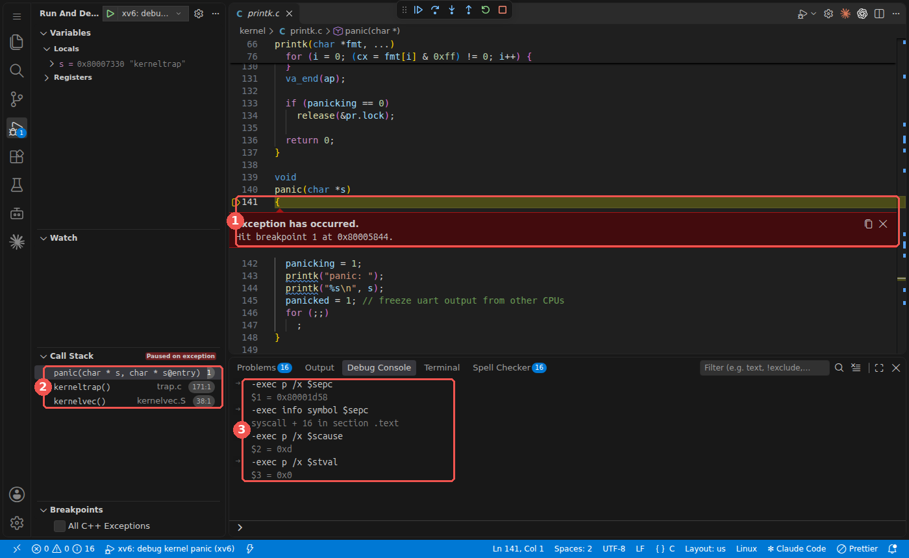

    _After step 4. **1** The `panic` breakpoint from `launch.json`, reported as an exception. **2** Call Stack ends at `kernelvec`. **3** The CSRs still hold the fault: `sepc` in `syscall + 16`, load page fault `0xd`, address `0x0`._

5. Map `$sepc` to a source line with [`addr2line` or `kernel/kernel.asm`](#find-where-the-kernel-crashed-sepc-kernelasm-and-addr2line), then click the gutter on that line, here `num = *(int *)0;` in `kernel/syscall.c`. A line breakpoint resolves to the line's first instruction, which here is the faulting `lw` itself, `0x80001d58`. If the fault is later on the line, record `$sepc` for an address breakpoint instead.
6. Press Stop, then F5 again, and **stay paused at the initial connect stop**. VS Code restores the gutter breakpoint. For an exact address stop, enter `-exec hbreak *0x<sepc>` **now**, in the new session: a breakpoint entered through the Debug Console is lost when the previous GDB process exits. Keep the same build so the address remains valid, then press Continue.
7. VS Code stops **before** the faulting load executes. Variables shows `syscall`'s locals: `p` points at init's `proc`, and `num` is [`<optimized out>`](#why-print-num-shows-optimized-out). Run `-exec p p->name`, `-exec p p->pid`, and `-exec x/i $pc` to confirm `"init"`, `1`, and `lw a3,0(zero)`. **Open Disassembly View** in the editor shows the same instruction.

    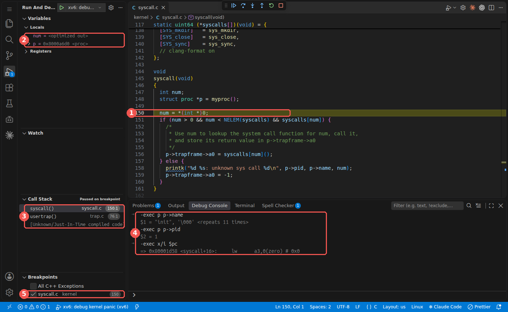

    _After step 7, in the recorded build. **1** Stopped on line 150 before the load runs. **2** Variables: `p` points into `proc`; `num` is `<optimized out>`. **3** Call Stack reaches `syscall()` through `usertrap()`. **4** `p->name`, `p->pid`, and `x/i $pc`: `init`, pid `1`, and `lw a3,0(zero)` at `0x80001d58`. **5** The gutter breakpoint from step 5._

8. **Continue from this stop only to watch the panic again.** Press Stop when finished, and revert the edit before any other work.

> [!WARNING]
> **Do not read the fault's cause from Variables or `$scause` at step 7's stop.** The faulting load has not executed yet, so the trap CSRs still describe the previous trap; see [Live CSRs versus saved user registers](#live-csrs-versus-saved-user-registers). The cause comes from step 4 or the console's `scause=...` line.

## Find where the kernel crashed: `sepc`, `kernel.asm`, and `addr2line`

When the kernel takes an unexpected fault — an invalid memory address, most often — `kerneltrap()` prints `scause`, `sepc`, and `stval` before `panic("kerneltrap")`. `sepc` is the program counter of the faulting instruction. Two ways to turn that number into a location:

```bash
grep -n '80001f2a' kernel/kernel.asm               # the disassembly the Makefile already built
riscv64-linux-gnu-addr2line -f -e kernel/kernel 0x80001f2a   # function, file, and line
```

`kernel/kernel.asm` is produced on every kernel build, and the Makefile emits a `.asm` next to every user program too. It is also the answer to "what assembly did the compiler actually generate for this", which matters more than usual in the traps and pgtbl labs. The host's plain `addr2line` may also read the RISC-V ELF, depending on how binutils was built.

[06-build-artifacts.md](06-build-artifacts.md#panic-invariant-failures-output-and-hart-shutdown) owns what `panic()` prints, which console line is evidence and which is verdict, the meaning of `scause`, `sepc`, and `stval`, and the [`.sym`-then-`.asm` lookup](06-build-artifacts.md#map-sepc-to-a-function-and-c-source-line). Addresses go stale after every rebuild.

## Backtraces: panics, kernel-mode faults, and hangs

| Situation               | What to do                                                        | What the backtrace can show                                       |
| ----------------------- | ----------------------------------------------------------------- | ----------------------------------------------------------------- |
| **A `panic()` call**    | `b panic`, `c`, then `bt`                                         | The caller chain up to `panic()`                                  |
| **A kernel-mode fault** | `b panic`, `c`, then read the trap CSRs; or `b *<sepc>` and rerun | `bt` stops at `kernelvec`; the CSRs name the faulting instruction |
| **A hang**              | `c`, wait for it to wedge, `Ctrl-C`, then `bt` on every hart      | Where each hart is spinning or blocked                            |

For a panic, break on `panic` and let the kernel run into it. [The VS Code panic stop](#vs-code-panic-stop-panic-and-the-faulting-sepc) runs the same recipe from the **xv6: debug kernel panic** configuration:

```gdb
(gdb) b panic
(gdb) c
(gdb) bt
```

**After a kernel-mode fault, that backtrace stops at the trap.** For a `panic("kerneltrap")`, this tree's `bt` shows `panic`, `kerneltrap`, and `kernelvec`, then `Backtrace stopped: frame did not save the PC`: the unwinder **cannot** cross into the function that faulted. The trap CSRs still hold the fault at that stop, because `kerneltrap()` runs with interrupts off, so ask them directly:

```gdb
(gdb) p /x $sepc
(gdb) info symbol $sepc
(gdb) p /x $scause
(gdb) p /x $stval
```


_`b panic` with the syscall lab's null-load edit in `syscall()`, `CPUS=1`. **1** The trace ends at `kernelvec`, the S-mode trap entry. **2** `$sepc` still holds the faulting PC, so `info symbol` names the function the unwinder **cannot** reach. **3** That function's locals are out of scope here._

To see the faulting function's locals, set `b *<sepc>` and rerun. That stop comes **before** the faulting instruction executes, so `$scause` there still describes the previous trap; see [the next section](#live-csrs-versus-saved-user-registers). Locals of the faulting function, such as `p`, are in scope only at that stop, not in `panic()`'s frame. A line breakpoint works too when the faulting instruction is the line's first, as here:

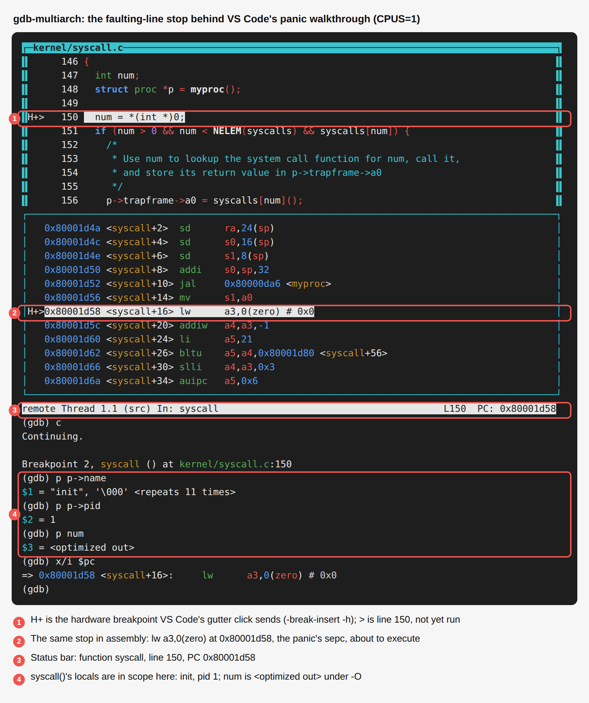

_`hbreak kernel/syscall.c:150` with the null-load edit, `CPUS=1`. **1** The breakpoint `H+` on line 150. **2** The faulting `lw` at the panic's `sepc` has not run yet. **3** The status bar confirms `syscall`, line 150, and the PC. **4** `syscall()`'s locals are in scope; `num` is [`<optimized out>`](#why-print-num-shows-optimized-out)._

For a **hang** — a **deadlock**, or a loop that **never** exits — there is nothing to break on. Continue, wait for it to wedge, then interrupt it and look at where it stopped. In VS Code, run the [**xv6: interrupt GDB (Pause)** task](#vs-code-pause-does-not-interrupt-qemu-use-the-interrupt-task) instead of `Ctrl-C`:

```gdb
(gdb) c
^C
(gdb) bt
```

> [!TIP]
> A backtrace that stops at a lock acquisition is usually a deadlock; one that sits in the same function across several `Ctrl-C` interrupts is usually a live loop. `bt` on every hart (`info threads`, then `thread N`) tells you which core holds what.

## Live CSRs versus saved user registers

**Select `frame 0` to read live registers; outer frames may show reconstructed values.** At any stop inside a system call or trap handler, the user's registers and the hart's registers are different things:

| What you print in GDB               | Where the value lives                   | What it describes at a stop inside the kernel                                    |
| ----------------------------------- | --------------------------------------- | -------------------------------------------------------------------------------- |
| **`p->trapframe->a0` … `->a7`**     | The process's trapframe page, in memory | The user's registers at the moment of the trap, saved by `uservec`               |
| **`$a0` … `$a7`, `info registers`** | The selected frame's register values    | Live in `frame 0`; outer frames may reconstruct values, not the user's trapframe |
| **`$sstatus`**                      | The hart's live CSR                     | Current interrupt enables, plus `SPP`: the mode the last trap came from          |
| **`$scause`, `$sepc`, `$stval`**    | The hart's live CSRs                    | The **most recent** trap on this hart, until the next trap overwrites them       |

**Saved and live values diverge as soon as the kernel runs.** `uservec` copies the 31 user registers into the trapframe, and the kernel then uses the real registers for its own work. The [trapframe walkthrough](labs/01-util-sleep.md#the-per-process-trapframe-layout-and-access) owns the layout; `kernel/trampoline.S` and `struct trapframe` in `kernel/proc.h` are the sources.

**Trap CSRs describe the last trap, not the one you are thinking of.** A breakpoint on a faulting instruction stops before it executes, so `$scause` describes the most recent trap, which may be the system call or an intervening interrupt. Read a fault's cause from the console line, or stop at `panic`, where the fault has been recorded.

**Decode `$sstatus` with the `SSTATUS_*` masks in `kernel/riscv.h`:**

| Field  | Bit | Meaning                                  |
| ------ | --- | ---------------------------------------- |
| `SPP`  | 8   | Previous mode: 1 = Supervisor, 0 = User. |
| `SPIE` | 5   | Supervisor Previous Interrupt Enable.    |
| `SIE`  | 1   | Supervisor Interrupt Enable.             |

On RV64 the printed value is large because bits 33:32 hold the `UXL` field, U-mode's register width, which says nothing about the previous mode.

## Inspect the machine through the QEMU monitor

`Ctrl-a` then `c` switches from the xv6 console to QEMU's monitor, which queries the state of the emulated machine directly. `Ctrl-a c` again switches back; [02](02-build-boot-and-usage.md#qemu-escape-sequences) covers the escape prefix and terminal multiplexers.

| Command          | What it shows                                            |
| ---------------- | -------------------------------------------------------- |
| `info mem`       | The active page table — the pgtbl lab's single best tool |
| `info registers` | Every RISC-V register, including the CSRs                |
| `cpu N`          | Select which core the other commands report on           |

`info mem` reports the page table that the selected hart's `satp` points to: the kernel page table while that hart is in the scheduler or a kernel thread, or a process's user table while it runs user code. On a multi-core boot either pick the core with `cpu` first or sidestep the question entirely:

```bash
make CPUS=1 qemu
```

## Debug user programs: load symbols from the right ELF

**Kernel symbols are loaded by default; a user program's are not.** The three subsections below explain why a `user/sleep.c` breakpoint stays unresolved and how that differs from debugging a native host program. [The user-stop walkthrough](#debug-usersleep-manually-with-add-symbol-file-and-hbreak) is the recipe that stops inside `user/_sleep` without breaking kernel debugging.

### Source breakpoints require symbols from the correct ELF

A source breakpoint becomes usable when **a loaded symbol file maps its source line to an address**. The directory containing the C file does not decide that.

| Session            | Loaded ELF                                                 | Source resolution                                                                      |
| ------------------ | ---------------------------------------------------------- | -------------------------------------------------------------------------------------- |
| **Native C notes** | The selected program, built and launched for the exercise. | That ELF supplies the selected source's symbols.                                       |
| **xv6**            | Only `kernel/kernel`, attached to the emulated machine.    | `kernel/sysproc.c` resolves; `user/sleep.c` belongs to the separate `user/_sleep` ELF. |

The [VS Code configuration](#debug-with-vs-code-launch-configuration-and-evidence) loads the same kernel symbols.

### Native process launch versus QEMU remote attachment

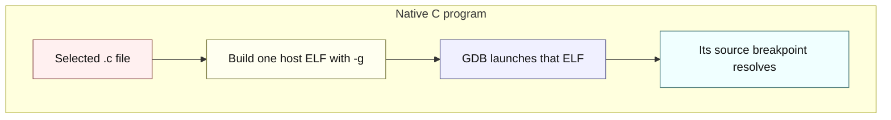

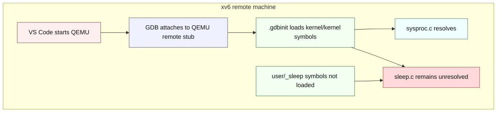

The colors label request, processing, routing, data, successful resolution, and unresolved state; every node also states its meaning so the diagram remains readable in monochrome.

| Layer                            | Native C notes                          | This xv6 session                                                                       |
| -------------------------------- | --------------------------------------- | -------------------------------------------------------------------------------------- |
| **Debug target**                 | The selected host process.              | QEMU's emulated RISC-V machine, exposed through the remote debugging stub.             |
| **Host-side process**            | The selected compiled program itself.   | QEMU; GDB controls its emulated CPUs rather than debugging QEMU's host implementation. |
| **Machine executing the C code** | The host machine.                       | QEMU's emulated RISC-V machine.                                                        |
| **Initial symbol file**          | The selected program's ELF.             | `kernel/kernel`.                                                                       |
| **Source covered initially**     | Sources linked into the selected ELF.   | Sources linked into the kernel ELF.                                                    |
| **Other executable code**        | Usually outside the exercise's process. | Separate user ELFs such as `user/_sleep`, loaded later from `fs.img`.                  |

<a id="kernelkernel-symbols-do-not-cover-usersleep"></a>

### kernel/kernel symbols do not cover user/\_sleep

**Both ELFs contain debug information; only the kernel ELF is loaded initially.** The Makefile's `-ggdb` supplies DWARF source mappings in the independent RISC-V files `kernel/kernel` and `user/_sleep`.

The generated `.gdbinit` contains `symbol-file kernel/kernel` and no `add-symbol-file user/_sleep`. GDB therefore maps `sysproc.c` lines to kernel virtual addresses but has no source-to-address translation for `sleep.c`.

`fs.img` does not solve that symbol problem. It stores the linked `sleep` executable for xv6 to load with `exec`; it is not a GDB symbol container, and QEMU's remote stub does not understand the xv6 filesystem or process table. The stub reports machine state—registers, memory, and emulated CPUs—while GDB relies on the ELF files supplied by the human or debugger configuration to label that state.

## Why use `CPUS=1`

**`CPUS` selects emulated harts, independently of the host CPU count.** The Makefile defaults to `CPUS := 3`, passes it to QEMU's `-smp`, and accepts a command-line override. The `fs` lab is the branch that forces `CPUS := 1`; each virtual CPU in this machine is a RISC-V hart.

| Setting              | Best use                                                                                                     | Execution differences                                                                  |
| -------------------- | ------------------------------------------------------------------------------------------------------------ | -------------------------------------------------------------------------------------- |
| `CPUS=1`             | Trace one causal path, single-step, inspect one call stack, or use the QEMU monitor without choosing a hart. | Removes cross-hart execution, lock contention, and many interleavings.                 |
| **Default `CPUS=3`** | Reproduce multicore failures and run final correctness checks after a focused trace.                         | Exercises concurrent paths that can expose races, deadlocks, and ordering assumptions. |

**One hart is simpler, not fully deterministic:** timer interrupts and xv6 scheduling still occur. With three harts, console order and the currently stopped hart are less predictable; those interleavings can reveal failures the single-hart trace hides.

QEMU exposes the emulated harts to GDB as debugger threads. Those entries are execution contexts of virtual CPUs, not xv6 processes and not user-level software threads. `info threads` answers “which hart did QEMU report?”, while `myproc()` and `p->state` in xv6 answer “which process is this hart running?”

> [!IMPORTANT]
> `CPUS=1` is a debugging lens, not a fix. A change is not concurrency-safe until it also survives the repository's normal multi-hart tests.

## GDB troubleshooting: symbols, reused addresses, and harts

| Observation                                                                | Likely cause                                                                                                                 | Check or correction                                                                                                                                                                               |
| -------------------------------------------------------------------------- | ---------------------------------------------------------------------------------------------------------------------------- | ------------------------------------------------------------------------------------------------------------------------------------------------------------------------------------------------- |
| **gdb prints `Undefined item: "riscv:rv64"`**                              | The `gdb` binary was built without RISC-V support.                                                                           | Run `gdb-multiarch`, `riscv64-linux-gnu-gdb`, or `riscv64-unknown-elf-gdb` instead.                                                                                                               |
| **gdb never mentions `riscv:rv64`**                                        | gdb was started outside the repository root, so it did not read the generated `.gdbinit`.                                    | `cd` to the root and pass `-x .gdbinit`; [the session setup](#start-a-kernel-gdb-session-qemu-gdb-and-gdbinit) explains auto-load safe paths.                                                     |
| **A breakpoint is gray or hollow**                                         | No loaded symbol file maps that source line to an address.                                                                   | Run `info sources` and `info files`; load the correct ELF rather than moving the breakpoint randomly.                                                                                             |
| **`continue` prints `Continuing.` and no further `(gdb)` prompt appears**  | The target is running; GDB does not prompt again until it stops.                                                             | Watch terminal 1 for the `$ ` prompt, then press `Ctrl-C` in terminal 2 to regain the `(gdb)` prompt, as in step 3 of [the user stop](#debug-usersleep-manually-with-add-symbol-file-and-hbreak). |
| **`sleep.c` resolves but execution stops in another user program**         | Several xv6 user ELFs reuse virtual address zero, and the breakpoint was installed before `sleep` owned the user page table. | Continue to the shell first, interrupt GDB, then add the symbols and hardware breakpoint immediately before running `sleep`.                                                                      |
| **GDB cannot insert the breakpoint**                                       | The requested breakpoint type or address is unavailable in the current target state.                                         | Confirm the QEMU remote connection, use `hbreak`, and check `info breakpoints`; do not replace it with a software breakpoint in read-only user text.                                              |
| **A local is `<optimized out>` or nonsensical**                            | The compiler optimized it or the stop is before its initialization.                                                          | Check the highlighted source line and step past the assignment before printing the value; [`num` in `syscall`](#why-print-num-shows-optimized-out) is a worked example.                           |
| **`The program is not being run.` and `No symbol "p" in current context`** | GDB has no target: QEMU was started with `make qemu`, which has no GDB stub, so `.gdbinit`'s `target remote` failed.         | Start QEMU with `make qemu-gdb`, attach GDB again, and set breakpoints before `c`.                                                                                                                |
| **VS Code's Pause does nothing; Call Stack stays `Running`**               | cppdbg does not know `.gdbinit` attached a remote target, so it never sends `-exec-interrupt`.                               | Run the task **xv6: interrupt GDB (Pause)**; see [the warning](#vs-code-pause-does-not-interrupt-qemu-use-the-interrupt-task).                                                                    |
| **A `launch.json` breakpoint never stops the session**                     | A plain `break` in `setupCommands` runs before cppdbg loads symbols and is silently dropped.                                 | Use `-break-insert -f`; see [why](#vs-code-launch-breakpoints-why-break-insert-f).                                                                                                                |
| **`b *80001d58` prints `Invalid number "80001d58".`**                      | GDB uses decimal input by default; the address needs a hex prefix.                                                           | Write the address in hex: `b *0x80001d58`.                                                                                                                                                        |
| **The GDB port is already in use**                                         | A previous QEMU instance still owns the per-user port.                                                                       | Run `pgrep -af qemu-system-riscv64`, identify the stale instance, and terminate only that process.                                                                                                |
| **`exec sleep failed` appears**                                            | The running guest's `fs.img` does not contain the linked user program.                                                       | Quit QEMU, rebuild the image, boot again, and confirm the xv6 shell's `ls` output includes `sleep` before debugging source behavior.                                                              |
| **The bug disappears with `CPUS=1`**                                       | The failure depends on cross-hart concurrency.                                                                               | Treat the single-hart trace as partial evidence and reproduce with the default three harts.                                                                                                       |

## Assembly, GDB, ELF, and lab references

- [Assembly practice: stepping instructions and inspecting memory](../../assembly-language/docs/riscv/00-tools-and-first-run.md)
- [Assembly practice: observing ra across a nested call](../../assembly-language/docs/riscv/04-functions-and-stacks.md#gdb-observe-ra-change-across-the-nested-call)

- [Console output and `script` logs](02-build-boot-and-usage.md#debug-xv6-with-console-output-gdb-and-qemu)
- [Terminology lookup](04-terminology.md)
- [ELF and build artifacts](06-build-artifacts.md#elf-headers-segments-and-load-addresses)
- [`panic()` output and `sepc` lookup](06-build-artifacts.md#panic-invariant-failures-output-and-hart-shutdown)
- [The util `sleep` exercise](labs/01-util-sleep.md)
- [The syscall lab's gdb exercise](labs/12-syscall-using-gdb.md)
