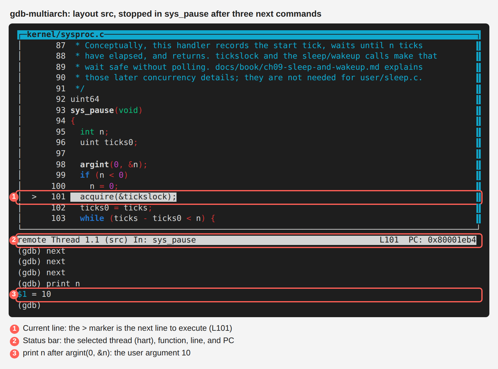
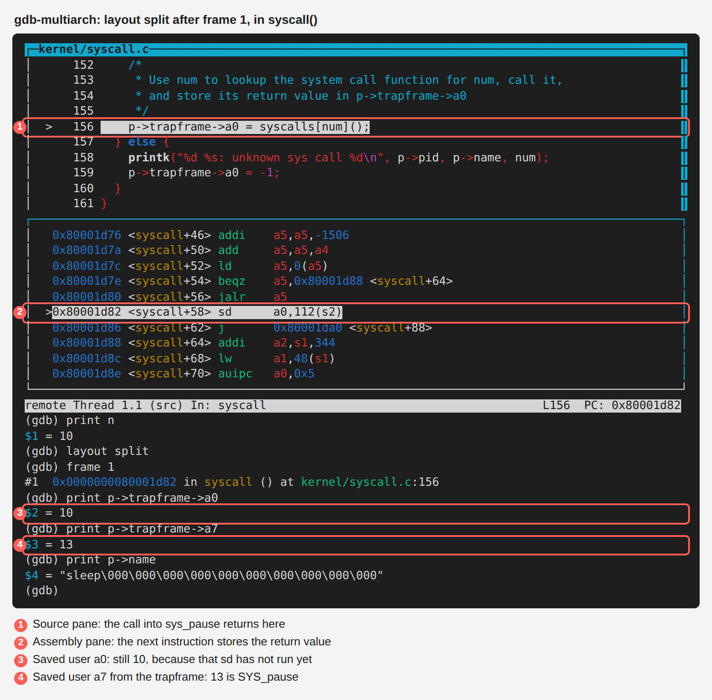
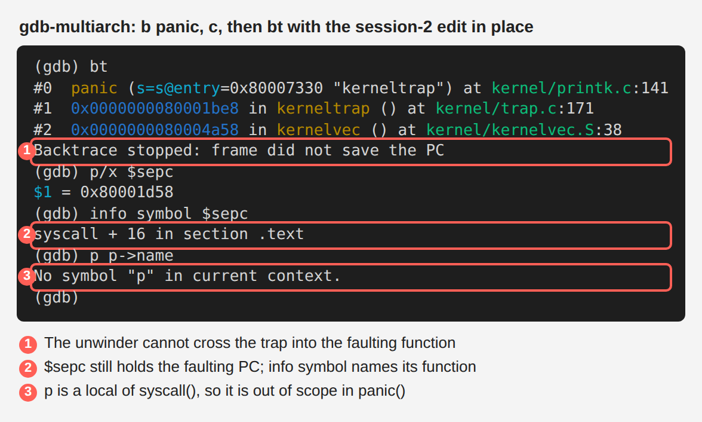
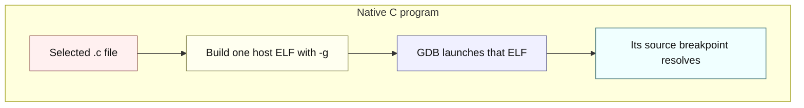
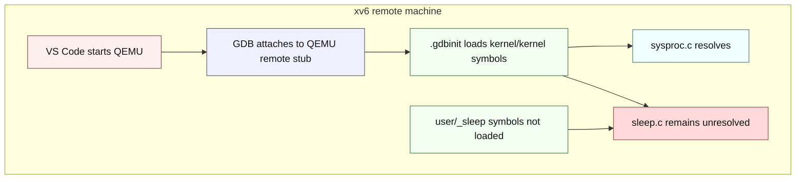

# Debugging xv6 with GDB: sessions, crashes, symbols, and harts

---

[toc]

---

**This is the canonical GDB guide for this tree.** Lab notes and other documents keep only their exercise-specific breakpoints and observations, and link here for setup, controls, crash lookup, backtraces, and pitfalls.

| Task                                                              | Section                                                                                                                                                                     |
| ----------------------------------------------------------------- | --------------------------------------------------------------------------------------------------------------------------------------------------------------------------- |
| **Attach GDB to the emulated machine**                            | [Start a kernel GDB session](#start-a-kernel-gdb-session-qemu-gdb-and-gdbinit)                                                                                              |
| **See a whole session end to end, with screenshots**              | [Follow a system call into `sys_pause`](#follow-a-system-call-into-syspause)                                                                                                |
| **Look up a command: `next`, `finish`, `p/x`, `bt`, `layout`, …** | [GDB command reference](#gdb-command-reference-run-control-breakpoints-inspection-and-harts)                                                                                |
| **Use VS Code instead of a terminal**                             | [Debug with VS Code](#debug-with-vs-code-launch-configuration-and-evidence)                                                                                                 |
| **Turn a panic's `sepc` into a source line**                      | [Find where the kernel crashed](#find-where-the-kernel-crashed-sepc-kernelasm-and-addr2line)                                                                                |
| **Get a backtrace from a panic or a hang**                        | [Backtraces](#backtraces-panics-kernel-mode-faults-and-hangs)                                                                                                               |
| **Decide whether a register value is the user's or the kernel's** | [Live CSRs versus saved user registers](#live-csrs-versus-saved-user-registers)                                                                                             |
| **Read the page table or CSRs without GDB**                       | [QEMU monitor](#inspect-the-machine-through-the-qemu-monitor)                                                                                                               |
| **Stop inside a user program**                                    | [Debug user programs](#debug-user-programs-load-symbols-from-the-right-elf), then [the `add-symbol-file` recipe](#debug-usersleep-manually-with-add-symbol-file-and-hbreak) |
| **Choose a hart count**                                           | [Why use `CPUS=1`](#why-use-cpus1)                                                                                                                                          |
| **Fix a misbehaving session**                                     | [GDB troubleshooting](#gdb-troubleshooting-symbols-reused-addresses-and-harts)                                                                                              |

Console output comes first: [02-build-boot-and-usage.md](02-build-boot-and-usage.md#debug-xv6-with-console-output-gdb-and-qemu) owns `printf` tracing and saving a console log with `script`. For register stepping on a tiny bare-metal program, start with [the assembly course's QEMU/GDB exercise](../../assembly-language/docs/riscv/00-tools-and-first-run.md#qemu-and-gdb-run-and-step-the-first-example). Use [04-terminology.md](04-terminology.md) for term lookup.

Kernel bugs rarely announce themselves clearly. MIT's [lab guidance](https://pdos.csail.mit.edu/6.1810/2026/labs/guidance.html) says learning these tools is well worth the time, and the sections below turn most "it just hangs" sessions into a short investigation.

## Start a kernel GDB session: `qemu-gdb` and `.gdbinit`

Use two terminals. In the first, start one emulated hart to remove cross-hart interleavings while you trace one path; timer interrupts and xv6 process scheduling still occur:

```bash
make CPUS=1 qemu-gdb
```

The `qemu-gdb` recipe adds `-S`, which stops the hart at the reset vector before its first instruction, and `-gdb tcp::<port>`, which exposes QEMU's remote GDB stub. The Makefile derives the port from the host uid and generates `.gdbinit` with that value, the RISC-V architecture, `kernel/kernel` as the symbol file, and compressed-breakpoint support.

In the second terminal, from the repository root, explicitly source that generated file:

```bash
gdb-multiarch -x .gdbinit kernel/kernel
```

If that binary is not installed, `riscv64-linux-gnu-gdb` or `riscv64-unknown-elf-gdb` works identically — any of the three can debug a RISC-V target. Plain `gdb` on an x86 host usually cannot; [troubleshooting](#gdb-troubleshooting-symbols-reused-addresses-and-harts) lists its symptom.

The explicit `-x` works even when GDB declines to auto-load a repository-local `.gdbinit`. To use the shorter `gdb-multiarch kernel/kernel` command, trust this one repository by adding the exact absolute path GDB prints to the user-init file named in its diagnostic, which may be `~/.config/gdb/gdbinit` or `~/.gdbinit`:

> [!NOTE]
> Add only repositories you trust. A local `.gdbinit` executes debugger commands, so globally disabling `auto-load safe-path` would also trust files in unrelated repositories.
>
> ```gdb
> add-auto-load-safe-path /absolute/path/to/xv6-riscv/.gdbinit
> ```

<a id="follow-a-system-call-into-syspause"></a>

## Follow a system call into `sys_pause`

**One session, end to end:** stop the kernel in the handler for `sleep 10`, read the decoded argument, then read the user's saved registers one frame up. Set the breakpoint before continuing from the reset vector, then type the command in QEMU's terminal once xv6 reaches its `$ ` prompt:

```gdb
(gdb) break sys_pause
(gdb) continue
(gdb) next
(gdb) print n
(gdb) backtrace
(gdb) frame 1
(gdb) print p->trapframe->a0
(gdb) print p->trapframe->a7
(gdb) detach
(gdb) quit
```

1. Enter `sleep 10` in QEMU's terminal. The breakpoint stops at the handler's opening brace, before local `n` has a value.
2. Run `next` until the highlighted line is past `argint(0, &n)`, then `print n`. Check the current source position rather than relying on a fixed number of `next` commands.
3. Run `backtrace` to see `sys_pause()`, `syscall()`, and `usertrap()`. Frame pointers in the kernel build make that trace available.
4. Select the `syscall` frame with `frame 1`, where `p` is in scope, and print the **saved** user registers from the trapframe.

This tree's session printed the following; addresses change after a rebuild, and line 94 is the handler's opening brace:

```text
Breakpoint 1 at 0x80001e98: file kernel/sysproc.c, line 94.
Breakpoint 1, sys_pause () at kernel/sysproc.c:94
(gdb) print n
$1 = 10
(gdb) backtrace
#0  sys_pause () at kernel/sysproc.c:101
#1  0x0000000080001d82 in syscall () at kernel/syscall.c:156
#2  0x0000000080001b02 in usertrap () at kernel/trap.c:76
#3  0x0000003ffffff09c in ?? ()
(gdb) frame 1
#1  0x0000000080001d82 in syscall () at kernel/syscall.c:156
(gdb) print p->trapframe->a0
$3 = 10
(gdb) print p->trapframe->a7
$4 = 13
```

**Frame `#3` is not a kernel caller.** `0x3ffffff09c` is in the trampoline page that `uservec` runs from, and the unwinder **cannot** continue past it into user code. `13` is `SYS_pause` in `kernel/syscall.h`.

> [!WARNING]
> `info registers a0 a7` prints the hart's **live** registers, not the trapframe. In this session they happened to read 10 and 13 as well, but nothing preserves them once the kernel runs; see [Live CSRs versus saved user registers](#live-csrs-versus-saved-user-registers).

### The same stop in GDB's TUI: `layout src` and `layout split`

`layout src` keeps the source beside the prompt, so each `next` moves a visible marker instead of printing one line at a time:



_`layout src` after three `next` commands. **1** The `>` row is the next line to execute, not the last one executed. **2** The status bar names the selected hart (`Thread 1.1`), the function, the line, and the PC. **3** `print n` reads the local after `argint(0, &n)` has filled it._

`layout split` adds the disassembly. Selecting `frame 1` moves both panes to the caller, which is how to see where `sys_pause` will return:



_`layout split` after `frame 1`. **1** Line 156 calls through `syscalls[num]` and stores the result. **2** The selected frame's PC is the instruction after `jalr a5`: the `sd` that writes the return value into `p->trapframe->a0`. **3** That store has not run, so the saved `a0` still holds the argument 10. **4** The saved `a7` is 13, `SYS_pause`._

The [sleep note](labs/01-util-sleep.md#inspecting-the-argument-the-grader-does-not-check) records what this stop does and does not prove about the exercise.

## GDB command reference: run control, breakpoints, inspection, and harts

**Most xv6 sessions need about twenty commands.** Each table groups commands by the question they answer; the short form is what GDB accepts at the prompt, and the examples come from this tree. Pressing Enter on an empty line repeats the previous command, and after `x` it continues from the next address.

### Run control: `continue`, `next`, `step`, and `finish`

| Command               | Short form  | What it does in an xv6 session                                                                                   |
| --------------------- | ----------- | ---------------------------------------------------------------------------------------------------------------- |
| **`continue`**        | `c`         | Runs every hart until a breakpoint, a fault, or `Ctrl-C`.                                                        |
| **`next`**            | `n`         | Runs to the next source line of the current function, stepping **over** calls such as `argint()`.                |
| **`step`**            | `s`         | Runs to the next source line, stepping **into** calls: from `sys_pause` it stops inside `argint()`.              |
| **`finish`**          | `fin`       | Runs until the current function returns and prints `Value returned`; from `sys_pause` that waits the full ticks. |
| **`stepi` / `nexti`** | `si` / `ni` | Executes one machine instruction; `ni` steps over a `jal`.                                                       |
| **`Ctrl-C`**          | —           | Interrupts the running target and returns the `(gdb)` prompt; the way to inspect a hang.                         |

### Breakpoints: `break`, `tbreak`, `hbreak`, and `watch`

| Command                                 | Short form | What it does in an xv6 session                                                                                                |
| --------------------------------------- | ---------- | ----------------------------------------------------------------------------------------------------------------------------- |
| **`break FUNC` or `break FILE:LINE`**   | `b`        | Sets a breakpoint by symbol; it resolves only through a loaded ELF, normally `kernel/kernel`.                                 |
| **`break *0xADDR`**                     | `b *0x…`   | Stops at an exact address, such as a panic's `sepc`.                                                                          |
| **`break FUNC if EXPR`**                | `b … if …` | Stops only when the condition holds, for example `b argint if n == 1`; prefer variables over function calls in the condition. |
| **`tbreak FUNC`**                       | `tb`       | A one-shot breakpoint: GDB deletes it after the first hit.                                                                    |
| **`hbreak`**                            | —          | Asks QEMU for a hardware breakpoint; [user programs](#debug-usersleep-manually-with-add-symbol-file-and-hbreak) need it.      |
| **`watch EXPR`**                        | —          | Stops when the value of a variable or memory location changes, for example `watch ticks`.                                     |
| **`info breakpoints`**                  | `i b`      | Lists numbers, addresses, hit counts, and whether each breakpoint is enabled.                                                 |
| **`delete N`, `disable N`, `enable N`** | `d N`      | Removes or pauses breakpoint `N`; `delete` with no number removes them all.                                                   |

### Inspect values, memory, and registers: `print`, `x`, and `info`

| Command                        | Short form | What it does in an xv6 session                                                                                              |
| ------------------------------ | ---------- | --------------------------------------------------------------------------------------------------------------------------- |
| **`print EXPR`**               | `p`        | Evaluates a C expression in the selected frame: `p n`, `p p->trapframe->a7`, `p p->name`, `p *p`.                           |
| **`print/x EXPR`**             | `p/x`      | Prints in hex; use it for addresses and CSRs, such as `p/x $sstatus` or `p/x $satp`.                                        |
| **`x/Ni ADDR`**                | —          | Disassembles `N` instructions: `x/4i $pc` shows the instruction about to run.                                               |
| **`x/s ADDR`, `x/Ngx ADDR`**   | —          | Reads memory as a string or as `N` 8-byte hex words.                                                                        |
| **`info registers [REG…]`**    | `i r`      | Prints the hart's **live** registers, never the trapframe; see [live versus saved](#live-csrs-versus-saved-user-registers). |
| **`info locals`, `info args`** | `i lo`     | Lists the selected frame's variables; `<optimized out>` means the compiler kept no copy at this PC.                         |
| **`info symbol ADDR`**         | —          | Names the function containing an address: `info symbol $pc` printed `sys_pause + 20 in section .text`.                      |
| **`display EXPR`**             | —          | Reprints the expression after every stop inside the function where it was set.                                              |
| **`list`**                     | `l`        | Prints source around the current line, for sessions without the TUI.                                                        |

### Stack frames and harts: `backtrace`, `frame`, and `thread`

| Command            | Short form | What it does in an xv6 session                                                                        |
| ------------------ | ---------- | ----------------------------------------------------------------------------------------------------- |
| **`backtrace`**    | `bt`       | Lists the call chain on the selected hart; in the kernel it ends at the trap entry, not in user code. |
| **`frame N`**      | `f N`      | Selects frame `N`, which changes the scope that `print` and `info locals` use.                        |
| **`up` / `down`**  | —          | Moves one frame toward the caller or back toward the stop.                                            |
| **`info threads`** | `i th`     | Lists QEMU's harts as threads: `Thread 1.1 (CPU#0 [running])`. They are CPUs, not xv6 processes.      |
| **`thread N`**     | `t N`      | Selects hart `N`; combine with `bt` to see where every core is during a hang.                         |

### GDB and QEMU session controls

| Focus or intended outcome                     | Control                                                                |
| --------------------------------------------- | ---------------------------------------------------------------------- |
| **Show source or assembly beside the prompt** | `layout src`, `layout asm`, `layout split`, or `layout regs`.          |
| **Leave the TUI**                             | `Ctrl-x a` or `tui disable`.                                           |
| **Scroll command history instead of source**  | `focus cmd`; `focus src` gives the arrow keys back to the source pane. |
| **Redraw a garbled TUI**                      | `Ctrl-l` or `refresh` after a terminal resize or stray output.         |
| **Interrupt the target from GDB**             | `Ctrl-C` returns to the GDB prompt.                                    |
| **Leave GDB while QEMU keeps running**        | Use `detach` before `quit`.                                            |
| **Exit QEMU from its terminal**               | `Ctrl-a x` exits the emulator.                                         |

Otherwise, exit QEMU after leaving GDB so its per-user GDB port and `fs.img` are not left occupied.

## Debug with VS Code: launch configuration and evidence

The checked-in `.vscode/launch.json` and `.vscode/tasks.json` automate the same two-terminal setup. They require `gdb-multiarch` and Microsoft's C/C++ extension, whose extension identifier is `ms-vscode.cpptools`:

```bash
code --install-extension ms-vscode.cpptools
```

1. Open the repository root in VS Code and select **xv6: debug sys_pause** in Run and Debug.
2. Press F5. The pre-launch task runs `make CPUS=1 qemu-gdb` in a dedicated terminal, and `cppdbg` invokes `gdb-multiarch` with the generated `.gdbinit` explicitly sourced. This obtains the per-user port without hard-coding it in `launch.json`.
3. The debugger connects at QEMU's reset vector with a breakpoint already set on `sys_pause`. Press Continue once and wait for xv6's `$ ` prompt in the QEMU terminal.
4. Enter `sleep 10` in that terminal. VS Code stops in `kernel/sysproc.c`; step past `argint(0, &n)`, then inspect `n` in Variables or the Debug Console, the kernel path in Call Stack, and the saved user registers through `p->trapframe` in the `syscall` frame.
5. Press Stop when finished. The post-debug task terminates the QEMU process using this user's generated GDB port, freeing both the port and disk image for the next run.

The launch configuration leaves the initial target stopped instead of issuing `run`, because `kernel/kernel` is not a host executable: GDB controls an already-created remote machine. If startup fails, run the [terminal workflow](#start-a-kernel-gdb-session-qemu-gdb-and-gdbinit) first; it exposes GDB safe-path diagnostics, an occupied port, a missing `gdb-multiarch`, or a QEMU build failure directly.

> [!IMPORTANT]
> The `program` value in this repository's `.vscode/launch.json` names `kernel/kernel` for symbols. The configuration does not ask the host operating system to execute that RISC-V file: `.gdbinit` attaches to QEMU's already-running remote target, and `launchCompleteCommand: "None"` prevents a host-style `run` command.

### VS Code evidence: sys_pause breakpoint and decoded argument


_VS Code paused on the verified `sys_pause` breakpoint while the `sleep.c` breakpoint remains gray. The filled red breakpoint in `kernel/sysproc.c` has an address from `kernel/kernel`; the gray `user/sleep.c` entry has no address in the currently loaded symbols._


_After `argint(0, &n)` executes, the debugger can show `n = 10`. The stack remains `sys_pause` → `syscall` → `usertrap`, so this is kernel-side evidence about the request rather than a stop in `sleep.c:main`._

## Find where the kernel crashed: `sepc`, `kernel.asm`, and `addr2line`

When the kernel takes an unexpected fault — an invalid memory address, most often — `kerneltrap()` prints `scause`, `sepc`, and `stval` before `panic("kerneltrap")`. `sepc` is the program counter of the faulting instruction. Two ways to turn that number into a location:

```bash
grep -n '80001f2a' kernel/kernel.asm               # the disassembly the Makefile already built
riscv64-linux-gnu-addr2line -f -e kernel/kernel 0x80001f2a   # function, file, and line
```

`kernel/kernel.asm` is produced on every kernel build, and the Makefile emits a `.asm` next to every user program too. It is also the answer to "what assembly did the compiler actually generate for this", which matters more than usual in the traps and pgtbl labs. The host's plain `addr2line` may also read the RISC-V ELF, depending on how binutils was built.

[06-build-artifacts.md](06-build-artifacts.md#panic-invariant-failures-output-and-hart-shutdown) owns what `panic()` prints, which console line is evidence and which is verdict, the meaning of `scause`, `sepc`, and `stval`, and the [`.sym`-then-`.asm` lookup](06-build-artifacts.md#map-sepc-to-a-function-and-c-source-line). Addresses go stale after every rebuild.

## Backtraces: panics, kernel-mode faults, and hangs

| Situation               | What to do                                                        | What the backtrace can show                                       |
| ----------------------- | ----------------------------------------------------------------- | ----------------------------------------------------------------- |
| **A `panic()` call**    | `b panic`, `c`, then `bt`                                         | The caller chain up to `panic()`                                  |
| **A kernel-mode fault** | `b panic`, `c`, then read the trap CSRs; or `b *<sepc>` and rerun | `bt` stops at `kernelvec`; the CSRs name the faulting instruction |
| **A hang**              | `c`, wait for it to wedge, `Ctrl-C`, then `bt` on every hart      | Where each hart is spinning or blocked                            |

For a panic, break on `panic` and let the kernel run into it:

```gdb
(gdb) b panic
(gdb) c
(gdb) bt
```

**After a kernel-mode fault, that backtrace stops at the trap.** For a `panic("kerneltrap")`, this tree's `bt` shows `panic`, `kerneltrap`, and `kernelvec`, then `Backtrace stopped: frame did not save the PC`: the unwinder **cannot** cross into the function that faulted. The trap CSRs still hold the fault at that stop, because `kerneltrap()` runs with interrupts off, so ask them directly:

```gdb
(gdb) p /x $sepc
(gdb) info symbol $sepc
(gdb) p /x $scause
(gdb) p /x $stval
```



_`b panic` with the syscall lab's null-load edit in `syscall()`, `CPUS=1`. **1** The trace ends at `kernelvec`, the S-mode trap entry. **2** `$sepc` still holds the faulting PC, so `info symbol` names the function the unwinder **cannot** reach. **3** That function's locals are out of scope here._

To see the faulting function's locals, set `b *<sepc>` and rerun. That stop comes **before** the faulting instruction executes, so `$scause` there still describes the previous trap; see [the next section](#live-csrs-versus-saved-user-registers). Locals of the faulting function, such as `p`, are in scope only at that stop, not in `panic()`'s frame.

For a **hang** — a **deadlock**, or a loop that **never** exits — there is nothing to break on. Continue, wait for it to wedge, then interrupt it and look at where it stopped:

```gdb
(gdb) c
^C
(gdb) bt
```

> [!TIP]
> A backtrace that stops at a lock acquisition is usually a deadlock; one that sits in the same function across several `Ctrl-C` interrupts is usually a live loop. `bt` on every hart (`info threads`, then `thread N`) tells you which core holds what.

## Live CSRs versus saved user registers

**GDB prints the hart's live state unless you ask for the trapframe.** At any stop inside a system call or trap handler, the user's registers and the hart's registers are different things:

| What you print in GDB               | Where the value lives                   | What it describes at a stop inside the kernel                              |
| ----------------------------------- | --------------------------------------- | -------------------------------------------------------------------------- |
| **`p->trapframe->a0` … `->a7`**     | The process's trapframe page, in memory | The user's registers at the moment of the trap, saved by `uservec`         |
| **`$a0` … `$a7`, `info registers`** | The hart's live registers               | Whatever the **kernel** last put there; equal to the user's only by chance |
| **`$sstatus`**                      | The hart's live CSR                     | Current interrupt enables, plus `SPP`: the mode the last trap came from    |
| **`$scause`, `$sepc`, `$stval`**    | The hart's live CSRs                    | The **most recent** trap on this hart, until the next trap overwrites them |

**Saved and live values diverge as soon as the kernel runs.** `uservec` copies the 31 user registers into the trapframe, and the kernel then uses the real registers for its own work. The [trapframe walkthrough](labs/01-util-sleep.md#the-per-process-trapframe-layout-and-access) owns the layout; `kernel/trampoline.S` and `struct trapframe` in `kernel/proc.h` are the sources.

**Trap CSRs describe the last trap, not the one you are thinking of.** A breakpoint on a faulting instruction stops before it executes, so `$scause` still holds the cause of the trap that brought the hart into the kernel — for a system call, `8`, an environment call from U-mode. Read a fault's cause from the console line, or stop at `panic`, where the fault has been recorded.

To decode `$sstatus`, test the `SSTATUS_*` masks in `kernel/riscv.h`: `SPP` is bit 8 (1 = Supervisor, 0 = User), `SPIE` bit 5, and `SIE` bit 1. On RV64 the printed value is large because bits 33:32 hold the `UXL` field, U-mode's register width, which says nothing about the previous mode.

## Inspect the machine through the QEMU monitor

`Ctrl-a` then `c` switches from the xv6 console to QEMU's monitor, which queries the state of the emulated machine directly. `Ctrl-a c` again switches back; [02](02-build-boot-and-usage.md#qemu-escape-sequences) covers the escape prefix and terminal multiplexers.

| Command          | What it shows                                            |
| ---------------- | -------------------------------------------------------- |
| `info mem`       | The active page table — the pgtbl lab's single best tool |
| `info registers` | Every RISC-V register, including the CSRs                |
| `cpu N`          | Select which core the other commands report on           |

`info mem` reports the page table that the selected hart's `satp` points to: the kernel page table while that hart is in the scheduler or a kernel thread, or a process's user table while it runs user code. On a multi-core boot either pick the core with `cpu` first or sidestep the question entirely:

```bash
make CPUS=1 qemu
```

## Debug user programs: load symbols from the right ELF

**Kernel symbols are loaded by default; a user program's are not.** The four subsections below explain why a `user/sleep.c` breakpoint stays unresolved, how that differs from debugging a native host program, and the manual recipe that stops inside `user/_sleep` without breaking kernel debugging.

### Source breakpoints require symbols from the correct ELF

A source breakpoint becomes usable when **a loaded symbol file maps its source line to an address**. The directory containing the C file does not decide that.

| Session            | Loaded ELF                                                 | Source resolution                                                                      |
| ------------------ | ---------------------------------------------------------- | -------------------------------------------------------------------------------------- |
| **Native C notes** | The selected program, built and launched for the exercise. | That ELF supplies the selected source's symbols.                                       |
| **xv6**            | Only `kernel/kernel`, attached to the emulated machine.    | `kernel/sysproc.c` resolves; `user/sleep.c` belongs to the separate `user/_sleep` ELF. |

The [VS Code configuration](#debug-with-vs-code-launch-configuration-and-evidence) loads the same kernel symbols.

### Native process launch versus QEMU remote attachment





The colors label request, processing, routing, data, successful resolution, and unresolved state; every node also states its meaning so the diagram remains readable in monochrome.

| Layer                            | Native C notes                          | This xv6 session                                                                       |
| -------------------------------- | --------------------------------------- | -------------------------------------------------------------------------------------- |
| **Debug target**                 | The selected host process.              | QEMU's emulated RISC-V machine, exposed through the remote debugging stub.             |
| **Host-side process**            | The selected compiled program itself.   | QEMU; GDB controls its emulated CPUs rather than debugging QEMU's host implementation. |
| **Machine executing the C code** | The host machine.                       | QEMU's emulated RISC-V machine.                                                        |
| **Initial symbol file**          | The selected program's ELF.             | `kernel/kernel`.                                                                       |
| **Source covered initially**     | Sources linked into the selected ELF.   | Sources linked into the kernel ELF.                                                    |
| **Other executable code**        | Usually outside the exercise's process. | Separate user ELFs such as `user/_sleep`, loaded later from `fs.img`.                  |

### kernel/kernel symbols do not cover user/\_sleep

**Both ELFs contain debug information; only the kernel ELF is loaded initially.** The Makefile's `-ggdb` supplies DWARF source mappings in the independent RISC-V files `kernel/kernel` and `user/_sleep`.

The generated `.gdbinit` contains `symbol-file kernel/kernel` and no `add-symbol-file user/_sleep`. GDB therefore maps `sysproc.c` lines to kernel virtual addresses but has no source-to-address translation for `sleep.c`.

`fs.img` does not solve that symbol problem. It stores the linked `sleep` executable for xv6 to load with `exec`; it is not a GDB symbol container, and QEMU's remote stub does not understand the xv6 filesystem or process table. The stub reports machine state—registers, memory, and emulated CPUs—while GDB relies on the ELF files supplied by the human or debugger configuration to label that state.

<a id="debug-usersleep-manually-with-add-symbol-file-and-hbreak"></a>

### Debug user/\_sleep manually with add-symbol-file and hbreak

The following recipe adds `user/_sleep` to the existing kernel-debugging session without changing `.vscode`. It is deliberately manual because the symbol file is meaningful only while the intended xv6 process occupies that user address space.

1. Start the normal one-hart QEMU debug target in terminal 1:

    ```bash
    make CPUS=1 qemu-gdb
    ```

2. Attach from terminal 2 and continue through boot:

    ```bash
    gdb-multiarch -q -x .gdbinit kernel/kernel
    ```

    ```gdb
    (gdb) continue
    ```

    GDB prints `Continuing.` and then shows no further `(gdb)` prompt; that is expected, because the target is running and GDB only prompts again once it stops.

3. Wait for the `$ ` prompt in terminal 1, then press `Ctrl-C` in terminal 2. Stopping after the shell is ready matters because every xv6 user ELF is linked at virtual address zero; installing an address-zero breakpoint during boot could stop in `init` or `sh` before `sleep` runs.

4. Load the user ELF's symbols, set a source-qualified hardware breakpoint, and continue:

    ```gdb
    (gdb) add-symbol-file user/_sleep 0
    add symbol table from file "user/_sleep" at
        .text_addr = 0x0
    (gdb) hbreak -source sleep.c -function main
    Hardware assisted breakpoint 1 at 0x0: file user/sleep.c, line 7.
    (gdb) info breakpoints
    (gdb) continue
    ```

5. Enter the command in terminal 1:

    ```text
    $ sleep 10
    ```

6. Confirm that GDB stopped in the user program and inspect its arguments:

    ```gdb
    Breakpoint 1, main (argc=2, argv=0x4fc0) at user/sleep.c:7
    (gdb) info source
    Current source file is user/sleep.c
    (gdb) print argc
    $1 = 2
    (gdb) x/s argv[1]
    0x4fe0: "10"
    ```

    Stack and string addresses vary after a rebuild, but the source file, argument count, and argument text should agree. A user backtrace is reliable through `main` and `start`; **do not** interpret frames beyond the saved entry context as kernel callers because the user-to-kernel transition happens only when the program executes a system-call stub.

7. Remove the temporary breakpoint and user symbols before returning to kernel-only debugging:

    ```gdb
    (gdb) delete 1
    (gdb) remove-symbol-file -a 0
    (gdb) detach
    (gdb) quit
    ```

> [!WARNING]
> `add-symbol-file` teaches GDB how to label addresses; it does not teach GDB which xv6 process owns the current page table. xv6 links user programs at the same virtual addresses, so `user/_sleep` labels become wrong when another user program runs. Load them for a focused stop, then remove them.

The hardware breakpoint is purposeful. It asks QEMU to stop when a hart executes the address instead of having GDB patch a breakpoint instruction into a guest text page. The repository's VS Code configuration likewise requires hardware breakpoints.

## Why use `CPUS=1`

**`CPUS` selects emulated harts, independently of the host CPU count.** The Makefile defaults to `CPUS := 3`, passes it to QEMU's `-smp`, and accepts a command-line override. The `fs` lab is the branch that forces `CPUS := 1`; each virtual CPU in this machine is a RISC-V hart.

| Setting              | Best use                                                                                                     | Execution differences                                                                  |
| -------------------- | ------------------------------------------------------------------------------------------------------------ | -------------------------------------------------------------------------------------- |
| `CPUS=1`             | Trace one causal path, single-step, inspect one call stack, or use the QEMU monitor without choosing a hart. | Removes cross-hart execution, lock contention, and many interleavings.                 |
| **Default `CPUS=3`** | Reproduce multicore failures and run final correctness checks after a focused trace.                         | Exercises concurrent paths that can expose races, deadlocks, and ordering assumptions. |

**One hart is simpler, not fully deterministic:** timer interrupts and xv6 scheduling still occur. With three harts, console order and the currently stopped hart are less predictable; those interleavings can reveal failures the single-hart trace hides.

QEMU exposes the emulated harts to GDB as debugger threads. Those entries are execution contexts of virtual CPUs, not xv6 processes and not user-level software threads. `info threads` answers “which hart did QEMU report?”, while `myproc()` and `p->state` in xv6 answer “which process is this hart running?”

> [!IMPORTANT]
> `CPUS=1` is a debugging lens, not a fix. A change is not concurrency-safe until it also survives the repository's normal multi-hart tests.

## GDB troubleshooting: symbols, reused addresses, and harts

| Observation                                                               | Likely cause                                                                                                                 | Check or correction                                                                                                                                  |
| ------------------------------------------------------------------------- | ---------------------------------------------------------------------------------------------------------------------------- | ---------------------------------------------------------------------------------------------------------------------------------------------------- |
| **gdb prints `Undefined item: "riscv:rv64"`**                             | The `gdb` binary was built without RISC-V support.                                                                           | Run `gdb-multiarch`, `riscv64-linux-gnu-gdb`, or `riscv64-unknown-elf-gdb` instead.                                                                  |
| **gdb never mentions `riscv:rv64`**                                       | gdb was started outside the repository root, so it did not read the generated `.gdbinit`.                                    | `cd` to the root and pass `-x .gdbinit`; [the session setup](#start-a-kernel-gdb-session-qemu-gdb-and-gdbinit) explains auto-load safe paths.        |
| **A breakpoint is gray or hollow**                                        | No loaded symbol file maps that source line to an address.                                                                   | Run `info sources` and `info files`; load the correct ELF rather than moving the breakpoint randomly.                                                |
| **`continue` prints `Continuing.` and no further `(gdb)` prompt appears** | The target is running; GDB does not prompt again until it stops.                                                             | Watch terminal 1 for the `$ ` prompt, then press `Ctrl-C` in terminal 2 to regain the `(gdb)` prompt, as in step 3 of the recipe above.              |
| **`sleep.c` resolves but execution stops in another user program**        | Several xv6 user ELFs reuse virtual address zero, and the breakpoint was installed before `sleep` owned the user page table. | Continue to the shell first, interrupt GDB, then add the symbols and hardware breakpoint immediately before running `sleep`.                         |
| **GDB cannot insert the breakpoint**                                      | The requested breakpoint type or address is unavailable in the current target state.                                         | Confirm the QEMU remote connection, use `hbreak`, and check `info breakpoints`; do not replace it with a software breakpoint in read-only user text. |
| **A local is `<optimized out>` or nonsensical**                           | The compiler optimized it or the stop is before its initialization.                                                          | Check the highlighted source line and step past the assignment before printing the value.                                                            |
| **The GDB port is already in use**                                        | A previous QEMU instance still owns the per-user port.                                                                       | Run `pgrep -af qemu-system-riscv64`, identify the stale instance, and terminate only that process.                                                   |
| **`exec sleep failed` appears**                                           | The running guest's `fs.img` does not contain the linked user program.                                                       | Quit QEMU, rebuild the image, boot again, and confirm the xv6 shell's `ls` output includes `sleep` before debugging source behavior.                 |
| **The bug disappears with `CPUS=1`**                                      | The failure depends on cross-hart concurrency.                                                                               | Treat the single-hart trace as partial evidence and reproduce with the default three harts.                                                          |

## Assembly, GDB, ELF, and lab references

- [Assembly practice: stepping instructions and inspecting memory](../../assembly-language/docs/riscv/00-tools-and-first-run.md)
- [Assembly practice: observing ra across a nested call](../../assembly-language/docs/riscv/04-functions-and-stacks.md#gdb-observe-ra-change-across-the-nested-call)

- [Console output and `script` logs](02-build-boot-and-usage.md#debug-xv6-with-console-output-gdb-and-qemu)
- [Terminology lookup](04-terminology.md)
- [ELF and build artifacts](06-build-artifacts.md#elf-headers-segments-and-load-addresses)
- [`panic()` output and `sepc` lookup](06-build-artifacts.md#panic-invariant-failures-output-and-hart-shutdown)
- [The util `sleep` exercise](labs/01-util-sleep.md)
- [The syscall lab's gdb exercise](labs/12-syscall-using-gdb.md)
