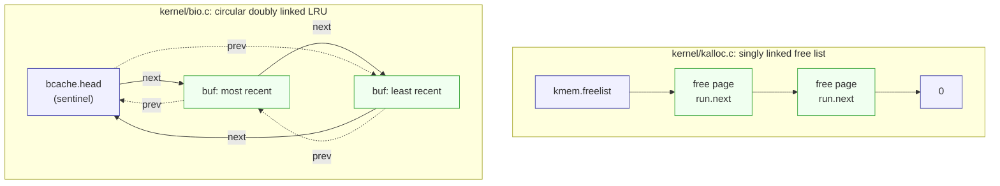

# C in xv6

---

[toc]

---

The companion to Lecture 2, [_programming xv6 in C_](../lectures/l-c.txt), and Homework 2, [_kernel C_](https://pdos.csail.mit.edu/6.1810/2026/homework/xv6-c.html). The lecture is "not a general intro to C", and neither is this note: generic C lives in `../c-programming/`, and this file owns only what is specific to xv6 — where things land in memory, what the toolchain shows, and which kernel files use each idea.

> [!NOTE]
> Ownership follows the [book notes rule](book/README.md): `../c-programming/` owns the language, this note owns xv6's use of it, and [`07-exercises.md`](07-exercises.md#lecture-2--c-and-memory) owns the practice programs. Read the linked C note when a row below is unfamiliar; do not expect it restated here.

## Lecture topic map

| Lecture topic              | Generic C (read when needed)                                                                                                   | xv6-specific, in this note                                                                                                       | Practice                                |
| -------------------------- | ------------------------------------------------------------------------------------------------------------------------------ | -------------------------------------------------------------------------------------------------------------------------------- | --------------------------------------- |
| **Memory layout**          | [C_Memory_Organization.md](../../c-programming/C_Memory_Organization.md)                                                       | [The user address space](#the-user-address-space)                                                                                | [`user/ptr.c`](../user/ptr.c)           |
| **From `cat.c` to `_cat`** | [C_Project_Build_Tool.md](../../c-programming/C_Project_Build_Tool.md)                                                         | [Looking inside a user binary](#looking-inside-a-user-binary); ELF in [06-build-artifacts.md](06-build-artifacts.md#what-elf-is) | —                                       |
| **Pointers**               | [C_Pointers.md](../../c-programming/C_Pointers.md), [C_Pointer_Declarations.md](../../c-programming/C_Pointer_Declarations.md) | [`argv` and the calling convention](#argv-and-the-calling-convention)                                                            | [`user/ptr.c`](../user/ptr.c)           |
| **Arrays**                 | [C_Array.md](../../c-programming/C_Array.md), [C_Pointer_Arithmetic.md](../../c-programming/C_Pointer_Arithmetic.md)           | [Strings in `ulib.c`](#strings-in-ulibc)                                                                                         | [`user/array.c`](../user/array.c)       |
| **Strings**                | [C_String.md](../../c-programming/C_String.md)                                                                                 | [Strings in `ulib.c`](#strings-in-ulibc), `struct dirent`                                                                        | [`user/str.c`](../user/str.c)           |
| **Structs**                | [C_Custom_Data_Types.md](../../c-programming/C_Custom_Data_Types.md#same-structs-ilp32-and-lp64)                               | [Homework 2](#homework-2-struct-addresses)                                                                                       | [`user/hwstruct.c`](../user/hwstruct.c) |
| **Lists**                  | [C_Linked_List.md](../../c-programming/C_Linked_List.md)                                                                       | [Two kernel lists](#two-kernel-lists)                                                                                            | —                                       |
| **Bitwise operators**      | [C_Bitwise_Module.md](../../c-programming/C_Bitwise_Module.md)                                                                 | [Flags in `fcntl.h`](#flags-in-fcntlh)                                                                                           | —                                       |
| **`static`, `void`**       | [C_Memory_Organization.md](../../c-programming/C_Memory_Organization.md#storage-class-specifiers)                              | [Keywords and common bugs](#keywords-and-common-bugs)                                                                            | —                                       |
| **Common C bugs**          | [C_Valgrind.md](../../c-programming/C_Valgrind.md), [C_Dynamic_Memory.md](../../c-programming/C_Dynamic_Memory.md)             | [Keywords and common bugs](#keywords-and-common-bugs)                                                                            | [`user/str.c`](../user/str.c)           |

## The user address space

Every address below was printed by [`ptr`](../user/ptr.c) and [`array`](../user/array.c) in this tree with `LAB=util`; the shape is the book's Figure 3.4, captioned in [ch03](book/ch03-page-tables.md#figures).

| Address           | Region             | What lands there                                                          | Set by                                     |
| ----------------- | ------------------ | ------------------------------------------------------------------------- | ------------------------------------------ |
| `0x0`             | **text** (R-X)     | `main` first, then the rest of the code and `.rodata`                     | `user/user.ld` `. = 0x0`                   |
| `0x1000`          | **data/bss** (RW-) | initialized globals (`g`, `a`, `b`) and zeroed ones (`umalloc.c` `freep`) | `user/user.ld` `ALIGN(0x1000)`             |
| `0x2000`          | **guard page**     | nothing; `PTE_U` cleared, so a touch faults                               | `kernel/exec.c` `uvmclear()`               |
| `0x3000`–`0x5000` | **stack** (RW-)    | `argv` strings, the `argv[]` array, then `main`'s frame                   | `kernel/exec.c` `kexec()`, `USERSTACK` = 2 |
| above `0x5000`    | **heap**           | `sbrk()` / `malloc()` growth                                              | `kernel/sysproc.c` `sys_sbrk()`            |

`USERSTACK` is 2 only under `LAB_UTIL` (`kernel/param.h`); otherwise it is 1, and every stack address above shifts down by a page.

> [!WARNING]
> `main` sits at address `0`, so `func = &main` in `ptr.c` prints `0x0000000000000000`: a valid function pointer that compares equal to a null pointer. Code that tests `if (fn)` would treat it as absent. On Linux the zero page is unmapped exactly to make null dereferences fault; xv6 maps code there.

## Looking inside a user binary

The lecture's commands, with the values this tree's build produced:

```bash
riscv64-linux-gnu-objdump -htr user/cat.o   # sections, symbols, relocations
riscv64-linux-gnu-objdump -fp user/_cat     # entry point and program headers
riscv64-linux-gnu-objdump -S user/_cat      # same as user/cat.asm
riscv64-linux-gnu-nm -n user/_cat           # symbols sorted by address
```

| Question the lecture asks          | What this tree shows                                                                                                                                                                                                                                |
| ---------------------------------- | --------------------------------------------------------------------------------------------------------------------------------------------------------------------------------------------------------------------------------------------------- |
| **What is unresolved in `cat.o`?** | Relocation records such as `R_RISCV_CALL_PLT read`: `cat.o` calls `read` but does not contain it; the link with `ULIB` fills it in.                                                                                                                 |
| **Where does `_cat` start?**       | `start address 0x00000000000000ea`, which is `start` in `nm`. The lecture's `0xf6` came from a different build; the address moves whenever code before it changes.                                                                                  |
| **What is `start`?**               | `user/ulib.c` `start()` runs `exit(main(argc, argv))`. The lecture says it "calls main() and exit(0)"; this tree passes `main`'s return value, which is why `return 0` and `exit(0)` are equivalent (see [AGENTS.md](../AGENTS.md#c-source-style)). |
| **Where is `buf`?**                | `0000000000001010 B buf`: `B` is `.bss`. The file stores no bytes for it (`filesz 0`, `memsz 0x220` in the second `LOAD` header), so `kexec()` must allocate and zero it.                                                                           |
| **Two `cat`s at once?**            | Both use virtual address `0x0` for text; per-process page tables map them to different physical pages. That is Lecture 4.                                                                                                                           |

The general ELF and `.asm` material belongs to [06-build-artifacts.md](06-build-artifacts.md#what-elf-is); the build graph that produces these files is in [08-makefile-tour.md](08-makefile-tour.md).

## `argv` and the calling convention

`kexec()` in `kernel/exec.c` builds the stack top-down, then hands the result to `main` through registers:

1. Copy each argument string below `sp`, rounding `sp` down to 16 bytes each time (`sp -= sp % 16`).
2. Push the `ustack[]` array of string addresses, with `ustack[argc] = 0` as the terminator.
3. Set `p->trapframe->a1 = sp`, the address of that array.
4. Return `argc` as the system call's result, which lands in `a0`.

The RISC-V calling convention ([riscv-calling.pdf](https://pdos.csail.mit.edu/6.1810/2026/readings/riscv-calling.pdf)) passes the first two integer arguments in `a0` and `a1`, so `start(argc, argv)` receives them unchanged. `ptr x yz` prints `argv[0]=...4FF0 "ptr"`, `argv[1]=...4FE0 "x"`, `argv[2]=...4FD0 "yz"`, and `argv[3]=0x0000000000000000`: the strings 16 bytes apart, the array below them. The book's Figure 3.4 draws the same panel.

## Strings in `ulib.c`

| Function       | Style        | Code in `user/ulib.c`                                           |
| -------------- | ------------ | --------------------------------------------------------------- |
| **`strlen()`** | array index  | `for (n = 0; s[n]; n++)`                                        |
| **`strcmp()`** | pointer walk | `while (*p && *p == *q) p++, q++;` then `(uchar)*p - (uchar)*q` |

Both stop at the terminating `0`, which is the only length a C string carries. `struct dirent` in `kernel/fs.h` is the exception that proves it: `name[DIRSIZ]` with `DIRSIZ` = 14 is marked `__attribute__((nonstring))` because a 14-byte name has no room for the `0`. The `ls.c` `T_DIR` case and [`ex9ls`](07-exercises.md#ex9ls--a-directory-is-a-file) copy it into a `DIRSIZ + 1` buffer for that reason.

## Two kernel lists



Green nodes hold data (a free page or a cached block); blue nodes are list roots, the sentinel, and the terminator. Solid arrows are `next`, dashed arrows are `prev`.

| List                | Node type                                             | Insert                                                         | Remove                          | Why that shape                                                                                         |
| ------------------- | ----------------------------------------------------- | -------------------------------------------------------------- | ------------------------------- | ------------------------------------------------------------------------------------------------------ |
| **`kmem.freelist`** | `struct run`, stored _inside_ the free 4096-byte page | `kfree()` prepends                                             | `kalloc()` takes the front      | Only the front is ever touched, so one `next` pointer is enough and the list costs no memory.          |
| **`bcache.head`**   | `struct buf`, `prev` and `next` in `kernel/buf.h`     | `brelse()` moves a buffer to the front when `refcnt` reaches 0 | `bget()` recycles from the back | Moving an arbitrary node to the front needs its predecessor, which only `prev` gives in constant time. |

`brelse()` unlinks with `b->next->prev = b->prev; b->prev->next = b->next;`, then splices `b` in after `bcache.head`. The sentinel means neither step needs an empty-list special case.

## Flags in `fcntl.h`

`kernel/fcntl.h` defines `O_RDONLY` `0x000`, `O_WRONLY` `0x001`, `O_RDWR` `0x002`, `O_CREATE` `0x200`, and `O_TRUNC` `0x400`: one bit each except `O_RDONLY`, which is the absence of the write bits. User code combines them with `|` (`O_CREATE|O_RDWR` in `user/usertests.c`), and `sys_open()` in `kernel/sysfile.c` tests them with `&`:

| Test in `sys_open()`                           | Meaning                           |
| ---------------------------------------------- | --------------------------------- |
| **`omode & O_CREATE`**                         | create the file if it is missing  |
| **`!(omode & O_WRONLY)`**                      | readable unless opened write-only |
| **`(omode & O_WRONLY) \|\| (omode & O_RDWR)`** | writable in either write mode     |
| **`(omode & O_TRUNC) && ip->type == T_FILE`**  | truncate plain files only         |

Because `O_RDONLY` is `0`, `omode & O_RDONLY` is always false; read-only is detected as "no write bit". Page-table entry flags in `kernel/riscv.h` (`PTE_V`, `PTE_R`, `PTE_W`, `PTE_X`, `PTE_U`) are the lecture's "more interesting examples later".

## Keywords and common bugs

| Item                       | xv6 example                                                            | What xv6 does about it                                                                                                                                                                       |
| -------------------------- | ---------------------------------------------------------------------- | -------------------------------------------------------------------------------------------------------------------------------------------------------------------------------------------- |
| **`static`**               | `static Header *freep` in `user/umalloc.c`                             | file-scope global: visible to `malloc`/`free`, invisible to user programs; lives in `.bss`, so it starts at `0`                                                                              |
| **`void`**                 | `main(void)`, `void *` from `malloc()`, `void` return of `kfree()`     | no parameters, untyped pointer, no value                                                                                                                                                     |
| **Use after free**         | a stale pointer into a freed page                                      | `kfree()` fills the page with `1`s (`memset(pa, 1, PGSIZE)`) so a dangling read sees junk, not plausible data                                                                                |
| **Double free / bad free** | `kfree()` of an unaligned or out-of-range address                      | `panic("kfree")` on a misaligned page or one outside `end`..`PHYSTOP`; a true double free of a valid page is _not_ detected                                                                  |
| **Uninitialized memory**   | a local, or a page from `kalloc()`                                     | `kalloc()` fills new pages with `5`s; stack locals hold whatever was there                                                                                                                   |
| **Buffer overflow**        | `s1[4] = 'D'` in [`str.c`](../user/str.c)                              | nothing on the stack: no bounds checks, and no Valgrind or sanitizer in the guest. Only page permissions catch it: `s[4] = 'D'` into a literal faults because text is mapped without `PTE_W` |
| **Memory leak**            | a `malloc()` never freed                                               | nothing until the process exits; `freeproc()` in `kernel/proc.c` then frees every user page through `proc_freepagetable()`                                                                   |
| **Type confusion**         | casting `0x1000` to `struct h *` in [`hwstruct.c`](../user/hwstruct.c) | nothing: the load succeeds if the page is mapped                                                                                                                                             |

The lecture's reference on how far undefined behaviour reaches is [Regehr, _UB in 2016_](https://blog.regehr.org/archives/1393).

## Homework 2: struct addresses

The handout assumes a **32-bit** machine (ILP32: `int` and pointers are 4 bytes) and `h == 0x1000`:

```c
struct f { int a; char b[32]; };
struct g { char *c; int d[4]; };
struct h { struct f *f; struct g g; };
struct h *h;
```

| Member             | 32-bit offset    | Size | 64-bit xv6 offset | Size |
| ------------------ | ---------------- | ---- | ----------------- | ---- |
| **`h->f`**         | `0x00`           | 4    | `0x00`            | 8    |
| **`h->g.c`**       | `0x04`           | 4    | `0x08`            | 8    |
| **`h->g.d[0..3]`** | `0x08`–`0x17`    | 16   | `0x10`–`0x1F`     | 16   |
| **`sizeof`**       | f 36, g 20, h 24 |      | f 36, g 24, h 32  |      |

| Expression        | 32-bit answer                     | Determinable? | Why                                                                      |
| ----------------- | --------------------------------- | ------------- | ------------------------------------------------------------------------ |
| **`&h->g.d[2]`**  | `0x1000 + 4 + 4 + 2*4` = `0x1010` | yes           | pure offset arithmetic                                                   |
| **`&h->f->a`**    | `h->f + 0`                        | no            | needs the pointer _stored_ at `0x1000`, which the question does not give |
| **`&h->g.c`**     | `0x1000 + 4` = `0x1004`           | yes           | pure offset arithmetic                                                   |
| **`&h->g.c[10]`** | `h->g.c + 10`                     | no            | needs the pointer stored at `0x1004`; `char` scales by 1                 |

`&` cancels only the final access. `&h->f->a` is `&((*h).f)->a`: the compiler must still load `h->f` to know where `a` is. No padding appears in either ABI because every member's offset is already a multiple of its alignment; [`docs/labs/03-util-memdump.md`](labs/03-util-memdump.md#structure-layout) covers the LP64 alignment rules.

On xv6 the lecture asks "which printed values are guaranteed" and "why did all the prints succeed?" — [`user/hwstruct.c`](../user/hwstruct.c) answers both by running the expressions. The two arithmetic answers are fixed at `0x1018` and `0x1008`. The two loads read `0x1000` and `0x1008`, which in that binary is `umalloc.c`'s zeroed `freep`, so they print `0x0` and `0xA`. They succeed because `0x1000` is the program's own data page; with that page unmapped, `usertrap()` would kill the process.

### Where the first draft went wrong

| Draft claim                              | Problem                                                                                                   |
| ---------------------------------------- | --------------------------------------------------------------------------------------------------------- |
| **`char b[32]` is 4B; `struct f` is 8B** | An array's size is element size × count: 32 bytes, so `struct f` is 36.                                   |
| **Pointers are 8B**                      | True on xv6, but the handout says 32-bit, where they are 4.                                               |
| **`0x1040 + 64 bits`**                   | Addresses count bytes. Adding bits to a byte address mixes units: 64 bits is 8 bytes, `0x08`, not `0x40`. |
| **`&h->f->a` = `0x1000`**                | That is `&h->f`. `&h->f->a` needs the value of `h->f`.                                                    |
| **`&h->g.c[10]` = `+ 8*10`**             | `c` is `char *`, so `[10]` moves 10 bytes; and the base is the unknown value of `c`, not `&h->g.c`.       |

## Questions I had

### Why does `b` sit below `a` in `array`?

`a` is declared first, but `nm -n user/_array` shows `b` at `0x1000` and `a` at `0x1010`. C does not define the order of separate globals. Here GCC's small-data rule decides it: objects of at most 8 bytes go to `.sdata` (`objdump -t user/array.o` shows `b`, 3 bytes, there) and larger ones to `.data` (`a`, 12 bytes). `user/user.ld` places `*(.sdata .sdata.*)` first, then `ALIGN(16)`, then `*(.data .data.*)`, which also explains the 13-byte gap after `b`. Only members _inside_ one struct keep declaration order.

### Why is the same local at different addresses in `ptr` and `ptr x yz`?

`kexec()` puts the argument strings and `argv[]` above `main`'s frame, so more or longer arguments push the frame down: `q` is `0x...4F8C` with no arguments and `0x...4F5C` with two. Globals do not move, because the linker fixed them.
