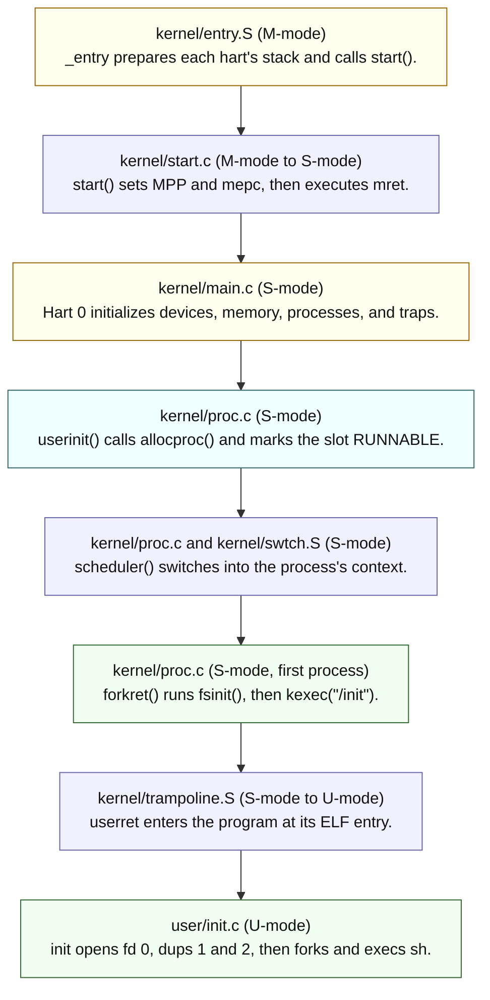

# OS Design in xv6

---

[toc]

---

The companion to Lecture 3, [_OS design_](../lectures/l-os.txt). The lecture's question is how a kernel isolates programs that it **must** assume are malicious; this note answers it with this tree's code, measured addresses, and two practice programs that attack the boundary and record what refuses them.

Use this ownership map to find the explanation you need, following the [book notes rule](book/README.md):

| Explanation                                                   | Owning note                                                                                                                  |
| ------------------------------------------------------------- | ---------------------------------------------------------------------------------------------------------------------------- |
| **Portable user/kernel mode, traps, and system-call numbers** | [The Process Abstraction](../../operating-system/The_Process_Abstraction.md#user-mode-vs-kernel-mode).                       |
| **Stub-to-`sys_*` dispatch**                                  | [05-syscall-reference.md](05-syscall-reference.md#what-a-system-call-actually-is-here).                                      |
| **`ecall` and `a7`**                                          | [06-build-artifacts.md](06-build-artifacts.md#why-the-system-call-number-goes-in-a7).                                        |
| **The kernel trap path**                                      | [ch04](book/ch04-traps-and-system-calls.md), when written.                                                                   |
| **Lecture 3's additions in this tree**                        | This note: where the boundary is enforced, how the first process crosses it, and how `fork` and `exec` handle hostile input. |

> [!IMPORTANT]
> **Status: draft study notes.** Lecture 3 is not yet marked studied in [STUDY-PROGRESS.md](../STUDY-PROGRESS.md#lectures), and Homework 3 is unanswered. Measurements below are from this tree's `LAB=util` build on 2026-10-28.

## Lecture topic map

| Lecture topic                            | Generic concept (read when needed)                                                                                                                                                          | xv6-specific, in this note                                            | Practice                                |
| ---------------------------------------- | ------------------------------------------------------------------------------------------------------------------------------------------------------------------------------------------- | --------------------------------------------------------------------- | --------------------------------------- |
| **Isolation as the design goal**         | [Design Goals](../../operating-system/Introduction_to_Operating_Systems.md#5-design-goals-25)                                                                                               | [Where the boundary is enforced](#where-the-boundary-is-enforced)     | [`user/isolate.c`](../user/isolate.c)   |
| **Threat model, TCB**                    | — (held here on loan)                                                                                                                                                                       | [Kernel organization and trust](#kernel-organization-and-trust)       | —                                       |
| **User/supervisor mode**                 | [User Mode vs. Kernel Mode](../../operating-system/The_Process_Abstraction.md#user-mode-vs-kernel-mode)                                                                                     | [Where the boundary is enforced](#where-the-boundary-is-enforced)     | [`isolate csr`](../user/isolate.c)      |
| **Virtual memory as isolation**          | [Address Spaces and Translation](../../operating-system/Address_Spaces_And_Translation.md)                                                                                                  | [Where the boundary is enforced](#where-the-boundary-is-enforced)     | [`isolate kload`](../user/isolate.c)    |
| **`ecall` and system-call numbers**      | [Trap / Return-from-trap](../../operating-system/The_Process_Abstraction.md#trap--return-from-trap), [05-syscall-reference.md](05-syscall-reference.md#what-a-system-call-actually-is-here) | [A system call is a number](#a-system-call-is-a-number)               | [`isolate badsys`](../user/isolate.c)   |
| **Monolithic kernel versus microkernel** | — (held here on loan; Lecture 12 reads about microkernels)                                                                                                                                  | [Kernel organization and trust](#kernel-organization-and-trust)       | —                                       |
| **The board, QEMU, and emulation**       | —                                                                                                                                                                                           | [The machine xv6 runs on](#the-machine-xv6-runs-on)                   | —                                       |
| **Kernel source and the build**          | [08-makefile-tour.md](08-makefile-tour.md), [06-build-artifacts.md](06-build-artifacts.md)                                                                                                  | [The machine xv6 runs on](#the-machine-xv6-runs-on)                   | —                                       |
| **Boot to `/init`**                      | [`init` / PID 1](../../operating-system/The_Process_Abstraction.md#init--pid-1)                                                                                                             | [From boot to the first process](#from-boot-to-the-first-process)     | —                                       |
| **`fork`: `allocproc`, `uvmcopy`**       | [`fork()`](../../operating-system/The_Process_Abstraction.md#71-fork--create-a-near-copy-51)                                                                                                | [`fork`, `kfork`, and a full table](#fork-kfork-and-a-full-table)     | [`user/forkfill.c`](../user/forkfill.c) |
| **`exec`: ELF, checks, stack**           | [`exec()`](../../operating-system/The_Process_Abstraction.md#73-exec--become-a-different-program-53), [What ELF is](06-build-artifacts.md#what-elf-is)                                      | [`exec` treats the file as hostile](#exec-treats-the-file-as-hostile) | [`isolate kcopy`](../user/isolate.c)    |

## Where the boundary is enforced

The lecture names two defences: hardware controls on user instructions, and a careful system-call interface. [`isolate`](../user/isolate.c) tries one attack per mode, and each is refused at a different layer:

| Attempt (`isolate <mode>`)                         | Layer that refuses it                                               | Observed result                                            |
| -------------------------------------------------- | ------------------------------------------------------------------- | ---------------------------------------------------------- |
| **`csr`**: run `r_sstatus()` from `kernel/riscv.h` | CPU privilege check                                                 | `scause 0x2` (illegal instruction); `usertrap()` kills it  |
| **`kload`**: load a byte from `TRAMPOLINE`         | MMU: the page is mapped but lacks `PTE_U`                           | `scause 0xd` (load page fault); `usertrap()` kills it      |
| **`badsys`**: `ecall` with `a7` = 99               | `syscall()` bounds-checks `a7` against `syscalls[]`                 | Kernel prints `unknown sys call 99`; the call returns `-1` |
| **`kcopy`**: `read()` from a pipe into `TRAPFRAME` | `copyout()` calls `walkaddr()`, which rejects a PTE without `PTE_U` | `read()` returns `-1`; the two pipe bytes are not consumed |

The results divide into the lecture's two defences:

- **Hardware faults (`csr`, `kload`):** hardware stops the instruction. `usertrap()` in `kernel/trap.c` has no applicable handler for these cases and calls `setkilled()`.
- **Kernel checks (`badsys`, `kcopy`):** these attempts **never** fault. Kernel code detects the invalid request and returns an ordinary error.

> [!NOTE]
> `TRAMPOLINE` (`0x3FFFFFF000`) and `TRAPFRAME` (`0x3FFFFFE000`) are **mapped in every user page table**. `proc_pagetable()` in `kernel/proc.c` maps them with `PTE_R | PTE_X` and `PTE_R | PTE_W` but never `PTE_U`, so isolation here is a permission bit, not a missing mapping.


_“Layout of a process's virtual address space” — [book figure](book/fig/README.md), `first.tex` `fig:as`; also captioned in [ch02](book/ch02-operating-system-organization.md#figures)._

Read the bands **bottom to top**, starting at address 0:

1. User text and data.
2. User stack.
3. A large heap region.
4. Trapframe, then trampoline: two thin bands immediately below `MAXVA`.

The last two bands are the targets of `isolate kcopy` and `isolate kload`, respectively. They are inside the user's own virtual address space, but neither mapping carries `PTE_U`: **mapped does not mean user-accessible**. The attack table above records the resulting refusals.

Why `kcopy` matters:

- **Protected state:** the trapframe holds this process's saved registers, including `epc`, the user instruction address that the kernel will resume. Without `walkaddr()`'s `PTE_U` test in `kernel/vm.c`, a `read()` into that page could corrupt the saved return state.
- **Failure preserves the pipe bytes:** `piperead()` in `kernel/pipe.c` returns `-1` before advancing `nread`. A following `read()` into a real buffer therefore still gets `"hi"`.

## A system call is a number

Lecture 3's observation: a user call to `fork()` reaches the kernel through a **number**, rather than an ordinary function call into kernel code.

1. The stub in `user/usys.S` executes `li a7, SYS_fork`, then `ecall`.
2. `syscall()` in `kernel/syscall.c` uses saved `a7` to index `syscalls[]`.

The full mechanics belong to [05-syscall-reference.md](05-syscall-reference.md#what-a-system-call-actually-is-here). The numbers below come from this tree's `kernel/syscall.h`:

| Call       | Number | Kernel entry | Does the work                                    |
| ---------- | ------ | ------------ | ------------------------------------------------ |
| **`fork`** | 1      | `sys_fork()` | `kfork()` in `kernel/proc.c`                     |
| **`exec`** | 7      | `sys_exec()` | `kexec()` in `kernel/exec.c`                     |
| **`sync`** | 22     | `sys_sync()` | the highest number in the table; 99 has no entry |

| Dispatch condition                                  | Result                                                                        |
| --------------------------------------------------- | ----------------------------------------------------------------------------- |
| `num > 0 && num < NELEM(syscalls) && syscalls[num]` | Call the registered handler.                                                  |
| **Any other value**                                 | Run `printk("%d %s: unknown sys call %d\n", ...)` and set saved `a0` to `-1`. |

The second row produces `5 isolate: unknown sys call 99` in `isolate badsys`. Each generated `usys.S` stub hard-codes its own `a7`, so `rawsyscall()` uses a hand-written `ecall` to try an unused number.

> [!WARNING]
> The lecture's naming convention, `k<syscallname>()`, holds only for process calls. This tree has `kfork()`, `kexec()`, `kexit()`, `kwait()`, and `kkill()`; file calls go from `sys_read()` to `fileread()`, not to a `kread()`. The full rename table is in [the concordance appendix](book/00-ostep-concordance.md#system-call-naming).

The lecture also suggests editing `syscall()` to print a trace of every system call `init` and `sh` make. That edit is the syscall lab's `trace` exercise, so it is deliberately not done here.

## Kernel organization and trust

> [!NOTE]
> **Concepts on loan:** the OSTEP notes cover user/kernel mode but do not yet own the threat model or kernel organization. These two concepts stay here until an owning note exists; Lecture 12 reads about microkernels.

| Assumption      | Lecture 3's position                                                 | Consequence in this tree                                                                                     |
| --------------- | -------------------------------------------------------------------- | ------------------------------------------------------------------------------------------------------------ |
| **User code**   | Actively malicious: tries to break isolation and trick system calls. | Every user pointer goes through `copyin()`/`copyout()`; `a7` is bounds-checked; `kexec()` validates the ELF. |
| **Kernel code** | Trusted, written by competent people, but still buggy.               | The whole of `kernel/` is the trusted computing base (TCB); any bug there may be an exploit.                 |

| Organization    | What runs in supervisor mode                                 | Trade-off the lecture names                                                                                                |
| --------------- | ------------------------------------------------------------ | -------------------------------------------------------------------------------------------------------------------------- |
| **Monolithic**  | All system calls, the file system, and drivers: one program. | Subsystems cooperate easily (one cache for file system and VM), but interactions are complex and drivers are not isolated. |
| **Microkernel** | A small kernel; services run as user processes.              | Less code in the TCB limits damage from bugs; services talk by message instead of by function call.                        |


_“A microkernel with a file-system server” — [book figure](book/fig/README.md), `first.tex` `fig:mkernel`._

| Figure feature                                   | How to read it                                                                                    |
| ------------------------------------------------ | ------------------------------------------------------------------------------------------------- |
| **`shell` and `File server` above the red line** | Both are user processes. The file system runs outside the privileged kernel.                      |
| **Thin `Microkernel` box below the line**        | The kernel mediates communication between those processes.                                        |
| **Connection labelled “Send message”**           | The connection dips through the microkernel instead of calling the file system inside the kernel. |

For a schematic `read` request/reply exchange, the shell sends a request through the kernel to the server, and the server sends a reply through the kernel to the shell: **two messages**. This illustrates the microkernel row above; the figure does not specify every message a real file-system protocol might require. Compare [Lecture 1's figure](12-os-overview-in-xv6.md#what-a-system-call-does-step-by-step), where the request is a single system-call arrow into one large kernel.

Moving the file system to user space removes it from the privileged kernel's TCB and limits its authority. It does not make the server irrelevant to security: file-system integrity can still depend on trusting that service.

- **xv6's choice:** every file in `kernel/` links into one `kernel/kernel` binary. It is monolithic, and its user-facing kernel interface is the system-call interface.
- **The lecture's alternative:** a strongly typed language, such as Singularity's, can provide process isolation without hardware modes. xv6 does not take that approach.

## The machine xv6 runs on

The lecture models the board as a 4-core SiFive HiFive Unleashed with 128 MB of RAM, a UART, and disk. This tree's `QEMUOPTS` in the [Makefile](../Makefile) is the authority for what QEMU actually emulates:

| Property          | Lecture 3                                  | This tree                                                                           |
| ----------------- | ------------------------------------------ | ----------------------------------------------------------------------------------- |
| **Machine**       | `qemu -machine virt`                       | `-machine virt -bios none`                                                          |
| **Cores**         | 4                                          | `CPUS := 3` by default; 1 under `LAB=fs`, 4 under `LAB=lock`                        |
| **RAM**           | 128 MB                                     | `-m 128M`                                                                           |
| **Kernel entry**  | the kernel's first instruction             | `_entry` at `0x80000000`, the ELF entry point (`readelf -h kernel/kernel`)          |
| **Disk**          | virtio instead of the board's storage      | `fs.img`, 2,048,000 bytes, attached as a virtio block device                        |
| **Kernel binary** | `ls -l kernel/kernel`                      | 276,264 bytes                                                                       |
| **Kernel source** | small enough to understand by semester end | 23 `.c` files, 4 `.S` files, 7,041 lines including headers (`wc -l kernel/*.[chS]`) |

The lecture's emulation sketch is a useful model for each emulated hart:

1. Read the next instruction.
2. Decode it.
3. Execute its effect on state such as a `uint64 reg[32]` register array.

`-bios none` omits a separate firmware image. QEMU still executes a small reset stub before transferring to `_entry` in machine mode; `_entry` is the kernel's first instruction, not necessarily the first instruction seen when attaching GDB at reset. Why the kernel is linked there is in [06-build-artifacts.md](06-build-artifacts.md#why-the-kernel-is-linked-at-0x80000000).


_“On the left, xv6's kernel virtual address space; on the right, the RISC-V physical address space that xv6 expects to see.” — [book figure](book/fig/README.md), `mem.tex` `fig:xv6_layout`; also captioned in [ch03](book/ch03-page-tables.md#figures)._

Read the devices and RAM **bottom to top**:

| Region                                      | Address / placement                                                       | Connection to this build                                                                                                  |
| ------------------------------------------- | ------------------------------------------------------------------------- | ------------------------------------------------------------------------------------------------------------------------- |
| **PLIC**                                    | `0x0C000000`                                                              | QEMU `virt` interrupt controller.                                                                                         |
| **UART0**                                   | `0x10000000`                                                              | Console device registers.                                                                                                 |
| **Virtio disk**                             | `0x10001000`                                                              | `fs.img` is reached through device registers, not as RAM contents.                                                        |
| **RAM: kernel text, data, and free memory** | `KERNBASE` (`0x80000000`) through the exclusive `PHYSTOP` (`0x88000000`). | `_entry` begins the kernel text band. `-m 128M` matches `PHYSTOP = KERNBASE + 128 * 1024 * 1024` in `kernel/memlayout.h`. |
| **High kernel virtual mappings**            | Trampoline and kernel stacks at the top of the virtual column.            | Unmapped guard pages separate kernel stacks.                                                                              |

The two columns distinguish virtual placement from the physical machine map; high virtual mappings do not add physical RAM above `PHYSTOP`.

## From boot to the first process

> [!TIP]
> **Assembly new to you?** Start with the [assembly course](../../assembly-language/README.md), then its [readiness checks](../../assembly-language/docs/riscv/08-readiness-and-next-steps.md). This section is an overview, not a line-by-line tutorial. The [boot-study proposal](boot/README.md) specifies the missing lessons and source coverage.

Lecture 3 traces `main()` → `userinit()` → `forkret()` → `/init`. The path starts two steps earlier, in machine mode. M-mode means machine mode, S-mode supervisor mode, and U-mode user mode; a hart is a hardware thread with its own register state (see the [glossary](04-terminology.md)).



Legend: yellow means setup, blue a mode/context transition, cyan stored process state, and green loading or launching a program. `start()` selects S-mode in `mstatus.MPP` and `main` in `mepc`; `mret` performs that transfer. The lecture mostly ignores M-mode, and so does xv6 after this transfer. Every hart eventually runs `scheduler()`; the full initialization shown here belongs to hart 0.

| Symbol      | Address (`nm -n kernel/kernel`) | Role in the path                                  |
| ----------- | ------------------------------- | ------------------------------------------------- |
| `_entry`    | `0x80000000`                    | first instruction QEMU runs                       |
| `main`      | `0x800002e8`                    | `mepc` target of `start()`'s `mret`               |
| `forkret`   | `0x80000dcc`                    | `allocproc()` stores it in `p->context.ra`        |
| `userinit`  | `0x8000105a`                    | creates the only process not made by `fork`       |
| `scheduler` | `0x80001206`                    | every hart ends `main()` here                     |
| `start`     | `0x800050a8`                    | the last machine-mode C function                  |
| `uservec`   | `0x80006000`                    | the trampoline page, mapped again at `TRAMPOLINE` |

Two details the lecture compresses:

| Stage                 | What it actually establishes                                                   | Why the distinction matters                                                          |
| --------------------- | ------------------------------------------------------------------------------ | ------------------------------------------------------------------------------------ |
| `allocproc()`         | Sets `p->context.ra` to `forkret`.                                             | The first context switch has a kernel destination.                                   |
| `userinit()`          | Allocates the slot, sets `p->cwd`, and marks it `RUNNABLE`; **loads no code**. | A runnable kernel context is not yet a loaded user program.                          |
| **First `forkret()`** | Under `static int first`, runs `fsinit()` before the first `kexec()`.          | `fsinit()` may sleep, so it **must** run in process context rather than in `main()`. |

For `/init`'s console descriptors, the order is:

1. Open `console`. If that fails, call `mknod("console", CONSOLE, 0)` and retry the open: a fresh `fs.img` may lack the device file.
2. Use the opened descriptor as fd 0, then call `dup(0)` twice for fds 1 and 2.
3. Let later processes inherit the three descriptors through `fork`.

## `fork`, `kfork`, and a full table

`kfork()` in `kernel/proc.c`, in the order the lecture lists:

1. `allocproc()` scans `proc[NPROC]` for an `UNUSED` slot, assigns a pid, allocates a trapframe page and an empty page table, and points `context.ra` at `forkret`. It returns `0` when no slot is free or `kalloc()` fails.
2. `uvmcopy()` copies the parent's `p->sz` bytes of user memory into the child's page table.
3. `*(np->trapframe) = *(p->trapframe)` copies saved registers, then `np->trapframe->a0 = 0` makes `fork()` return `0` in the child.
4. `filedup()` shares every open file and `idup()` shares the working directory.
5. The child is marked `RUNNABLE`; the parent gets the child's pid.

The lecture's homework question, "what happens if out of proc's?", is answered by [`forkfill`](../user/forkfill.c):

```text
$ forkfill
forkfill: fork returned -1 after 61 children
forkfill: reaped 61 children
forkfill: fork works again
```

| Quantity                 | Value | Source                                                           |
| ------------------------ | ----- | ---------------------------------------------------------------- |
| **`NPROC`**              | 64    | `kernel/param.h`; 10 under `LAB_FS`                              |
| **Already in use**       | 3     | `init`, `sh`, and `forkfill` itself                              |
| **Children before `-1`** | 61    | measured, and the same on a second run once the first was reaped |

| Event                               | Result                                                                           |
| ----------------------------------- | -------------------------------------------------------------------------------- |
| **No process slot is available**    | `allocproc()` returns `0`, `kfork()` returns `-1`, and the kernel keeps running. |
| **A child exits but is not reaped** | It remains a `ZOMBIE` and still occupies its slot.                               |
| **The parent reaps that child**     | The parent's `wait()` reaches `freeproc()`, making the slot available again.     |

One user can therefore exhaust the table for everyone. This is the lecture's **resource isolation** problem: xv6 has no per-user process limit.

## `exec` treats the file as hostile

Before calling `kexec()`, `sys_exec()` in `kernel/sysfile.c` checks and copies user-supplied inputs:

| Input                             | How it is copied / checked                                                                 |
| --------------------------------- | ------------------------------------------------------------------------------------------ |
| **Executable path**               | `argstr()` copies the path into kernel storage.                                            |
| **Argument pointers and strings** | `fetchaddr()` reads pointers; `fetchstr()` copies strings into kernel pages.               |
| **Argument count**                | Reject an `argv` needing more than `MAXARG` (32) slots, **including** its terminating `0`. |

These user-pointer reads require `PTE_U`, just as the destination check in `isolate kcopy` does. `kexec()` then rejects ELF input that could make it write outside the new image:

| Check in `kexec()`                   | It rejects                                                              |
| ------------------------------------ | ----------------------------------------------------------------------- |
| **`elf.magic != ELF_MAGIC`**         | a file that is not ELF at all                                           |
| **`ph.memsz < ph.filesz`**           | a segment claiming more file bytes than memory to hold them             |
| **`ph.vaddr + ph.memsz < ph.vaddr`** | a segment whose end wraps around the 64-bit address space               |
| **`ph.vaddr % PGSIZE != 0`**         | a segment that does not start on a page boundary                        |
| **`sp < stackbase`**                 | arguments that would overflow the `USERSTACK` pages into the guard page |

The wrap-around check addresses the lecture's “don't be tricked into overwriting kernel memory”: without it, a huge `memsz` could give `uvmalloc()` a range whose end is below its start.

> [!IMPORTANT]
> **Replace the old image only after success.** Each listed `kexec()` failure goes to `bad:`, frees any half-built page table, and returns `-1`. The old image stays intact because `p->pagetable` is replaced only after all checks pass.

The resulting stack and `argv` layout is drawn in [10-c-in-xv6.md](10-c-in-xv6.md#argv-and-the-calling-convention).

## Divergences from the lecture text

| Lecture 3 says                       | This tree                                                                                         |
| ------------------------------------ | ------------------------------------------------------------------------------------------------- |
| **4 cores**                          | 3 emulated harts by default (`CPUS` in the Makefile).                                             |
| **`ecall <n>`**                      | `ecall` takes no operand; the number travels in `a7`, set by the preceding `li` in `user/usys.S`. |
| **`k<syscallname>()` in the kernel** | Only for process calls; see [A system call is a number](#a-system-call-is-a-number).              |

## Homework 3

Homework 3, [_kernel design_](https://pdos.csail.mit.edu/6.1810/2026/homework/xv6-design.html), is **not answered yet**. Its reading list is in [STUDY-PROGRESS.md](../STUDY-PROGRESS.md#homework-and-assigned-reading). When an answer is drafted, record it here as a worked table, keeping a _where the first draft went wrong_ table as [10-c-in-xv6.md](10-c-in-xv6.md#where-the-first-draft-went-wrong) does.

## Questions I had

### Why can the user page table contain kernel pages at all?

Because the trap path needs them before it can switch page tables. `uservec` in `kernel/trampoline.S` starts running with the user's `satp` still active, so its own code (the trampoline) and the place it saves registers (the trapframe) **must** be mapped in that table. Leaving `PTE_U` clear keeps U-mode out while S-mode can still use them. [ch04](book/ch04-traps-and-system-calls.md) will own the full path.

### Why does `isolate csr` report `stval=0x100027f3`?

| Experiment          | Meaning of the observed `stval`                                       | Source evidence                                                                               |
| ------------------- | --------------------------------------------------------------------- | --------------------------------------------------------------------------------------------- |
| **`isolate csr`**   | `0x100027f3` is the faulting instruction's encoding in this QEMU run. | `user/isolate.asm` shows `100027f3` at `0x44`, equal to `sepc`, decoded as `csrr a5,sstatus`. |
| **`isolate kload`** | `0x3ffffff000` is the refused address.                                | This case is a load page fault rather than an illegal instruction.                            |

For illegal instructions, the architecture permits implementations to report instruction bits in `stval`; do not assume every RISC-V implementation supplies a nonzero encoding. Here the disassembly explains the measured value.
