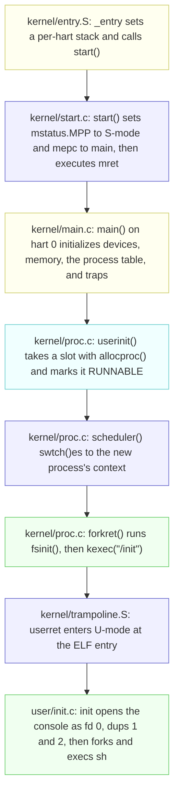

# OS Design in xv6

---

[toc]

---

The companion to Lecture 3, [_OS design_](../lectures/l-os.txt). The lecture's question is how a kernel isolates programs that it **must** assume are malicious; this note answers it with this tree's code, measured addresses, and two practice programs that attack the boundary and record what refuses them.

> [!NOTE]
> Ownership follows the [book notes rule](book/README.md): [The Process Abstraction](../../operating-system/The_Process_Abstraction.md#user-mode-vs-kernel-mode) owns user/kernel mode, traps, and system-call numbers as portable ideas; [05-syscall-reference.md](05-syscall-reference.md#what-a-system-call-actually-is-here) owns the stub-to-`sys_*` dispatch path; [06-build-artifacts.md](06-build-artifacts.md#why-the-system-call-number-goes-in-a7) owns `ecall` and `a7`; [ch04](book/ch04-traps-and-system-calls.md) will own the trap path. This note owns only what Lecture 3 adds on top: where the boundary is enforced in this tree, how the first process gets across it, and what `fork` and `exec` do when user input is hostile.

> [!IMPORTANT]
> **Status: draft study notes.** Lecture 3 is not yet marked studied in [STUDY-PROGRESS.md](../STUDY-PROGRESS.md#lectures), and Homework 3 is unanswered. Measurements below are from this tree's `LAB=util` build on 2026-10-28.

## Lecture topic map

| Lecture topic                            | Generic concept (read when needed)                                                                                                                                                          | xv6-specific, in this note                                            | Practice                                |
| ---------------------------------------- | ------------------------------------------------------------------------------------------------------------------------------------------------------------------------------------------- | --------------------------------------------------------------------- | --------------------------------------- |
| **Isolation as the design goal**         | [Design Goals](../../operating-system/Introduction_to_Operating_Systems.md#5-design-goals-25)                                                                                               | [Where the boundary is enforced](#where-the-boundary-is-enforced)     | [`user/isolate.c`](../user/isolate.c)   |
| **Threat model, TCB**                    | — (held here on loan)                                                                                                                                                                       | [Kernel organization and trust](#kernel-organization-and-trust)       | —                                       |
| **User/supervisor mode**                 | [User Mode vs. Kernel Mode](../../operating-system/The_Process_Abstraction.md#user-mode-vs-kernel-mode)                                                                                     | [Where the boundary is enforced](#where-the-boundary-is-enforced)     | [`isolate csr`](../user/isolate.c)      |
| **Virtual memory as isolation**          | [Address Spaces and Translation](../../operating-system/Address_Spaces_And_Translation.md)                                                                                                  | [Where the boundary is enforced](#where-the-boundary-is-enforced)     | [`isolate kload`](../user/isolate.c)    |
| **`ecall` and system-call numbers**      | [Trap / Return-from-trap](../../operating-system/The_Process_Abstraction.md#trap--return-from-trap), [05-syscall-reference.md](05-syscall-reference.md#what-a-system-call-actually-is-here) | [A system call is a number](#a-system-call-is-a-number)               | [`isolate badsys`](../user/isolate.c)   |
| **Monolithic kernel versus microkernel** | — (held here on loan; Lecture 12 reads about microkernels)                                                                                                                                  | [Kernel organization and trust](#kernel-organization-and-trust)       | —                                       |
| **The board, QEMU, and emulation**       | —                                                                                                                                                                                           | [The machine xv6 runs on](#the-machine-xv6-runs-on)                   | —                                       |
| **Kernel source and the build**          | [08-makefile-tour.md](08-makefile-tour.md), [06-build-artifacts.md](06-build-artifacts.md)                                                                                                  | [The machine xv6 runs on](#the-machine-xv6-runs-on)                   | —                                       |
| **Boot to `/init`**                      | [`init` / PID 1](../../operating-system/The_Process_Abstraction.md#init--pid-1)                                                                                                             | [From boot to the first process](#from-boot-to-the-first-process)     | —                                       |
| **`fork`: `allocproc`, `uvmcopy`**       | [`fork()`](../../operating-system/The_Process_Abstraction.md#71-fork--create-a-near-copy-51)                                                                                                | [`fork`, `kfork`, and a full table](#fork-kfork-and-a-full-table)     | [`user/forkfill.c`](../user/forkfill.c) |
| **`exec`: ELF, checks, stack**           | [`exec()`](../../operating-system/The_Process_Abstraction.md#73-exec--become-a-different-program-53), [What ELF is](06-build-artifacts.md#what-elf-is)                                      | [`exec` treats the file as hostile](#exec-treats-the-file-as-hostile) | [`isolate kcopy`](../user/isolate.c)    |

## Where the boundary is enforced

The lecture names two defences: hardware controls on user instructions, and a careful system-call interface. [`isolate`](../user/isolate.c) tries one attack per mode, and each is refused at a different layer:

| Attempt (`isolate <mode>`)                         | Layer that refuses it                                               | Observed result                                            |
| -------------------------------------------------- | ------------------------------------------------------------------- | ---------------------------------------------------------- |
| **`csr`**: run `r_sstatus()` from `kernel/riscv.h` | CPU privilege check                                                 | `scause 0x2` (illegal instruction); `usertrap()` kills it  |
| **`kload`**: load a byte from `TRAMPOLINE`         | MMU: the page is mapped but lacks `PTE_U`                           | `scause 0xd` (load page fault); `usertrap()` kills it      |
| **`badsys`**: `ecall` with `a7` = 99               | `syscall()` bounds-checks `a7` against `syscalls[]`                 | Kernel prints `unknown sys call 99`; the call returns `-1` |
| **`kcopy`**: `read()` from a pipe into `TRAPFRAME` | `copyout()` calls `walkaddr()`, which rejects a PTE without `PTE_U` | `read()` returns `-1`; the two pipe bytes are not consumed |

The first two are faults: the hardware stops the instruction, `usertrap()` in `kernel/trap.c` finds no handler for that `scause`, and calls `setkilled()`. The last two **never** fault, because the kernel itself performs the check and turns a hostile request into an ordinary error return. That split is the lecture's pair of defences made concrete.

> [!NOTE]
> `TRAMPOLINE` (`0x3FFFFFF000`) and `TRAPFRAME` (`0x3FFFFFE000`) are **mapped in every user page table**. `proc_pagetable()` in `kernel/proc.c` maps them with `PTE_R | PTE_X` and `PTE_R | PTE_W` but never `PTE_U`, so isolation here is a permission bit, not a missing mapping.


_“Layout of a process's virtual address space” — [book figure](book/fig/README.md), `first.tex` `fig:as`, also captioned in [ch02](book/ch02-operating-system-organization.md#figures). Bottom to top from 0: **user text and data**, **user stack**, a large **heap**, then two thin bands under `MAXVA`, **trapframe** and **trampoline**. Those two slivers are the targets of `isolate kload` and `isolate kcopy`: the drawing places them inside the user's own address space, and the table above shows that being mapped there still does not make them reachable, because neither carries `PTE_U`._

The `kcopy` case matters more than it looks. The trapframe holds this process's saved registers, including the `epc` that `usertrap()` returns to. If `walkaddr()` in `kernel/vm.c` did not test `PTE_U`, a `read()` with that destination would let a user choose the kernel's next return address. `piperead()` in `kernel/pipe.c` returns `-1` before advancing `nread`, which is why the following `read()` into a real buffer still gets `"hi"`.

## A system call is a number

Lecture 3's observation is that `fork()` does not call a kernel function: the stub in `user/usys.S` executes `li a7, SYS_fork` and `ecall`, and `syscall()` in `kernel/syscall.c` uses `a7` to index `syscalls[]`. The mechanics are in [05-syscall-reference.md](05-syscall-reference.md#what-a-system-call-actually-is-here); this tree's numbers for the calls the lecture walks through come from `kernel/syscall.h`:

| Call       | Number | Kernel entry | Does the work                                    |
| ---------- | ------ | ------------ | ------------------------------------------------ |
| **`fork`** | 1      | `sys_fork()` | `kfork()` in `kernel/proc.c`                     |
| **`exec`** | 7      | `sys_exec()` | `kexec()` in `kernel/exec.c`                     |
| **`sync`** | 22     | `sys_sync()` | the highest number in the table; 99 has no entry |

`syscall()` accepts `num` only when `num > 0 && num < NELEM(syscalls) && syscalls[num]`. Any other value reaches the `printk("%d %s: unknown sys call %d\n", ...)` branch and sets `a0` to `-1`, which is the `5 isolate: unknown sys call 99` line in `isolate badsys`. Because `usys.S` hard-codes `a7` per stub, reaching an unused number needs the hand-written `ecall` in `rawsyscall()`.

> [!WARNING]
> The lecture's naming convention, `k<syscallname>()`, holds only for process calls. This tree has `kfork()`, `kexec()`, `kexit()`, `kwait()`, and `kkill()`; file calls go from `sys_read()` to `fileread()`, not to a `kread()`. The full rename table is in [the concordance appendix](book/00-ostep-concordance.md#system-call-naming).

The lecture also suggests editing `syscall()` to print a trace of every system call `init` and `sh` make. That edit is the syscall lab's `trace` exercise, so it is deliberately not done here.

## Kernel organization and trust

This section holds two concepts **on loan**: the OSTEP notes cover user/kernel mode but have no section on the threat model or kernel organization, and Lecture 12 reads about microkernels. Move them when an owning note exists.

| Assumption      | Lecture 3's position                                                 | Consequence in this tree                                                                                     |
| --------------- | -------------------------------------------------------------------- | ------------------------------------------------------------------------------------------------------------ |
| **User code**   | Actively malicious: tries to break isolation and trick system calls. | Every user pointer goes through `copyin()`/`copyout()`; `a7` is bounds-checked; `kexec()` validates the ELF. |
| **Kernel code** | Trusted, written by competent people, but still buggy.               | The whole of `kernel/` is the trusted computing base (TCB); any bug there may be an exploit.                 |

| Organization    | What runs in supervisor mode                                 | Trade-off the lecture names                                                                                                |
| --------------- | ------------------------------------------------------------ | -------------------------------------------------------------------------------------------------------------------------- |
| **Monolithic**  | All system calls, the file system, and drivers: one program. | Subsystems cooperate easily (one cache for file system and VM), but interactions are complex and drivers are not isolated. |
| **Microkernel** | A small kernel; services run as user processes.              | Less code in the TCB limits damage from bugs; services talk by message instead of by function call.                        |


_“A microkernel with a file-system server” — [book figure](book/fig/README.md), `first.tex` `fig:mkernel`. Two user processes, `shell` and `File server`, sit above the red user/kernel line; their connection dips through a thin `Microkernel` box and is labelled **Send message**. This is the table's second row drawn out: the file system has moved out of the TCB into user space, so a shell's `read` becomes two messages through the kernel instead of one system call into it. Compare [Lecture 1's figure](12-os-overview-in-xv6.md#what-a-system-call-does-step-by-step), where the same request is a single arrow into one large kernel._

xv6 is monolithic: every file in `kernel/` is linked into one `kernel/kernel` binary, so the kernel interface is exactly the system-call interface. The lecture's aside, that a strongly typed language such as Singularity's can isolate processes without hardware modes, is the alternative xv6 does not take.

## The machine xv6 runs on

The lecture models the board as a 4-core SiFive HiFive Unleashed with 128 MB of RAM, a UART, and disk. This tree's `QEMUOPTS` in the [Makefile](../Makefile) is the authority for what QEMU actually emulates:

| Property          | Lecture 3                                  | This tree                                                                           |
| ----------------- | ------------------------------------------ | ----------------------------------------------------------------------------------- |
| **Machine**       | `qemu -machine virt`                       | `-machine virt -bios none`                                                          |
| **Cores**         | 4                                          | `CPUS := 3` by default; 1 under `LAB=fs`, 4 under `LAB=lock`                        |
| **RAM**           | 128 MB                                     | `-m 128M`                                                                           |
| **Kernel entry**  | the kernel's first instruction             | `_entry` at `0x80000000`, the ELF entry point (`readelf -h kernel/kernel`)          |
| **Disk**          | virtio instead of the board's storage      | `fs.img`, 2,048,000 bytes, attached as a virtio block device                        |
| **Kernel binary** | `ls -l kernel/kernel`                      | 276,264 bytes                                                                       |
| **Kernel source** | small enough to understand by semester end | 23 `.c` files, 4 `.S` files, 7,041 lines including headers (`wc -l kernel/*.[chS]`) |

The lecture's "emulation" sketch, a loop that reads, decodes, and executes one instruction against a `uint64 reg[32]` array, is what QEMU does for each of the emulated harts. `-bios none` means no firmware runs first: QEMU jumps straight to `_entry` in machine mode. Why the kernel is linked at that address is in [06-build-artifacts.md](06-build-artifacts.md#why-the-kernel-is-linked-at-0x80000000).


_“On the left, xv6's kernel virtual address space; on the right, the RISC-V physical address space that xv6 expects to see.” — [book figure](book/fig/README.md), `mem.tex` `fig:xv6_layout`, also captioned in [ch03](book/ch03-page-tables.md#figures). Bottom to top: the devices QEMU's `virt` machine provides, `PLIC` at `0x0C000000`, `UART0` at `0x10000000`, and the virtio disk at `0x10001000`, then RAM from `KERNBASE` (`0x80000000`) to `PHYSTOP` (`0x88000000`) holding kernel text, data, and free memory, with the trampoline and guard-separated kernel stacks at the top. It is the table above as a memory map: `-m 128M` is why `PHYSTOP` is `KERNBASE + 128 * 1024 * 1024` in `kernel/memlayout.h`, `_entry` is the first byte of the kernel text band, and `fs.img` is reached through the virtio registers, not through RAM._

## From boot to the first process

Lecture 3 traces `main()` → `userinit()` → `forkret()` → `/init`. The path starts two steps earlier, in machine mode:



Yellow nodes do setup work, blue nodes switch privilege mode or context, the cyan node commits a new process-table entry, and green nodes load a program image. M-mode is RISC-V machine mode, S-mode is supervisor mode, and U-mode is user mode; the lecture mostly ignores M-mode, and so does xv6 after `mret`.

| Symbol      | Address (`nm -n kernel/kernel`) | Role in the path                                  |
| ----------- | ------------------------------- | ------------------------------------------------- |
| `_entry`    | `0x80000000`                    | first instruction QEMU runs                       |
| `main`      | `0x800002e8`                    | `mepc` target of `start()`'s `mret`               |
| `forkret`   | `0x80000dcc`                    | `allocproc()` stores it in `p->context.ra`        |
| `userinit`  | `0x8000105a`                    | creates the only process not made by `fork`       |
| `scheduler` | `0x80001206`                    | every hart ends `main()` here                     |
| `start`     | `0x800050a8`                    | the last machine-mode C function                  |
| `uservec`   | `0x80006000`                    | the trampoline page, mapped again at `TRAMPOLINE` |

Two details the lecture compresses:

1. `userinit()` does not load any code. It only allocates a slot, sets `p->cwd`, and marks it `RUNNABLE`; `allocproc()` already pointed `p->context.ra` at `forkret`. The first `kexec()` happens inside `forkret()`, guarded by `static int first`, because `fsinit()` may sleep and so **must** run in a process context, not in `main()`.
2. `/init` gets descriptors 0, 1, and 2 by opening `console` once and calling `dup(0)` twice. If `open()` fails it first runs `mknod("console", CONSOLE, 0)`, since a fresh `fs.img` may not hold the device file yet. Every later process inherits those three descriptors through `fork`.

## `fork`, `kfork`, and a full table

`kfork()` in `kernel/proc.c`, in the order the lecture lists:

1. `allocproc()` scans `proc[NPROC]` for an `UNUSED` slot, assigns a pid, allocates a trapframe page and an empty page table, and points `context.ra` at `forkret`. It returns `0` when no slot is free or `kalloc()` fails.
2. `uvmcopy()` copies the parent's `p->sz` bytes of user memory into the child's page table.
3. `*(np->trapframe) = *(p->trapframe)` copies saved registers, then `np->trapframe->a0 = 0` makes `fork()` return `0` in the child.
4. `filedup()` shares every open file and `idup()` shares the working directory.
5. The child is marked `RUNNABLE`; the parent gets the child's pid.

The lecture's homework question, "what happens if out of proc's?", is answered by [`forkfill`](../user/forkfill.c):

```text
$ forkfill
forkfill: fork returned -1 after 61 children
forkfill: reaped 61 children
forkfill: fork works again
```

| Quantity                 | Value | Source                                                           |
| ------------------------ | ----- | ---------------------------------------------------------------- |
| **`NPROC`**              | 64    | `kernel/param.h`; 10 under `LAB_FS`                              |
| **Already in use**       | 3     | `init`, `sh`, and `forkfill` itself                              |
| **Children before `-1`** | 61    | measured, and the same on a second run once the first was reaped |

`allocproc()` returns `0`, `kfork()` returns `-1`, and the kernel keeps running. A slot comes back only when the parent's `wait()` reaches `freeproc()`; an exited child that nobody reaps still holds its slot as a `ZOMBIE`. One user can therefore exhaust the table for everyone, which is the "resource isolation" problem the lecture lists and xv6 does not solve: it has no per-user process limit.

## `exec` treats the file as hostile

`sys_exec()` in `kernel/sysfile.c` copies the path with `argstr()` and each argument with `fetchaddr()` and `fetchstr()` into kernel pages, failing once `argv` would need more than `MAXARG` (32) slots including its terminating `0`, before it calls `kexec()`. Every user pointer is therefore read through the same `PTE_U`-checked path that `isolate kcopy` hits. `kexec()` then refuses an ELF file that could make it write outside the new image:

| Check in `kexec()`                   | It rejects                                                              |
| ------------------------------------ | ----------------------------------------------------------------------- |
| **`elf.magic != ELF_MAGIC`**         | a file that is not ELF at all                                           |
| **`ph.memsz < ph.filesz`**           | a segment claiming more file bytes than memory to hold them             |
| **`ph.vaddr + ph.memsz < ph.vaddr`** | a segment whose end wraps around the 64-bit address space               |
| **`ph.vaddr % PGSIZE != 0`**         | a segment that does not start on a page boundary                        |
| **`sp < stackbase`**                 | arguments that would overflow the `USERSTACK` pages into the guard page |

The wrap-around check is the one the lecture's "don't be tricked into overwriting kernel memory" points at: without it, a huge `memsz` could pass `uvmalloc()` a range that ends below where it starts. Every failure jumps to `bad:`, frees the half-built page table, and returns `-1` while the old image is still intact, because `p->pagetable` is replaced only after every check has passed. The stack and `argv` layout `kexec()` builds is drawn in [10-c-in-xv6.md](10-c-in-xv6.md#argv-and-the-calling-convention).

## Divergences from the lecture text

| Lecture 3 says                       | This tree                                                                                         |
| ------------------------------------ | ------------------------------------------------------------------------------------------------- |
| **4 cores**                          | 3 emulated harts by default (`CPUS` in the Makefile).                                             |
| **`ecall <n>`**                      | `ecall` takes no operand; the number travels in `a7`, set by the preceding `li` in `user/usys.S`. |
| **`k<syscallname>()` in the kernel** | Only for process calls; see [A system call is a number](#a-system-call-is-a-number).              |

## Homework 3

Homework 3, [_kernel design_](https://pdos.csail.mit.edu/6.1810/2026/homework/xv6-design.html), is **not answered yet**. Its reading list is in [STUDY-PROGRESS.md](../STUDY-PROGRESS.md#homework-and-assigned-reading). When an answer is drafted, record it here as a worked table, keeping a _where the first draft went wrong_ table as [10-c-in-xv6.md](10-c-in-xv6.md#where-the-first-draft-went-wrong) does.

## Questions I had

### Why can the user page table contain kernel pages at all?

Because the trap path needs them before it can switch page tables. `uservec` in `kernel/trampoline.S` starts running with the user's `satp` still active, so its own code (the trampoline) and the place it saves registers (the trapframe) **must** be mapped in that table. Leaving `PTE_U` clear keeps U-mode out while S-mode can still use them. [ch04](book/ch04-traps-and-system-calls.md) will own the full path.

### Why does `isolate csr` report `stval=0x100027f3`?

For an illegal-instruction trap, RISC-V puts the faulting instruction's encoding in `stval` instead of an address. `user/isolate.asm` shows `100027f3` at `0x44`, the same address as `sepc`, decoded as `csrr a5,sstatus`. For the page fault in `isolate kload`, `stval` is the refused address, `0x3ffffff000`.
