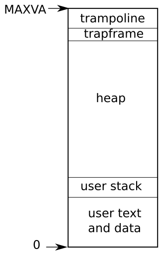
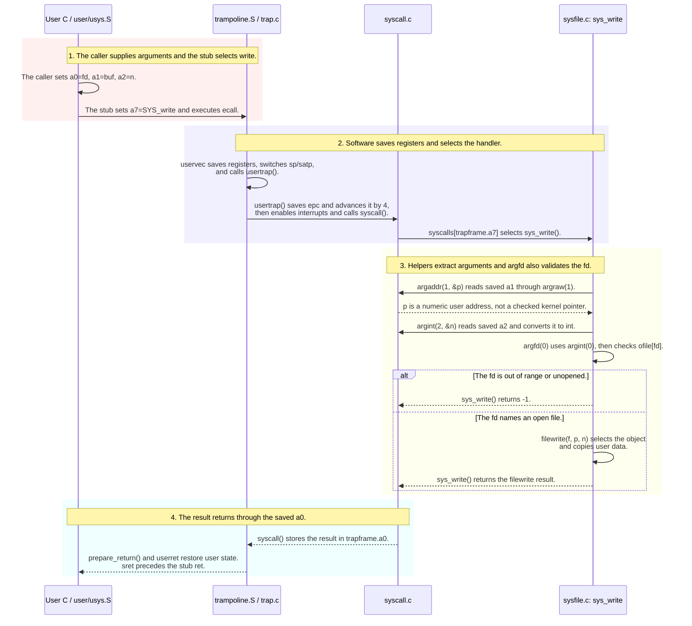
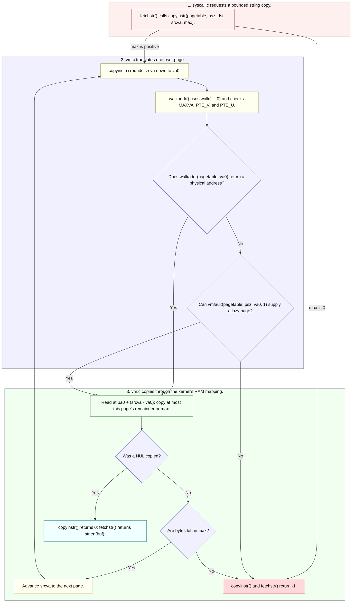
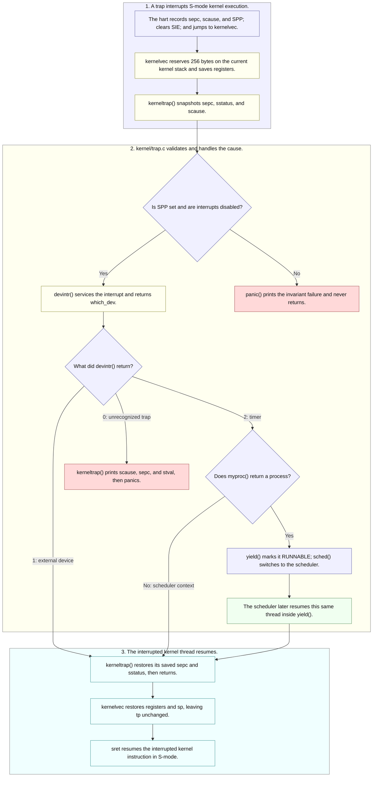
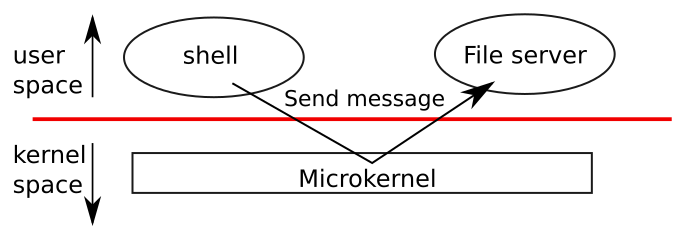
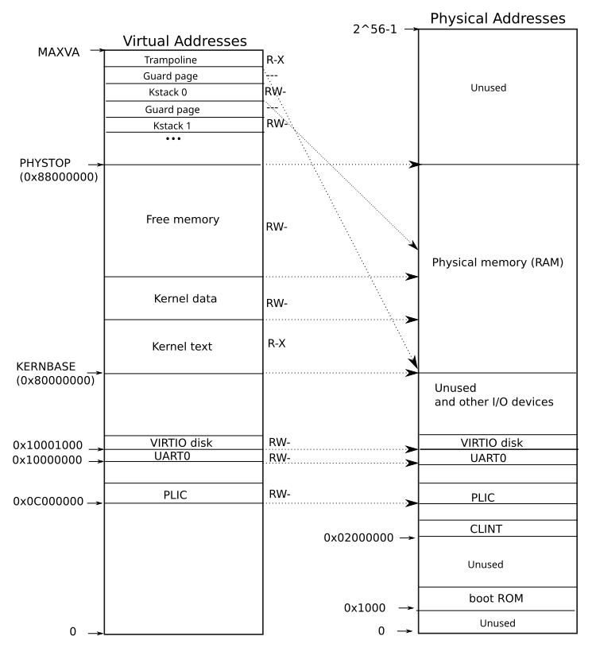
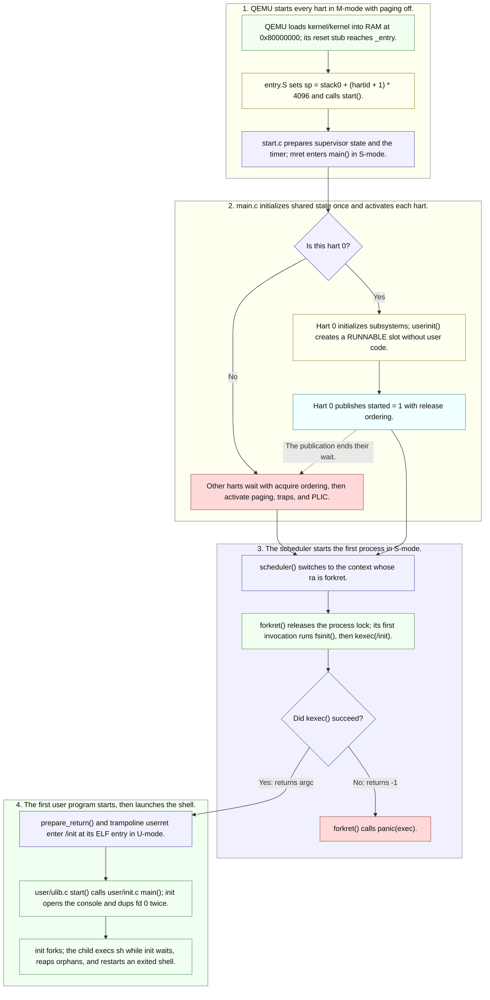

# OS Design in xv6

---

[toc]

---

**How does xv6 isolate programs it must assume are malicious?** This companion to Lecture 3, [_OS design_](../lectures/l-os.txt), follows this tree's code, measured addresses, and two practice programs that attack the boundary and record what refuses them.

## xv6 isolation, system calls, and boot at a glance

- **Isolation has two defences:** hardware blocks forbidden instructions and memory accesses; kernel code checks system-call numbers and user-memory copies.
- **Mapped does not mean user-accessible:** the trampoline and trapframe appear in every user page table, but their mappings lack `PTE_U`.
- **Extracting an address does not validate it:** `argaddr()` retrieves a number; the copy helpers translate and check user memory when it is accessed.
- **The first process starts through the return path:** `userinit()` creates its slot, `forkret()` loads `/init`, and the trap-return machinery enters U-mode.
- **Failures expose different limits:** a full process table makes `fork()` return `-1`; a rejected `exec()` leaves the old image intact. xv6 has no per-user process limit.

### Concept ownership: canonical explanations

Use this ownership map to find the explanation you need, following the [book notes rule](book/README.md):

| Explanation                                                   | Owning note                                                                                                                                                   |
| ------------------------------------------------------------- | ------------------------------------------------------------------------------------------------------------------------------------------------------------- |
| **Portable user/kernel mode, traps, and system-call numbers** | [The Process Abstraction](../../operating-system/The_Process_Abstraction.md#user-mode-vs-kernel-mode).                                                        |
| **Stub-to-`sys_*` dispatch**                                  | [05-syscall-reference.md](05-syscall-reference.md#system-call-path-declaration-stub-dispatch-implementation).                                                 |
| **`ecall` and `a7`**                                          | [06-build-artifacts.md](06-build-artifacts.md#why-the-system-call-number-goes-in-a7).                                                                         |
| **Argument extraction and safe user-memory copies**           | [System-call arguments and user memory](#system-call-arguments-and-user-memory), on loan to ch04.                                                             |
| **Traps while already in the kernel**                         | [Traps from kernel space](#kernel-space-traps-dispatch-preemption-and-return), on loan to ch04.                                                               |
| **The user trap path**                                        | [Lecture 1’s step-by-step flow](12-os-overview-in-xv6.md#what-a-system-call-does-step-by-step) and [ch04](book/ch04-traps-and-system-calls.md), when written. |
| **Lecture 3's additions in this tree**                        | This note: where the boundary is enforced, how the first process crosses it, and how `fork` and `exec` handle hostile input.                                  |

> [!IMPORTANT]
> **Status: draft study notes.** Lecture 3 is not yet marked studied in [STUDY-PROGRESS.md](../STUDY-PROGRESS.md#lectures), and Homework 3 is unanswered. Measurements below are from this tree's `LAB=util` build on 2026-10-28.

## Lecture 3 topics and practice programs

| Lecture topic                            | Generic concept (read when needed)                                                                                                                                                                                | xv6-specific, in this note                                                                 | Practice                                |
| ---------------------------------------- | ----------------------------------------------------------------------------------------------------------------------------------------------------------------------------------------------------------------- | ------------------------------------------------------------------------------------------ | --------------------------------------- |
| **Isolation as the design goal**         | [Design Goals](../../operating-system/Introduction_to_Operating_Systems.md#5-design-goals-25)                                                                                                                     | [Where the boundary is enforced](#program-isolation-hardware-faults-and-kernel-checks)     | [`user/isolate.c`](../user/isolate.c)   |
| **Threat model, TCB**                    | — (held here on loan)                                                                                                                                                                                             | [Kernel organization and trust](#kernel-organization-threat-model-and-trusted-code)        | —                                       |
| **User/supervisor mode**                 | [User Mode vs. Kernel Mode](../../operating-system/The_Process_Abstraction.md#user-mode-vs-kernel-mode)                                                                                                           | [Where the boundary is enforced](#program-isolation-hardware-faults-and-kernel-checks)     | [`isolate csr`](../user/isolate.c)      |
| **Virtual memory as isolation**          | [Address Spaces and Translation](../../operating-system/Address_Spaces_And_Translation.md)                                                                                                                        | [Where the boundary is enforced](#program-isolation-hardware-faults-and-kernel-checks)     | [`isolate kload`](../user/isolate.c)    |
| **`ecall` and system-call numbers**      | [Trap / Return-from-trap](../../operating-system/The_Process_Abstraction.md#trap--return-from-trap), [05-syscall-reference.md](05-syscall-reference.md#system-call-path-declaration-stub-dispatch-implementation) | [A system call is a number](#system-call-dispatch-numbers-handlers-and-invalid-requests)   | [`isolate badsys`](../user/isolate.c)   |
| **Monolithic kernel versus microkernel** | — (held here on loan; Lecture 12 reads about microkernels)                                                                                                                                                        | [Kernel organization and trust](#kernel-organization-threat-model-and-trusted-code)        | —                                       |
| **The board, QEMU, and emulation**       | —                                                                                                                                                                                                                 | [The machine xv6 runs on](#qemu-machine-configuration-and-physical-memory-map)             | —                                       |
| **Kernel source and the build**          | [08-makefile-tour.md](08-makefile-tour.md), [06-build-artifacts.md](06-build-artifacts.md)                                                                                                                        | [The machine xv6 runs on](#qemu-machine-configuration-and-physical-memory-map)             | —                                       |
| **Boot to `/init`**                      | [`init` / PID 1](../../operating-system/The_Process_Abstraction.md#init--pid-1)                                                                                                                                   | [From boot to the first process](#kernel-boot-from-entry-to-the-first-user-process)        | —                                       |
| **`fork`: `allocproc`, `uvmcopy`**       | [`fork()`](../../operating-system/The_Process_Abstraction.md#71-fork--create-a-near-copy-51)                                                                                                                      | [`fork`, `kfork`, and a full table](#fork-and-kfork-process-creation-and-table-exhaustion) | [`user/forkfill.c`](../user/forkfill.c) |
| **`exec`: ELF, checks, stack**           | [`exec()`](../../operating-system/The_Process_Abstraction.md#73-exec--become-a-different-program-53), [What ELF is](06-build-artifacts.md#elf-headers-segments-and-load-addresses)                                | [`exec` treats the file as hostile](#exec-hostile-elf-checks-and-failure-cleanup)          | [`isolate kcopy`](../user/isolate.c)    |

## Program isolation: hardware faults and kernel checks

The lecture names two defences: hardware controls on user instructions, and a careful system-call interface. [`isolate`](../user/isolate.c) tries one attack per mode, and each is refused at a different layer:

| Attempt (`isolate <mode>`)                         | Layer that refuses it                                               | Observed result                                            |
| -------------------------------------------------- | ------------------------------------------------------------------- | ---------------------------------------------------------- |
| **`csr`**: run `r_sstatus()` from `kernel/riscv.h` | CPU privilege check                                                 | `scause 0x2` (illegal instruction); `usertrap()` kills it  |
| **`kload`**: load a byte from `TRAMPOLINE`         | MMU: the page is mapped but lacks `PTE_U`                           | `scause 0xd` (load page fault); `usertrap()` kills it      |
| **`badsys`**: `ecall` with `a7` = 99               | `syscall()` bounds-checks `a7` against `syscalls[]`                 | Kernel prints `unknown sys call 99`; the call returns `-1` |
| **`kcopy`**: `read()` from a pipe into `TRAPFRAME` | `copyout()` calls `walkaddr()`, which rejects a PTE without `PTE_U` | `read()` returns `-1`; the two pipe bytes are not consumed |

The results divide into the lecture's two defences:

- **Hardware faults (`csr`, `kload`):** hardware stops the instruction. `usertrap()` in `kernel/trap.c` has no applicable handler for these cases and calls `setkilled()`.
- **Kernel checks (`badsys`, `kcopy`):** these attempts **never** fault. Kernel code detects the invalid request and returns an ordinary error.

> [!NOTE]
> `TRAMPOLINE` (`0x3FFFFFF000`) and `TRAPFRAME` (`0x3FFFFFE000`) are **mapped in every user page table**. `proc_pagetable()` in `kernel/proc.c` maps them with `PTE_R | PTE_X` and `PTE_R | PTE_W` but never `PTE_U`, so isolation here is a permission bit, not a missing mapping.



_“Layout of a process's virtual address space” — [book figure](book/fig/README.md), `first.tex` `fig:as`; also captioned in [ch02](book/ch02-operating-system-organization.md#figures)._

Read the bands **bottom to top**, starting at address 0:

1. User text and data.
2. User stack.
3. A large heap region.
4. Trapframe, then trampoline: two thin bands immediately below `MAXVA`.

The last two bands are the targets of `isolate kcopy` and `isolate kload`, respectively. They are inside the user's own virtual address space, but neither mapping carries `PTE_U`: **mapped does not mean user-accessible**. The attack table above records the resulting refusals.

Why `kcopy` matters:

- **Protected state:** the trapframe holds this process's saved registers, including `epc`, the user instruction address that the kernel will resume. Without `walkaddr()`'s `PTE_U` test in `kernel/vm.c`, a `read()` into that page could corrupt the saved return state.
- **Failure preserves the pipe bytes:** `piperead()` in `kernel/pipe.c` returns `-1` before advancing `nread`. A following `read()` into a real buffer therefore still gets `"hi"`.

## System-call dispatch: numbers, handlers, and invalid requests

Lecture 3's observation: a user call to `fork()` reaches the kernel through a **number**, rather than an ordinary function call into kernel code.

1. The stub in `user/usys.S` executes `li a7, SYS_fork`, then `ecall`.
2. `syscall()` in `kernel/syscall.c` uses saved `a7` to index `syscalls[]`.

The full mechanics belong to [05-syscall-reference.md](05-syscall-reference.md#system-call-path-declaration-stub-dispatch-implementation). The numbers below come from this tree's `kernel/syscall.h`:

| Call       | Number | Kernel entry | Does the work                                    |
| ---------- | ------ | ------------ | ------------------------------------------------ |
| **`fork`** | 1      | `sys_fork()` | `kfork()` in `kernel/proc.c`                     |
| **`exec`** | 7      | `sys_exec()` | `kexec()` in `kernel/exec.c`                     |
| **`sync`** | 22     | `sys_sync()` | the highest number in the table; 99 has no entry |

| Dispatch condition                                  | Result                                                                        |
| --------------------------------------------------- | ----------------------------------------------------------------------------- |
| `num > 0 && num < NELEM(syscalls) && syscalls[num]` | Call the registered handler.                                                  |
| **Any other value**                                 | Run `printk("%d %s: unknown sys call %d\n", ...)` and set saved `a0` to `-1`. |

The second row produces `5 isolate: unknown sys call 99` in `isolate badsys`. Each generated `usys.S` stub hard-codes its own `a7`, so `rawsyscall()` uses a hand-written `ecall` to try an unused number.

> [!WARNING]
> The lecture's naming convention, `k<syscallname>()`, holds only for process calls. This tree has `kfork()`, `kexec()`, `kexit()`, `kwait()`, and `kkill()`; file calls go from `sys_read()` to `fileread()`, not to a `kread()`. The full rename table is in [the concordance appendix](book/00-ostep-concordance.md#system-call-naming).

The lecture also suggests editing `syscall()` to print a trace of every system call `init` and `sh` make. That edit is the syscall lab's `trace` exercise, so it is deliberately not done here.

## System-call arguments and user memory

| Flow                                          | Canonical explanation                                                                                                                                                                       |
| --------------------------------------------- | ------------------------------------------------------------------------------------------------------------------------------------------------------------------------------------------- |
| **Entry, dispatch, and return to user space** | [Lecture 1’s symbol-by-symbol flow](12-os-overview-in-xv6.md#what-a-system-call-does-step-by-step); [`a7` and stub rationale](06-build-artifacts.md#why-the-system-call-number-goes-in-a7). |
| **Extract arguments and validate an fd**      | The sequence below, verified against [`kernel/syscall.c`](../kernel/syscall.c) and [`kernel/sysfile.c`](../kernel/sysfile.c).                                                               |
| **Follow a user pointer safely**              | [The string-copy flow](#following-a-user-string-with-copyinstr), verified against [`kernel/vm.c`](../kernel/vm.c).                                                                          |

> [!NOTE]
> **On loan to [Chapter 4](book/ch04-traps-and-system-calls.md).** This section owns the current argument/copy walkthrough; move it into that chapter when written and leave section links here. Book §4.4 describes the mechanism; the signatures and lazy-page branches below come from this tree.

**Diagram legend for this page:** phase names, actions, and branch labels carry the same meaning without color.

| Color                  | Meaning                |
| ---------------------- | ---------------------- |
| **Pink** (`#fff0f0`)   | Request                |
| **Blue** (`#f0f0ff`)   | Decision or routing    |
| **Green** (`#f0fff0`)  | Data movement          |
| **Yellow** (`#fffff0`) | Processing             |
| **Cyan** (`#f0ffff`)   | Stored state or commit |
| **Red** (`#ffd9d9`)    | Stall or failure       |

M-mode, S-mode, and U-mode mean machine, supervisor, and user mode; see the [architecture glossary](04-terminology.md#risc-v-architecture).



### Argument helpers: extraction versus validation

**An address argument is still an unchecked number after extraction.** The helpers in [`kernel/syscall.c`](../kernel/syscall.c) read the saved registers; `argfd()` adds descriptor validation in [`kernel/sysfile.c`](../kernel/sysfile.c).

| Helper      | Reads or converts                                     | Validation and result                                           |
| ----------- | ----------------------------------------------------- | --------------------------------------------------------------- |
| `argraw(n)` | Saved `a0` through `a5`, for indices `0` through `5`. | Unsupported index: kernel programming error, `panic("argraw")`. |
| `argint()`  | Narrows the saved value to a 32-bit `int`.            | Returns `void` here.                                            |
| `argaddr()` | Keeps a 64-bit address.                               | Does not dereference or validate it; returns `void` here.       |
| `argfd()`   | Calls `argint()` to extract the descriptor.           | Rejects `fd < 0`, `fd >= NOFILE`, or an empty `p->ofile[fd]`.   |

`argfd()` is local to `kernel/sysfile.c`. It returns `-1` on failure or `0` after filling any requested descriptor/file output arguments.

**Why the registers are available:** `uservec` saves them in memory; the hardware trap does not. It first saves user `a0` via `sscratch`, then uses `a0` as its trapframe pointer.

### When `write` actually copies the buffer

**Extracting `buf` does not copy its contents.** [`filewrite()`](../kernel/file.c) routes the write according to its destination:

| Destination        | Copy path                                                                   |
| ------------------ | --------------------------------------------------------------------------- |
| **Console device** | [`kernel/console.c`](../kernel/console.c) → `either_copyin()`.              |
| **Inode**          | [`kernel/fs.c`](../kernel/fs.c) → `either_copyin()`.                        |
| **Pipe**           | [`pipewrite()` in `kernel/pipe.c`](../kernel/pipe.c) → `copyin()` directly. |

With a user source, `either_copyin()` in [`kernel/proc.c`](../kernel/proc.c) selects `copyin()`. These helpers translate the user address before reading its contents; an ordinary dereference of `buf` would use the kernel's current page table.

### Following a user string with `copyinstr`

| Caller in `sys_exec()`  | Path through `kernel/syscall.c`                                                                                             | Destination                              |
| ----------------------- | --------------------------------------------------------------------------------------------------------------------------- | ---------------------------------------- |
| **Executable pathname** | `argstr(0, path, MAXPATH)` → `argaddr(0)` → `fetchstr()` → `copyinstr()`                                                    | Kernel `path[MAXPATH]`.                  |
| **An argument string**  | `fetchaddr()` first copies one pointer from user `argv` using `copyin()`; `fetchstr(uarg, argv[i], PGSIZE)` → `copyinstr()` | A kernel page allocated for that string. |



#### User address translation: checks and kernel access

**The kernel walks the process's page table in software.** The `pagetable` argument is that data structure; the active `satp` still selects the kernel's address space.

| Check                                                           | Performed by                                                                       |
| --------------------------------------------------------------- | ---------------------------------------------------------------------------------- |
| **Address below `MAXVA`; entry present and valid; `PTE_U` set** | `walkaddr()` in [`kernel/vm.c`](../kernel/vm.c).                                   |
| **Original eight-byte pointer slot inside `p->sz`**             | `fetchaddr()`, with separate start/end checks to catch overflow.                   |
| **Writable destination (`PTE_W`)**                              | `copyout()`, after translation or lazy allocation; it also rejects `va0 >= MAXVA`. |
| **Process-size limit or `PTE_R` permission**                    | Neither is checked by `walkaddr()` itself.                                         |

`kvmmake()` in [`kernel/vm.c`](../kernel/vm.c) establishes the kernel's identity mapping of RAM. That makes **the translated physical address `pa0` plus offset** reachable by ordinary kernel loads. Loading from the original user virtual address would use the wrong address space.

#### `vmfault()`: lazy allocation during user-memory copies

**A missing user page may be allocated; a supervisor-only mapping cannot be converted into user memory.** This revision adds `psz` to the copy helpers and a lazy-allocation branch absent from the supplied §4.4 outline.

| Failed lookup in            | Retry             |
| --------------------------- | ----------------- |
| `copyinstr()` or `copyin()` | `vmfault(..., 1)` |
| `copyout()`                 | `vmfault(..., 0)` |

`vmfault()` follows this order:

1. Reject a page address at or beyond `psz`, or a page that is already mapped.
2. Allocate a zeroed page and map it `PTE_R | PTE_W | PTE_U`.
3. Return the physical address on success, or `0` on failure.

The first check prevents an existing supervisor-only trapframe mapping from becoming user memory. The helper's `read` parameter is currently unused.

#### User-memory copy contracts and partial failures

| Helper in `kernel/vm.c` | Direction                    | Successful stopping rule                                          | Result                                                                          |
| ----------------------- | ---------------------------- | ----------------------------------------------------------------- | ------------------------------------------------------------------------------- |
| `copyinstr()`           | User → kernel, across pages. | Copy a NUL before exhausting `max`; `max` includes space for NUL. | `0` after NUL; `-1` on failed translation/allocation or exhaustion without NUL. |
| `copyin()`              | User → kernel, across pages. | Copy exactly `len` bytes.                                         | `0` on completion; `-1` on failed lookup/lazy allocation.                       |
| `copyout()`             | Kernel → user, across pages. | Copy exactly `len` bytes to writable pages.                       | `0` on completion; `-1` on failure.                                             |

> [!WARNING]
> **A failed copy can leave a copied prefix.** Earlier pages or bytes are not rolled back when a later part fails.

**`sys_exec()` cleanup:** a failed copy returns an error and frees any allocated argument pages. It calls `kexec()` only after argument preparation succeeds; the later ELF checks are [below](#exec-hostile-elf-checks-and-failure-cleanup).

## Kernel-space traps: dispatch, preemption, and return

> [!NOTE]
> **On loan to [Chapter 4](book/ch04-traps-and-system-calls.md).** This is the canonical current walkthrough of book §4.5, checked against [`kernel/kernelvec.S`](../kernel/kernelvec.S), [`kernel/trap.c`](../kernel/trap.c), and [`yield()` / `sched()`](../kernel/proc.c). User-mode trap entry remains in [Lecture 1’s flow](12-os-overview-in-xv6.md#what-a-system-call-does-step-by-step).



### `kernelvec`: entry state and saved registers

**No trampoline switch is needed:** `satp` already selects the kernel page table, and `sp` names a valid kernel stack, either a process's stack or the scheduler's boot stack. Hardware switches neither one.

| Register or group                | What `kernelvec` preserves                                           | Why it works                                             |
| -------------------------------- | -------------------------------------------------------------------- | -------------------------------------------------------- |
| `ra`, `gp`, `t0`–`t6`, `a0`–`a7` | Saves them in a 256-byte stack frame.                                | They must survive the C trap handler.                    |
| `sp`                             | Reserves 256 bytes, then adds 256 to restore it; no saved `sp` slot. | The stack frame stays on the interrupted thread's stack. |
| `tp`                             | Neither saved nor restored.                                          | Keeps the current hart id after possible CPU migration.  |
| `s0`–`s11`                       | Preserved by the C calling convention.                               | The ABI makes these registers callee-saved.              |

This frame differs from the 31-register user trapframe. Compare the [saved-state primer](../../assembly-language/docs/riscv/07-memory-and-saved-state.md#saved-state-stack-frame-context-and-trapframe).

### Timer preemption: preserving the interrupted thread's stack

**Running another thread does not replace this thread's trap frame.** A timer interrupt can suspend the original thread along this path:

1. `yield()` switches through `sched()` to the scheduler; the `kerneltrap()` and `kernelvec` frame remain on the original thread's stack.
2. The scheduler may run other threads, whose trap returns use their own stacks.
3. When selected again, the original thread resumes through `sched()` and `yield()`, releases `p->lock`, and returns along its own trap path.

The detailed context-switch and lock-handoff diagrams remain canonical in [Chapter 8](book/ch08-scheduling.md#figures).

### `kerneltrap()`: which interrupts return and which traps panic

**`kerneltrap()` validates its entry state before dispatching.** Either violated invariant causes a panic:

| Invariant                            | Required value     |
| ------------------------------------ | ------------------ |
| **Trap came from supervisor mode**   | `sstatus.SPP != 0` |
| **Interrupts are disabled on entry** | `intr_get() == 0`  |

After those checks, `devintr()` determines the path:

| `devintr()` result | Cause and work                                                           | What happens next                                                       |
| ------------------ | ------------------------------------------------------------------------ | ----------------------------------------------------------------------- |
| `1`                | Supervisor external interrupt through the PLIC; services UART or virtio. | Returns along the interrupted trap path.                                |
| `2`                | Supervisor timer interrupt; runs `clockintr()`.                          | Calls `yield()` if `myproc() != 0`, then eventually returns.            |
| `0`                | Unrecognized cause, including kernel exceptions.                         | Prints `scause`, `sepc`, and `stval`, then calls `panic("kerneltrap")`. |

For PLIC interrupts, the handler also reports an unexpected nonzero IRQ and completes a nonzero claim. The [panic reference](06-build-artifacts.md#panic-invariant-failures-output-and-hart-shutdown) owns panic output and halt behavior.

**Kernel exceptions have no recovery branch here.** Unlike `usertrap()`, this handler does not resolve lazy page faults or kill just one process.

### Trap CSR restoration after timer preemption

**Timer preemption condition:** `which_dev == 2 && myproc() != 0`. This revision has no separate `p->state == RUNNING` test.

Other execution while this thread is suspended can overwrite the hart's trap CSRs. Restoring the snapshot before returning to `kernelvec` lets `sret` resume the interrupted kernel code with its previous interrupt state:

| CSR       | Treatment                                                             |
| --------- | --------------------------------------------------------------------- |
| `sepc`    | Restored to the interrupted instruction address.                      |
| `sstatus` | Restored to the saved status, including the previous interrupt state. |
| `scause`  | Used for diagnosis and dispatch; not restored.                        |

> [!IMPORTANT]
> **Switch `stvec` before enabling interrupts.** Device interrupts must use the trap vector appropriate to the current execution mode.

**User → kernel ordering:**

1. Hardware clears `sstatus.SIE` before entering `uservec`.
2. `usertrap()` writes `stvec = kernelvec`.
3. It saves `sepc` and inspects `scause` before its system-call branch calls `intr_on()`.

**Kernel → user ordering:** `prepare_return()` disables interrupts before pointing `stvec` back at `uservec`. During boot, `trapinithart()` installs `kernelvec`.

The first ordering protects the interval when S-mode has begun but `stvec` still names `uservec`. **Scope of protection:** `SIE` masks device interrupts, not synchronous exceptions.

## Kernel organization: threat model and trusted code

> [!NOTE]
> **Concepts on loan:** the OSTEP notes cover user/kernel mode but do not yet own the threat model or kernel organization. These two concepts stay here until an owning note exists; Lecture 12 reads about microkernels.

| Assumption      | Lecture 3's position                                                 | Consequence in this tree                                                                                     |
| --------------- | -------------------------------------------------------------------- | ------------------------------------------------------------------------------------------------------------ |
| **User code**   | Actively malicious: tries to break isolation and trick system calls. | Every user pointer goes through `copyin()`/`copyout()`; `a7` is bounds-checked; `kexec()` validates the ELF. |
| **Kernel code** | Trusted, written by competent people, but still buggy.               | The whole of `kernel/` is the trusted computing base (TCB); any bug there may be an exploit.                 |

| Organization    | What runs in supervisor mode                                 | Trade-off the lecture names                                                                                                |
| --------------- | ------------------------------------------------------------ | -------------------------------------------------------------------------------------------------------------------------- |
| **Monolithic**  | All system calls, the file system, and drivers: one program. | Subsystems cooperate easily (one cache for file system and VM), but interactions are complex and drivers are not isolated. |
| **Microkernel** | A small kernel; services run as user processes.              | Less code in the TCB limits damage from bugs; services talk by message instead of by function call.                        |



_“A microkernel with a file-system server” — [book figure](book/fig/README.md), `first.tex` `fig:mkernel`._

| Figure feature                                   | How to read it                                                                                    |
| ------------------------------------------------ | ------------------------------------------------------------------------------------------------- |
| **`shell` and `File server` above the red line** | Both are user processes. The file system runs outside the privileged kernel.                      |
| **Thin `Microkernel` box below the line**        | The kernel mediates communication between those processes.                                        |
| **Connection labelled “Send message”**           | The connection dips through the microkernel instead of calling the file system inside the kernel. |

**Schematic `read` exchange: two messages.** The microkernel row above corresponds to:

1. Shell → kernel → file server: request.
2. File server → kernel → shell: reply.

The figure does not specify every message a real file-system protocol might require. Compare [Lecture 1's figure](12-os-overview-in-xv6.md#what-a-system-call-does-step-by-step), where the request is a single system-call arrow into one large kernel.

**The file server still matters to security.** Moving it to user space removes it from the privileged kernel's TCB and limits its authority, but file-system integrity can still depend on trusting that service.

- **xv6's choice:** every file in `kernel/` links into one `kernel/kernel` binary. It is monolithic, and its user-facing kernel interface is the system-call interface.
- **The lecture's alternative:** a strongly typed language, such as Singularity's, can provide process isolation without hardware modes. xv6 does not take that approach.

## QEMU machine configuration and physical memory map

The lecture models the board as a 4-core SiFive HiFive Unleashed with 128 MB of RAM, a UART, and disk. This tree's `QEMUOPTS` in the [Makefile](../Makefile) is the authority for what QEMU actually emulates:

| Property          | Lecture 3                                  | This tree                                                                           |
| ----------------- | ------------------------------------------ | ----------------------------------------------------------------------------------- |
| **Machine**       | `qemu -machine virt`                       | `-machine virt -bios none`                                                          |
| **Cores**         | 4                                          | `CPUS := 3` by default; 1 under `LAB=fs`, 4 under `LAB=lock`                        |
| **RAM**           | 128 MB                                     | `-m 128M`                                                                           |
| **Kernel entry**  | the kernel's first instruction             | `_entry` at `0x80000000`, the ELF entry point (`readelf -h kernel/kernel`)          |
| **Disk**          | virtio instead of the board's storage      | `fs.img`, 2,048,000 bytes, attached as a virtio block device                        |
| **Kernel binary** | `ls -l kernel/kernel`                      | 276,264 bytes                                                                       |
| **Kernel source** | small enough to understand by semester end | 23 `.c` files, 4 `.S` files, 7,041 lines including headers (`wc -l kernel/*.[chS]`) |

The lecture's emulation sketch is a useful model for each emulated hart:

1. Read the next instruction.
2. Decode it.
3. Execute its effect on state such as a `uint64 reg[32]` register array.

**`-bios none` omits separate firmware; QEMU's reset stub still runs.** The stub transfers to `_entry` in machine mode.

`_entry` is the kernel's first instruction; GDB attached at reset may see the stub first. Why the kernel is linked there is in [06-build-artifacts.md](06-build-artifacts.md#why-the-kernel-is-linked-at-0x80000000).



_“On the left, xv6's kernel virtual address space; on the right, the RISC-V physical address space that xv6 expects to see.” — [book figure](book/fig/README.md), `mem.tex` `fig:xv6_layout`; also captioned in [ch03](book/ch03-page-tables.md#figures)._

Read the devices and RAM **bottom to top**:

| Region                                      | Address / placement                                                       | Connection to this build                                                                                                  |
| ------------------------------------------- | ------------------------------------------------------------------------- | ------------------------------------------------------------------------------------------------------------------------- |
| **PLIC**                                    | `0x0C000000`                                                              | QEMU `virt` interrupt controller.                                                                                         |
| **UART0**                                   | `0x10000000`                                                              | Console device registers.                                                                                                 |
| **Virtio disk**                             | `0x10001000`                                                              | `fs.img` is reached through device registers, not as RAM contents.                                                        |
| **RAM: kernel text, data, and free memory** | `KERNBASE` (`0x80000000`) through the exclusive `PHYSTOP` (`0x88000000`). | `_entry` begins the kernel text band. `-m 128M` matches `PHYSTOP = KERNBASE + 128 * 1024 * 1024` in `kernel/memlayout.h`. |
| **High kernel virtual mappings**            | Trampoline and kernel stacks at the top of the virtual column.            | Unmapped guard pages separate kernel stacks.                                                                              |

The two columns distinguish virtual placement from the physical machine map; high virtual mappings do not add physical RAM above `PHYSTOP`.

## Kernel boot: from entry to the first user process

> [!TIP]
> **Assembly new to you?** Start with the [assembly course](../../assembly-language/README.md), then its [readiness checks](../../assembly-language/docs/riscv/08-readiness-and-next-steps.md). This section is an overview, not a line-by-line tutorial. The [boot-study proposal](boot/README.md) specifies the missing lessons and source coverage.

**Boot path:** `_entry` → kernel `start()` → `main()` → `userinit()` → `scheduler()` → `forkret()` → `/init`. Lecture 3 starts its trace at `main()`; this tree's path begins two steps earlier, in machine mode.

M-mode means machine mode, S-mode supervisor mode, and U-mode user mode. A **hart** is a hardware thread with its own register state (see the [glossary](04-terminology.md)).



**Sources behind the diagram:**

| Stage                                                 | Source                                                                                                 |
| ----------------------------------------------------- | ------------------------------------------------------------------------------------------------------ |
| **Machine-mode entry and supervisor setup**           | [`kernel/entry.S`](../kernel/entry.S), [`kernel/start.c`](../kernel/start.c).                          |
| **Shared initialization**                             | [`kernel/main.c`](../kernel/main.c).                                                                   |
| **Process creation, scheduling, and first execution** | [`userinit()` / `allocproc()` / `forkret()`](../kernel/proc.c), [`kernel/swtch.S`](../kernel/swtch.S). |
| **Entry to user mode**                                | [`kernel/trampoline.S`](../kernel/trampoline.S).                                                       |
| **User entry and shell launch**                       | [`user/ulib.c`](../user/ulib.c), [`user/init.c`](../user/init.c).                                      |

**Physical starting point:** RAM starts at `0x80000000` on QEMU's `virt` board. Low physical addresses contain devices and the reset ROM; `-bios none` omits separate firmware but retains QEMU's reset stub. The [memory-map reference](06-build-artifacts.md#why-the-kernel-is-linked-at-0x80000000) owns the exact regions.

### Boot stacks and the M-mode to S-mode transition

**Each hart gets a downward-growing 4096-byte stack slice.** In `stack0[4096 * NCPU]`, `stack0 + (hartid + 1) * 4096` selects that slice's exclusive upper bound before C runs.

Kernel `start()` prepares the transition to S-mode:

| Setup                     | Value or work                                                                      |
| ------------------------- | ---------------------------------------------------------------------------------- |
| **Target privilege**      | `mstatus.MPP = S`                                                                  |
| **Next instruction**      | `mepc = main`                                                                      |
| **Paging**                | `satp = 0`                                                                         |
| **Trap delegation**       | `medeleg = mideleg = 0xffff`                                                       |
| **Supervisor facilities** | Supervisor interrupts, PMP access, hardware A/D updates, and the supervisor timer. |
| **Hart identity**         | `tp = mhartid`                                                                     |
| **Transfer**              | `mret` enters `main()` in S-mode.                                                  |

The complete register-write table remains in [Chapter 2's start() walkthrough](book/ch02-operating-system-organization.md#start-everything-machine-mode-has-to-do-first). **Timer version:** this tree uses `stimecmp`, rather than the older machine-mode clock-interrupt path.

### Multicore boot: shared initialization and per-hart activation

**Hart 0 initializes shared state; every hart can schedule the first process.** The release/acquire publication prevents other harts from using unfinished shared state.

| Actor                 | Work before scheduling                                                                                                          |
| --------------------- | ------------------------------------------------------------------------------------------------------------------------------- |
| **Hart 0**            | Initializes console/printing, allocator, and kernel page table; activates that page table.                                      |
| **Hart 0, continued** | Initializes process table, traps, PLIC, buffer/inode/file tables, and virtio disk; calls `userinit()` and publishes completion. |
| **Other harts**       | Wait for the release/acquire publication; activate the existing kernel page table, trap vector, and their PLIC enables.         |
| **Every hart**        | Enters `scheduler()`; any hart may schedule the first process.                                                                  |

**The first process slot contains no user program yet:**

- `allocproc()` gives it `context.ra = forkret`.
- `userinit()` sets its working directory to `/` and marks it `RUNNABLE`, without loading user code.

### `forkret()`: loading `/init` and entering user mode

**The first entry into U-mode uses the trap-return machinery**, even though this process has not made an earlier user system call:

1. The first `forkret()` runs `fsinit(ROOTDEV)` in process context, because initialization may sleep.
2. It calls `kexec("/init", {"/init", 0})`, places the result (`argc`) in `p->trapframe->a0`, and panics if the result is `-1`.
3. It calls `prepare_return()` and jumps to trampoline `userret` with the user `satp`.
4. The ELF entry, `start()` in `user/ulib.c`, calls `main(argc, argv)` and exits with its return value.

| Name                 | Role                                    |
| -------------------- | --------------------------------------- |
| **Kernel `start()`** | Machine-mode setup in `kernel/start.c`. |
| **User `start()`**   | `/init`'s ELF entry in `user/ulib.c`.   |

### Measured kernel symbol addresses in the boot path

| Symbol      | Address (`nm -n kernel/kernel`) | Role in the path                                  |
| ----------- | ------------------------------- | ------------------------------------------------- |
| `_entry`    | `0x80000000`                    | first kernel instruction after QEMU’s reset stub  |
| `main`      | `0x800002e8`                    | `mepc` target of `start()`'s `mret`               |
| `forkret`   | `0x80000dcc`                    | `allocproc()` stores it in `p->context.ra`        |
| `userinit`  | `0x8000105a`                    | creates the only process not made by `fork`       |
| `scheduler` | `0x80001206`                    | every hart ends `main()` here                     |
| `start`     | `0x800050a8`                    | the last machine-mode C function                  |
| `uservec`   | `0x80006000`                    | the trampoline page, mapped again at `TRAMPOLINE` |

### `/init`: console descriptors and shell lifecycle

**`/init` prepares fds 0, 1, and 2 before starting the shell.** The order is:

1. Open `console`. If that fails, call `mknod("console", CONSOLE, 0)` and retry the open: a fresh `fs.img` may lack the device file.
2. Use the opened descriptor as fd 0, then call `dup(0)` twice for fds 1 and 2.
3. Let later processes inherit the three descriptors through `fork`.

| Process             | Shell lifecycle                                                                       |
| ------------------- | ------------------------------------------------------------------------------------- |
| **Child**           | Calls `exec("sh", argv)`.                                                             |
| **Parent (`init`)** | Calls `wait(0)`, reaps orphan exits, and restarts the shell when its pid is returned. |

**Failure behavior:** `fork` failure, a failed child `exec`, or a negative `wait` prints a diagnostic and exits that caller with status `1`.

## `fork()` and `kfork()`: process creation and table exhaustion

**`fork()` creates a child; exhausting the shared table returns `-1` while the kernel keeps running.** `kfork()` in `kernel/proc.c` follows the lecture's order:

1. `allocproc()` scans `proc[NPROC]` for an `UNUSED` slot, assigns a pid, allocates a trapframe page and an empty page table, and points `context.ra` at `forkret`. It returns `0` when no slot is free or `kalloc()` fails.
2. `uvmcopy()` copies the parent's `p->sz` bytes of user memory into the child's page table.
3. `*(np->trapframe) = *(p->trapframe)` copies saved registers, then `np->trapframe->a0 = 0` makes `fork()` return `0` in the child.
4. `filedup()` shares every open file and `idup()` shares the working directory.
5. The child is marked `RUNNABLE`; the parent gets the child's pid.

The lecture's homework question, "what happens if out of proc's?", is answered by [`forkfill`](../user/forkfill.c):

```text
$ forkfill
forkfill: fork returned -1 after 61 children
forkfill: reaped 61 children
forkfill: fork works again
```

| Quantity                 | Value | Source                                                           |
| ------------------------ | ----- | ---------------------------------------------------------------- |
| **`NPROC`**              | 64    | `kernel/param.h`; 10 under `LAB_FS`                              |
| **Already in use**       | 3     | `init`, `sh`, and `forkfill` itself                              |
| **Children before `-1`** | 61    | measured, and the same on a second run once the first was reaped |

| Event                               | Result                                                                           |
| ----------------------------------- | -------------------------------------------------------------------------------- |
| **No process slot is available**    | `allocproc()` returns `0`, `kfork()` returns `-1`, and the kernel keeps running. |
| **A child exits but is not reaped** | It remains a `ZOMBIE` and still occupies its slot.                               |
| **The parent reaps that child**     | The parent's `wait()` reaches `freeproc()`, making the slot available again.     |

> [!WARNING]
> **One user can exhaust the process table for everyone.** xv6 has no per-user process limit: this is the lecture's resource-isolation problem.

## `exec()`: hostile ELF checks and failure cleanup

**`exec()` checks hostile input before replacing the current image.** The responsibilities are:

| Stage                                  | Checks and ownership                                                                                                                                         |
| -------------------------------------- | ------------------------------------------------------------------------------------------------------------------------------------------------------------ |
| **Copy arguments into kernel storage** | The [argument-copy walkthrough](#following-a-user-string-with-copyinstr) owns `sys_exec()`'s pathname, pointer-array, string-copy, and failure-cleanup flow. |
| **Limit argument count**               | `MAXARG` is 32, **including the terminating `0` slot**.                                                                                                      |
| **Validate the new image**             | Once inputs are in kernel storage, `kexec()` checks the ELF and argument stack as listed below.                                                              |

| Check in `kexec()`                   | It rejects                                                              |
| ------------------------------------ | ----------------------------------------------------------------------- |
| **`elf.magic != ELF_MAGIC`**         | a file that is not ELF at all                                           |
| **`ph.memsz < ph.filesz`**           | a segment claiming more file bytes than memory to hold them             |
| **`ph.vaddr + ph.memsz < ph.vaddr`** | a segment whose end wraps around the 64-bit address space               |
| **`ph.vaddr % PGSIZE != 0`**         | a segment that does not start on a page boundary                        |
| **`sp < stackbase`**                 | arguments that would overflow the `USERSTACK` pages into the guard page |

The wrap-around check addresses the lecture's “don't be tricked into overwriting kernel memory”: without it, a huge `memsz` could give `uvmalloc()` a range whose end is below its start.

> [!IMPORTANT]
> **Replace the old image only after success.** Each listed `kexec()` failure goes to `bad:`, frees any half-built page table, and returns `-1`. The old image stays intact because `p->pagetable` is replaced only after all checks pass.

The resulting stack and `argv` layout is drawn in [10-c-in-xv6.md](10-c-in-xv6.md#argv-and-the-calling-convention).

## Lecture 3 differences: CPU count and system-call conventions

| Lecture 3 says                       | This tree                                                                                                             |
| ------------------------------------ | --------------------------------------------------------------------------------------------------------------------- |
| **4 cores**                          | 3 emulated harts by default (`CPUS` in the Makefile).                                                                 |
| **`ecall <n>`**                      | `ecall` takes no operand; the number travels in `a7`, set by the preceding `li` in `user/usys.S`.                     |
| **`k<syscallname>()` in the kernel** | Only for process calls; see [A system call is a number](#system-call-dispatch-numbers-handlers-and-invalid-requests). |

## Homework 3: kernel-design questions and answer status

Homework 3, [_kernel design_](https://pdos.csail.mit.edu/6.1810/2026/homework/xv6-design.html), is **not answered yet**. Its reading list is in [STUDY-PROGRESS.md](../STUDY-PROGRESS.md#homework-and-assigned-reading). When an answer is drafted, record it here as a worked table, keeping a _where the first draft went wrong_ table as [10-c-in-xv6.md](10-c-in-xv6.md#struct-address-mistakes-widths-units-and-pointer-loads) does.

## Questions about page-table permissions and trap diagnostics

### Why can the user page table contain kernel pages at all?

**The trap path needs both mappings before it can switch page tables.** `uservec` in `kernel/trampoline.S` starts with the user's `satp` still active:

| Mapping        | Why it must be present                    | Why user code cannot use it |
| -------------- | ----------------------------------------- | --------------------------- |
| **Trampoline** | Contains the code `uservec` is executing. | `PTE_U` is clear.           |
| **Trapframe**  | Receives the saved user registers.        | `PTE_U` is clear.           |

Leaving `PTE_U` clear keeps U-mode out while S-mode can still use the mappings. [ch04](book/ch04-traps-and-system-calls.md) will own the full path.

### Why does `isolate csr` report `stval=0x100027f3`?

| Experiment          | Meaning of the observed `stval`                                       | Source evidence                                                                               |
| ------------------- | --------------------------------------------------------------------- | --------------------------------------------------------------------------------------------- |
| **`isolate csr`**   | `0x100027f3` is the faulting instruction's encoding in this QEMU run. | `user/isolate.asm` shows `100027f3` at `0x44`, equal to `sepc`, decoded as `csrr a5,sstatus`. |
| **`isolate kload`** | `0x3ffffff000` is the refused address.                                | This case is a load page fault rather than an illegal instruction.                            |

For illegal instructions, the architecture permits implementations to report instruction bits in `stval`; do not assume every RISC-V implementation supplies a nonzero encoding. Here the disassembly explains the measured value.
