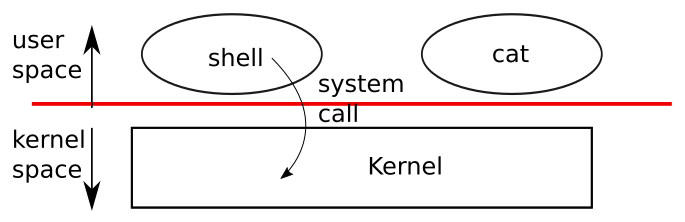

# OS Overview in xv6

---

[toc]

---

The companion to Lecture 1, [_O/S overview_](../lectures/l-overview.txt), and Homework 1, [_file descriptors_](https://pdos.csail.mit.edu/6.1810/2026/homework/xv6-intro.html). The lecture is a tour of the Unix system-call interface through nine example programs. Almost all of it already has an owner here, so this note is mostly a map: it adds only the lecture's framing that no other note carries, which is where the four goals live in this tree, what the lecture's "what happens on a system call" steps are in this tree's code, and where the lecture text and this tree disagree.

> [!NOTE]
> Ownership follows the [book notes rule](book/README.md): [The Process Abstraction](../../operating-system/The_Process_Abstraction.md#7-the-process-api-fork--exec--wait-ch-5) owns `fork`, `exec`, `wait`, descriptors, redirection, and pipes as portable ideas; [ch01](book/ch01-operating-system-interfaces.md) owns how this kernel implements them; [07-exercises.md](07-exercises.md#the-set) owns the nine practice programs; [05-syscall-reference.md](05-syscall-reference.md) owns each call's signature and return values. [ch04](book/ch04-traps-and-system-calls.md) will own the trap path, which is still a placeholder, so [the system-call steps below](#what-a-system-call-does-step-by-step) are held here on loan.

> [!NOTE]
> **Status:** Lecture 1 is checked in [STUDY-PROGRESS.md](../STUDY-PROGRESS.md#lectures) on the basis of the nine programs and the Chapter 1 note. Symbols and sizes below are from this tree's `LAB=util` build on 2026-10-28.

## Lecture topic map

| Lecture topic                             | Generic concept (read when needed)                                                                                                                                                                                     | xv6-specific                                                                                                             | Practice                                                                                                                                    |
| ----------------------------------------- | ---------------------------------------------------------------------------------------------------------------------------------------------------------------------------------------------------------------------- | ------------------------------------------------------------------------------------------------------------------------ | ------------------------------------------------------------------------------------------------------------------------------------------- |
| **What an OS is for; conflicting goals**  | [What Is an Operating System?](../../operating-system/Introduction_to_Operating_Systems.md#what-is-an-operating-system), [Design Goals](../../operating-system/Introduction_to_Operating_Systems.md#5-design-goals-25) | [The four goals in this tree](#the-four-goals-in-this-tree)                                                              | —                                                                                                                                           |
| **User space, kernel, system calls**      | [User Mode vs. Kernel Mode](../../operating-system/The_Process_Abstraction.md#user-mode-vs-kernel-mode)                                                                                                                | [ch01 figure](book/ch01-operating-system-interfaces.md#figures); [ch02](book/ch02-operating-system-organization.md)      | —                                                                                                                                           |
| **`read`, `write`, descriptors 0 and 1**  | [File Descriptors, Open File Descriptions, and Pipes](../../operating-system/The_Process_Abstraction.md#file-descriptors-open-file-descriptions-and-pipes)                                                             | [Descriptors: two levels of indirection](book/ch01-operating-system-interfaces.md#descriptors-two-levels-of-indirection) | [`ex1copy`](07-exercises.md#ex1copy--the-lecture-1-input-filter)                                                                            |
| **`open` and the per-process FD table**   | same                                                                                                                                                                                                                   | same; `fdalloc()` in `kernel/sysfile.c`                                                                                  | [`ex2create`](07-exercises.md#ex2create--making-a-descriptor)                                                                               |
| **What happens on a system call**         | [Trap / Return-from-trap](../../operating-system/The_Process_Abstraction.md#trap--return-from-trap)                                                                                                                    | [What a system call does, step by step](#what-a-system-call-does-step-by-step)                                           | —                                                                                                                                           |
| **The shell is a user program**           | [Why are `fork()` and `exec()` separate?](../../operating-system/The_Process_Abstraction.md#74-why-are-fork-and-exec-separate-54)                                                                                      | [The shell is just another program](book/ch01-operating-system-interfaces.md#the-shell-is-just-another-program)          | —                                                                                                                                           |
| **`fork`**                                | [`fork()`](../../operating-system/The_Process_Abstraction.md#71-fork--create-a-near-copy-51)                                                                                                                           | [Creating a process: `kfork()`](book/ch01-operating-system-interfaces.md#creating-a-process-kfork)                       | [`ex3fork`](07-exercises.md#ex3fork--one-call-two-returns)                                                                                  |
| **`exec`**                                | [`exec()`](../../operating-system/The_Process_Abstraction.md#73-exec--become-a-different-program-53)                                                                                                                   | [Replacing the image: `kexec()`](book/ch01-operating-system-interfaces.md#replacing-the-image-kexec)                     | [`ex4exec`](07-exercises.md#ex4exec--becoming-another-program)                                                                              |
| **`fork` + `exec` + `wait`, exit status** | [`wait()`](../../operating-system/The_Process_Abstraction.md#72-wait--parent-waits-for-child-52)                                                                                                                       | [Divergences](#divergences-from-the-lecture-text)                                                                        | [`ex5forkexec`](07-exercises.md#ex5forkexec--the-shells-execution-model)                                                                    |
| **I/O redirection**                       | [Why are `fork()` and `exec()` separate?](../../operating-system/The_Process_Abstraction.md#74-why-are-fork-and-exec-separate-54)                                                                                      | [Descriptors: two levels of indirection](book/ch01-operating-system-interfaces.md#descriptors-two-levels-of-indirection) | [`ex6redirect`](07-exercises.md#ex6redirect--how--is-implemented)                                                                           |
| **"Other designs are possible"**          | same                                                                                                                                                                                                                   | [What the other designs would cost here](#what-the-other-designs-would-cost-here)                                        | —                                                                                                                                           |
| **Pipes, and pipes with `fork`**          | [`pipe()`](../../operating-system/The_Process_Abstraction.md#76-pipe--connect-two-processes-xv6-13)                                                                                                                    | [Pipes](book/ch01-operating-system-interfaces.md#pipes)                                                                  | [`ex7pipe`](07-exercises.md#ex7pipe--a-buffer-with-two-descriptors), [`ex8pipefork`](07-exercises.md#ex8pipefork--two-processes-one-buffer) |
| **Reading a directory**                   | — (`File_Systems.md` is still a placeholder)                                                                                                                                                                           | [ch10](book/ch10-file-system.md)                                                                                         | [`ex9ls`](07-exercises.md#ex9ls--a-directory-is-a-file)                                                                                     |
| **Class structure, labs, grading**        | —                                                                                                                                                                                                                      | [03-lab-workflow.md](03-lab-workflow.md); progress in [STUDY-PROGRESS.md](../STUDY-PROGRESS.md)                          | —                                                                                                                                           |

## The four goals in this tree

The lecture names four goals that "have worked out well". OSTEP's [Design Goals](../../operating-system/Introduction_to_Operating_Systems.md#5-design-goals-25) list overlaps but is not the same list: it has no _share_ entry, and it splits isolation into protection and security. Each of the lecture's four has a concrete home in this kernel:

| Goal          | What the lecture means                               | Mechanism in this tree                                                                                                                                                             | Read first                                                                                         |
| ------------- | ---------------------------------------------------- | ---------------------------------------------------------------------------------------------------------------------------------------------------------------------------------- | -------------------------------------------------------------------------------------------------- |
| **Multiplex** | Many programs share few CPUs and one memory.         | `scheduler()` in `kernel/proc.c` picks a `RUNNABLE` process per hart; a timer interrupt makes `devintr()` return 2, and `usertrap()` then calls `yield()`.                         | [ch08](book/ch08-scheduling.md)                                                                    |
| **Isolate**   | A buggy or hostile program cannot harm others.       | One page table per process; kernel pages lack `PTE_U`; `copyin()`/`copyout()` check every user pointer.                                                                            | [11-os-design-in-xv6.md](11-os-design-in-xv6.md#where-the-boundary-is-enforced)                    |
| **Share**     | Cooperating programs exchange data on purpose.       | Pipes (`kernel/pipe.c`); one `struct file` shared through `fork` or `dup`; files named in one file system.                                                                         | [ch01 Pipes](book/ch01-operating-system-interfaces.md#pipes)                                       |
| **Abstract**  | Programs see convenient objects, not device details. | A descriptor hides its backing object: `struct file` in `kernel/file.h` is tagged `FD_PIPE`, `FD_INODE`, or `FD_DEVICE`, and `read`/`write` take the same arguments for all three. | [ch01 Descriptors](book/ch01-operating-system-interfaces.md#descriptors-two-levels-of-indirection) |

The tension the lecture warns about shows up even in a kernel this small. _Isolate_ and _share_ pull against each other at `fork`: memory is copied (`uvmcopy()`), so the child cannot touch the parent's data, but descriptors are shared (`filedup()`), so parent and child move one file offset together. Which state is copied and which is shared is a design decision, not a consequence of the hardware.

## What a system call does, step by step

For the underlying machine operations, see the assembly course’s [calls, traps, and privilege returns](../../assembly-language/docs/riscv/06-csrs-and-privilege.md#control-transfers-calls-traps-and-privilege-returns). The sequence below pins that mechanism to xv6’s files and symbols.

> [!NOTE]
> **On loan to [ch04](book/ch04-traps-and-system-calls.md).** The lecture says "we'll see more detail later in the course"; this section only pins its seven steps to the symbols that perform them. Move it into ch04 when that chapter is written, and leave a link here.

The lecture's list is accurate in outline, but it hides who does each step. The CPU does very little; most of the "saving registers" and "restoring privilege" is ordinary code in `kernel/trampoline.S` and `kernel/trap.c`.



_“A kernel and two user processes.” — [book figure](book/fig/README.md), `unix.tex` `fig:os`, also captioned in [ch01](book/ch01-operating-system-interfaces.md#figures). Two user processes, `shell` and `cat`, above a red line; below it, one box holding the whole kernel; one arrow from the shell crosses the line, labelled **system call**. That single arrow is what the sequence diagram below opens up: every step in it happens somewhere along the arrow, and the red line is the U-mode/S-mode switch the hart makes at `ecall` and undoes at `sret`._

<!-- TODO: Fix broken mermaid -->

```mermaid
sequenceDiagram
    participant U as user program (U-mode)
    participant H as RISC-V hart
    participant T as kernel/trampoline.S
    participant K as kernel/trap.c and syscall.c

    Note over U,K: Phase 1: enter the kernel
    rect rgb(255, 240, 240)
        U->>H: user/usys.S puts SYS_open in a7 and executes ecall
        H->>T: The hart saves pc in sepc, switches to S-mode, and jumps to stvec (uservec)
    end
    Note over U,K: Phase 2: dispatch the call
    rect rgb(240, 240, 255)
        T->>K: uservec saves 31 user registers in TRAPFRAME, loads the kernel page table, and calls usertrap()
        K->>K: usertrap() sees scause 8, adds 4 to the saved epc, and calls syscall()
    end
    Note over U,K: Phase 3: do the work
    rect rgb(255, 255, 240)
        K->>K: syscall() indexes syscalls[a7] and runs sys_open(), which may sleep on the disk
    end
    Note over U,K: Phase 4: return to the caller
    rect rgb(240, 255, 255)
        K->>T: prepare_return() sets stvec, sstatus.SPP, and sepc; usertrap() returns the user satp
        T->>U: userret switches page tables, restores registers from TRAPFRAME, and executes sret
    end
```

Red is the request into the kernel, blue is routing to the right handler, yellow is the work itself, and cyan is the commit back to user space. U-mode is RISC-V user mode and S-mode is supervisor mode; the [glossary](04-terminology.md#risc-v-architecture) expands `sepc`, `stvec`, and `scause`.

| Lecture step                                              | Who does it in this tree                                                                                                                                                                                   |
| --------------------------------------------------------- | ---------------------------------------------------------------------------------------------------------------------------------------------------------------------------------------------------------- |
| **"a special instruction"**                               | `ecall`, after `li a7, SYS_<name>` in the generated `user/usys.S`. The number, not a function address, tells the kernel which call it is.                                                                  |
| **"CPU saves some user registers"**                       | The hart saves only the program counter, into `sepc`. The 31 general registers are stored by `uservec` in `kernel/trampoline.S`, into the page mapped at `TRAPFRAME`.                                      |
| **"CPU increases privilege level"**                       | Hardware: `ecall` from U-mode enters S-mode and records the previous mode in `sstatus.SPP`.                                                                                                                |
| **"jumps to a known entry point"**                        | Hardware jumps to `stvec`, which `prepare_return()` in `kernel/trap.c` set to `uservec`'s address inside the `TRAMPOLINE` page before the process last entered U-mode.                                     |
| **"kernel calls system call implementation"**             | `usertrap()` checks `r_scause() == 8`, then `syscall()` in `kernel/syscall.c` calls `syscalls[a7]` and stores the result in `trapframe->a0`.                                                               |
| **"`sys_open()` ... might wait for the disk"**            | `sys_open()` in `kernel/sysfile.c` calls `namei()` or `create()`, which read blocks through `bread()` in `kernel/bio.c`; a cache miss calls `virtio_disk_rw()`, which `sleep()`s until the disk interrupt. |
| **"restore user registers, reduce privilege, jump back"** | `prepare_return()` clears `SSTATUS_SPP` and writes the saved `epc` to `sepc`; `userret` reloads the registers from `TRAPFRAME` and executes `sret`.                                                        |

Two details the lecture's outline compresses:

1. **The return address is moved by software.** `sepc` points at the `ecall` itself, so `usertrap()` executes `p->trapframe->epc += 4`. Without that line the program would execute `ecall` again forever.
2. **Interrupts stay off until the kernel has read the trap registers.** `usertrap()` calls `intr_on()` only after copying `sepc` and checking `scause`, because a nested interrupt would overwrite them. This is why a system call can sleep on the disk at all: by the time `sys_open()` runs, the hart can take the disk interrupt that wakes it.

## What the other designs would cost here

The lecture lists three alternatives in one line each. The portable argument for the third is in [Why are `fork()` and `exec()` separate?](../../operating-system/The_Process_Abstraction.md#74-why-are-fork-and-exec-separate-54); what follows is only what each would remove from this tree.

| Alternative the lecture names         | What this tree would lose                                                                                                                                                                         |
| ------------------------------------- | ------------------------------------------------------------------------------------------------------------------------------------------------------------------------------------------------- |
| **Pass a filename to `read`/`write`** | `p->ofile[NOFILE]` and the shared `struct file`: every call would repeat the `namei()` path walk, the offset would have nowhere to live, and a pipe, which has no name, could not be read at all. |
| **Access the disk directly**          | `kernel/fs.c`, `kernel/log.c`, and `kernel/bio.c` exist so that programs never see block numbers; without them, sharing and crash recovery would be every program's job.                          |
| **Combine `fork` and `exec`**         | The window in which `runcmd()` in `user/sh.c` does `close()` and `open()` or `dup()` before `exec()`. Redirection and pipes would need new arguments to the combined call.                        |

## Running the lecture's examples here

The lecture's programs are kept verbatim under [`lectures/l-overview/`](../lectures/l-overview/) and are not built. Their practice versions in `user/` add error checks and teaching headers, and are renamed so they never collide with an upstream program; [07-exercises.md](07-exercises.md#the-set) explains the names and what each one teaches.

| Lecture command              | This tree                                                                | Difference                                                                                                                                                                |
| ---------------------------- | ------------------------------------------------------------------------ | ------------------------------------------------------------------------------------------------------------------------------------------------------------------------- |
| **`$ ex1` … `$ ex9`**        | `$ ex1copy` … `$ ex9ls`                                                  | Names follow `ex<N><verb>`; see [The set](07-exercises.md#the-set).                                                                                                       |
| **`$ ex2` then `$ cat out`** | `$ ex2create` then `$ cat ex2.out`                                       | Each program writes its own file, so `ex2create` and `ex6redirect` do not overwrite each other.                                                                           |
| **`$ ex6` then `$ cat out`** | `$ ex6redirect` then `$ cat ex6.out`                                     | Same reason.                                                                                                                                                              |
| **`ls -l /bin/echo`**        | `ls -l user/_echo` on the host: 34,336 bytes                             | xv6 has no `/bin`: `mkfs` strips `user/_` and puts every program in `/` of `fs.img`.                                                                                      |
| **`cat -n user/echo.c`**     | `cat -n user/echo.c` on the host                                         | xv6's own `cat` has no `-n`; `lectures/l-overview/echo.c` differs from `user/echo.c` only in formatting, comments, and one extra `#include "kernel/stat.h"` in this tree. |
| **`man 2 open`**             | [05-syscall-reference.md](05-syscall-reference.md#files-and-descriptors) | xv6 has no man pages; that file is the lookup.                                                                                                                            |

## Divergences from the lecture text

| Lecture 1 says                                            | This tree                                                                                                                                                                                                                   |
| --------------------------------------------------------- | --------------------------------------------------------------------------------------------------------------------------------------------------------------------------------------------------------------------------- |
| **"CPU saves some user registers"**                       | Hardware saves only `pc` into `sepc`; `uservec` saves the rest. See [the step table](#what-a-system-call-does-step-by-step).                                                                                                |
| **"status allows children to send back 32 bits of info"** | True of the kernel: `p->xstate` is an `int` in `kernel/proc.h`, and `kwait()` copies out `sizeof(pp->xstate)` bytes. But `user/sh.c` calls `wait(0)` every time, so the shell discards the status, and `$?` does not exist. |
| **"status convention: 0 = success, 1 = error"**           | Followed by `user/sh.c` (`exit(1)` after a failed `exec`) and by the practice programs; the kernel attaches no meaning to the value.                                                                                        |
| **"Figure 1.2 in the xv6 book lists system calls"**       | The book's `fig:api` table in `unix.tex` lists 22 calls, and `kernel/syscall.h` defines the same 22, numbered 1 to 22. The clock call is `pause`, not `sleep`.                                                              |
| **"the shell runs `echo`" (implied: from anywhere)**      | `runcmd()` in `user/sh.c` passes `argv[0]` to `exec()` unchanged, and there is no `PATH`. `echo` is found only because the shell's working directory is `/`.                                                                |
| **ex9.c declares its own `struct dirent`**                | The real one is in `kernel/fs.h`, with `name[DIRSIZ]` and `DIRSIZ` = 14, and its `name` may fill all 14 bytes with no terminating NUL. `user/ex9ls.c` includes `kernel/fs.h` rather than repeating the struct.              |

## Homework 1

Homework 1, [_file descriptors_](https://pdos.csail.mit.edu/6.1810/2026/homework/xv6-intro.html), assigns [`user/cat.c`](../user/cat.c) and book Chapter 1. Its box is checked in [STUDY-PROGRESS.md](../STUDY-PROGRESS.md#homework-and-assigned-reading), but no written answer is recorded in this tree, and the progress page lists its completion as unconfirmed. When an answer is written, record it here the way [10-c-in-xv6.md](10-c-in-xv6.md#homework-2-struct-addresses) records Homework 2. The reading itself is covered: `cat.c` moves whole buffers with one `write()` per `read()`, the same loop as [`ex1copy`](07-exercises.md#ex1copy--the-lecture-1-input-filter), and [05-syscall-reference.md](05-syscall-reference.md) explains why that is cheaper than one call per character.

## Questions I had

### Why does `$ echo hi` fail after `cd` into a directory?

Because nothing searches for programs. `kexec()` in `kernel/exec.c` resolves the path with `namei()`, which starts at `p->cwd` for a relative name. The lecture's examples all run from `/`, where every program in `fs.img` lives, so the problem never shows. `/echo hi` works from any directory.

### If the hardware saves only `pc`, how does `uservec` save registers without losing one?

It needs one free register to hold the `TRAPFRAME` address, and every register still holds a user value. `uservec` first does `csrw sscratch, a0` to park the user's `a0` in a CSR, loads `TRAPFRAME` into `a0`, stores the other registers through it, and finally copies the parked `a0` out of `sscratch` into the trapframe. `userret` reverses the order and restores `a0` last.
