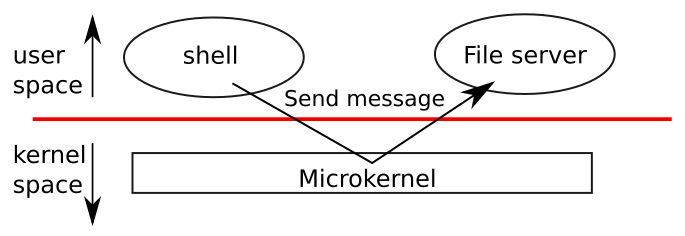
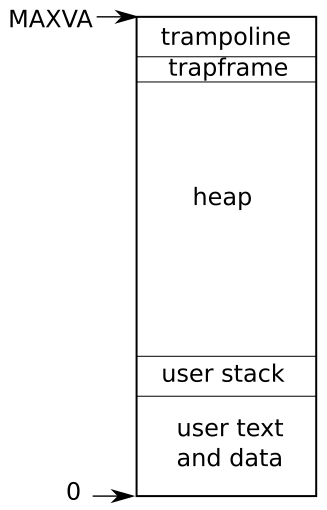

# Chapter 2: Operating system organization

---

[toc]

---

> **Theory:** [OSTEP — Introduction to Operating Systems][ostep]. Read that first; this note does not re-explain it.

The chapter is mixed: the kernel/user split and the monolithic-versus-microkernel choice are portable and linked, while machine mode and the boot path are xv6-only and owned here. The per-concept rows are in [00-ostep-concordance.md](00-ostep-concordance.md#concepts). The lecture-side companion, with measured symbol addresses and the `isolate` experiments, is [11-os-design-in-xv6.md](../11-os-design-in-xv6.md).

## Figures



_“A microkernel with a file-system server” — [book figure](fig/README.md), `first.tex` `fig:mkernel`. Two ellipses above the red line, `shell` and `File server`, joined by lines that dip through a thin `Microkernel` box below it and meet at a label reading **Send message**. Read it against [ch01's figure](ch01-operating-system-interfaces.md#figures): same red line, but the file system has moved above it into user space, so what was a system call becomes a message between two user processes. Xv6 is the monolithic alternative — every file in `kernel/` sits inside that one box._



_“Layout of a process's virtual address space” — [book figure](fig/README.md), `first.tex` `fig:as`. Bottom to top from 0: **user text and data**, **user stack**, a large **heap**, and then two thin bands immediately under `MAXVA` — **trapframe** and **trampoline**. Those two slivers are the ones to remember: they are mapped without `PTE_U`, so user code cannot touch them, and they are what makes the trap path in [ch04](ch04-traps-and-system-calls.md) possible at all._

## What xv6 actually does

### One program in supervisor mode

Xv6 is monolithic in the most literal sense: every `.c` and `.S` file in `kernel/` links into the single `kernel/kernel` binary, and `kernel/kernel.ld` places its first instruction at `0x80000000` (`KERNBASE` in `kernel/memlayout.h`). The book's source-file table lists 27 files, and this tree has exactly those 27; [11-os-design-in-xv6.md](../11-os-design-in-xv6.md#the-machine-xv6-runs-on) records their measured size. Because there is no second privileged program, the kernel interface _is_ the system-call interface, which [05-syscall-reference.md](../05-syscall-reference.md#what-a-system-call-actually-is-here) catalogues.

### A process is an address space plus a thread

The book's summary of a process maps field by field onto `struct proc` in `kernel/proc.h`. The comments in that struct also say which lock guards each group, and that grouping is worth reading alongside the design idea each field serves:

| Design idea               | `struct proc` fields                       | Guarded by                   |
| ------------------------- | ------------------------------------------ | ---------------------------- |
| **Run state**             | `state`, `chan`, `killed`, `xstate`, `pid` | `p->lock`                    |
| **Family**                | `parent`                                   | `wait_lock`                  |
| **Address space**         | `pagetable`, `sz`, `trapframe`             | none: private to the process |
| **Thread**                | `kstack`, `context`                        | none: private to the process |
| **Kernel-held resources** | `ofile[NOFILE]`, `cwd`, `name`             | none: private to the process |

The book describes five run states informally; `enum procstate` in `kernel/proc.h` names them and adds `UNUSED` for a free slot:

| Book's description   | `enum procstate` |
| -------------------- | ---------------- |
| **Slot free**        | `UNUSED`         |
| **Allocated**        | `USED`           |
| **Ready to run**     | `RUNNABLE`       |
| **Running on a CPU** | `RUNNING`        |
| **Waiting for I/O**  | `SLEEPING`       |
| **Exiting**          | `ZOMBIE`         |

`p->kstack` is a virtual address computed by `KSTACK(p)` in `kernel/memlayout.h`, two pages per slot below `TRAMPOLINE`, so each kernel stack has an unmapped guard page beneath it. `proc_mapstacks()` in `kernel/proc.c` maps one page per slot into the kernel page table and `procinit()` records the address, both once at boot; nothing allocates a kernel stack per `fork`.

### Boot, from `_entry` to the shell

Each step runs once, in order, so a numbered list carries it. [11-os-design-in-xv6.md](../11-os-design-in-xv6.md#from-boot-to-the-first-process) draws the same path as a flowchart with the symbols' addresses.

1. QEMU (`-bios none`) loads `kernel/kernel` at `0x80000000` and starts **every** hart at `_entry` in `kernel/entry.S`, in machine mode with paging off.
2. `_entry` gives each hart its own 4096-byte slice of `stack0[4096 * NCPU]` (declared in `kernel/start.c`) and calls `start()`.
3. `start()` in `kernel/start.c` does the machine-mode-only setup, then executes `mret` to land in `main()` in supervisor mode. The full list of what it writes is under [Code walked through](#start-everything-machine-mode-has-to-do-first).
4. `main()` in `kernel/main.c` initializes the console, allocator, kernel page table, process table, traps, PLIC, buffer cache, inode table, file table, and disk on hart 0 only, then calls `userinit()` and sets `started`. The other harts spin until `started` is set, then only turn on paging and install their trap vector and PLIC enables. Every hart ends in `scheduler()`.
5. `userinit()` in `kernel/proc.c` takes a slot with `allocproc()`, sets `p->cwd` to `/`, and marks it `RUNNABLE`. It loads no code.
6. `allocproc()` set `p->context.ra` to `forkret`, so the scheduler's first `swtch()` into the process lands in `forkret()`. The first time only, `forkret()` runs `fsinit(ROOTDEV)` and then `kexec("/init", ...)`, panicking if that returns `-1`.
7. `forkret()` calls `prepare_return()` and jumps to `userret` on the trampoline page, which enters user mode at `/init`'s ELF entry.
8. `main()` in `user/init.c` opens `console` (running `mknod` first if it is missing), `dup`s it to descriptors 1 and 2, then forks and `exec`s `sh`, restarting it whenever it exits.

### Panic as the last line of defence

The book's security model trusts kernel code and treats `panic()` as the response to a broken invariant. In this tree `panic()` lives in `kernel/printk.c`: it sets `panicking`, prints `panic: ` and the message, sets `panicked`, and spins forever. `uartputc_sync()` in `kernel/uart.c` spins forever once `panicked` is set, so any other hart that prints through it stops there instead of interleaving with the message.

## Divergences

| Topic                 | Book (`first.tex`)                                                          | This tree                                                                                                                                                                         | Where to look                          |
| --------------------- | --------------------------------------------------------------------------- | --------------------------------------------------------------------------------------------------------------------------------------------------------------------------------- | -------------------------------------- |
| **Boot stack**        | `_entry` loads `sp` with `stack0+4096`.                                     | `sp = stack0 + (mhartid + 1) * 4096`, because every hart runs `_entry` and needs its own slice of `stack0[4096 * NCPU]`.                                                          | `kernel/entry.S`, `kernel/start.c`     |
| **`start()`'s setup** | Sets `mstatus`, `mepc`, `satp`, delegates traps, programs timer interrupts. | Also enables supervisor external and timer interrupts in `sie`, opens PMP to all of physical memory, enables hardware A/D bit updates in `menvcfg`, and puts the hart id in `tp`. | `start()` in `kernel/start.c`          |
| **Timer**             | `start()` programs "the clock chip".                                        | `timerinit()` enables the Sstc extension and writes `stimecmp`, so supervisor mode handles timer interrupts itself afterwards.                                                    | `timerinit()` in `kernel/start.c`      |
| **`MAXVA`**           | The maximum address is 2^38 − 1, "which is `MAXVA`".                        | `MAXVA` is `1L << 38`, one **past** the highest usable address; `TRAMPOLINE` is `MAXVA - PGSIZE` (`0x3FFFFFF000`).                                                                | `kernel/riscv.h`, `kernel/memlayout.h` |
| **Stack in `fig:as`** | A single **user stack** band above text and data.                           | `kexec()` allocates `USERSTACK + 1` pages and clears `PTE_U` on the lowest with `uvmclear()`, leaving a guard page. `USERSTACK` is 2 under `LAB_UTIL` and 1 otherwise.            | `kernel/exec.c`, `kernel/param.h`      |
| **Heap growth**       | The heap is expanded as needed.                                             | `sys_sbrk()` takes a mode: `SBRK_EAGER` allocates immediately, while `SBRK_LAZY` only raises `p->sz` and leaves allocation to page faults.                                        | `kernel/sysproc.c`, `kernel/vm.h`      |
| **Who runs `main()`** | `main()` initializes devices and subsystems.                                | Only hart 0 does the full initialization; the others wait on `started` and do per-hart setup only.                                                                                | `main()` in `kernel/main.c`            |

The naming divergences in the [concordance appendix](00-ostep-concordance.md#system-call-naming) do not arise here: the current book text already calls `kexec` from `forkret` and lists `printk.c`, matching this tree.

## Code walked through

### `_entry`: one stack per hart

```
_entry:
        la sp, stack0
        li a0, 1024*4
        csrr a1, mhartid
        addi a1, a1, 1
        mul a0, a0, a1
        add sp, sp, a0
        call start
```

Quoted from `kernel/entry.S`, comments removed. The `+ 1` is there because RISC-V stacks grow down: hart 0's stack pointer starts at the **top** of its slice, `stack0 + 4096`, not at `stack0`. If `start()` ever returned, `_entry` would fall into `spin: j spin`.

### `start()`: everything machine mode has to do first

`start()` in `kernel/start.c` is the last C function that runs in machine mode, and every write it makes exists to set up the `mret` at its end or to hand supervisor mode something it cannot take for itself:

| Write                                          | Why it has to happen in machine mode                                                            |
| ---------------------------------------------- | ----------------------------------------------------------------------------------------------- |
| `mstatus.MPP = S`                              | `mret` drops to the privilege level in `MPP`, so this picks supervisor mode.                    |
| `mepc = main`                                  | `mret` jumps to `mepc`; the comment notes this needs `gcc -mcmodel=medany`.                     |
| `satp = 0`                                     | Supervisor mode starts with paging off; `kvminithart()` turns it on later from `main()`.        |
| `medeleg`, `mideleg = 0xffff`                  | Without delegation, every trap would go to machine mode, where xv6 has no handler.              |
| `pmpaddr0`, `pmpcfg0`                          | Physical Memory Protection denies supervisor mode by default; this grants all of memory.        |
| `menvcfg` `ADUE`, then `STCE` in `timerinit()` | These enable hardware A/D-bit updates and the supervisor timer compare, both M-mode controlled. |
| `tp = mhartid`                                 | `mhartid` is machine-mode only; `cpuid()` reads `tp` instead from then on.                      |

### `forkret()`: the first process's special case

`forkret()` in `kernel/proc.c` is where every new process first runs in the kernel. Its `static int first` guard exists because `fsinit()` can sleep, and sleeping needs a process context that `main()` does not have. That is also why `userinit()` loads no program: `kexec("/init", ...)` cannot run until the file system is up, and it puts its return value, `argc`, into `p->trapframe->a0` so `/init` receives it as `main`'s first argument.

## Questions I had

## Lab connection

- [The util `memdump` note](../labs/03-util-memdump.md) relies on this chapter's address-space picture for what a user virtual address is.
- The chapter's one exercise, a system call that reports free memory, crosses both halves of this chapter's organization: the system-call path that [05-syscall-reference.md](../05-syscall-reference.md#what-a-system-call-actually-is-here) and [ch04](ch04-traps-and-system-calls.md) describe, and the physical page allocator in `kernel/kalloc.c`.

[ostep]: ../../../operating-system/Introduction_to_Operating_Systems.md
