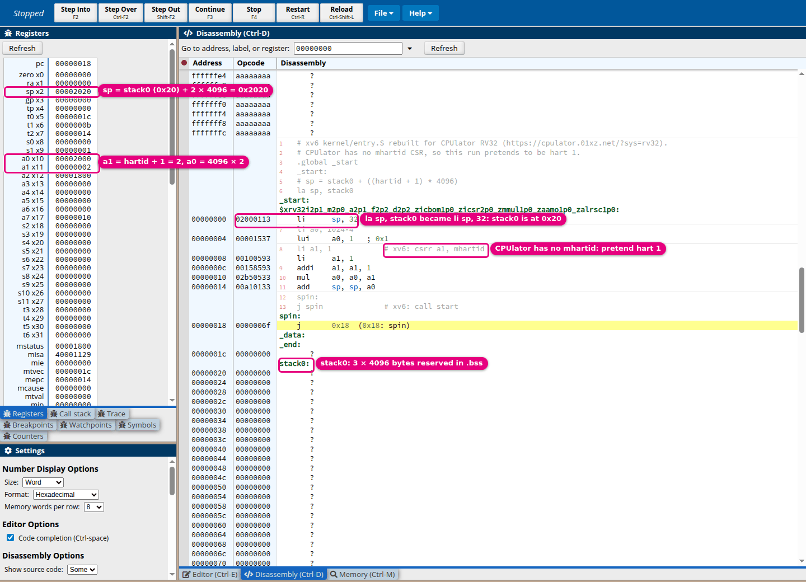
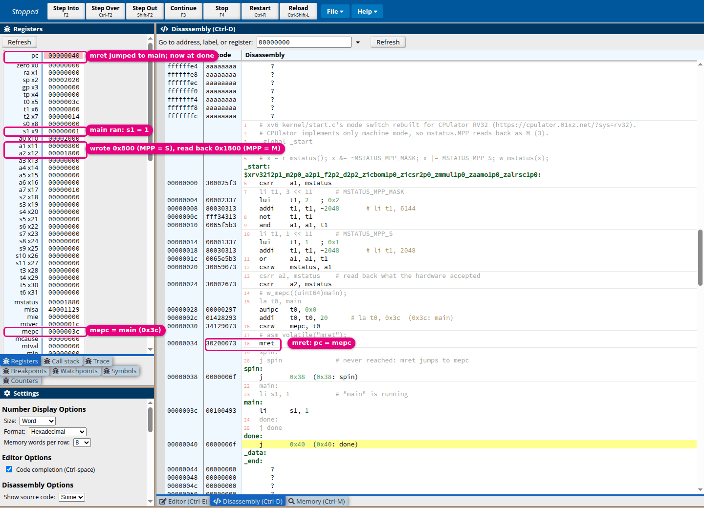
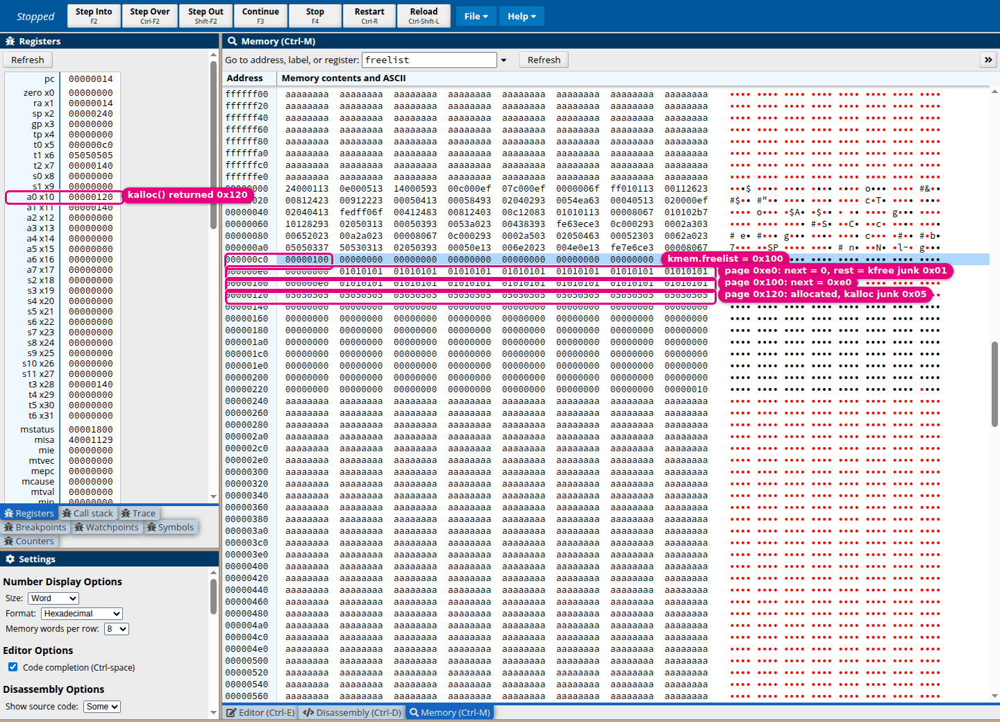
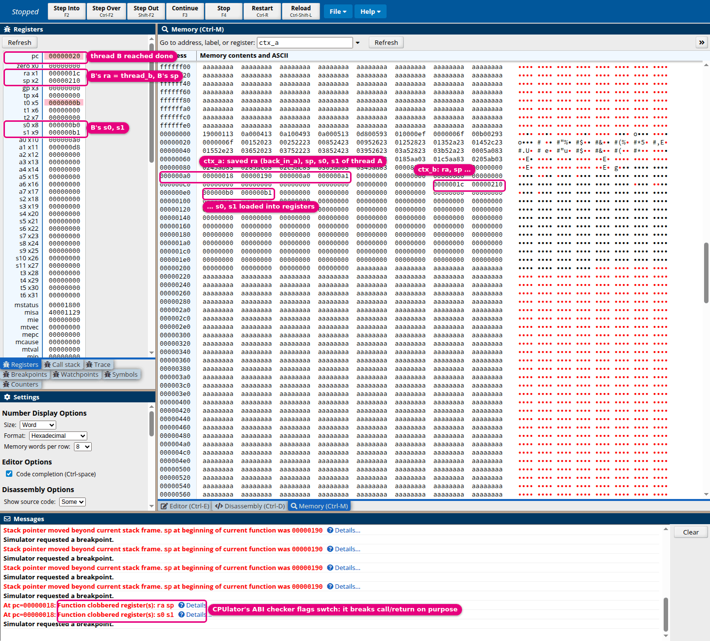
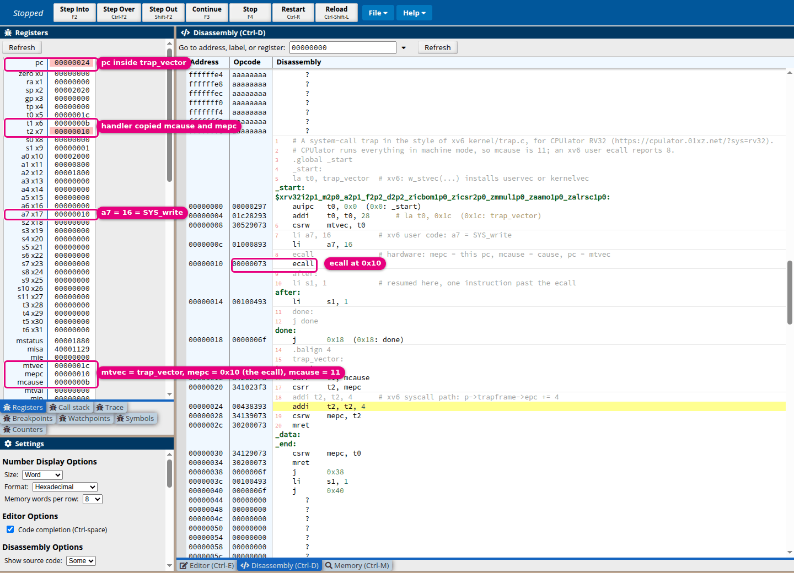

# Proposal: understand the boot source one line at a time

> [!NOTE]
> **Status: proposed follow-up, not completed walkthroughs.** The assembly prerequisites have been created and committed in [the sibling course](../../../assembly-language/README.md). This document proposes the xv6 teaching material to write next; the filenames below are planned outputs. It does not mark any reading, homework, or source coverage complete.

## Start with the missing prerequisites

| Stage | Read / do | Ready to continue when you can… |
| --- | --- | --- |
| **Assembly foundations** | [Lessons 0–5](../../../assembly-language/README.md): registers, memory, control flow, calls, tools, and ELF. | Single-step a tiny example and explain its next `pc`, register changes, and memory accesses. |
| **Kernel-facing foundations** | [CSRs](../../../assembly-language/docs/06-csrs-and-privilege.md) and [memory/saved state](../../../assembly-language/docs/07-memory-and-saved-state.md). | Distinguish ordinary registers, CSRs, allocations, mappings, contexts, and trapframes. |
| **Readiness check** | [Prediction exercises](../../../assembly-language/docs/08-readiness-and-next-steps.md). | Explain the results yourself; passing the automated checker alone is insufficient. |
| **This tree's boot** | The proposed lessons below, one source fragment at a time. | Account for every covered source line and verify the important transitions in GDB. |

The prerequisite course assumes C/C++ knowledge and no assembly knowledge. Its six programs expose register arithmetic, memory widths, branches, nested calls, a C/assembly interface, and CSR operations. Keep those reusable explanations there; keep this kernel's addresses, fields, masks, ordering constraints, and failure paths here.

## Preview each mechanism in the browser first

The sibling course rebuilds five boot-path mechanisms as small RV32 programs in [examples/xv6-rv32](../../../assembly-language/examples/xv6-rv32/) and runs them in [CPUlator's generic RV32 system](https://cpulator.01xz.net/?sys=rv32). Step one before writing or reading the matching lesson below: it fixes the expected register and memory state, so the later GDB session on QEMU checks a prediction rather than introducing the idea.

> [!WARNING]
> These are previews, not evidence about this tree. CPUlator is a 32-bit, machine-mode-only CPU without `mhartid`, so the programs use 4-byte registers, `sw`/`lw`, a pretend hart id, and small addresses. Every value that the walkthroughs record must still come from this kernel under QEMU.

| Planned lesson | Preview program | What the screenshot fixes | Explained in |
| --- | --- | --- | --- |
| **1. Entry and boot stacks** | [1-entry-stack.s](../../../assembly-language/examples/xv6-rv32/1-entry-stack.s) | `sp = stack0 + (hartid + 1) * 4096`, the per-hart slice top. | [Readiness lesson](../../../assembly-language/docs/08-readiness-and-next-steps.md#preview-entrys-in-the-browser) |
| **2. Machine controls** | [2-start-mret.s](../../../assembly-language/examples/xv6-rv32/2-start-mret.s) | Clear-then-set of `mstatus.MPP`, `mepc = main`, and `mret` jumping without a call. | [CSR lesson](../../../assembly-language/docs/06-csrs-and-privilege.md#watch-xv6s-mode-switch-and-a-trap-in-the-browser) |
| **4. Physical pages** | [4-kalloc-freelist.s](../../../assembly-language/examples/xv6-rv32/4-kalloc-freelist.s) | `struct run` links stored inside free pages, junk fills, and the LIFO pop. | [Memory lesson](../../../assembly-language/docs/07-memory-and-saved-state.md#watch-kallocs-free-list-in-the-browser) |
| **5. First context switch** | [5-swtch-context.s](../../../assembly-language/examples/xv6-rv32/5-swtch-context.s) | Callee-saved registers stored to the old context and loaded from the new one; `ret` lands in another thread. | [Memory lesson](../../../assembly-language/docs/07-memory-and-saved-state.md#watch-swtch-save-one-context-and-load-another) |
| **7. Trampoline (trap side)** | [3-ecall-trap.s](../../../assembly-language/examples/xv6-rv32/3-ecall-trap.s) | `ecall` sets the cause and saved PC, jumps to the vector, and returns past the `ecall` after `epc += 4`. | [CSR lesson](../../../assembly-language/docs/06-csrs-and-privilege.md#a-system-call-is-a-trap) |

*Lesson 1 preview.* With `stack0` at `0x20`, hart 1 starts at `0x2020`, the exclusive top of its own 4096-byte slice. In this kernel the same formula runs at the `stack0` address chosen by `kernel.ld`, and `mhartid` supplies the real hart id.

*Lesson 2 preview.* The read-back shows that `MPP` is a WARL field: CPUlator implements only M-mode, so it keeps `11`. On QEMU's `virt` board the write sticks and `mret` enters S-mode at `main`; lesson 2 must observe that transition directly.

*Lesson 4 preview.* Toy 32-byte pages make the whole list visible on one screen. The real allocator uses 4096-byte pages from `end` to `PHYSTOP` and takes `kmem.lock`, which a single-hart preview cannot exercise.

*Lesson 5 preview.* CPUlator's calling-convention checker flags `swtch` because it returns with different `ra`, `sp`, and saved registers, which is the purpose of a context switch. The real `struct context` fields are 8 bytes, so lesson 5 must match each `sd`/`ld` offset to `kernel/proc.h`.

*Lesson 7 preview (trap side).* The preview traps to machine mode with `mcause = 11`; an xv6 user `ecall` is delegated to supervisor mode, reports `scause = 8`, and enters `uservec` in the trampoline page. The `epc += 4` step matches `p->trapframe->epc += 4` in `kernel/trap.c`.

## Teaching format for every lesson

1. **Name the question and prerequisites.** Start with a small lookup table and a concrete question, such as “where does this hart's stack point before C runs?” Link each prerequisite at the point it is needed rather than sending the reader back to an entire chapter.
2. **State the starting machine state.** Record hart, privilege mode, executing function, active stack, whether a current process exists, paging state, and known register values. Mark unspecified values as unknown instead of inventing zeros.
3. **Quote a small, contiguous source fragment.** Use roughly 3–10 statements or instructions, with a file link, source revision, and line span. Account for includes, declarations, attributes, labels, directives, macros, comments, and casts too; classify structural lines instead of skipping them silently.
4. **Explain each line using a state table.** Show inputs, plain-language meaning, outputs, unchanged state that matters, and why the line is needed. Describe the C-like operation beside assembly where that translation helps; do not pretend privilege transitions are ordinary C calls.
5. **Open unfamiliar dependencies at the call site.** Give each function a contract: arguments, return value, effects, preconditions, ownership/locks, and failure behavior. Link its implementation lesson and return to the suspended caller afterward. “Initializes memory” is not enough to explain a function body.
6. **Use a focused visual when it helps.** Show a small control-flow figure, byte layout, object graph, or before/after memory snapshot. Keep causal reasoning directly below the visual. Use separate tables for field offsets and register values rather than packing them into diagram labels.
7. **Predict, observe, and explain.** Give one GDB observation and one hand-trace exercise, with an expected result and a worked answer. Distinguish a source line from an instruction: optimized or inlined C may need disassembly breakpoints and several `si` steps.
8. **Update the coverage ledger.** A completed fragment needs both its explanation and its evidence. Unexplained lines, unvisited branches, and deferred helpers stay visible as remaining work.

A trace table should use these columns:

| Source line / instruction | Inputs before it | Operation in plain language | Registers / memory after it | Why needed; failure or invariant |
| --- | --- | --- | --- | --- |
| **One actual source statement per row** | Values, addresses, and their owners; use symbolic values where appropriate. | Expand unfamiliar syntax and identifiers. | Show changes separately from preserved state. | Explain the constraint, not merely the operation again. |

A separate symbol table should identify each local/global variable's type, lifetime, owner, and role. For example, a local pointer, a global array, and a CSR helper must not all be described merely as “state.” Introduce acronyms through the existing [glossary](../04-terminology.md), adding missing entries there as the lessons are written.

## Proposed lesson order

### 0. Machine state and source map

**Planned file:** `00-machine-state-and-source-map.md`.

**Source coverage:** [Makefile](../../Makefile), [kernel/kernel.ld](../../kernel/kernel.ld), [kernel/memlayout.h](../../kernel/memlayout.h), and the current ELF.

**Teaching material and observations:** Host versus emulated machine; one hart's state sheet; physical/virtual address distinction; `nm`, ELF entry, loadable segments, reset stub, and initial stack placement. Record actual build flags rather than reusing the tutorial's smaller ISA/ABI selection.

### 1. Entry and boot stacks

**Planned file:** `01-entry-and-boot-stacks.md`.

**Source coverage:** All of [kernel/entry.S](../../kernel/entry.S), plus `stack0` and `NCPU` declarations.

**Teaching material and observations:** Every directive, label, instruction, and comment; register values after each instruction for harts 0 and 1; a stacked-memory drawing of the separate 4096-byte slices and their exclusive upper bounds. Explain why C needs a stack before `start()` runs.

### 2. Machine controls and the first mode transition

**Planned file:** `02-start-and-machine-controls.md`.

**Source coverage:** All of [kernel/start.c](../../kernel/start.c), with every used wrapper/mask from [kernel/riscv.h](../../kernel/riscv.h).

**Teaching material and observations:** Decode each CSR name and bit field, the C read/modify/write sequence, delegation, `sie`, PMP encoding and bounds, A/D updates, Sstc, `mcounteren`, `stimecmp`, and `tp`. Include `timerinit()`, declarations, attributes, includes, and the mode/PC changes at `mret`; distinguish enabling, pending, and taking an interrupt.

### 3. Initialization order and multiple harts

**Planned file:** `03-main-and-initialization-order.md`.

**Source coverage:** All of [kernel/main.c](../../kernel/main.c), with a contract and a linked body walkthrough for every initializer.

**Teaching material and observations:** Hart 0 versus other harts; acquire/release publication of `started`; why `volatile` alone would not supply that ordering; shared versus per-hart initialization; a dependency diagram. Teach console, locks, PLIC, cache, inode/file tables, and virtio through small dependency lessons rather than opaque function names.

### 4. Physical pages and kernel mappings

**Planned file:** `04-physical-pages-and-kernel-mappings.md`.

**Source coverage:** All of [kernel/kalloc.c](../../kernel/kalloc.c); boot-facing `kvmmake`, `kvmmap`, `kvminit`, `kvminithart`, `walk`, and `mappages` in [kernel/vm.c](../../kernel/vm.c); relevant macros in `riscv.h`.

**Teaching material and observations:** Work an actual `end`/`PHYSTOP` example: rounding, complete pages, free-list pushes/pops, junk fill, allocation failure, and locks. Then derive an Sv39 translation with actual indices, PTE encodings, flags, root PPN, `MAKE_SATP`, TLB fences, and the identity mapping that keeps execution valid when paging starts.

### 5. The first process and context switch

**Planned file:** `05-first-process-and-context-switch.md`.

**Source coverage:** Boot-facing globals, `proc_mapstacks`, `procinit`, `cpuid`, `mycpu`, `myproc`, `allocpid`, `allocproc`, `freeproc`, `proc_pagetable`, `proc_freepagetable`, `userinit`, `scheduler`, `sched`, and `forkret` in [kernel/proc.c](../../kernel/proc.c); all of [kernel/swtch.S](../../kernel/swtch.S); relevant [kernel/proc.h](../../kernel/proc.h) fields.

**Teaching material and observations:** Object graph of CPU, process, context, trapframe, stacks, and page tables; every `sd`/`ld` matched to its exact struct offset. Trace who owns `p->lock`, how `swtch`'s `ret` first reaches `forkret`, stack changes, the `static first` guard, failure cleanup, `wfi`, and why filesystem initialization needs process context.

### 6. Load init and prepare user state

**Planned file:** `06-load-init-and-prepare-user-state.md`.

**Source coverage:** All of [kernel/exec.c](../../kernel/exec.c), `prepare_return` in [kernel/trap.c](../../kernel/trap.c), and `forkret`'s call/indirect-jump expressions.

**Teaching material and observations:** ELF header/segments, `flags2perm`, `loadseg`, page ownership, guard page, user stack, argument strings/pointers, `a0`/`a1`, commit-versus-cleanup paths, and saved `epc`. Unpack `TRAMPOLINE + (userret - trampoline)` and the function-pointer cast. Observe the trapframe before switching page tables.

### 7. The trampoline and first user instruction

**Planned file:** `07-trampoline-and-first-user-instruction.md`.

**Source coverage:** All of [kernel/trampoline.S](../../kernel/trampoline.S), its layout in `kernel.ld`, and every offset in `struct trapframe`.

**Teaching material and observations:** Separate `userret`'s first entry from `uservec`'s later trap entry. Trace `a0`'s changing roles, `satp`, both translation fences, `fence.i`, CSR state, register restoration, `sscratch`, and `sret`. Show why the trampoline needs the same virtual address in both tables and why mapped trap state is still inaccessible to U-mode.

### 8. Init, console, and shell

**Planned file:** `08-init-console-and-shell.md`.

**Source coverage:** All of [user/init.c](../../user/init.c), the entry wrapper `start` in [user/ulib.c](../../user/ulib.c), and [user/user.ld](../../user/user.ld).

**Teaching material and observations:** Separate the two functions named `start` by binary and privilege mode. Follow ELF entry into the user wrapper and `main`; annotate includes, `argv`, every branch, fd allocation, `dup` sharing, parent/child values, `exec` failure, `wait`, orphan reaping, and shell restart. Use a descriptor object graph and a small parent/child sequence diagram.

### 9. Whole-file coverage and remaining paths

**Planned file:** `09-whole-file-coverage-and-remaining-process-paths.md`.

**Source coverage:** Remaining [kernel/proc.c](../../kernel/proc.c) lines: growth, `kfork`, reparenting, exit/wait, yield, sleep/wakeup, kill, copy helpers, and `procdump`; then remaining lines of supporting files that were only partly covered.

**Teaching material and observations:** Extend the coverage ledger with dedicated process-lifecycle and trap/memory lessons. These functions do not all run on the initial path, but they cannot disappear from an “every line of the file” goal. Link their explanations to the owning book chapters.

These are learning units, not an obligation to fit each unit into one long page. Split the physical allocator from page tables, or a subsystem initializer into its own dependency note, when one page would overload a first-time reader. Preserve a clear “return to caller” link after every detour.

## What “every line” will mean

| Coverage level | Required evidence | What remains visible |
| --- | --- | --- |
| **Complete small file** | Every source line classified and explained, including structural lines and both branch outcomes. | Runtime observations may exercise only selected paths; say which. |
| **Boot-facing part of a large file** | Every line of the listed functions, their globals/types, and required helper contracts explained. | All other functions remain explicitly pending; the file is not marked complete. |
| **Whole-file completion** | Union of all covered spans accounts for the entire file at a recorded revision. | Later edits invalidate affected spans until checked again. |
| **Dependency body** | The called function's actual implementation receives the same line treatment in its owning lesson. | An interface summary alone does not complete the dependency. |

The initial full-file set is `entry.S`, `start.c`, `main.c`, `swtch.S`, `trampoline.S`, and `user/init.c`. `proc.c` gets a boot-path pass followed by the remaining-process-path pass. `kernel.ld`, `kalloc.c`, and `exec.c` are supporting full-file studies; `riscv.h`, `proc.h`, `vm.c`, `trap.c`, and device/filesystem helpers need explicit partial coverage until their owning lessons finish them.

Do not recursively expand every dependency inside the same page. Record the edge, teach its body in the appropriate small lesson, and keep the caller's state snapshot available. This keeps the reading sequence manageable without silently abandoning the request to understand the implementation.

## Visuals to create where they earn their space

| Relationship | Proposed material | Why this form |
| --- | --- | --- |
| **Boot-stack slices** | Editable Excalidraw source plus adjacent SVG export: two harts, slice bounds, downward frame growth, and the initial `sp` values. | Spatial placement makes “top of stack” and the `+1` in the slice calculation concrete. |
| **Page ownership and translation** | Before/after page tables plus a small object graph for free list → allocated page → mapped page. | Distinguishes ownership changes from address translation and avoids treating virtual/physical addresses as interchangeable. |
| **Initialization dependencies** | Small Mermaid graph separating shared initialization from per-hart activation. | Explains ordering and the `started` publication boundary. |
| **First context switch** | Register/offset table plus a compact sequence diagram. | Shows saved `ra`/`sp`, which stack is active, and the unusual lock handoff. |
| **Trampoline address continuity** | Editable Excalidraw source plus SVG: kernel and user tables mapping the same code page, with trapframe access and the switching instruction marked. | The same virtual address across a page-table switch is a spatial relationship. |
| **Parent, child, and descriptors** | Object graph and a short message sequence for fork/exec/wait. | Makes shared open-file objects and the shell's lifecycle explicit. |

Use the [repository palette and figure rules](../../AGENTS.md#documentation-visual-readability). Excalidraw sources must sit beside their SVG exports, with both linked from captions; render and inspect every new/changed figure. Required facts stay in the Markdown too, so a drawing never becomes a second specification. Do not add a diagram where a small table or numbered list already explains the relationship.

## Existing documents to update when the walkthroughs are written

| Document | Proposed change |
| --- | --- |
| **[OS design note](../11-os-design-in-xv6.md#from-boot-to-the-first-process)** | Keep its compact overview and measured addresses; link each stage to the corresponding completed lesson. Do not grow another full explanation here. |
| **[Book chapter 2](../book/ch02-operating-system-organization.md)** | Preserve its standard sections and ownership model; add links from the boot-stack, `start`, and `forkret` summaries to the new lessons. Reconcile its “straight to `_entry`” wording with the observed QEMU reset stub. |
| **[Build artifacts](../06-build-artifacts.md)** | Keep artifact/reference ownership; link its instruction and register reference to the slower assembly course where practice is needed. |
| **[Terminology](../04-terminology.md)** | Add missing terms once and link to them from the new lessons. |
| **[Debugging](../09-debugging-xv6.md)** | Keep reusable debugger mechanics here; leave source-fragment-specific observations beside the fragment. |
| **[Docs index](../README.md)** | Register this study route once the walkthrough lessons exist, distinguishing it from the chapter summaries. |
| **[Progress tracker](../../STUDY-PROGRESS.md)** | Record actual reading and verification evidence when the learner completes it; creating documents does not establish mastery. |

## Verification and commit sequence for the follow-up

1. **Pin the input.** Record source revision, relevant file hashes, `LAB`, `CPUS`, tool versions, and build flags. Current planning baseline: xv6 revision `0cd2dba5438218a60b5dfbe9163b92a9aae8e5a4`; line numbers and measured addresses must be refreshed when writing, not copied blindly from the old overview.
2. **Complete one unit at a time.** Begin with the source map and `entry.S`, then machine controls, then initialization/memory, then process/context, then ELF/trampoline, then `/init`, followed by whole-file closure. Each commit should carry a coherent lesson, its figures, links, and evidence, rather than one commit per visual or source line.
3. **Check the explanations.** Match every quoted fragment verbatim to its source; check bit masks, pointer arithmetic, alignment, struct offsets, ownership, locks, error branches, and the coverage ledger. Distinguish illustrative numbers from measured addresses.
4. **Check observations on one hart first.** Follow the existing [debugging guide](../09-debugging-xv6.md) with `CPUS=1`; record expected state before and after each transfer. Verify multi-hart claims separately with at least two harts, especially stack separation and release/acquire publication. Never reuse a one-hart trace as evidence about concurrency.
5. **Check navigation and visuals.** Run `docs/book/check-notes.sh`, check local links/headings/fences, inspect rendered figures, and verify prose remains one paragraph per line. Keep source files unchanged for the teaching pass.
6. **Update chapter links and coverage status.** Do this only for completed lessons. Keep proposals, partial annotations, executed observations, and learner-completed exercises distinct.

The next deliverable is the first small walkthrough, not another broad boot summary: a source map followed by every line of `entry.S`, with concrete register and stack snapshots. Stop to resolve failed predictions there before adding another layer of kernel terminology.
