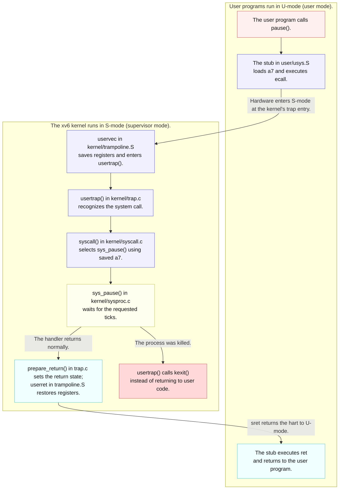
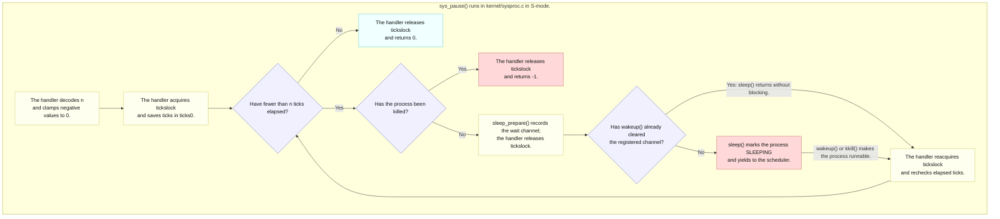

# Lab util: Deriving `sleep`

---

[toc]

---

Derive the first exercise of MIT's [util lab](https://pdos.csail.mit.edu/6.1810/2026/labs/util.html) by reading the existing `pause` system call. This note leaves `user/sleep.c` as the exercise and holds trap-path background for later labs until the relevant book notes are written.

| If you are...                              | Start at                                                                                                                   |
| ------------------------------------------ | -------------------------------------------------------------------------------------------------------------------------- |
| **Implementing the exercise**              | [The contract](#contract), then [Deriving `user/sleep.c`](#deriving-usersleepc)                                            |
| **Tracing a system call**                  | [The four existing layers](#the-four-existing-layers), then [the foundation](#the-foundation-a-c-call-that-becomes-a-trap) |
| **Comparing xv6 and Linux**                | [xv6 `pause` is not Linux `pause(2)`](#xv6-pause-is-not-linux-pause2)                                                      |
| **Deciding where code belongs**            | [Kernel or user](#kernel-or-user-where-code-belongs)                                                                       |
| **Distinguishing hardware from processes** | [Harts, CPUs, and processes](#harts-cpus-and-processes)                                                                    |
| **Checking behavior or a grader result**   | [Verifying it](#verifying-it) and [grader limits](#what-the-grader-does-not-prove)                                         |
| **Starting a later lab**                   | [Carrying this into later labs](#carrying-this-into-later-labs)                                                            |

> [!IMPORTANT]
> No solution or pseudocode: the C quotation below is existing kernel code. The target gets a contract, source-backed decisions, and traps to check.

## What the exercise asks for

### Contract

| Aspect                 | Requirement or local convention                                                                                        |
| ---------------------- | ---------------------------------------------------------------------------------------------------------------------- |
| **Program**            | Write `user/sleep.c`; its host build product `user/_sleep` enters `fs.img` as the guest command `sleep`.               |
| **Input**              | One command-line argument containing a decimal tick count.                                                             |
| **Waiting**            | Pass the requested tick count to `pause`; do not poll or count in user space.                                          |
| **Missing argument**   | Print a diagnostic and finish so the shell can continue. This is an exercise requirement; see the grader limits below. |
| **Available APIs**     | Use `user/user.h`; there is no host C library.                                                                         |
| **Build registration** | Add `$U/_sleep` to `UPROGS`; this tree already contains the entry.                                                     |
| **Exit status**        | Nonzero for an error and zero for success are repository conventions; the grader does not inspect them directly.       |

### What the grader checks

The four tests in [`grade-lab-util`](../../grade-lab-util) total **25 points**. Positive and negative assertions below are regex matches against console lines.

| Test                                          | Points | Commands                              | Required match | Forbidden matches              |
| --------------------------------------------- | ------ | ------------------------------------- | -------------- | ------------------------------ |
| **`sleep, no arguments`**                     | 5      | `sleep`                               | None           | `exec .* failed`, `$ sleep\n$` |
| **`sleep, returns`**                          | 5      | `sleep`, then `echo OK`               | `^OK$`         | `exec .* failed`, `$ sleep\n$` |
| **`sleep, makes syscall`**                    | 10     | `sleep 10`, then `echo FAIL`          | `\$ sleep 10`  | `FAIL`                         |
| **`sleep, zero and non-numeric args return`** | 5      | `sleep 0`, `sleep z`, then `echo OK0` | `^OK0$`        | `exec .* failed`               |

Only **makes syscall** installs a breakpoint: `stop_breakpoint('sys_pause')` stops the guest at handler entry. The shell's `echo FAIL` can run only after another prompt, so it never runs when the breakpoint stops the test. [The monitor walkthrough under Grader internals](#grader-internals) explains how the harness stops and destroys QEMU.

### What the grader does not prove

| Evidence                              | What remains unchecked                                                                      |
| ------------------------------------- | ------------------------------------------------------------------------------------------- |
| **No-argument tests pass**            | A diagnostic was printed, its wording, and the exit status.                                 |
| **`sys_pause` breakpoint is reached** | The argument equals 10, any ticks elapsed, or the program avoided extra CPU-consuming work. |
| **`OK0` appears**                     | Which path each corner case took, a diagnostic for `z`, or either call's elapsed duration.  |

`no=` means “must not match,” so `Usage: sleep ticks` is allowed. The attempted silent-output rejection `$ sleep\n$` is ineffective: [`assert_lines_match()`](../../gradelib.py) first splits the transcript into lines, and the unescaped dollar signs are regex end anchors rather than literal prompts. A missing diagnostic can therefore pass; a faulting command may also leave the shell able to print `OK`.

The syscall test matches console text after `run_qemu()`; it does not separately assert that the breakpoint caused the stop. `Runner.__react()` can also return on timeout, so a stalled guest with the expected command echo and no `FAIL` can pass that text check.

The corner-case test requires both invocations to return within the test's runtime budget so the shell can reach `echo OK0`. It neither distinguishes valid zero from failed conversion nor defines a malformed-input policy. Use the [contract](#contract), not a passing score alone, to decide whether the exercise is complete.

## Prerequisites

| When                            | Read                                                                                                      | Why it matters here                                                                                                                                       |
| ------------------------------- | --------------------------------------------------------------------------------------------------------- | --------------------------------------------------------------------------------------------------------------------------------------------------------- |
| **Read first**                  | [`02-build-boot-and-usage.md`](../02-build-boot-and-usage.md#adding-and-running-a-user-exercise)          | Establishes the xv6 user-program shape, `argc`/`argv`, available headers, and `UPROGS` registration.                                                      |
| **Read first**                  | [`C_Command_Line_Arguments.md`](../../../c-programming/C_Command_Line_Arguments.md#reading-the-arguments) | Reviews how `argc` bounds valid `argv` indices before the missing-argument path uses them.                                                                |
| **Use when tracing the call**   | [`06-build-artifacts.md`](../06-build-artifacts.md#the-four-line-stub-decoded)                            | Owns the generated stub, `a7`, `ecall`, dispatch, and return path shown in the first diagram.                                                             |
| **Use when checking semantics** | [`05-syscall-reference.md`](../05-syscall-reference.md#time-and-system)                                   | Records this tree's `pause(int)` name, tick unit, return behavior, and divergence from upstream xv6.                                                      |
| **Use when a term is unclear**  | [`04-terminology.md`](../04-terminology.md#risc-v-architecture)                                           | Defines hart, CSR, `stvec`, `sepc`, `scause`, privilege modes, trap, and trapframe.                                                                       |
| **Use for the trap mechanism**  | [`book/ch04-traps-and-system-calls.md`](../book/ch04-traps-and-system-calls.md)                           | Will own the trap path; it is still a placeholder, so [the foundation section](#the-foundation-a-c-call-that-becomes-a-trap) holds that material for now. |

> [!NOTE]
> The sibling C note is hosted-C background, not an API list for xv6. In this repository, [`user/user.h`](../../user/user.h) remains the complete callable user interface.

## Why the call is named `pause`

> [!WARNING]
> Grepping for the upstream name wastes time here. `sleep()` in this tree is a _kernel_ function, and the system call the exercise needs is `pause`.

| Name in this tree | What it is                                                           | Defined in                                   |
| ----------------- | -------------------------------------------------------------------- | -------------------------------------------- |
| **`sleep()`**     | The kernel's sleep/wakeup primitive — reserved, not the system call. | [`kernel/proc.c`](../../kernel/proc.c)       |
| **`pause(int)`**  | The user-facing system call, number 13.                              | [`kernel/syscall.h`](../../kernel/syscall.h) |
| **`sys_pause()`** | Its kernel handler, and the symbol the grader breakpoints.           | [`kernel/sysproc.c`](../../kernel/sysproc.c) |
| **`sleep`**       | The guest _program_ this exercise writes. The name is unchanged.     | `user/sleep.c` (the target)                  |

[`05-syscall-reference.md`](../05-syscall-reference.md#divergences-from-posix) records the divergence from upstream xv6, which calls the system call itself `sleep`.

### xv6 `pause` is not Linux `pause(2)`

> [!WARNING]
> `man 2 pause` on the host documents a different system call with a different contract. Use [`05-syscall-reference.md`](../05-syscall-reference.md#time-and-system) and `kernel/sysproc.c`, not the Linux manual, as the specification here.

| Aspect                 | xv6 `pause` (this tree)                | Linux `pause(2)` (`man 2 pause` on the host)                                           |
| ---------------------- | -------------------------------------- | -------------------------------------------------------------------------------------- |
| **Declaration**        | `int pause(int);` in `user/user.h`     | `int pause(void);` in `<unistd.h>`                                                     |
| **Waits for**          | `n` clock ticks to elapse              | A signal that either terminates the process or runs a signal-catching function         |
| **Normal return**      | `0` once enough ticks have passed      | `-1` with `errno` set to `EINTR`, and only after a caught signal's handler returns     |
| **Call number**        | `SYS_pause` = 13 in `kernel/syscall.h` | `__NR_pause` = 34 in the host's x86-64 `/usr/include/x86_64-linux-gnu/asm/unistd_64.h` |
| **Who runs it**        | The xv6 kernel inside the QEMU guest   | The Linux kernel on the host                                                           |
| **Closer Linux match** | —                                      | `sleep(3)` or `nanosleep(2)`, which wait for a duration rather than a signal           |

xv6 has no signals, so Linux's signal-based contract does not apply. Each kernel numbers its own calls; the shared name does not connect their implementations.

## The four existing layers

| File               | Contributes                                                                                          | Does not contribute                                   |
| ------------------ | ---------------------------------------------------------------------------------------------------- | ----------------------------------------------------- |
| `user/user.h`      | Declares `int pause(int)` and the user helpers available without a host C library.                   | No implementation or argument validation.             |
| `user/usys.S`      | Loads `SYS_pause`, executes `ecall`, and returns; it is generated from `user/usys.pl`.               | No policy and no reason to edit it for this exercise. |
| `kernel/syscall.c` | Dispatches call number 13 (`kernel/syscall.h`) and transfers the return value through the trapframe. | No knowledge of the argument's meaning.               |
| `kernel/sysproc.c` | Fetches the tick count and implements the wait in `sys_pause()`.                                     | No parsing of command-line text.                      |

[`06-build-artifacts.md`](../06-build-artifacts.md#the-four-line-stub-decoded) owns the `ecall`, `a7`, and generated-stub mechanics. [`02-build-boot-and-usage.md`](../02-build-boot-and-usage.md#adding-and-running-a-user-exercise) owns user-program layout, headers, formatting, and `UPROGS`.

### Why four files when Linux already has `pause`

> [!NOTE]
> Only `user/sleep.c` is new. The four layers already exist; read them without changing them for this exercise.

`user/_sleep` runs inside the xv6 guest, so its `ecall` reaches xv6 rather than the host Linux kernel. Host glibc wrappers cannot supply the missing service under `-ffreestanding -nostdlib`; [docs 06](../06-build-artifacts.md#why-you-cannot-use-the-hosts-headers) explains the header and linking failures and [maps the layers onto Linux](../06-build-artifacts.md#where-each-piece-would-live-on-linux).

### Names before mechanisms

| Distinction                                 | Where to read it                                                                                                                          |
| ------------------------------------------- | ----------------------------------------------------------------------------------------------------------------------------------------- |
| **Program, library, and kernel image**      | [Program layout](../02-build-boot-and-usage.md#adding-and-running-a-user-exercise) and [ULIB](../06-build-artifacts.md#ulib-versus-glibc) |
| **Process versus hardware**                 | [Harts, CPUs, and processes](#harts-cpus-and-processes)                                                                                   |
| **Tick counter versus a caller's deadline** | [What a tick means](#what-a-tick-means), following the handler walkthrough                                                                |

A source file is not necessarily a program: `ulib.c`, `printf.c`, and `umalloc.c` supply library code, while `kernel/sysproc.c` contributes to the single `kernel/kernel` image. A process is a running program instance; it runs user code and enters that same kernel for services.

## The foundation: a C call that becomes a trap

> [!NOTE]
> **Concept on loan.** [`book/ch04-traps-and-system-calls.md`](../book/ch04-traps-and-system-calls.md) will own the trap path but is still a placeholder, so this section holds the trap entry, trapframe, and return material for now. When ch04 is written, move that material there and leave links here. [`06-build-artifacts.md`](../06-build-artifacts.md#the-four-line-stub-decoded) already owns the stub's instructions and the [`a7` design](../06-build-artifacts.md#why-the-system-call-number-goes-in-a7), so this section summarizes them only as far as the exercise needs.

| Mode                         | Who runs here in xv6?                                                                 | What may it do?                                                                              |
| ---------------------------- | ------------------------------------------------------------------------------------- | -------------------------------------------------------------------------------------------- |
| **U-mode (user mode)**       | A process executes its user program and linked library code, including syscall stubs. | It accesses permitted user memory and requests kernel services through system calls.         |
| **S-mode (supervisor mode)** | The hart executes xv6 kernel code for system calls, interrupts, and other traps.      | The kernel manages page tables, devices, and process scheduling using privileged operations. |

These are RISC-V hardware privilege levels inside the QEMU guest. The same process enters kernel code for a system call; no separate kernel program is launched. `ecall` transfers control to the configured trap entry, and `sret` returns to user execution on this path. See [the architecture glossary](../04-terminology.md#risc-v-architecture) for the full mode terminology, including M-mode used during boot.



_Legend for both diagrams: pink requests, blue routes or decides, yellow processes, cyan commits or returns, and red stalls or fails. Labels carry the meaning without color._

The C call reaches a user-space stub. Hardware crosses the privilege boundary at `ecall` and `sret`; kernel code reads saved user registers from the per-process trapframe. The diagram shows the route; the tables below explain the register and storage rules. For the detailed spatial view of the boundary, register roles, and trapframe offsets, [view the SVG](fig/util-sleep-syscall-boundary.svg) or open [the editable Excalidraw drawing](fig/util-sleep-syscall-boundary.excalidraw) in Excalidraw.

### Three control transfers

| Transfer               | Instruction                 | Privilege       | Stack                                               | Target chosen by                                             | In this exercise                                   |
| ---------------------- | --------------------------- | --------------- | --------------------------------------------------- | ------------------------------------------------------------ | -------------------------------------------------- |
| **C function call**    | `jal`, returning with `ret` | Unchanged       | The same user stack                                 | The linker, which resolved the symbol's address              | `main()` calls `pause()`, `atoi()`, or `fprintf()` |
| **System-call entry**  | `ecall`                     | U-mode → S-mode | `uservec` switches to the process's kernel stack    | The kernel, through `stvec` set by `prepare_return()`        | The `pause` stub enters `uservec`                  |
| **System-call return** | `sret`                      | S-mode → U-mode | `userret` restores the user `sp` from the trapframe | `sepc`, which `prepare_return()` loads from `trapframe->epc` | `userret` resumes at the instruction after `ecall` |

A call to `pause()` and a call to `atoi()` look identical in C and compile to the same `jal` instruction. The difference is what the callee does: `atoi()` in `user/ulib.c` computes and returns in user mode, while `pause` in `user/usys.S` executes `ecall`.

A user program cannot simply `jal sys_pause`, for three reasons that together are the point of a system call:

1. **Privilege.** `sys_pause()` runs code that needs S-mode, such as sleeping on the scheduler, and U-mode cannot raise its own privilege.
2. **Mapping.** A process's page table does not map the kernel image at all; `uservec` switches to the separate kernel page table before calling C. The only kernel pages a user page table contains, the trampoline and the trapframe, lack `PTE_U` (`proc_pagetable()` in `kernel/proc.c`), so U-mode cannot touch even those.
3. **Entry point control.** `ecall` always lands at the address in `stvec`, which only the kernel can set. A user program can ask for a service by number; it can never choose where in the kernel to start executing.

`ecall` is one kind of **trap**. The same `uservec` and `usertrap()` path also handles device interrupts and exceptions such as page faults, and `usertrap()` tells them apart through `scause`: `8` is an environment call from U-mode, `13` and `15` are load and store page faults, and `devintr()` recognizes interrupt causes.

### `a0` versus `a7`

| Register      | Before `ecall`                    | Inside the kernel                                                                                  | After `sret`                |
| ------------- | --------------------------------- | -------------------------------------------------------------------------------------------------- | --------------------------- |
| **`a0`**      | Argument 0: the tick count `n`    | Saved as `trapframe->a0`; `argint(0, &n)` reads it, then `syscall()` overwrites it with the result | The result: `0` in practice |
| **`a1`–`a5`** | Arguments 1–5; `pause` uses none  | Readable through `argraw(1)` to `argraw(5)`                                                        | Restored unchanged          |
| **`a6`**      | Unused by every xv6 system call   | Saved and restored like any register                                                               | Restored unchanged          |
| **`a7`**      | `SYS_pause` = 13, set by the stub | `syscall()` reads `trapframe->a7` to index `syscalls[]`                                            | Restored, still 13          |

`a0` does double duty because the RISC-V calling convention already uses it for both the first argument and the return value. The C caller placed `n` in `a0` before the stub ran, and the caller will read the result from `a0` after the stub's `ret`, so the stub never moves either value. `a7` is the argument register the six-argument channel leaves free; [`06-build-artifacts.md`](../06-build-artifacts.md#why-the-system-call-number-goes-in-a7) owns the full reasoning.

The widths differ at each end. The register and the trapframe slot are 64-bit; `argint()` truncates to `int`, and `sys_pause()` returns `uint64`, which the user-side declaration `int pause(int)` reads back as `int`. That round trip is why a handler's `return -1`, such as a failing `sys_read()`, arrives as the user `int` value `-1`. The **killed path** in the handler walkthrough below explains why `sys_pause()`'s own `-1` never reaches user code.

### The stub

**Read the owner:** [the decoded stub](../06-build-artifacts.md#the-four-line-stub-decoded), [why it is generated](../06-build-artifacts.md#why-generate-usyss-instead-of-writing-it), and [why it is called a stub](../04-terminology.md#stub-not-snippet-function-or-module).

`user/usys.pl` generates the ignored `user/usys.S`; `usys.o` links into every user program through `ULIB`. The exported label gives C a callable symbol for the three instructions that load `a7`, trap, and return. The unrelated [`sbrk` exception](../05-syscall-reference.md#memory) uses a `sys_sbrk` stub beneath ordinary `sbrk()` and `sbrklazy()` wrappers.

### The trapframe

**Saved state:** `p->trapframe` points to a `struct trapframe` allocated in one 4096-byte page per process. Its layout comes from [`kernel/proc.h`](../../kernel/proc.h) and [`kernel/trampoline.S`](../../kernel/trampoline.S):

| Byte offset | Field                  | Role                                                                                |
| ----------- | ---------------------- | ----------------------------------------------------------------------------------- |
| 0           | `kernel_satp`          | Kernel page table                                                                   |
| 8           | `kernel_sp`            | Kernel stack top                                                                    |
| 16          | `kernel_trap`          | `usertrap` entry address                                                            |
| 24          | `epc`                  | Saved user PC; advanced past a syscall                                              |
| 32          | `kernel_hartid`        | Hart id to load into `tp`                                                           |
| 40–280      | 31 user-register slots | Includes `a0` at 112 and `a7` at 168; 29 other registers occupy the remaining slots |

| Property                             | Source or constraint                                                                                |
| ------------------------------------ | --------------------------------------------------------------------------------------------------- |
| **Per process**                      | `p->trapframe` in `struct proc`, `kernel/proc.h`                                                    |
| **Fixed virtual address**            | `TRAPFRAME = TRAMPOLINE - PGSIZE`, `kernel/memlayout.h`                                             |
| **Kernel-only mapping**              | `PTE_R \| PTE_W` without `PTE_U`, `proc_pagetable()` in `kernel/proc.c`                             |
| **Independent of user stack**        | Entry must work even with a garbage user `sp`.                                                      |
| **Kernel fields and user registers** | `prepare_return()` fills the kernel fields; `uservec`/`userret` save/restore the 31 user registers. |

The per-process allocation prevents one process's trap from overwriting a sleeping process's registers. On entry, `uservec` has no free register: it parks user `a0` in `sscratch`, then loads the fixed `TRAPFRAME` address to reach the save area. Keeping that page inaccessible to U-mode prevents user code from reading or forging `kernel_satp`, `kernel_sp`, and `kernel_trap`, which entry code trusts.

> [!IMPORTANT]
> Every system-call argument is read from the trapframe, never from a C parameter. That is why every handler has the signature `uint64 sys_x(void)`, and why a handler that changes `p->trapframe->a0` or `epc` changes what user code sees after `sret`.

### The trap path in eight steps

**Trace the normal path** through the source files in this order:

1. **`user/sleep.c`** calls `pause(n)` with `jal`; the calling convention has already put `n` in `a0`.
2. **`user/usys.S`** loads `SYS_pause` into `a7` and executes `ecall`. The hardware switches to S-mode, saves the `ecall`'s address in `sepc`, sets `scause` to 8, and jumps to `stvec`.
3. **`uservec` in `kernel/trampoline.S`** saves all 31 user registers into `TRAPFRAME`, loads the kernel stack pointer, page table (`satp`), and hart id (`tp`) from the trapframe's kernel half, and jumps to `usertrap()`.
4. **`usertrap()` in `kernel/trap.c`** copies `sepc` to `trapframe->epc`, recognizes `scause == 8`, adds 4 to `epc`, enables interrupts, and calls `syscall()`.
5. **`syscall()` in `kernel/syscall.c`** reads `trapframe->a7` and calls `syscalls[13]`, which is `sys_pause`.
6. **`sys_pause()` in `kernel/sysproc.c`** reads argument 0 from `trapframe->a0`, sleeps until the ticks have passed, and returns `0` or `-1`.
7. **`syscall()` stores the result in `trapframe->a0`**, then `usertrap()` calls `prepare_return()` to set `sepc` from `epc`, and `userret` in `kernel/trampoline.S` restores every user register before `sret`.
8. **Back in U-mode**, execution resumes at the stub's `ret`, which returns to `main()` with the result in `a0`.

Step 4's `epc += 4` is easy to miss and fatal to omit. `sepc` records the `ecall` itself, and `ecall` is a 4-byte instruction with no compressed form even though `-march=rv64gc` allows 2-byte instructions elsewhere, so without the adjustment `sret` would re-execute the `ecall` and the program would loop in the system call forever. Interrupts are enabled only after `sepc`, `scause`, and `sstatus` have been read, because an interrupt would overwrite them.

The dispatcher in [`kernel/syscall.c`](../../kernel/syscall.c) also checks that the number is positive, within `syscalls[]`, and names a non-null entry. Designated initializers such as `[SYS_pause] = sys_pause` define that mapping. An unknown number prints a kernel diagnostic and stores `-1` in `trapframe->a0` instead of killing the process.

## `sys_pause()` line by line



The loop is “snapshot, wait, recheck.” Here, unlocking means releasing `tickslock`. `sleep()` tests the registered channel under `p->lock`: if `wakeup()` already cleared it, the process does not block; otherwise, it sleeps until made runnable. Publishing `&ticks` before unlocking closes the lost-wakeup gap. Both paths reacquire `tickslock` before rechecking the deadline. Red marks a deliberate stall as well as the killed path; it does not always mean failure.

The helper functions `sleep_prepare()`, `sleep()`, `wakeup()`, and `kkill()` live in [`kernel/proc.c`](../../kernel/proc.c). Hart 0 supplies timer wakeups through `clockintr()` in [`kernel/trap.c`](../../kernel/trap.c). For the side-by-side view of that global counter and one waiting process, [view the SVG](fig/util-sleep-tick-wait.svg) or open [the editable Excalidraw drawing](fig/util-sleep-tick-wait.excalidraw) in Excalidraw. These drawings supplement the inline explanation; use the source quotation below for the complete handler and its edge cases.

The complete existing function from [`kernel/sysproc.c`](../../kernel/sysproc.c):

```c
uint64
sys_pause(void)
{
  int n;
  uint ticks0;

  argint(0, &n);
  if (n < 0)
    n = 0;
  acquire(&tickslock);
  ticks0 = ticks;
  while (ticks - ticks0 < n) {
    if (killed(myproc())) {
      release(&tickslock);
      return -1;
    }
    sleep_prepare(&ticks);
    release(&tickslock);
    sleep();
    acquire(&tickslock);
  }
  release(&tickslock);
  return 0;
}
```

| Code or invariant                  | Consequence                                                                                                                                            |
| ---------------------------------- | ------------------------------------------------------------------------------------------------------------------------------------------------------ |
| `argint(0, &n)`                    | Reads argument zero from saved `a0`; see [register roles](#a0-versus-a7).                                                                              |
| **Negative clamp**                 | Prevents a negative `int` from becoming a huge unsigned wait.                                                                                          |
| **Shared counter, local snapshot** | `tickslock` protects `ticks`; `ticks0` belongs to this invocation. Both global symbols are defined in `kernel/trap.c` and declared in `kernel/defs.h`. |
| `while (ticks - ticks0 < n)`       | Every tick wakes all waiters on `&ticks`; each must recheck its own condition. Unsigned subtraction handles counter wraparound.                        |
| **Prepare before releasing**       | A wakeup in the gap is remembered by clearing the channel; `sleep()` then returns without blocking.                                                    |
| **Reacquire before rechecking**    | Every elapsed-tick check runs under `tickslock`.                                                                                                       |

**Killed path:** `kkill()` in [`kernel/proc.c`](../../kernel/proc.c) makes a sleeping victim runnable. The handler may return `-1`, but `usertrap()` in [`kernel/trap.c`](../../kernel/trap.c) sees the kill flag and calls `kexit(-1)` before user-mode return. User code cannot observe or recover from that `-1`.

The [chapter 9 figure and divergence](../book/ch09-sleep-and-wakeup.md#figures) explain the general prepare/sleep mechanism. The chapter body is still a placeholder; this note keeps the `sys_pause`-specific invariants here.

## What a tick means

| Fact                 | Source-backed meaning                                                                                                                                               |
| -------------------- | ------------------------------------------------------------------------------------------------------------------------------------------------------------------- |
| **Counter owner**    | Only hart 0 increments the global `ticks` counter in `clockintr()` in [`kernel/trap.c`](../../kernel/trap.c); the other harts do not maintain per-hart tick counts. |
| **Wakeup event**     | The same interrupt path calls `wakeup(&ticks)`, making waiters eligible to recheck their own elapsed-tick condition.                                                |
| **Current interval** | The next interrupt is scheduled `1000000` RISC-V `time`-register timebase units later, which the source comment describes as about one tenth of a second.           |

| Call        | Approximate nominal interval |
| ----------- | ---------------------------- |
| `pause(1)`  | 0.1 s                        |
| `pause(10)` | 1 s                          |
| `pause(20)` | 2 s                          |

> [!CAUTION]
> Ticks, not seconds, are the interface. The conversion is an observation about the current timer constant, not a guarantee for user programs to encode.

| Boundary                 | Earliest source-level conclusion                                                                                                       |
| ------------------------ | -------------------------------------------------------------------------------------------------------------------------------------- |
| **`n == 0`**             | The loop condition is false immediately, so no tick wakeup is required.                                                                |
| **`n > 0`**              | The condition becomes false after between `n - 1` and `n` timer intervals because `ticks0` may be sampled anywhere within an interval. |
| **After the final tick** | The process is eligible to run, but scheduler delay can make the observed return later than the nominal interval.                      |

Every hart takes timer interrupts and may `yield()`, but only hart 0 advances the shared counter. This timing range follows from sampling that counter rather than starting a new timer at the instant of the call. The kernel guarantees an elapsed-tick condition, not exact wall-clock latency.

## Harts, CPUs, and processes

| Term         | In this tree                                                                                                                         | Source                                  |
| ------------ | ------------------------------------------------------------------------------------------------------------------------------------ | --------------------------------------- |
| **Hart**     | A hardware thread with its own registers, PC, and control registers. QEMU creates `-smp $(CPUS)` of them.                            | `QEMUOPTS` in the Makefile              |
| **How many** | `CPUS` defaults to 3; the Makefile forces 1 for `LAB=fs` and 4 for `LAB=lock`; `NCPU` = 8 is the most xv6 supports.                  | Makefile; `kernel/param.h`              |
| **CPU**      | xv6's per-hart bookkeeping, `struct cpu` in `cpus[NCPU]`: the running process, the scheduler context, and interrupt-nesting state.   | `kernel/proc.h`                         |
| **Hart id**  | `start()` copies `mhartid` into `tp`; `cpuid()` reads `tp`. User code may change `tp`, so `uservec` reloads it from `kernel_hartid`. | `kernel/start.c`; `kernel/trampoline.S` |
| **Process**  | Software: `struct proc`. A hart runs at most one process at a time, and a process can resume on a different hart after it sleeps.    | `kernel/proc.h`                         |

> [!TIP]
> Use `make CPUS=1 qemu-gdb` when stepping through the trap path. GDB then has one hart to follow, with no other hart executing between your steps.

A hart is neither a process nor a user-level software thread; a physical core may implement several harts. The trapframe follows the process rather than the hart: `sys_pause()` can sleep on hart 1 and resume on hart 2, so the saved user registers must travel with the process, not stay with the hardware.

## Kernel or user: where code belongs

> [!IMPORTANT]
> Put code in the kernel only when it needs something that only S-mode has. Everything else belongs in user space, where a bug kills one process instead of stopping the machine with a `panic`.

| Does the code need to...                                               | Then it belongs in | Example from this exercise                                         |
| ---------------------------------------------------------------------- | ------------------ | ------------------------------------------------------------------ |
| **Touch hardware or privileged registers** (CSRs, device MMIO, `satp`) | Kernel             | `clockintr()` programs the next timer interrupt with `stimecmp`    |
| **Stop a process from running, or wake one**                           | Kernel             | `sleep()` and `wakeup()` inside `sys_pause()`                      |
| **Read or change state shared between processes**                      | Kernel             | `ticks`, protected by `tickslock`                                  |
| **Compute on the process's own memory**                                | User               | Counting arguments, `atoi()`, the diagnostic text                  |
| **Combine existing system calls**                                      | User library       | `fprintf()` builds text and calls `write`; `malloc()` calls `sbrk` |

`sleep` splits cleanly along that line. Parsing `"10"` needs nothing privileged, so it stays in `user/sleep.c`. Waiting without burning CPU means marking the process `SLEEPING` so `scheduler()` in `kernel/proc.c` skips it until a timer interrupt wakes it, which only the kernel can do, and `pause` already exposes exactly that. No new kernel code is needed, which is why this exercise writes a user program and the later syscall lab is the one that adds system calls.

### What the kernel already offers a user program

| Interface            | Declared in                                  | Used by                                 |
| -------------------- | -------------------------------------------- | --------------------------------------- |
| **System calls**     | `user/user.h`; numbers in `kernel/syscall.h` | User programs through stubs and `ecall` |
| **User library**     | Below `// ulib.c` in `user/user.h`           | User programs through ordinary C calls  |
| **Kernel internals** | `kernel/defs.h`                              | Kernel code through ordinary C calls    |

[Docs 05](../05-syscall-reference.md#at-a-glance) owns the complete inventory: 22 calls, from `SYS_fork` = 1 to `SYS_sync` = 22, used by every user program including the shell. [Docs 06](../06-build-artifacts.md#ulib-versus-glibc) owns the four `ULIB` objects and their functions.

> [!WARNING]
> Keep the interfaces separate. Kernel code already runs in S-mode and uses internal functions: `sleep()`, `printk()`, `kalloc()`, and `copyout()`. It does not call user stubs such as `pause()`. Including `user/user.h` in kernel code, or `kernel/defs.h` in user code, does not make the other interface callable.

## Deriving `user/sleep.c`

**Contract:** use the [single requirements table](#contract) above; the questions below identify the choices left to make.

### Decisions and evidence

1. **How should `main` receive arguments?** Compare an argument-taking program such as `user/echo.c`; [`02-build-boot-and-usage.md`](../02-build-boot-and-usage.md#how-command-words-reach-main-via-argcargv) traces how the shell and kernel construct `argc` and `argv`, while its [house-style section](../02-build-boot-and-usage.md#house-style-for-a-new-user-program) records the required top-level function layout.
2. **Which `argc` value represents exactly one supplied argument?** Account for `argv[0]`, the program name.
3. **How is text converted to an integer?** Read `atoi()` in `user/ulib.c`. It converts only the initial run of decimal digits and returns zero when the first character is not a digit, without reporting whether conversion succeeded, so decide whether the exercise requires validation beyond that helper's contract.
4. **How is a diagnostic written to file descriptor 2?** Find the descriptor-taking formatted-output function in `user/user.h`; `user/ex2create.c` demonstrates the repository's error style.
5. **What does the grader require from the missing-argument path?** Compare both no-argument test bodies in `grade-lab-util`; distinguish their output and return checks from local exit-status convention.

> [!NOTE]
> The exercise requires a missing-argument diagnostic; the grader does not enforce it or define a malformed-input policy. This tree's `atoi()` maps `"0"`, `"abc"`, and `""` to `0` and accepts `"3x"` as `3`, so checking only its result cannot validate the input. [Docs 05](../05-syscall-reference.md#atoi-is-conversion-not-validation) owns the helper's examples and limits. Checking every character and detecting integer overflow would require a separate parser, which is additional scope for this exercise.

### Traps

| Trap                                           | Consequence                                                            | Check                                                                                                     |
| ---------------------------------------------- | ---------------------------------------------------------------------- | --------------------------------------------------------------------------------------------------------- |
| **Continuing after a missing argument**        | `atoi(argv[1])` dereferences a null pointer and faults.                | Pair the diagnostic with leaving the error path.                                                          |
| **Using `printf` for diagnostics**             | Writes to standard output.                                             | Use descriptor 2 to separate diagnostics.                                                                 |
| **Treating conversion result zero as invalid** | Rejects valid `0` without distinguishing malformed input.              | Read the `atoi()` contract above.                                                                         |
| **Converting ticks to seconds**                | Scales the requested wait incorrectly.                                 | The syscall already accepts ticks.                                                                        |
| **Polling `uptime()`**                         | Keeps the process runnable and never reaches `sys_pause`.              | Use kernel-managed waiting.                                                                               |
| **Omitting `UPROGS`**                          | The shell cannot execute a command missing from `fs.img`.              | This tree already registers `$U/_sleep`.                                                                  |
| **Using host-library APIs**                    | Missing headers, link failures, or silently incompatible declarations. | [Host-header pitfalls](../06-build-artifacts.md#why-you-cannot-use-the-hosts-headers); use `user/user.h`. |

With no supplied argument, `argv[1]` is the argument vector's null terminator. A fault there can still leave the shell able to execute `echo OK`, which is why the return test cannot stand in for checking the diagnostic yourself.

## Verifying it

> [!WARNING]
> Quit an existing QEMU guest with `Ctrl-a x` before rebuilding or grading, and confirm `pgrep -af qemu-system-riscv64` finds no old instance. A dependency rebuild can rewrite `fs.img` before a second QEMU discovers the image's write lock, leaving the first guest using a disk changed underneath it.

1. Build and boot:

    ```bash
    make qemu
    ```

2. In the guest, check the missing-argument diagnostic and shell return, then a normal wait:

    ```text
    $ sleep
    $ sleep 10
    $ echo OK
    ```

3. Quit QEMU with `Ctrl-a x`, then run the focused grader:

    ```bash
    ./grade-lab-util sleep
    ```

Use the [grader evidence table](#what-the-grader-does-not-prove) when interpreting a pass. Failures leave `xv6.out.sleep`, `xv6.out.sleep_no_args`, or `xv6.out.sleep_corner_args`; the duplicate-name caveat below applies to the first two no-argument tests. [Docs 03](../03-lab-workflow.md#grading) owns transcript handling generally.

### Inspecting the argument the grader does not check

1. Start the halted guest with one hart in terminal 1:

    ```bash
    make CPUS=1 qemu-gdb
    ```

2. Connect in terminal 2 and continue through boot:

    ```bash
    gdb-multiarch -x .gdbinit kernel/kernel
    ```

    ```gdb
    break sys_pause
    continue
    ```

3. Enter `sleep 10` at the guest prompt. When GDB stops, use the source listing and `next` to advance past `argint(0, &n)`; inspect the decoded local, then select the `syscall` frame, where `p` identifies this process:

    ```gdb
    list sys_pause
    next
    next
    print n
    backtrace
    frame 1
    print p->trapframe->a0
    print p->trapframe->a7
    ```

Check the current source position rather than relying on a fixed number of `next` commands. Before the handler returns, `n` and saved `a0` should be 10, and saved `a7` should be 13. The named frames should include `sys_pause`, `syscall`, and `usertrap`; addresses change after rebuilding. `info registers a0 a7` reads live kernel registers at this stop, not the saved user-register slots.

For a stronger check, inspecting the decoded argument is deterministic and, together with the existing handler, establishes the intended request. Comparing guest `uptime()` before and after execution measures the interface's tick unit. Host wall-clock timing is only a coarse secondary check because QEMU startup and host scheduling add unrelated delay. None of these argument observations alone proves the program did no extra CPU-consuming work.

[Docs 02](../02-build-boot-and-usage.md#debugging-with-vs-code) owns console/debugger setup, controls, and cleanup. [Docs 09](../09-debugging-xv6.md#manually-debugging-an-xv6-user-program) explains why a `sleep.c` breakpoint initially remains unresolved and how to stop in user code without changing `.vscode`.

### Grader internals

**Read when interpreting harness output:** the preflight build, decorator registration, and breakpoint monitor below are existing [`gradelib.py`](../../gradelib.py) behavior, not tasks for `user/sleep.c`.

#### Why the preflight says the kernel is up to date

> [!NOTE]
> `make: 'kernel/kernel' is up to date.` reports that the preflight kernel link needed no work. It does not mean QEMU was skipped, a result was reused, or the grader compared program output already.

1. `run_tests()` calls `gradelib.make()` before filtering test titles, including `sleep`.
2. Plain `make` uses this Makefile's default target, `kernel/kernel`; if its prerequisites do not require an update, it prints that status.
3. Each selected test then starts `qemu-gdb` through `make -s --no-print-directory`, which still updates dependencies such as `fs.img` when needed.

#### Why two tests can have the same Python function name

**Both wrappers survive.** The duplicate `def test_sleep_no_args():` declarations rebind a module variable, but each `@test(...)` decorator runs as its `def` is evaluated:

1. `test()` constructs `register_test`.
2. `register_test(original_function)` constructs a separate `run_test` wrapper.
3. `TESTS.append(run_test)` **preserves that wrapper in registration order**.
4. The returned wrapper is assigned to the module name `test_sleep_no_args`.

The second declaration replaces that name but does not remove the first wrapper already stored in `TESTS`. `run_tests()` iterates the list, so both wrappers execute, each with the distinct title captured from its own decorator.

The repeated name is still misleading. `register_test()` copies the original function's `__name__` onto each wrapper, and `save()` derives a failed test's path from that name, so both failures use `xv6.out.sleep_no_args`; if both fail in one run, the later transcript can overwrite the earlier one.

#### How `stop_breakpoint('sys_pause')` ends the test

**The monitor uses a small remote-GDB client.** It does not launch the interactive `gdb` command:

1. `Runner.run_qemu()` turns its default target base `qemu` into `qemu-gdb`, whose Makefile recipe starts QEMU halted with `-S` and exposes its GDB stub. `GDBClient` connects to the port returned by `make print-gdbport`.
2. `shell_script()` watches QEMU output for each `$ ` prompt. It sends `sleep 10` at the first prompt; it can send `echo FAIL` only if another prompt appears.
3. `stop_breakpoint('sys_pause')` scans `kernel/kernel.sym`, parses the address on the line whose symbol equals `sys_pause`, and passes that address to `GDBClient.breakpoint()`.
4. `breakpoint()` sends remote-protocol packet `Z1,<address>,1`, requesting a hardware breakpoint, and `cont()` later sends `c` to continue the halted machine.
5. When execution reaches `sys_pause`, QEMU sends a stop-reply packet beginning with `T05`, where signal 5 is the remote protocol's trap stop. `GDBClient.handle_read()` responds by raising `TerminateTest`, and `Runner.__react()` catches that private control-flow exception and ends its event loop.
6. `Runner.run_qemu()` terminates QEMU in its `finally` block. Only then does the test call `r.match('\\$ sleep 10', no=['FAIL'])` against the captured console transcript.

The stop is intentional, not a grader failure. Its evidence limits are recorded [once above](#what-the-grader-does-not-prove).

### When the grader and shell disagree

| Observation                                           | Check next                                                                                                         |
| ----------------------------------------------------- | ------------------------------------------------------------------------------------------------------------------ |
| **Grader passes; an older shell behaves differently** | The grader boots a fresh guest for each test; it does not update a shell already running against an earlier build. |
| **`sleep 3` appears immediate**                       | Three ticks nominally span about 0.3 seconds here; see [tick phase and scheduling limits](#what-a-tick-means).     |
| **`exec sleep failed`**                               | `user/sh.c` could not load the executable, before `main()` ran. Check whether that guest's image contains `sleep`. |

`make qemu` rotates the old image to `fs.img.bk` and constructs a fresh `fs.img` from `UPROGS`. In the guest, `ls | grep sleep` checks for the command's presence; no matching row means it is absent from that image. [Docs 02](../02-build-boot-and-usage.md#adding-and-running-a-user-exercise) owns the build and image mechanics.

## Carrying this into later labs

Each later lab branch in this repository's `labs` remote builds on one part of this note. The table names the part to reread first; it does not describe any lab's solution.

| Lab                   | Reuses from this note                                                                                                  | Existing code it turns on                                                                                                                                                              |
| --------------------- | ---------------------------------------------------------------------------------------------------------------------- | -------------------------------------------------------------------------------------------------------------------------------------------------------------------------------------- |
| **`syscall`**         | [The stub](#the-stub), [`a0` versus `a7`](#a0-versus-a7), and [where code belongs](#kernel-or-user-where-code-belongs) | The four registration files plus the handler, listed in [`05-syscall-reference.md`](../05-syscall-reference.md#what-a-system-call-actually-is-here); `argint`, `argaddr`, and `argstr` |
| **`pgtbl`**           | [The trapframe](#the-trapframe)'s fixed address and missing `PTE_U`                                                    | `proc_pagetable()` in `kernel/proc.c`; `kernel/memlayout.h`                                                                                                                            |
| **`traps`**           | [The trap path in eight steps](#the-trap-path-in-eight-steps) and the saved `epc`                                      | `usertrap()` and `prepare_return()` in `kernel/trap.c`; `kernel/trampoline.S`                                                                                                          |
| **`cow`**, **`mmap`** | The `scause` branches in [Three control transfers](#three-control-transfers)                                           | The page-fault branch of `usertrap()` that calls `vmfault()`                                                                                                                           |
| **`net`**             | Device interrupts sharing the trap path                                                                                | `devintr()` in `kernel/trap.c` and the PLIC                                                                                                                                            |
| **`lock`**            | [Harts, CPUs, and processes](#harts-cpus-and-processes); `tickslock` in `sys_pause()`                                  | `CPUS := 4` for `LAB=lock` in the Makefile                                                                                                                                             |
| **`fs`**              | [Harts, CPUs, and processes](#harts-cpus-and-processes)                                                                | `CPUS := 1` for `LAB=fs` in the Makefile                                                                                                                                               |

> [!TIP]
> The fastest orientation for any later exercise is the gdb recipe in [Verifying it](#verifying-it) with a different breakpoint: stop at the handler the exercise turns on, run `backtrace`, and inspect `p->trapframe` to see which user registers the kernel is working from.

## Questions

1. Why does `sys_pause(void)` receive no C parameter when `pause(int)` does, and where is the integer stored across the trap?
2. What failure occurs if the program reads `argv[1]` when only `argv[0]` exists?
3. Why must the wait condition be a `while` rather than an `if` when two processes request different delays?
4. How does registering `&ticks` before releasing `tickslock` prevent a lost wakeup?
5. What happens from `kkill()` through `usertrap()` when the target is already sleeping in `sys_pause()`?
6. Why does unsigned subtraction handle tick-counter wraparound while a comparison against `ticks0 + n` may not?
7. What would happen if `usertrap()` forgot to add 4 to `trapframe->epc` for a system call, and why does it not add 4 for a timer interrupt?
8. Why can `uservec` not save the user registers on the user stack, and what failure would a garbage user `sp` cause if it tried?
