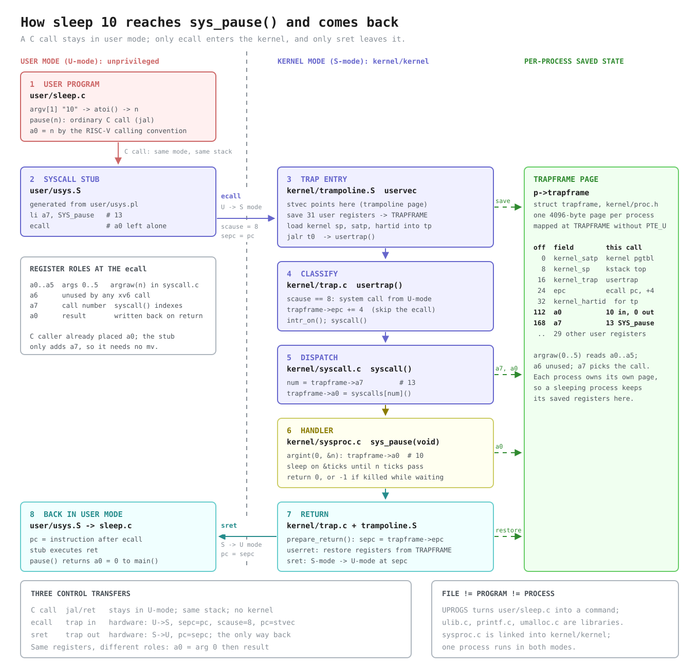
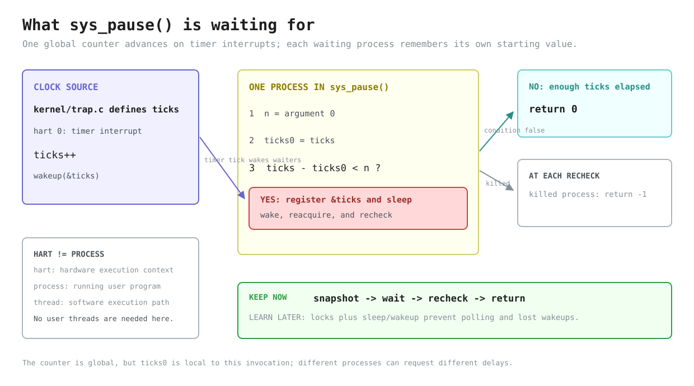

# Lab util: Deriving `sleep`

---

[toc]

---

The first exercise of MIT's [util lab](https://pdos.csail.mit.edu/6.1810/2026/labs/util.html) produces a small user program, but deriving it crosses four existing files: `user/user.h`, generated `user/usys.S`, `kernel/syscall.c`, and `kernel/sysproc.c`. This note explains that path and leaves the target `user/sleep.c` as the exercise.

`sleep` is also the first program in the course whose behavior depends on crossing from user code into the kernel, so this note is the **foundation note for the later labs**. It explains the system-call path once — C call versus `ecall`, `a0` versus `a7`, the stub, and the trapframe — together with where code belongs and what a hart is.

| If you are...                                | Start at                                                                                                        |
| -------------------------------------------- | --------------------------------------------------------------------------------------------------------------- |
| **Implementing the exercise**                | [What the exercise asks for](#what-the-exercise-asks-for), then [Deriving `user/sleep.c`](#deriving-usersleepc) |
| **Learning or reviewing the syscall path**   | [The foundation: a C call that becomes a trap](#the-foundation-a-c-call-that-becomes-a-trap)                    |
| **Wondering why Linux `pause` does not fit** | [xv6 `pause` is not Linux `pause(2)`](#xv6-pause-is-not-linux-pause2)                                           |
| **Deciding what goes in the kernel**         | [Kernel or user: where code belongs](#kernel-or-user-where-code-belongs)                                        |
| **Confused by "hart" versus "CPU"**          | [Harts, CPUs, and processes](#harts-cpus-and-processes)                                                         |
| **Starting a later lab**                     | [Carrying this into later labs](#carrying-this-into-later-labs)                                                 |

> [!IMPORTANT]
> This note contains no solution or pseudocode. It records existing code, the target contract, source-backed decisions, and common traps.

## What the exercise asks for

| Requirement                           | What it fixes                                                                                          |
| ------------------------------------- | ------------------------------------------------------------------------------------------------------ |
| **Program `sleep` in `user/sleep.c`** | The host build product is `user/_sleep`; `mkfs` imports it into `fs.img` as the guest command `sleep`. |
| **One decimal argument in ticks**     | The interface unit is kernel ticks, not seconds.                                                       |
| **Wait through the kernel**           | Pass the requested count to `pause`; do not poll or count in user space.                               |
| **No argument prints an error**       | The missing-argument path must be visible and must return control to the shell.                        |
| **Add `$U/_sleep` to `UPROGS`**       | The Makefile already contains this entry in this tree.                                                 |

The four relevant tests in [`grade-lab-util`](../../grade-lab-util) are worth 25 points:

| Test                                          | Runs                                  | Exact observation                                                                                                                                                                                                                                                                                                                                                  |
| --------------------------------------------- | ------------------------------------- | ------------------------------------------------------------------------------------------------------------------------------------------------------------------------------------------------------------------------------------------------------------------------------------------------------------------------------------------------------------------ |
| **`sleep, no arguments`**                     | `sleep`                               | Supplies no required regex and forbids `exec .* failed` plus `$ sleep\n$`. `no=` means “must not match,” not expected output, so `Usage: sleep ticks` is allowed. The second forbidden regex is also ineffective: `assert_lines_match()` splits the transcript into lines, and its unescaped dollar signs are regex end anchors rather than literal shell prompts. |
| **`sleep, returns`**                          | `sleep`, then `echo OK`               | Requires a line matching `^OK$`, proving that the no-argument invocation returned control to the shell so it could execute the next command. It also applies the same two negative regexes.                                                                                                                                                                        |
| **`sleep, makes syscall`**                    | `sleep 10`, then `echo FAIL`          | Stops at a gdb breakpoint on `sys_pause`, then requires the echoed command line `$ sleep 10` and rejects `FAIL`. Reaching the breakpoint before the shell can run `echo FAIL` proves that the program made the required syscall; the test stops at handler entry, so it neither verifies the argument value nor waits for the requested interval.                  |
| **`sleep, zero and non-numeric args return`** | `sleep 0`, `sleep z`, then `echo OK0` | Requires a line matching `^OK0$` and forbids `exec .* failed`. Both invocations must return promptly rather than hang, because the shell has to reach the third command. It does not distinguish the two cases, require any diagnostic for `z`, or check how long either call took.                                                                                |

> [!NOTE]
> The leading `make: 'kernel/kernel' is up to date.` is a build-status message, not a test result.

It comes from a preflight build that happens before any test is selected:

1. `run_tests()` calls `gradelib.make()` **before** it applies the `sleep` title filter.
2. That helper runs plain `make`, whose default target in this Makefile is `kernel/kernel`.
3. GNU Make finds every kernel prerequisite older than the existing target, so it runs no recipe and prints the message.
4. Each selected test then starts the `qemu-gdb` target through quiet `make -s --no-print-directory`, which still updates dependencies such as `fs.img` when necessary.

| The message does mean                     | The message does not mean                     |
| ----------------------------------------- | --------------------------------------------- |
| The preflight kernel link needed no work. | That QEMU was skipped.                        |
|                                           | That a prior test result was reused.          |
|                                           | That anything compared `user/sleep.c` output. |

### Why two tests can have the same Python function name

The duplicate `def test_sleep_no_args():` declarations are legal because a Python function name is only a module variable. Each `@test(...)` decorator runs as its `def` is evaluated, in this order:

1. `test()` constructs `register_test`.
2. `register_test(original_function)` constructs a separate `run_test` wrapper.
3. `TESTS.append(run_test)` **preserves that wrapper in registration order**.
4. The returned wrapper is assigned to the module name `test_sleep_no_args`.

The second declaration replaces that name but does not remove the first wrapper already stored in `TESTS`. `run_tests()` iterates the list, so both wrappers execute, each with the distinct title captured from its own decorator.

The repeated name is still misleading. `register_test()` copies the original function's `__name__` onto each wrapper, and `save()` derives a failed test's path from that name, so both failures use `xv6.out.sleep_no_args`; if both fail in one run, the later transcript can overwrite the earlier one.

### How `stop_breakpoint('sys_pause')` ends the test

The breakpoint monitor is a deliberately small remote-GDB client, not a subprocess running the interactive `gdb` command:

1. `Runner.run_qemu()` turns its default target base `qemu` into `qemu-gdb`, whose Makefile recipe starts QEMU halted with `-S` and exposes its GDB stub. `GDBClient` connects to the port returned by `make print-gdbport`.
2. `shell_script()` watches QEMU output for each `$ ` prompt. It sends `sleep 10` at the first prompt; it can send `echo FAIL` only if another prompt appears.
3. `stop_breakpoint('sys_pause')` scans `kernel/kernel.sym`, parses the address on the line whose symbol equals `sys_pause`, and passes that address to `GDBClient.breakpoint()`.
4. `breakpoint()` sends remote-protocol packet `Z1,<address>,1`, requesting a hardware breakpoint, and `cont()` later sends `c` to continue the halted machine.
5. When execution reaches `sys_pause`, QEMU sends a stop-reply packet beginning with `T05`, where signal 5 is the remote protocol's trap stop. `GDBClient.handle_read()` responds by raising `TerminateTest`, and `Runner.__react()` catches that private control-flow exception and ends its event loop.
6. `Runner.run_qemu()` terminates QEMU in its `finally` block. Only then does the test call `r.match('\\$ sleep 10', no=['FAIL'])` against the captured console transcript.

> [!IMPORTANT]
> The breakpoint hit is the intended stopping event, not a grader failure. `FAIL` is absent because QEMU stops at handler entry and is then destroyed before `sys_pause()` returns, so the shell never receives the next prompt and never runs `echo FAIL`. The grader does not wait ten ticks and would accept a call that reached `sys_pause` with the wrong integer.

## Prerequisites

| When                            | Read                                                                                                      | Why it matters here                                                                                                                                       |
| ------------------------------- | --------------------------------------------------------------------------------------------------------- | --------------------------------------------------------------------------------------------------------------------------------------------------------- |
| **Read first**                  | [`02-build-boot-and-usage.md`](../02-build-boot-and-usage.md#adding-and-running-a-user-exercise)          | Establishes the xv6 user-program shape, `argc`/`argv`, available headers, and `UPROGS` registration.                                                      |
| **Read first**                  | [`C_Command_Line_Arguments.md`](../../../c-programming/C_Command_Line_Arguments.md#reading-the-arguments) | Reviews how `argc` bounds valid `argv` indices before the missing-argument path uses them.                                                                |
| **Use when tracing the call**   | [`06-build-artifacts.md`](../06-build-artifacts.md#the-four-line-stub-decoded)                            | Owns the generated stub, `a7`, `ecall`, dispatch, and return path shown in the first diagram.                                                             |
| **Use when checking semantics** | [`05-syscall-reference.md`](../05-syscall-reference.md#time-and-system)                                   | Records this tree's `pause(int)` name, tick unit, return behavior, and divergence from upstream xv6.                                                      |
| **Use when a term is unclear**  | [`04-terminology.md`](../04-terminology.md#risc-v-architecture)                                           | Defines hart, CSR, `stvec`, `sepc`, `scause`, privilege modes, trap, and trapframe.                                                                       |
| **Use for the trap mechanism**  | [`book/ch04-traps-and-system-calls.md`](../book/ch04-traps-and-system-calls.md)                           | Will own the trap path; it is still a placeholder, so [the foundation section](#the-foundation-a-c-call-that-becomes-a-trap) holds that material for now. |

> [!NOTE]
> The sibling C note is hosted-C background, not an API list for xv6. In this repository, [`user/user.h`](../../user/user.h) remains the complete callable user interface.

## Why the call is named `pause`

> [!WARNING]
> Grepping for the upstream name wastes time here. `sleep()` in this tree is a _kernel_ function, and the system call the exercise needs is `pause`.

| Name in this tree | What it is                                                           | Defined in                                   |
| ----------------- | -------------------------------------------------------------------- | -------------------------------------------- |
| **`sleep()`**     | The kernel's sleep/wakeup primitive — reserved, not the system call. | [`kernel/proc.c`](../../kernel/proc.c)       |
| **`pause(int)`**  | The user-facing system call, number 13.                              | [`kernel/syscall.h`](../../kernel/syscall.h) |
| **`sys_pause()`** | Its kernel handler, and the symbol the grader breakpoints.           | [`kernel/sysproc.c`](../../kernel/sysproc.c) |
| **`sleep`**       | The guest _program_ this exercise writes. The name is unchanged.     | `user/sleep.c` (the target)                  |

[`05-syscall-reference.md`](../05-syscall-reference.md#divergences-from-posix) records the divergence from upstream xv6, which calls the system call itself `sleep`.

### xv6 `pause` is not Linux `pause(2)`

> [!WARNING]
> `man 2 pause` on the host documents a different system call with a different contract. Use [`05-syscall-reference.md`](../05-syscall-reference.md#time-and-system) and `kernel/sysproc.c`, not the Linux manual, as the specification here.

| Aspect                 | xv6 `pause` (this tree)                | Linux `pause(2)` (`man 2 pause` on the host)                                           |
| ---------------------- | -------------------------------------- | -------------------------------------------------------------------------------------- |
| **Declaration**        | `int pause(int);` in `user/user.h`     | `int pause(void);` in `<unistd.h>`                                                     |
| **Waits for**          | `n` clock ticks to elapse              | A signal that either terminates the process or runs a signal-catching function         |
| **Normal return**      | `0` once enough ticks have passed      | `-1` with `errno` set to `EINTR`, and only after a caught signal's handler returns     |
| **Call number**        | `SYS_pause` = 13 in `kernel/syscall.h` | `__NR_pause` = 34 in the host's x86-64 `/usr/include/x86_64-linux-gnu/asm/unistd_64.h` |
| **Who runs it**        | The xv6 kernel inside the QEMU guest   | The Linux kernel on the host                                                           |
| **Closer Linux match** | —                                      | `sleep(3)` or `nanosleep(2)`, which wait for a duration rather than a signal           |

The shared name is a coincidence of this tree's renaming, not an implementation relationship. xv6 has no signals at all, so the Linux meaning could not even be expressed here. The two numbers are independent too: each kernel numbers its own calls, and the number `13` means something only to `syscall()` in `kernel/syscall.c`.

## The foundation: a C call that becomes a trap

> [!NOTE]
> **Concept on loan.** [`book/ch04-traps-and-system-calls.md`](../book/ch04-traps-and-system-calls.md) will own the trap path but is still a placeholder, so this section holds the trap entry, trapframe, and return material for now. When ch04 is written, move that material there and leave links here. [`06-build-artifacts.md`](../06-build-artifacts.md#the-four-line-stub-decoded) already owns the stub's instructions and the [`a7` design](../06-build-artifacts.md#why-the-system-call-number-goes-in-a7), so this section summarizes them only as far as the exercise needs.



_Legend: pink is the user request, blue crosses and routes the boundary, yellow performs the kernel work, cyan returns the result, and green is the saved per-process data that every kernel step reads or writes. The dashed vertical line is the U-mode/S-mode privilege boundary; only `ecall` and `sret` cross it. [Edit the Excalidraw source.](fig/util-sleep-syscall-boundary.excalidraw)_

Two facts carry the whole figure. First, the user program never calls kernel code; it calls a three-instruction stub, and the hardware, not a function call, moves it into the kernel. Second, the kernel never receives C parameters from user code; it reads the saved user registers out of the trapframe.

### Three control transfers

| Transfer               | Instruction                 | Privilege       | Stack                                               | Target chosen by                                             | In this exercise                                   |
| ---------------------- | --------------------------- | --------------- | --------------------------------------------------- | ------------------------------------------------------------ | -------------------------------------------------- |
| **C function call**    | `jal`, returning with `ret` | Unchanged       | The same user stack                                 | The linker, which resolved the symbol's address              | `main()` calls `pause()`, `atoi()`, or `fprintf()` |
| **System-call entry**  | `ecall`                     | U-mode → S-mode | `uservec` switches to the process's kernel stack    | The kernel, through `stvec` set by `prepare_return()`        | The `pause` stub enters `uservec`                  |
| **System-call return** | `sret`                      | S-mode → U-mode | `userret` restores the user `sp` from the trapframe | `sepc`, which `prepare_return()` loads from `trapframe->epc` | `userret` resumes at the instruction after `ecall` |

A call to `pause()` and a call to `atoi()` look identical in C and compile to the same `jal` instruction. The difference is what the callee does: `atoi()` in `user/ulib.c` computes and returns in user mode, while `pause` in `user/usys.S` executes `ecall`.

A user program cannot simply `jal sys_pause`, for three reasons that together are the point of a system call:

1. **Privilege.** `sys_pause()` runs code that needs S-mode, such as sleeping on the scheduler, and U-mode cannot raise its own privilege.
2. **Mapping.** A process's page table does not map the kernel image at all; `uservec` switches to the separate kernel page table before calling C. The only kernel pages a user page table contains, the trampoline and the trapframe, lack `PTE_U` (`proc_pagetable()` in `kernel/proc.c`), so U-mode cannot touch even those.
3. **Entry point control.** `ecall` always lands at the address in `stvec`, which only the kernel can set. A user program can ask for a service by number; it can never choose where in the kernel to start executing.

`ecall` is one kind of **trap**. The same `uservec` and `usertrap()` path also handles device interrupts and exceptions such as page faults, and `usertrap()` tells them apart through `scause`: `8` is an environment call from U-mode, `13` and `15` are load and store page faults, and `devintr()` recognizes interrupt causes.

### `a0` versus `a7`

| Register      | Before `ecall`                    | Inside the kernel                                                                                  | After `sret`                |
| ------------- | --------------------------------- | -------------------------------------------------------------------------------------------------- | --------------------------- |
| **`a0`**      | Argument 0: the tick count `n`    | Saved as `trapframe->a0`; `argint(0, &n)` reads it, then `syscall()` overwrites it with the result | The result: `0` in practice |
| **`a1`–`a5`** | Arguments 1–5; `pause` uses none  | Readable through `argraw(1)` to `argraw(5)`                                                        | Restored unchanged          |
| **`a6`**      | Unused by every xv6 system call   | Saved and restored like any register                                                               | Restored unchanged          |
| **`a7`**      | `SYS_pause` = 13, set by the stub | `syscall()` reads `trapframe->a7` to index `syscalls[]`                                            | Restored, still 13          |

`a0` does double duty because the RISC-V calling convention already uses it for both the first argument and the return value. The C caller placed `n` in `a0` before the stub ran, and the caller will read the result from `a0` after the stub's `ret`, so the stub never moves either value. `a7` is the argument register the six-argument channel leaves free; [`06-build-artifacts.md`](../06-build-artifacts.md#why-the-system-call-number-goes-in-a7) owns the full reasoning.

The widths differ at each end. The register and the trapframe slot are 64-bit; `argint()` truncates to `int`, and `sys_pause()` returns `uint64`, which the user-side declaration `int pause(int)` reads back as `int`. That round trip is why a handler's `return -1`, such as a failing `sys_read()`, arrives as the user `int` value `-1`. `sys_pause()`'s own `-1` never arrives: as the **Killed check** row in the `sys_pause()` walkthrough below explains, `usertrap()` exits the killed process before it returns to user mode.

### The stub

| Property         | Value                                                                                                                                   |
| ---------------- | --------------------------------------------------------------------------------------------------------------------------------------- |
| **Generated by** | `user/usys.pl`, at build time, into `user/usys.S`, which `.gitignore` excludes                                                          |
| **Per call**     | A `.global` label, `li a7, SYS_<name>`, `ecall`, and `ret`                                                                              |
| **Linked into**  | Every user program, as `usys.o` in `ULIB` in the Makefile                                                                               |
| **Exception**    | `sbrk`'s stub is named `sys_sbrk`; `sbrk()` and `sbrklazy()` in `user/ulib.c` are ordinary C wrappers that call it with a mode argument |

The stub exists because C has no way to name `a7` or emit `ecall`. It gives each system call an ordinary C-callable symbol, so the prototype in `user/user.h` links like any other function. [`04-terminology.md`](../04-terminology.md#stub-not-snippet-function-or-module) explains why the word is "stub"; [`06-build-artifacts.md`](../06-build-artifacts.md#why-generate-usyss-instead-of-writing-it) explains why the file is generated rather than written.

### The trapframe

`struct trapframe` in `kernel/proc.h` is one page per process, pointed to by `p->trapframe`, that holds every user register while that process is in the kernel. The figure lists its fields; these are the design reasons:

| Property                  | Source                                                                         | Why it has to be that way                                                                                                                                        |
| ------------------------- | ------------------------------------------------------------------------------ | ---------------------------------------------------------------------------------------------------------------------------------------------------------------- |
| **One per process**       | `p->trapframe` in `struct proc`, `kernel/proc.h`                               | `sys_pause()` sleeps. Another process then runs on the same hart and traps; if both shared one save area, the second trap would overwrite the first's registers. |
| **At a fixed address**    | `TRAPFRAME` = `TRAMPOLINE - PGSIZE`, `kernel/memlayout.h`                      | On entry `uservec` has no free register. It parks user `a0` in `sscratch` and loads the constant `TRAPFRAME`, the only address it can form without a pointer.    |
| **Kernel-only**           | Mapped `PTE_R \| PTE_W` without `PTE_U` in `proc_pagetable()`, `kernel/proc.c` | User code must not read or forge `kernel_satp`, `kernel_sp`, or `kernel_trap`, which `uservec` trusts.                                                           |
| **Not on the user stack** | —                                                                              | A trap can arrive with any value in the user `sp`; the kernel cannot trust or depend on it.                                                                      |
| **Two halves**            | Offsets 0–32 and 40–280                                                        | `prepare_return()` in `kernel/trap.c` fills the kernel fields before each return to user; `uservec` and `userret` save and restore the 31 user registers.        |

> [!IMPORTANT]
> Every system-call argument is read from the trapframe, never from a C parameter. That is why every handler has the signature `uint64 sys_x(void)`, and why a handler that changes `p->trapframe->a0` or `epc` changes what user code sees after `sret`.

### The trap path in eight steps

The numbers match the figure:

1. **`user/sleep.c`** calls `pause(n)` with `jal`; the calling convention has already put `n` in `a0`.
2. **`user/usys.S`** loads `SYS_pause` into `a7` and executes `ecall`. The hardware switches to S-mode, saves the `ecall`'s address in `sepc`, sets `scause` to 8, and jumps to `stvec`.
3. **`uservec` in `kernel/trampoline.S`** saves all 31 user registers into `TRAPFRAME`, loads the kernel stack pointer, page table (`satp`), and hart id (`tp`) from the trapframe's kernel half, and jumps to `usertrap()`.
4. **`usertrap()` in `kernel/trap.c`** copies `sepc` to `trapframe->epc`, recognizes `scause == 8`, adds 4 to `epc`, enables interrupts, and calls `syscall()`.
5. **`syscall()` in `kernel/syscall.c`** reads `trapframe->a7` and calls `syscalls[13]`, which is `sys_pause`.
6. **`sys_pause()` in `kernel/sysproc.c`** reads argument 0 from `trapframe->a0`, sleeps until the ticks have passed, and returns `0` or `-1`.
7. **`syscall()` stores the result in `trapframe->a0`**, then `usertrap()` calls `prepare_return()` to set `sepc` from `epc`, and `userret` in `kernel/trampoline.S` restores every user register before `sret`.
8. **Back in U-mode**, execution resumes at the stub's `ret`, which returns to `main()` with the result in `a0`.

Step 4's `epc += 4` is easy to miss and fatal to omit. `sepc` records the `ecall` itself, and `ecall` is a 4-byte instruction with no compressed form even though `-march=rv64gc` allows 2-byte instructions elsewhere, so without the adjustment `sret` would re-execute the `ecall` and the program would loop in the system call forever. Interrupts are enabled only after `sepc`, `scause`, and `sstatus` have been read, because an interrupt would overwrite them.

Step 5 is the whole dispatcher, from [`kernel/syscall.c`](../../kernel/syscall.c):

```c
void
syscall(void)
{
  int num;
  struct proc *p = myproc();

  num = p->trapframe->a7;
  if (num > 0 && num < NELEM(syscalls) && syscalls[num]) {
    // Use num to lookup the system call function for num, call it,
    // and store its return value in p->trapframe->a0
    p->trapframe->a0 = syscalls[num]();
  } else {
    printk("%d %s: unknown sys call %d\n", p->pid, p->name, num);
    p->trapframe->a0 = -1;
  }
}
```

| Code                                     | Meaning                                                                                                                                                 |
| ---------------------------------------- | ------------------------------------------------------------------------------------------------------------------------------------------------------- |
| **`num = p->trapframe->a7`**             | The call number comes from the saved register, not from any argument. This is the only place `a7` is interpreted.                                       |
| **Bounds and null check**                | A forged or stale number cannot index past `syscalls[]` or call a hole in it; the table uses designated initializers such as `[SYS_pause] = sys_pause`. |
| **`p->trapframe->a0 = syscalls[num]()`** | The handler takes no parameters and its return value replaces argument 0, which `userret` then loads into the real `a0`.                                |
| **Unknown number**                       | Prints a kernel message and returns `-1` to the caller instead of killing the process.                                                                  |

## The four existing layers

| File               | Contributes                                                                                          | Does not contribute                                   |
| ------------------ | ---------------------------------------------------------------------------------------------------- | ----------------------------------------------------- |
| `user/user.h`      | Declares `int pause(int)` and the user helpers available without a host C library.                   | No implementation or argument validation.             |
| `user/usys.S`      | Loads `SYS_pause`, executes `ecall`, and returns; it is generated from `user/usys.pl`.               | No policy and no reason to edit it for this exercise. |
| `kernel/syscall.c` | Dispatches call number 13 (`kernel/syscall.h`) and transfers the return value through the trapframe. | No knowledge of the argument's meaning.               |
| `kernel/sysproc.c` | Fetches the tick count and implements the wait in `sys_pause()`.                                     | No parsing of command-line text.                      |

[`06-build-artifacts.md`](../06-build-artifacts.md#the-four-line-stub-decoded) owns the `ecall`, `a7`, and generated-stub mechanics. [`02-build-boot-and-usage.md`](../02-build-boot-and-usage.md#adding-and-running-a-user-exercise) owns user-program layout, headers, formatting, and `UPROGS`.

### Why four files when Linux already has `pause`

> [!NOTE]
> The exercise adds exactly one file, `user/sleep.c`. The four layers above already exist; you read them, and you edit none of them.

Two separate facts answer the question:

1. **The program never runs on Linux.** `user/_sleep` executes as an xv6 process inside the QEMU guest, so only xv6's kernel can answer its `ecall`. The host's glibc wrapper cannot even link, because user programs build with `-ffreestanding -nostdlib`; [`06-build-artifacts.md`](../06-build-artifacts.md#why-you-cannot-use-the-hosts-headers) traces exactly where that fails.
2. **Linux has the same four layers; you just never see them.** Every system call on any Unix needs a declaration, a user-side wrapper that loads a number and traps, kernel entry and dispatch code, and a handler. xv6 keeps all four in this tree, small enough to read:

| Layer                       | xv6, in this tree                                              | Linux, out of sight                                                      |
| --------------------------- | -------------------------------------------------------------- | ------------------------------------------------------------------------ |
| **Declaration**             | `user/user.h`                                                  | `<unistd.h>` and the other glibc headers                                 |
| **Wrapper that traps**      | Generated `user/usys.S`                                        | glibc's system-call wrappers, prebuilt into the shared C library         |
| **Trap entry and dispatch** | `kernel/trampoline.S`, `kernel/trap.c`, and `kernel/syscall.c` | The architecture's entry code and system-call table in the Linux kernel  |
| **Handler**                 | `sys_pause()` in `kernel/sysproc.c`                            | The corresponding handler inside the Linux kernel                        |

[`06-build-artifacts.md`](../06-build-artifacts.md#where-each-piece-would-live-on-linux) maps the rest of the tree onto its Linux counterparts.

### Names before mechanisms

| Term                    | Meaning in this exercise                                                                                                                                                                                                                                                                                                                                                          |
| ----------------------- | --------------------------------------------------------------------------------------------------------------------------------------------------------------------------------------------------------------------------------------------------------------------------------------------------------------------------------------------------------------------------------- |
| **User program**        | An executable that runs outside the kernel, such as the future `sleep` command. The `user/` directory also contains library sources such as `ulib.c`, `printf.c`, and `umalloc.c`, so a `.c` file under `user/` is not automatically a separate program. An entry such as `user/_sleep` in `UPROGS` builds a host file with that name; `mkfs` installs it in `fs.img` as `sleep`. |
| **Process**             | One running instance of a user program. Its saved `struct trapframe` holds the user registers while the kernel handles its system call.                                                                                                                                                                                                                                           |
| **Kernel**              | The privileged `kernel/kernel` image built from the files under `kernel/`. `kernel/sysproc.c` contributes handlers to that image; it is not an independently run program.                                                                                                                                                                                                         |
| **System-call handler** | Kernel code that performs a user request. `pause(int)` is the user-facing function, while `sys_pause(void)` is its dispatcher-compatible kernel handler.                                                                                                                                                                                                                          |
| **Hart**                | A RISC-V hardware execution context. QEMU presents each configured xv6 CPU as a hart, so this tree often uses “CPU” and “hart” for the same hardware role. A hart is not a process and is not a user-level software thread. See [Harts, CPUs, and processes](#harts-cpus-and-processes).                                                                                          |
| **Tick**                | One increment of the global `ticks` counter by `clockintr()` on hart 0. Other harts can run processes, but they do not each maintain a separate counter.                                                                                                                                                                                                                          |

> [!NOTE]
> For `user/sleep.c`, the important boundary is simple: the user program validates text, converts it to an integer, and asks `pause` to wait that many ticks. The kernel owns how waiting stops consuming CPU. The lock and wakeup protocol explains how that ownership is implemented safely, but it is not part of the user-program design.

## Kernel or user: where code belongs

> [!IMPORTANT]
> Put code in the kernel only when it needs something that only S-mode has. Everything else belongs in user space, where a bug kills one process instead of stopping the machine with a `panic`.

| Does the code need to...                                               | Then it belongs in | Example from this exercise                                         |
| ---------------------------------------------------------------------- | ------------------ | ------------------------------------------------------------------ |
| **Touch hardware or privileged registers** (CSRs, device MMIO, `satp`) | Kernel             | `clockintr()` programs the next timer interrupt with `stimecmp`    |
| **Stop a process from running, or wake one**                           | Kernel             | `sleep()` and `wakeup()` inside `sys_pause()`                      |
| **Read or change state shared between processes**                      | Kernel             | `ticks`, protected by `tickslock`                                  |
| **Compute on the process's own memory**                                | User               | Counting arguments, `atoi()`, the diagnostic text                  |
| **Combine existing system calls**                                      | User library       | `fprintf()` builds text and calls `write`; `malloc()` calls `sbrk` |

`sleep` splits cleanly along that line. Parsing `"10"` needs nothing privileged, so it stays in `user/sleep.c`. Waiting without burning CPU means marking the process `SLEEPING` so `scheduler()` in `kernel/proc.c` skips it until a timer interrupt wakes it, which only the kernel can do, and `pause` already exposes exactly that. No new kernel code is needed, which is why this exercise writes a user program and the later syscall lab is the one that adds system calls.

### What the kernel already offers a user program

| Layer                         | Where it is declared                                                  | Size                                        | Who can call it                                                          |
| ----------------------------- | --------------------------------------------------------------------- | ------------------------------------------- | ------------------------------------------------------------------------ |
| **System calls**              | Numbers in `kernel/syscall.h`; prototypes at the top of `user/user.h` | 22, from `SYS_fork` = 1 to `SYS_sync` = 22  | User programs, through a stub and `ecall`                                |
| **User library (`ULIB`)**     | Below `// ulib.c` in `user/user.h`                                    | `ulib.o`, `usys.o`, `printf.o`, `umalloc.o` | User programs, by plain C calls; it makes system calls on their behalf   |
| **Kernel-internal functions** | `kernel/defs.h`                                                       | Every function shared between kernel files  | Only kernel code; for example `printk`, `kalloc`, `copyout`, and `sleep` |

Those 22 calls are xv6's complete kernel interface, and they are deliberately minimal: process control (`fork`, `exit`, `wait`, `kill`, `exec`, `getpid`), files (`pipe`, `read`, `write`, `close`, `open`, `fstat`, `dup`), directories (`chdir`, `mknod`, `unlink`, `link`, `mkdir`), memory (`sbrk`), time (`pause`, `uptime`), and `sync`. Every user program in this tree, including the shell, is built from them; [`05-syscall-reference.md`](../05-syscall-reference.md#at-a-glance) documents each one.

> [!WARNING]
> The direction is one-way. User code reaches the kernel only through those 22 numbers, and kernel code never makes system calls: it already runs in S-mode, so it calls the internal function directly. The kernel waits with `sleep()`, not `pause()`, and prints with `printk()`, not `printf()`. `user/user.h` is not available to kernel files, and `kernel/defs.h` is not callable from user programs.

## Harts, CPUs, and processes

**Yes, hart means hardware thread**: one independently executing set of registers, program counter, and control registers. It is the RISC-V word for what an operating system schedules onto, and it is not always the same as a physical core, because one core can implement several harts.

| Term         | In this tree                                                                                                                         | Source                                  |
| ------------ | ------------------------------------------------------------------------------------------------------------------------------------ | --------------------------------------- |
| **Hart**     | One emulated hardware thread. QEMU creates `-smp $(CPUS)` of them.                                                                   | `QEMUOPTS` in the Makefile              |
| **How many** | `CPUS` defaults to 3; the Makefile forces 1 for `LAB=fs` and 4 for `LAB=lock`; `NCPU` = 8 is the most xv6 supports.                  | Makefile; `kernel/param.h`              |
| **CPU**      | xv6's per-hart bookkeeping, `struct cpu` in `cpus[NCPU]`: the running process, the scheduler context, and interrupt-nesting state.   | `kernel/proc.h`                         |
| **Hart id**  | `start()` copies `mhartid` into `tp`; `cpuid()` reads `tp`. User code may change `tp`, so `uservec` reloads it from `kernel_hartid`. | `kernel/start.c`; `kernel/trampoline.S` |
| **Process**  | Software: `struct proc`. A hart runs at most one process at a time, and a process can resume on a different hart after it sleeps.    | `kernel/proc.h`                         |
| **Ticks**    | Only hart 0 increments `ticks`, although every hart takes its own timer interrupts and may `yield()`.                                | `clockintr()` in `kernel/trap.c`        |

> [!TIP]
> Use `make CPUS=1 qemu-gdb` when stepping through the trap path. With one hart, GDB has one thread to follow, and no other hart runs a process between your steps.

This is also why the trapframe is per process rather than per hart: `sys_pause()` can sleep on hart 1 and resume on hart 2, so the saved user registers must travel with the process, not stay with the hardware.

## `sys_pause()` line by line

The waiting logic is this complete function from [`kernel/sysproc.c`](../../kernel/sysproc.c):

```c
uint64
sys_pause(void)
{
  int n;
  uint ticks0;

  argint(0, &n);
  if (n < 0)
    n = 0;
  acquire(&tickslock);
  ticks0 = ticks;
  while (ticks - ticks0 < n) {
    if (killed(myproc())) {
      release(&tickslock);
      return -1;
    }
    sleep_prepare(&ticks);
    release(&tickslock);
    sleep();
    acquire(&tickslock);
  }
  release(&tickslock);
  return 0;
}
```

| Code                             | Meaning                                                                                                                                                                                                                                                                                                                   |
| -------------------------------- | ------------------------------------------------------------------------------------------------------------------------------------------------------------------------------------------------------------------------------------------------------------------------------------------------------------------------- |
| **`argint(0, &n)`**              | Fetches system-call argument index 0 from the saved trapframe. `argraw()` in `kernel/syscall.c` maps indices 0 through 5 to `a0` through `a5`, so index 0 means `a0`; `a7` is separate because it holds the system-call number. Every handler has the dispatcher-compatible form `uint64 f(void)`.                        |
| **Negative clamp**               | Converts negative counts to zero. This prevents the later unsigned comparison from turning `-1` into a multi-year wait.                                                                                                                                                                                                   |
| **`tickslock` and `ticks0`**     | `ticks` and `tickslock` are defined in `kernel/trap.c` and declared for other kernel files in `kernel/defs.h`. The lock protects the shared global counter, while local variable `ticks0` snapshots this caller's starting tick.                                                                                          |
| **`while (ticks - ticks0 < n)`** | Rechecks the caller's own deadline because every tick wakes every waiter on `&ticks`. Unsigned subtraction remains correct across counter wraparound.                                                                                                                                                                     |
| **Killed check**                 | Allows the handler to return `-1`. A sleeping victim is made runnable by `kkill()` in `kernel/proc.c`; after the handler returns, `usertrap()` in `kernel/trap.c` sees the kill flag and calls `kexit(-1)` before returning to user mode. User code therefore cannot observe or recover from this `-1` path in this tree. |
| **Prepare, release, sleep**      | Registers the wait channel before releasing `tickslock`, preventing a lost wakeup. `sleep()` does not block if a wakeup already cleared the channel.                                                                                                                                                                      |
| **Reacquire and return**         | Rechecks under the lock, then returns zero after enough ticks.                                                                                                                                                                                                                                                            |

[`docs/book/ch09-sleep-and-wakeup.md`](../book/ch09-sleep-and-wakeup.md) owns the general lost-wakeup mechanism and this tree's prepare/sleep split.



_The main loop is “snapshot, wait, recheck.” The red wait state does not mean failure; it marks where the process is deliberately not runnable until a wakeup. [Edit the Excalidraw source.](fig/util-sleep-tick-wait.excalidraw)_

## What a tick means

| Fact                 | Source-backed meaning                                                                                                                                               |
| -------------------- | ------------------------------------------------------------------------------------------------------------------------------------------------------------------- |
| **Counter owner**    | Only hart 0 increments the global `ticks` counter in `clockintr()` in [`kernel/trap.c`](../../kernel/trap.c); the other harts do not maintain per-hart tick counts. |
| **Wakeup event**     | The same interrupt path calls `wakeup(&ticks)`, making waiters eligible to recheck their own elapsed-tick condition.                                                |
| **Current interval** | The next interrupt is scheduled `1000000` RISC-V `time`-register timebase units later, which the source comment describes as about one tenth of a second.           |
| **API contract**     | `pause(n)` accepts ticks, not seconds; the approximate wall-clock conversion is an observation about the current machine configuration.                             |

| Call        | Approximate nominal interval |
| ----------- | ---------------------------- |
| `pause(1)`  | 0.1 s                        |
| `pause(10)` | 1 s                          |
| `pause(20)` | 2 s                          |

> [!CAUTION]
> Ticks, not seconds, are the interface. The conversion is an observation about the current timer constant, not a guarantee for user programs to encode.

| Boundary                 | Earliest source-level conclusion                                                                                                       |
| ------------------------ | -------------------------------------------------------------------------------------------------------------------------------------- |
| **`n == 0`**             | The loop condition is false immediately, so no tick wakeup is required.                                                                |
| **`n > 0`**              | The condition becomes false after between `n - 1` and `n` timer intervals because `ticks0` may be sampled anywhere within an interval. |
| **After the final tick** | The process is eligible to run, but scheduler delay can make the observed return later than the nominal interval.                      |

This timing range follows from sampling a discrete counter rather than starting a new timer at the instant of the call. The kernel guarantees an elapsed-tick condition, not exact wall-clock latency.

## Deriving `user/sleep.c`

### Contract

| Aspect               | Fixed requirement                                                                                                           |
| -------------------- | --------------------------------------------------------------------------------------------------------------------------- |
| **Input**            | One command-line argument containing a decimal tick count.                                                                  |
| **Available APIs**   | Only declarations in `user/user.h`; there is no host C library.                                                             |
| **Waiting**          | Pass the tick count to `pause`; do not implement a user-space timer.                                                        |
| **Missing argument** | Print a diagnostic and finish so the shell can continue.                                                                    |
| **Exit status**      | A nonzero error status and zero success status are this repository's convention; the grader does not inspect them directly. |

### Decisions and evidence

1. **How should `main` receive arguments?** Compare an argument-taking program such as `user/echo.c`; [`02-build-boot-and-usage.md`](../02-build-boot-and-usage.md#how-command-words-reach-main-via-argcargv) traces how the shell and kernel construct `argc` and `argv`, while its [house-style section](../02-build-boot-and-usage.md#house-style-for-a-new-user-program) records the required top-level function layout.
2. **Which `argc` value represents exactly one supplied argument?** Account for `argv[0]`, the program name.
3. **How is text converted to an integer?** Read `atoi()` in `user/ulib.c`. It converts only the initial run of decimal digits and returns zero when the first character is not a digit, without reporting whether conversion succeeded, so decide whether the exercise requires validation beyond that helper's contract.
4. **How is a diagnostic written to file descriptor 2?** Find the descriptor-taking formatted-output function in `user/user.h`; `user/ex2create.c` demonstrates the repository's error style.
5. **What does the grader require from the missing-argument path?** Compare both no-argument test bodies in `grade-lab-util`; distinguish their output and return checks from local exit-status convention.

> [!NOTE]
> The exercise and grader require a missing-argument diagnostic but define no malformed-input policy. This tree's `atoi()` cannot distinguish valid zero from failed conversion and accepts a decimal prefix such as `3x`, so checking only whether its result equals zero is not validation. A stricter command would need a separate parser that checks every character and detects integer overflow; that is useful production behavior but additional scope for this exercise.

### Traps

| Trap                                    | Result                                                                                                                                                                                                    | Reason                                                             |
| --------------------------------------- | --------------------------------------------------------------------------------------------------------------------------------------------------------------------------------------------------------- | ------------------------------------------------------------------ |
| **Continuing after a missing argument** | `argv[1]` is the null terminator of the argument vector, so `atoi(argv[1])` dereferences a null pointer and the process faults. The later `echo OK` may still run, but the required diagnostic is absent. | A diagnostic must be paired with leaving the error path.           |
| **Using `printf` for a diagnostic**     | The message goes to standard output.                                                                                                                                                                      | Descriptor 2 keeps diagnostics separate from normal output.        |
| **Treating a zero result as invalid**   | A valid `0` and a string with no initial digits become indistinguishable.                                                                                                                                 | This tree's `atoi()` reports only the converted value.             |
| **Converting ticks to seconds**         | The requested wait is scaled incorrectly.                                                                                                                                                                 | The syscall already accepts ticks.                                 |
| **Polling `uptime()`**                  | The syscall breakpoint is never reached, and the process remains runnable.                                                                                                                                | The exercise requires kernel-managed waiting.                      |
| **Omitting `UPROGS`**                   | The shell reports `exec sleep failed`.                                                                                                                                                                    | Only named programs enter `fs.img`; this entry is already present. |
| **Using host-library APIs**             | Compilation fails under `-ffreestanding -nostdlib`.                                                                                                                                                       | `user/user.h` is the complete user API.                            |

## When the grader and shell disagree

The focused grader and an interactive shell can report different results because they may be running different QEMU instances against different moments in the build. The grader boots a new guest for each test; it does not inspect or update a shell that was already running before the latest `user/sleep.c` build.

| Observation                                 | What it means                                                                                                                                                                                                                                                                                                                   |
| ------------------------------------------- | ------------------------------------------------------------------------------------------------------------------------------------------------------------------------------------------------------------------------------------------------------------------------------------------------------------------------------- |
| **`./grade-lab-util sleep` passes**         | The no-argument invocation returned so the second test could observe `OK`, and `sleep 10` reached `sys_pause`. The grader does not require a particular diagnostic, its attempted silent-transcript rejection is ineffective, and the breakpoint test neither verifies that the handler received 10 nor measures elapsed ticks. |
| **`sleep 3` appears to return immediately** | The argument is three ticks, not three seconds. With the current timer interval, that is nominally about 0.3 seconds.                                                                                                                                                                                                           |
| **`exec sleep failed` appears**             | `exec()` failed before `user/sleep.c:main()` ran. The shell prints this message in `user/sh.c` when it cannot load the guest executable, commonly because the active `fs.img` does not contain `sleep`.                                                                                                                         |

If the grader is to be strengthened, the options are not equally good:

| Candidate assertion                                            | Determinism | Why                                                                                                                                   |
| -------------------------------------------------------------- | ----------- | ------------------------------------------------------------------------------------------------------------------------------------- |
| **Inspect the syscall argument at `sys_pause` and require 10** | Highest     | `sys_pause()` is existing kernel code, so the correct argument already establishes the intended wait without depending on scheduling. |
| **Compare guest `uptime()` before and after the command**      | Good        | Measures elapsed kernel ticks, the unit the interface actually promises.                                                              |
| **Time the command on the host wall clock**                    | Coarse only | QEMU startup and host scheduling add unrelated delay, so this belongs as a secondary check at most.                                   |

> [!WARNING]
> Do not run the grader while an interactive QEMU instance is still using `fs.img`. A dependency rebuild can rewrite that image before the grader's second QEMU process discovers the write lock, leaving the running guest with a disk that changed underneath it. Quit QEMU with `Ctrl-a x`, confirm that `pgrep -af qemu-system-riscv64` finds no old instance, then rebuild or grade.

`make qemu` rotates the old image to `fs.img.bk` and constructs a fresh `fs.img` from `UPROGS`. After boot, `ls | grep sleep` distinguishes an image problem from behavior inside the program: no matching row means the command is absent from that guest. [`02-build-boot-and-usage.md`](../02-build-boot-and-usage.md#adding-and-running-a-user-exercise) owns the general build and image mechanics.

## Verifying it

Build and exercise both paths in the guest:

```bash
make qemu
```

```text
$ sleep
$ sleep 10
$ echo OK
```

Run the focused grader:

```bash
./grade-lab-util sleep
```

Failures leave transcripts in `xv6.out.sleep` and `xv6.out.sleep_no_args`; because the first two wrappers share their Python name, two simultaneous failures can write the same `xv6.out.sleep_no_args` path. [`03-lab-workflow.md`](../03-lab-workflow.md#grading) explains how to read grader transcripts generally.

To reproduce the syscall test interactively, use two terminals:

1. Start QEMU halted with one hart in terminal 1:

    ```bash
    make CPUS=1 qemu-gdb
    ```

2. Connect in terminal 2, set the same symbolic breakpoint as the grader, and continue through boot:

    ```bash
    gdb-multiarch -x .gdbinit kernel/kernel
    ```

    ```gdb
    (gdb) break sys_pause
    (gdb) continue
    ```

3. When terminal 1 shows the xv6 prompt, enter the grader's command:

    ```text
    $ sleep 10
    ```

4. GDB stops at `kernel/sysproc.c:90`, the opening brace. Advance to the `argint` call, execute it, then inspect both the decoded local and the saved user registers:

    ```gdb
    (gdb) next
    94        argint(0, &n);
    (gdb) next
    95        if (n < 0)
    (gdb) print n
    $1 = 10
    (gdb) info registers a0 a7
    a0             0xa        10
    a7             0xd        13
    (gdb) backtrace
    ```

The exact addresses in the backtrace change after a rebuild, but its named kernel frames should include `sys_pause`, `syscall`, and `usertrap`. What each observation is worth:

| Observation             | Proves                                                        | Still does not prove                                        |
| ----------------------- | ------------------------------------------------------------- | ----------------------------------------------------------- |
| **The breakpoint hits** | `sleep 10` reached the handler through the real syscall path. | That the argument was correct.                              |
| **`n == 10`**           | The argument check that `grade-lab-util` omits entirely.      | That any ticks elapsed.                                     |
| **Neither, together**   | —                                                             | That no other path burned CPU, or how long the wait lasted. |

Two other notes own the surrounding workflow: [console setup and the VS Code workflow](../02-build-boot-and-usage.md#debugging-with-vs-code) covers debugger startup, controls, and cleanup, and [manually debugging an xv6 user program](../09-debugging-xv6.md#manually-debugging-an-xv6-user-program) explains why the existing `sleep.c` breakpoint is unresolved and how to stop at `sleep.c:main` without changing `.vscode`.

## Carrying this into later labs

Each later lab branch in this repository's `labs` remote builds on one part of this note. The table names the part to reread first; it does not describe any lab's solution.

| Lab                   | Reuses from this note                                                                                                  | Existing code it turns on                                                                                                                                                              |
| --------------------- | ---------------------------------------------------------------------------------------------------------------------- | -------------------------------------------------------------------------------------------------------------------------------------------------------------------------------------- |
| **`syscall`**         | [The stub](#the-stub), [`a0` versus `a7`](#a0-versus-a7), and [where code belongs](#kernel-or-user-where-code-belongs) | The four registration files plus the handler, listed in [`05-syscall-reference.md`](../05-syscall-reference.md#what-a-system-call-actually-is-here); `argint`, `argaddr`, and `argstr` |
| **`pgtbl`**           | [The trapframe](#the-trapframe)'s fixed address and missing `PTE_U`                                                    | `proc_pagetable()` in `kernel/proc.c`; `kernel/memlayout.h`                                                                                                                            |
| **`traps`**           | [The trap path in eight steps](#the-trap-path-in-eight-steps) and the saved `epc`                                      | `usertrap()` and `prepare_return()` in `kernel/trap.c`; `kernel/trampoline.S`                                                                                                          |
| **`cow`**, **`mmap`** | The `scause` branches in [Three control transfers](#three-control-transfers)                                           | The page-fault branch of `usertrap()` that calls `vmfault()`                                                                                                                           |
| **`net`**             | Device interrupts sharing the trap path                                                                                | `devintr()` in `kernel/trap.c` and the PLIC                                                                                                                                            |
| **`lock`**            | [Harts, CPUs, and processes](#harts-cpus-and-processes); `tickslock` in `sys_pause()`                                  | `CPUS := 4` for `LAB=lock` in the Makefile                                                                                                                                             |
| **`fs`**              | [Harts, CPUs, and processes](#harts-cpus-and-processes)                                                                | `CPUS := 1` for `LAB=fs` in the Makefile                                                                                                                                               |

> [!TIP]
> The fastest orientation for any later exercise is the gdb recipe in [Verifying it](#verifying-it) with a different breakpoint: stop at the handler the exercise turns on, run `backtrace`, and inspect `p->trapframe` to see which user registers the kernel is working from.

## Questions

1. Why does `sys_pause(void)` receive no C parameter when `pause(int)` does, and where is the integer stored across the trap?
2. What failure occurs if the program reads `argv[1]` when only `argv[0]` exists?
3. Why must the wait condition be a `while` rather than an `if` when two processes request different delays?
4. How does registering `&ticks` before releasing `tickslock` prevent a lost wakeup?
5. What happens from `kkill()` through `usertrap()` when the target is already sleeping in `sys_pause()`?
6. Why does unsigned subtraction handle tick-counter wraparound while a comparison against `ticks0 + n` may not?
7. What would happen if `usertrap()` forgot to add 4 to `trapframe->epc` for a system call, and why does it not add 4 for a timer interrupt?
8. Why can `uservec` not save the user registers on the user stack, and what failure would a garbage user `sp` cause if it tried?
