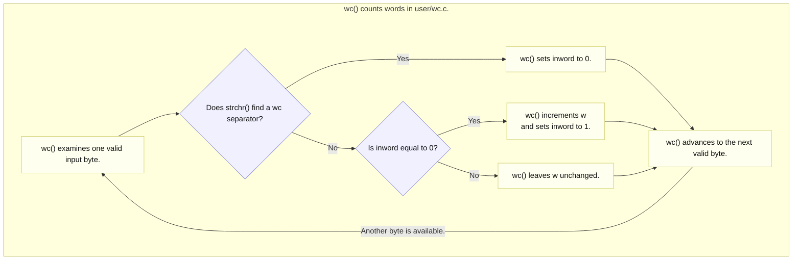

# Lab util: Deriving `sixfive`

---

[toc]

---

MIT's [`sixfive` exercise](https://pdos.csail.mit.edu/6.1810/2026/labs/util.html) is a small text parser built from `open`, `read`, `strchr`, integer arithmetic, and ordinary user-space state. The difficult part is not divisibility; it is preserving the distinction between a decimal number such as `/6,` and a digit embedded in a non-number such as `xv6`. This note derives that distinction and leaves the target [`user/sixfive.c`](../../user/sixfive.c) as the exercise.

> [!IMPORTANT]
> This note contains no solution or pseudocode. It records existing code, the target contract, a source-backed token model, implementation decisions, and common traps.

## What the exercise asks for

### Contract

| Aspect                  | Requirement, hint, or local convention                                                                                                                  |
| ----------------------- | ------------------------------------------------------------------------------------------------------------------------------------------------------- |
| **Input paths**         | Process every path after `argv[0]`, in order. With no path, read standard input.                                                                        |
| **Token grammar**       | Only the eight characters in `" -\r\t\n./,"` separate tokens; every byte inside a decimal token must be `0` through `9`.                                |
| **Implicit boundaries** | File start and EOF count as separators; tokens cannot continue across files.                                                                            |
| **Qualification**       | Print a whole decimal token's numeric value if divisible by 5 or 6; print a common multiple once.                                                       |
| **Output**              | Print one value per line, normalizing leading zeros. Keep labels and diagnostics off descriptor 1 by local convention.                                  |
| **Open failure**        | Print `sixfive: cannot open NAME` for the failing path.                                                                                                 |
| **Character source**    | The handout suggests one byte per `read()`; returned counts still distinguish data, EOF, and failure.                                                   |
| **File lifecycle**      | Local `cat()`/`wc()` examples use read-only open, check read errors, and close each owned descriptor.                                                   |
| **Environment**         | Use only the APIs in `user/user.h`; no host C library is linked.                                                                                        |
| **Unspecified cases**   | Overflow, post-open read failures, mixing paths with stdin, and continuation after a failed file need a deliberate policy; the tests do not choose one. |

For example, `/6,` contains the decimal token 6, while `xv6` is one nondecimal token. The separator set contains space, hyphen, carriage return, tab, newline, period, slash, and comma. Neither file start nor EOF is a byte inside that set.

### What the grader checks

The four tests in [`grade-lab-util`](../../grade-lab-util) total **35 points**. None installs a breakpoint. Each checks the complete, ordered output between a command and its following marker command.

| Test                                  | Points | Inputs                                                                                | Exact required output lines                                                              |
| ------------------------------------- | ------ | ------------------------------------------------------------------------------------- | ---------------------------------------------------------------------------------------- |
| **`sixfive_test`**                    | 10     | `sixfive.txt`; `sf-edge`; `sf-seps`; `sf-empty`                                       | Respectively: `5, 100, 18, 6, 0, 0, 30`; `5, 6, 30, 12, 18, 20, 24`; no lines; no lines. |
| **`sixfive_readme`**                  | 10     | `README`                                                                              | `6, 6, 1810, 6, 1810`.                                                                   |
| **`sixfive_all`**                     | 10     | `sixfive.txt README`; `sf-good-eof`; `sf-bad-eof`; `sf-good-eof sf-empty sf-good-eof` | Respectively: the two files' lists concatenated; `30`; no lines; `30, 30`.               |
| **`sixfive, stdin and missing file`** | 5      | `echo 12 30 7` piped to the program; a random missing path                            | Respectively: `12, 30`; `sixfive: cannot open NAME`.                                     |

Commas above separate expected output lines; they are not printed punctuation. The EOF fixtures require completing a qualifying final token and discarding a nonqualifying one, while the empty-middle-file case preserves argument order.

> [!IMPORTANT]
> `assert_command_output()` removes carriage returns, locates the echoed command and its following marker, and compares every intervening line by equality. Extra, missing, reordered, or prefix-only output fails. The transcript is the QEMU console, which receives descriptors 1 and 2 alike, so a diagnostic written to descriptor 2 inside a checked command is still an extra line. These are stronger output checks than the transcript regexes used by the other util tests.

### What the grader does not prove

The fixtures use small values; they establish no integer range or overflow policy. No test forces an actual post-open `read()` failure, mixes file operands with stdin, checks exit status or the diagnostic descriptor, or determines whether processing should continue after one file cannot open. Keep those distinctions separate from the [contract](#contract).

The checked fixture [`user/sixfive.txt`](../../user/sixfive.txt) makes several boundaries observable:

| Input text         | Intended result     | Reason                                                                                                     |
| ------------------ | ------------------- | ---------------------------------------------------------------------------------------------------------- |
| **`5`**            | Print 5.            | File start and newline delimit a qualifying number.                                                        |
| **`3`**            | Print nothing.      | It is a number but has no zero remainder for either divisor.                                               |
| **`xv6`**          | Print nothing.      | No allowed separator occurs before the digit, so the complete token is not decimal.                        |
| **`127`**          | Print nothing.      | It is decimal but not divisible by 5 or 6.                                                                 |
| **`100`**          | Print 100.          | It is divisible by 5.                                                                                      |
| **`18-4`**         | Print 18 only.      | Hyphen separates two decimal numbers; 18 qualifies and 4 does not.                                         |
| **`06`**           | Print 6.            | Leading zeros are normalized because output uses the numeric value.                                        |
| **`0-00-30`**      | Print 0, 0, and 30. | Zero is divisible by both divisors, leading zeros do not change its value, and each hyphen ends one token. |
| **`abc15`**        | Print nothing.      | Digits cannot repair a token that letters already made nondecimal.                                         |
| **`a5,a6,a0,a30`** | Print nothing.      | After a letter invalidates each token, qualifying digit suffixes must not restore numeric state.           |
| **`5a6b30`**       | Print nothing.      | Repeated alternation between letters and digits remains one invalid token until the next separator.        |

The five intended README results are `6`, `6`, `1810`, `6`, and `1810`: the standalone 6 in “Version 6,” the `/6.1810/` URL components, and the final “MIT's 6.1810.” Text such as `xv6`, `v6`, `6th`, and `x653` remains part of nondecimal tokens because the adjacent letters are not separators.

## Prerequisites

| When                               | Read                                                                                                             | Why it matters here                                                                                                    |
| ---------------------------------- | ---------------------------------------------------------------------------------------------------------------- | ---------------------------------------------------------------------------------------------------------------------- |
| **Read first**                     | [`C_String.md`](../../../c-programming/C_String.md#string-search-and-tokenization-stringh)                       | Distinguishes one byte, a NUL-terminated string, `strchr()` membership, and decimal text conversion.                   |
| **Read first**                     | [`05-syscall-reference.md`](../05-syscall-reference.md#files-and-descriptors)                                    | Defines the positive, zero, and negative results from `open()`, `read()`, and `close()` that drive the file lifecycle. |
| **Use when mapping arguments**     | [`C_Command_Line_Arguments.md`](../../../c-programming/C_Command_Line_Arguments.md#reading-the-arguments)        | Reviews why paths start at `argv[1]` and why every access must remain below `argc`.                                    |
| **Use when checking divisibility** | [`C_Operators.md`](../../../c-programming/C_Operators.md#arithmetic-operators)                                   | Reviews remainder and inclusive logical OR without prescribing the scanner around them.                                |
| **Worked comparison**              | [`count_words.c`](../../../c-programming/notes/src/main/library/io_streams/file_streams/text_mode/count_words.c) | Shows persistent token state and an explicit EOF commit in hosted C; its streams and library helpers are not xv6 APIs. |

## Setup in this tree

The Makefile already lists `$U/_sixfive` in `UPROGS`, so the linked program is installed in `fs.img` as the guest command `sixfive`. Under `LAB=util`, `UEXTRA` copies [`user/sixfive.txt`](../../user/sixfive.txt) plus the `sf-empty`, `sf-seps`, `sf-edge`, `sf-good-eof`, and `sf-bad-eof` grader fixtures into the image. [`02-build-boot-and-usage.md`](../02-build-boot-and-usage.md#adding-and-running-a-user-exercise) owns those build and program-layout mechanics.

This note treats the target file as the exercise and neither quotes nor explains it. All code below comes from existing non-target sources.

## The code to read first

| Source                                                                        | Contributes                                                                                                                               | Deliberately does not contribute                                            |
| ----------------------------------------------------------------------------- | ----------------------------------------------------------------------------------------------------------------------------------------- | --------------------------------------------------------------------------- |
| **[`grade-lab-util`](../../grade-lab-util)**                                  | Commands, points, exact expected output, edge fixtures, and remaining observable limits.                                                  | A range policy or a way to force a post-open read failure.                  |
| **[`user/sixfive.txt`](../../user/sixfive.txt) and [`README`](../../README)** | Concrete tokens, invalid lookalikes, leading zeros, repeated values, and EOF behavior.                                                    | Error-path requirements.                                                    |
| **[`user/wc.c`](../../user/wc.c)**                                            | A read loop, state that survives characters and buffer fills, `strchr()` as set membership, multiple input files, and read/open failures. | Decimal validation, numeric accumulation, or divisibility.                  |
| **[`user/ulib.c`](../../user/ulib.c)**                                        | The exact `strchr()` and `atoi()` implementations available to an xv6 user program.                                                       | Host `strtok`, `strtol`, `isdigit`, streams, or conversion error reporting. |
| **[`user/cat.c`](../../user/cat.c)**                                          | The smallest open/read/close lifecycle and the distinction among positive byte counts, EOF, and read failure.                             | Token state.                                                                |
| **[`user/user.h`](../../user/user.h)**                                        | The complete callable interface in this freestanding user environment.                                                                    | Any function from the host C library that is not declared there.            |

Everything else this exercise touches is owned elsewhere and is deliberately not restated here:

| Topic                                     | Owner                                                                                            |
| ----------------------------------------- | ------------------------------------------------------------------------------------------------ |
| **`open`, `read`, and `close` contracts** | [`05-syscall-reference.md`](../05-syscall-reference.md#files-and-descriptors)                    |
| **The kernel-backed descriptor model**    | [`book/ch01`](../book/ch01-operating-system-interfaces.md#descriptors-two-levels-of-indirection) |
| **Byte streams and EOF**                  | [`07-exercises.md`](../07-exercises.md#ex1copy--the-lecture-1-input-filter)                      |
| **Grader operation and transcripts**      | [`03-lab-workflow.md`](../03-lab-workflow.md#grading)                                            |

Two further sibling-repository examples are useful comparisons when working in this personal workspace:

| Sibling example                                                                                                                    | Demonstrates                                                                     |
| ---------------------------------------------------------------------------------------------------------------------------------- | -------------------------------------------------------------------------------- |
| [`search_functions.c`](../../../c-programming/notes/src/main/arrays_and_strings/strings/library_functions/search_functions.c)      | `strchr`'s single-character search, as distinct from delimiter-set tokenization. |
| [`redirect_vs_read.c`](../../../operating-system/codes/src/main/virtualization/cpu-process-api/redirect_family/redirect_vs_read.c) | One `open()`, repeated `read()` calls, and a final zero for EOF.                 |

> [!WARNING]
> Those three are **host** programs, not xv6 templates. Their `FILE`, `fgetc`, `<ctype.h>`, `strtok`, `perror`, `ssize_t`, and POSIX flags do not exist in this freestanding environment; [`user/user.h`](../../user/user.h) is the complete callable interface.

## `wc()` as the existing scanner

The closest existing function is this complete `wc()` from [`user/wc.c`](../../user/wc.c). Its global `char buf[512]` is declared immediately above the function.

```c
void
wc(int fd, char *name)
{
  int i, n;
  int l, w, c, inword;

  l = w = c = 0;
  inword = 0;
  while ((n = read(fd, buf, sizeof(buf))) > 0) {
    for (i = 0; i < n; i++) {
      c++;
      if (buf[i] == '\n')
        l++;
      if (strchr(" \r\t\n\v", buf[i]))
        inword = 0;
      else if (!inword) {
        w++;
        inword = 1;
      }
    }
  }
  if (n < 0) {
    printf("wc: read error\n");
    exit(1);
  }
  printf("%d %d %d %s\n", l, w, c, name);
}
```

| Existing line or state                | Consequence for the derivation                                                                                                                                     |
| ------------------------------------- | ------------------------------------------------------------------------------------------------------------------------------------------------------------------ |
| **`inword` lives outside both loops** | Token state survives every character and every `read()` call. Changing buffer size cannot change where a logical token begins or ends.                             |
| **The assignment is parenthesized**   | `n` receives the byte count from `read()`, after which `> 0` tests it. Without the inner parentheses, C assigns the comparison result instead.                     |
| **The inner loop stops at `i < n`**   | Only bytes written by the current `read()` are valid. `sizeof(buf)` is capacity, not the number of fresh bytes.                                                    |
| **`strchr(" \r\t\n\v", buf[i])`**     | The first argument is one NUL-terminated set string, and the second is one character being classified. A non-null return means membership.                         |
| **Separator clears `inword`**         | `wc` remembers only whether the current token has begun. `sixfive` needs enough state to remember whether every character in the current token is a decimal digit. |
| **`n < 0` is checked after the loop** | Zero means normal EOF; a negative result is a read failure and must not be mistaken for an empty file.                                                             |

`wc()` reads blocks for efficiency, while the handout suggests reading one character at a time for `sixfive`. That changes how many bytes each successful call can return, not the token-state principle. The `main()` below `wc()` supplies the other half of the existing pattern: iterate from `argv[1]`, open each path, call the worker, and close the descriptor.



_Blue marks decisions, and yellow marks processing. This diagram shows only word classification inside existing `wc()`, not the target decimal scanner._

`wc()` counts a word when its first nonseparator arrives, so EOF needs no extra word-count increment. Its `inword` state survives both individual bytes and buffer refills. Decimal-token recognition has a different contract: letters inside a token invalidate it, and EOF can complete a qualifying value.

## The concept underneath

> [!IMPORTANT]
> Keep three independent facts: **only the listed separators end tokens**, **invalid-token state survives later digits**, and **EOF can complete one pending decimal candidate**. Losing any one of them produces plausible output for simple inputs while failing the exercise's boundary cases.

### Separators define tokens; nondigits do not

There are three character classes, not two:

| Class                 | Examples                                    | Meaning                                                                           |
| --------------------- | ------------------------------------------- | --------------------------------------------------------------------------------- |
| **Decimal digit**     | `0` through `9`                             | May extend a decimal candidate.                                                   |
| **Allowed separator** | Space, `-`, `\r`, `\t`, `\n`, `.`, `/`, `,` | Ends the current token and permits a new one to begin.                            |
| **Other character**   | Letters, `:`, `;`, `(`, `)`                 | Makes the surrounding token nondecimal until an allowed separator or EOF ends it. |

Treating every nondigit as a boundary collapses the last two rows and incorrectly extracts 6 from `xv6`, `6th`, or `:6`. The handout's separator string is therefore a grammar rule, not merely a list of convenient punctuation.

### The minimum token model

| Distinction to preserve               | Contract example                                                                       |
| ------------------------------------- | -------------------------------------------------------------------------------------- |
| **No token versus a decimal token**   | Consecutive separators create no value; `/06,` encloses the value 6.                   |
| **Decimal versus nondecimal token**   | `xv6.`, `6th`, and `:6` contain nondigits inside their token and contribute no number. |
| **Explicit versus implicit boundary** | `30` at EOF qualifies even when no separator byte follows it.                          |
| **One file versus the next**          | Each file has its own implicit start and end boundaries.                               |

These distinctions describe the input language rather than a scanner implementation. A later digit cannot repair an earlier nondigit in the same token: `6th 12` contains the nondecimal token `6th` and a new decimal token `12`. File start permits the first token, and EOF completes a pending token before that file ends. Decide how to retain the necessary information using the existing `wc()` comparison above and the [derivation questions](#decisions-and-evidence).

### Text representation versus numeric value

| Existing fact                                         | Consequence for this exercise                                                                              |
| ----------------------------------------------------- | ---------------------------------------------------------------------------------------------------------- |
| **`atoi()` takes a pointer**                          | It expects a NUL-terminated sequence of characters, not one `char` value.                                  |
| **`atoi()` stops at the first nondigit**              | It does not report invalid trailing token text, so calling it on a digit suffix would lose the `xv6` rule. |
| **`atoi()` returns `int` without overflow reporting** | Any buffered-token design still needs an explicit range assumption or policy.                              |
| **`read()` returns bytes plus a count**               | It does not append a NUL, so raw input storage is not automatically a string accepted by `atoi()`.         |

These are the exact local behaviors of `atoi()` in [`user/ulib.c`](../../user/ulib.c), not the richer conversion contract of a hosted function such as `strtol()`. [Docs 05](../05-syscall-reference.md#atoi-is-conversion-not-validation) owns the conversion examples and error-reporting limits; [docs 02](../02-build-boot-and-usage.md#c-reading-pitfalls) explains the digit arithmetic, `*s++`, initialization, and declaration scope.

Those facts leave a design choice:

| Representation                   | What it requires                                                                                              | Tradeoff                                                                                                                                |
| -------------------------------- | ------------------------------------------------------------------------------------------------------------- | --------------------------------------------------------------------------------------------------------------------------------------- |
| **Buffered token text**          | Storage bound, length tracking, a NUL terminator, and a policy for an overlong token before calling `atoi()`. | Keeps the original digits available, but introduces memory and termination cases unrelated to the handout's main lesson.                |
| **Numeric state while scanning** | A numeric value that is extended as each digit arrives, plus separate token-validity state.                   | Avoids token storage and naturally normalizes `06` to 6, but needs an explicit assumption or policy for values outside the `int` range. |

The handout and grader fixtures provide only small values and specify no overflow behavior. That is evidence about the exercise's intended scale, not a general guarantee about parsing arbitrary text files.

### One byte is not a string

The hardest type errors in this exercise come from treating bytes, strings, and read buffers as interchangeable. Their representations and contracts are different:

| Value or operation             | C shape                                  | Consequence for this exercise                                                                                                                   |
| ------------------------------ | ---------------------------------------- | ----------------------------------------------------------------------------------------------------------------------------------------------- |
| **One input byte**             | `char`                                   | It can be compared with digit bounds or passed as `strchr()`'s second argument; it is not a pointer that `atoi()` can follow.                   |
| **The separator set**          | One NUL-terminated sequence of `char`    | `strchr()` searches one string for one byte. Comma-separated string literals do not concatenate and produce excess elements for a `char` array. |
| **A raw multi-byte read area** | Array storage plus a separate byte count | Only the returned byte count is initialized, and no NUL terminator is added automatically, so string functions cannot search it safely.         |
| **Text accepted by `atoi()`**  | Pointer to a NUL-terminated digit string | Buffering this form requires capacity, length, termination, and overlong-token decisions that direct numeric state does not require.            |

The return from `strchr()` is either a pointer into its first string or null. For membership testing, the pointer's exact address is irrelevant; only null versus non-null matters. The return from `read()` is instead a count, so it must remain an integer whose positive, zero, and negative values retain their distinct meanings.

`read()`'s buffer argument is a destination address: for one character object `c`, `&c` names writable storage, while `c` is only its current byte value. Passing `c` supplies a byte value where the kernel needs an address to copy into. `strchr()` needs no second comparison because finding the byte already establishes membership. This tree's implementation checks only characters before the terminating NUL, so searching for NUL returns null, unlike the hosted-C version.

### Divisible by 5 or 6

| Remainder by 5 | Remainder by 6 | Qualifies? | Output count for this token |
| -------------- | -------------- | ---------- | --------------------------- |
| **Zero**       | Nonzero        | Yes        | One line                    |
| **Nonzero**    | Zero           | Yes        | One line                    |
| **Zero**       | Zero           | Yes        | One line, not two           |
| **Nonzero**    | Nonzero        | No         | No line                     |

Divisibility means the remainder is zero, and the word “or” is inclusive. Zero belongs to the third row because it is mathematically divisible by both 5 and 6; the expanded fixture exercises both `0` and `00`.

## Deriving `user/sixfive.c`

**Contract:** use the [requirements above](#contract); the decisions below remain yours to derive.

### Decisions and evidence

1. **Which argument indices are input paths?** Read `main()` in `user/wc.c` and compare the `argc`/`argv` construction in [`02-build-boot-and-usage.md`](../02-build-boot-and-usage.md#how-command-words-reach-main-via-argcargv). What does `argv[0]` contain, which grader test requires a second path, and which descriptor stands in for a path when `argc` is 1?
2. **What are the three possible `read()` outcomes?** Use the files-and-descriptors table in [`05-syscall-reference.md`](../05-syscall-reference.md#files-and-descriptors). Which result contains a byte, which represents EOF, and which represents failure?
3. **How will one input byte be classified?** Verify the argument order and return contract of `strchr()` in `user/ulib.c`, and keep the exact handout separator string as one string rather than as an array of strings.
4. **What state distinguishes `6`, `xv6`, and `6th` before their boundary arrives?** Map each byte through the three-class table and the contract examples above. A digit alone does not prove that the enclosing token is decimal.
5. **How will the numeric value be represented?** Compare the two representation rows with `atoi()` in `user/ulib.c`. How will the chosen representation turn the fixture's `06` into the printed value 6, and what assumption does it make about range?
6. **At what events is a candidate complete?** Check the handout's implicit-boundary hint against `sf-good-eof` and the final invalid token in `user/sixfive.txt`. What information is needed to distinguish a file boundary from a successful byte read?
7. **How is a completed candidate selected exactly once?** Translate inclusive “multiple of 5 or 6” into remainder questions without printing a common multiple twice.
8. **Where do failures and cleanup live?** Compare `cat()` and `wc()` plus the multi-file loop in `user/wc.c`. Decide whether one bad path stops all processing or merely reports and advances; the grader does not choose for you. Answer the same question for a `read()` failure after a successful `open()`, so the two failure paths do not contradict each other, and decide what the exit status reports.

### Traps

| Trap                                                                  | Why it fails                                                                                                                                                                                                                                                                                                                    | Source that exposes it                                                                     |
| --------------------------------------------------------------------- | ------------------------------------------------------------------------------------------------------------------------------------------------------------------------------------------------------------------------------------------------------------------------------------------------------------------------------- | ------------------------------------------------------------------------------------------ |
| **Requiring exactly one path**                                        | Passes the two one-file tests but cannot satisfy the handout's “for each input file” contract; `sixfive_all` is intended to expose this.                                                                                                                                                                                        | `grade-lab-util`, `user/wc.c`                                                              |
| **Omitting `kernel/types.h`**                                         | `user/user.h` declares `strlen()`, `memset()`, `malloc()`, and others with `uint`, which `kernel/types.h` defines. Without it, every one of those declarations is a compile error.                                                                                                                                              | `user/user.h`, [docs 02](../02-build-boot-and-usage.md#adding-and-running-a-user-exercise) |
| **Rejecting a missing path as a usage error**                         | No argument means standard input, not a mistake. Exiting with a usage message leaves `echo 12 30 7 \| sixfive` printing nothing, and printing one before reading standard input adds a line; the 2026 corner test rejects both because the console includes descriptor 2.                                                       | Handout, `user/cat.c`, `user/wc.c`                                                         |
| **Treating every nondigit as a separator**                            | Extracts false numbers from `xv6`, `6th`, or `:6`; only the eight allowed bytes are boundaries.                                                                                                                                                                                                                                 | Handout, `README`                                                                          |
| **Declaring separators as separate strings**                          | `strchr()` expects one NUL-terminated search string and one character, not an array of string pointers.                                                                                                                                                                                                                         | `user/ulib.c`, `user/user.h`                                                               |
| **Calling `strchr()` on raw read data**                               | A read buffer is not NUL-terminated, so string search can continue into stale or unrelated bytes. Use `strchr()` on the fixed separator string, with the input byte as the search character.                                                                                                                                    | `user/cat.c`, `user/ulib.c`                                                                |
| **Writing `n = read(...) > 0`**                                       | Relational `>` binds before assignment, so `n` receives 0 or 1 instead of the byte count.                                                                                                                                                                                                                                       | Parenthesized loop in `user/wc.c`                                                          |
| **Writing `'0' <= c <= '9'`**                                         | C has no chained comparison. The left comparison yields 0 or 1, which is always at most `'9'`, so every byte is classified as a digit.                                                                                                                                                                                          | [`C_Operators.md`](../../../c-programming/C_Operators.md)                                  |
| **Writing a state's name where a comparison was meant**               | An enumeration constant or macro is just a nonzero value, so `n == 0 && SOME_STATE` is true at every EOF regardless of the current state. A file ending in a separator then gains a spurious `0` line, which fails almost every exact-output test.                                                                              | `sf-seps`, `sf-empty`, grader table                                                        |
| **Iterating to buffer capacity**                                      | Only the first `n` bytes were written by the current call; the rest may contain stale data.                                                                                                                                                                                                                                     | Inner loop in `user/wc.c`                                                                  |
| **Passing one `char` to `atoi()`**                                    | `atoi()` expects a pointer to a NUL-terminated sequence, not a character value.                                                                                                                                                                                                                                                 | `user/ulib.c`, `user/user.h`                                                               |
| **Buffering without a terminator or bound**                           | `atoi()` reads until a nondigit, while string functions require NUL-terminated storage; an overlong token can also overwrite adjacent state. Moving the buffer to `malloc()` adds two more: `sizeof` on a pointer gives the pointer's size, not the allocation's, and `user/user.h` declares no `realloc()`.                    | `atoi()` in `user/ulib.c`                                                                  |
| **Forgetting invalid-token state**                                    | Once a letter shares a token with digits, later digits stay invalid until a real separator; resetting early prints the 6 from `xv6`.                                                                                                                                                                                            | Handout example, contract examples above                                                   |
| **Resetting token state only after printing**                         | A nonqualifying token must be discarded too. Otherwise `7 30` carries the 7 into the next token and evaluates 730.                                                                                                                                                                                                              | `user/sixfive.txt` (`3`, `127`)                                                            |
| **Treating EOF only as loop termination**                             | Drops the qualifying value in `sf-good-eof` because no separator byte arrives to complete it.                                                                                                                                                                                                                                   | `sf-good-eof`, handout hint                                                                |
| **Printing the original digit spelling**                              | Produces `06`, while the handout's fixture output requires numeric `6`.                                                                                                                                                                                                                                                         | `user/sixfive.txt`, handout example                                                        |
| **Accumulating without a range check**                                | Signed `int` overflow is undefined behaviour, and a long digit run produces a wrong or negative value rather than an error. Grouping matters too: in the `atoi()` shape `n * 10 + c - '0'`, the character code is added before `'0'` is subtracted, so the intermediate sum can leave the range even when the final value fits. | `atoi()` in `user/ulib.c`, [range note](#text-representation-versus-numeric-value)         |
| **Requiring both divisibility tests or using two independent prints** | The first drops values divisible by only one divisor; the second prints common multiples twice.                                                                                                                                                                                                                                 | Handout's inclusive “5 or 6” requirement                                                   |
| **Ignoring negative `read()` or failed `open()`**                     | Turns an I/O failure into apparent EOF or sends an invalid descriptor into the scanner.                                                                                                                                                                                                                                         | `user/cat.c`, `user/wc.c`, `docs/05`                                                       |

## Verifying it

Build the program and a fresh filesystem image from the host:

```bash
make user/_sixfive
make qemu
```

Inside xv6, exercise the supplied files and then create focused boundary cases:

```text
$ sixfive sixfive.txt
$ sixfive README
$ sixfive sixfive.txt README
$ echo xv6 /6, 06 30 7 > sf-boundary
$ sixfive sf-boundary
$ echo x6 :6 6th > sf-invalid
$ sixfive sf-invalid
$ echo 12 30 7 | sixfive
$ echo 2147483646 2147483648 99999999999990 > sf-range
$ sixfive sf-range
```

This tree extends the handout fixture: compare `sixfive.txt` against the seven-line list in [the grader table](#what-the-grader-checks), not just the handout's original four values. The boundary file should produce the numeric values from `/6,`, `06`, and `30`, while the invalid-token file should produce no values. The standard-input command should print `12` and `30`. The range file straddles the 32-bit `int` limit; its output should follow the overflow policy you chose, and it must never be a wrapped or negative number. These are contract checks, not a predicted shell transcript; run them against the implementation and inspect its actual output.

Exit QEMU with `Ctrl-a` then `x`, then run the focused grader. A still-running QEMU keeps `fs.img` locked, and the grader then fails with `Failed to get "write" lock` before any test runs:

```bash
./grade-lab-util sixfive
```

Use `SIXFIVE_PROGRAM=sixfive2 ./grade-lab-util sixfive` once that alternate binary is registered in the image; the expected missing-file diagnostic then uses its program name. Read any failed `xv6.out.*` transcript; interpret a pass using [the evidence limits](#what-the-grader-does-not-prove). No kernel debugger recipe is needed because the meaningful state is entirely inside the user program.

### Grader details and transcripts

The duplicate function name for `sixfive_readme` and `sixfive_all` does not remove either registered test. Both can save to `xv6.out.sixfive_readme`; a later failure can overwrite the earlier failure, and a later pass can remove the shared failure log. [The sleep note](01-util-sleep.md#why-two-tests-can-have-the-same-python-function-name) explains decorator registration. The other paths are `xv6.out.sixfive_test` and `xv6.out.sixfive_corner`.

## Questions

1. **Why does `strchr(" -\r\t\n./,", c)` answer a membership question even though its name means “string character”?** Trace the loop and return values in `user/ulib.c`.
2. **Why is `xv6` one invalid token rather than the token `xv` followed by the number 6?** Identify which character classes the letters belong to and whether any allowed separator occurs.
3. **Why must invalid-token state survive later digits?** Walk `xv6.30` against the contract examples and identify the first real boundary.
4. **Why can EOF require work even though `read()` returned no byte?** Compare `sf-good-eof` with the explicit EOF commit in the sibling [`count_words.c`](../../../c-programming/notes/src/main/library/io_streams/file_streams/text_mode/count_words.c).
5. **What failure appears if a successful one-byte `read()` is tested correctly but its byte is passed directly to `atoi()`?** Compare the `char` value's type with the function declaration in `user/user.h`.
6. **What failure appears if a larger buffer is searched with `strchr()` without adding a NUL terminator?** Compare `read()`'s byte-count contract with `strchr()`'s stopping condition in `user/ulib.c`.
7. **Why does the grader remove carriage returns before comparing output?** Trace the console transcript format and the complete-line comparison in `assert_command_output()`.
8. **Which behavior should a robust implementation choose after one of several files cannot be opened?** Compare `user/cat.c` and `user/wc.c`, then distinguish repository convention from anything the handout or grader actually requires.
