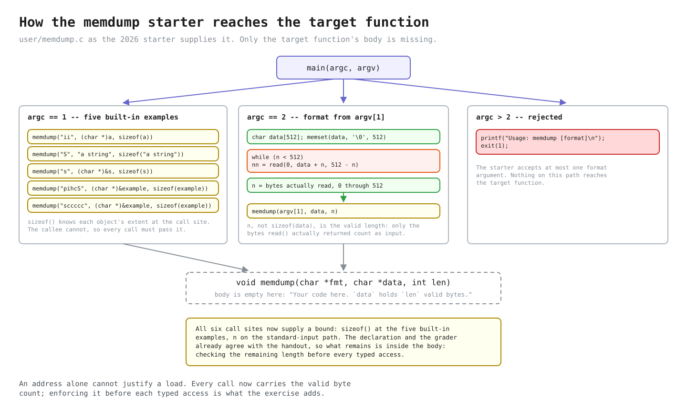
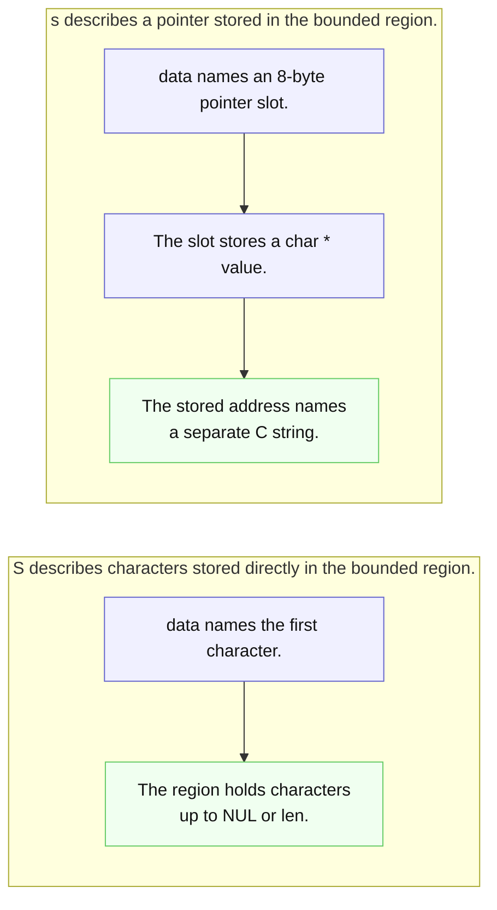
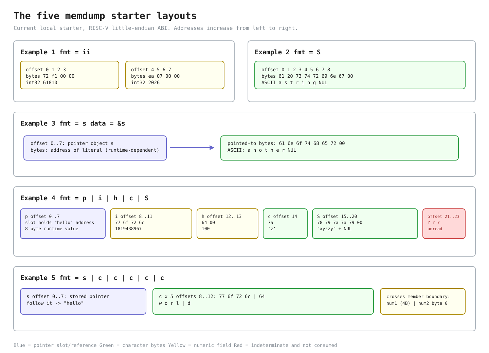

# Lab util: Deriving `memdump`

---

[toc]

---

MIT's [`memdump` exercise](https://pdos.csail.mit.edu/6.1810/2026/labs/util.html) asks a user-space formatter to walk raw memory according to a compact type description. The exercise is about the difference between an address, the bytes stored at that address, and a pointer value stored inside those bytes. This note derives those distinctions and stops where writing [`user/memdump.c`](../../user/memdump.c) begins.

> [!IMPORTANT]
> This note contains no solution or pseudocode, and it does not acquire one now that the exercise is graded. It records the target contract, the current grader's observations, existing non-target code, source-backed decisions, and common traps. The finished body and the two policy choices the handout leaves open are recorded in the banner comment of [`user/memdump.c`](../../user/memdump.c) itself.

## What the exercise asks for

### Contract

| Concern                    | Contract to preserve                                                                                                                                                                                                  |
| -------------------------- | --------------------------------------------------------------------------------------------------------------------------------------------------------------------------------------------------------------------- |
| **Inputs**                 | `memdump(char *fmt, char *data, int len)` receives a NUL-terminated format, a region address, and its valid byte count.                                                                                               |
| **Cursor**                 | Each recognized format character describes the current cursor. Fixed-width items advance the cursor and reduce the remaining count by the same byte width; continuation after `S` finds NUL needs an explicit policy. |
| **Bounds**                 | No access that decodes an item from the region may inspect beyond it. A short fixed-width item prints the exact diagnostic and ends the dump.                                                                         |
| **`s`**                    | Bounds-checks and consumes one stored 64-bit pointer, then follows it; the handout neither validates that address nor bounds the separate string it names.                                                            |
| **`S`**                    | Reads the current region directly through its first NUL or the valid boundary, whichever comes first.                                                                                                                 |
| **Output and environment** | Values use the required representations, runtime pointer values may vary, and only `user/user.h` plus local integer aliases are available.                                                                            |

The format is a small language over successive parts of the region. Its characters are not `printf` conversions and do not begin with `%`.

| Format  | Data item described by the 2026 handout                 | Printed interpretation                                             | Fixed-width bytes needed before access |
| ------- | ------------------------------------------------------- | ------------------------------------------------------------------ | -------------------------------------- |
| **`i`** | The next 4 bytes                                        | A 32-bit integer in decimal                                        | 4                                      |
| **`p`** | The next 8 bytes                                        | A 64-bit integer in hexadecimal                                    | 8                                      |
| **`h`** | The next 2 bytes                                        | A 16-bit integer in decimal                                        | 2                                      |
| **`c`** | The next byte                                           | One 8-bit ASCII character                                          | 1                                      |
| **`s`** | The next 8 bytes, which contain a pointer to a C string | The string reached through that stored pointer                     | 8                                      |
| **`S`** | The remaining valid bytes beginning at the cursor       | Bytes through the first NUL or through the end of the valid region | Variable                               |

For every fixed-width item, too few remaining bytes must produce `memdump: not enough data for 'X'` and stop, where `X` is the current format character. `S` is deliberately different: absence of a NUL within the valid region is not permission to read farther, so it prints only the bytes still covered by `len`.

### What the local grader checks

The three tests in [`grade-lab-util`](../../grade-lab-util) total **25 points**. None installs a breakpoint; all assertions search the combined console transcript.

| Test                                               | Points | Commands                                                                                                                               | Required matches                                                                                                           | Forbidden matches |
| -------------------------------------------------- | ------ | -------------------------------------------------------------------------------------------------------------------------------------- | -------------------------------------------------------------------------------------------------------------------------- | ----------------- |
| **`memdump, examples`**                            | 10     | `memdump`                                                                                                                              | Prefixes `^61810`, `^2026`, `^a string`, `^another`, `^1819438967`, `^100`, `^z`, `^xyzzy`, `^hello`, `^w`, `^d`           | None              |
| **`memdump, format ii, S, p`**                     | 10     | `echo abcdefgh12345678` piped to `memdump ii`, `memdump S`, and `memdump p`                                                            | Prefixes `^1684234849`, `^1751606885`, `^abcdefgh12345678`, `^6867666564636261`                                            | None              |
| **`memdump, formats h c, bounds checking, usage`** | 5      | `echo abcdefgh` piped to `memdump h` and `memdump c`; `echo a` piped to `memdump i`; `echo abc` piped to `memdump ii`; `memdump a b c` | Exact values `^25185$`, `^a$`, `^174285409$`; diagnostic prefix `memdump: not enough data`; usage prefix `^Usage: memdump` | `^2657$`          |

### What the grader does not prove

| Observation                           | Unchecked behavior                                                                                                   |
| ------------------------------------- | -------------------------------------------------------------------------------------------------------------------- |
| **Example prefixes match**            | Headings, the pointer value, `o`/`r`/`l` in Example 5, exact line endings, adjacency, ordering, and extra output.    |
| **`ii`, `S`, and `p` prefixes match** | Command attribution, lowercase `s`, advancement after `p`, and absence of extra output.                              |
| **The corner test passes**            | The character named in the diagnostic, bounds for `p`/`s`/`S`, and which short-input command emitted the diagnostic. |

[`assert_lines_match()`](../../gradelib.py) applies `re.match()` to each line and removes a required expression after a match. Lines can arrive in any order, and matching one command's output can satisfy another command's expectation. Start-only patterns permit trailing text; only the `$`-anchored values above require an exact line.

The 2026 checks require the full eight-byte `p` value and a shortage diagnostic, but piped `S` data is followed by convenient zero-fill in the starter. Correct-looking text therefore cannot prove that the scan respected `len`. [Verification](#verifying-it) distinguishes that coincidence from a useful boundary check.

## Prerequisites

| When                                     | Read                                                                                                                                            | Why it matters here                                                                                                                                         |
| ---------------------------------------- | ----------------------------------------------------------------------------------------------------------------------------------------------- | ----------------------------------------------------------------------------------------------------------------------------------------------------------- |
| **Read first**                           | [`C_Pointers.md`](../../../c-programming/C_Pointers.md#type-casting-byte-level-access)                                                          | Establishes addresses, dereference, byte-level casts, and why a `void *` needs a typed view before access.                                                  |
| **Read first**                           | [`C_Pointer_Arithmetic.md`](../../../c-programming/C_Pointer_Arithmetic.md#byte-level-access-use-char)                                          | Shows that pointer movement scales by the pointed-to type and that `char *` advances one byte.                                                              |
| **Read first**                           | [`C_Custom_Data_Types.md`](../../../c-programming/C_Custom_Data_Types.md#memory-placement-and-portability)                                      | Owns structure member order, alignment, padding, and the portability boundary around object layout.                                                         |
| **Use when reading memory helpers**      | [`C_Standard_Library.md`](../../../c-programming/C_Standard_Library.md#memory-blocks---stringh-and-stdlibh)                                     | Contrasts byte-counted `memset`, `memcpy`, `memmove`, and `memcmp` with NUL-terminated string operations.                                                   |
| **Use when checking arrays and strings** | [`C_Array.md`](../../../c-programming/C_Array.md#arrays-in-function-calls) and [`C_String.md`](../../../c-programming/C_String.md#core-concept) | Reviews array decay, separate lengths, embedded character arrays, string pointers, and NUL termination.                                                     |
| **Worked comparison**                    | [`byte_memory_functions.c`](../../../c-programming/notes/src/main/library/standard_library/memory_functions/byte_memory_functions.c)            | Demonstrates exact byte counts, overlap, comparison, and byte inspection in hosted C; its headers and `printf()` are not xv6 APIs.                          |
| **Worked comparison**                    | [`pointer_cast_print_width.c`](../../../c-programming/notes/src/main/pointers/basics/pointer_cast_print_width.c)                                | Runs this exercise's six read widths against one region in hosted C, including the `char **` hop and counted output; `%.*s` and `fwrite` do not exist here. |
| **Worked comparison**                    | [`byte_offset_cast_order.c`](../../../c-programming/notes/src/main/pointers/arithmetic/byte_offset_cast_order.c)                                | Prints where `(T *)p + k` and `(T *)(p + k)` land for a byte offset, how many dereferences a stored pointer needs, and `sizeof` of a pointer parameter.     |
| **Worked comparison**                    | [`bounded_cursor_walk.c`](../../../c-programming/notes/src/main/pointers/arithmetic/bounded_cursor_walk.c)                                      | Tabulates which bounds predicates over-read, then walks a TLV stream and NUL-separated fields with a cursor that never passes `len`; it is not `memdump`.   |
| **Worked comparison**                    | [`read_short_chunks.c`](../../../c-programming/notes/src/main/library/io_streams/file_descriptors/read_short_chunks.c)                          | Reproduces a two-`write()` sender, then contrasts per-chunk processing with accumulating at `buf + total` until EOF or a full buffer.                       |

## The code to read first

| Source                                                                         | Contributes                                                                                                                          | Deliberately does not contribute                                           |
| ------------------------------------------------------------------------------ | ------------------------------------------------------------------------------------------------------------------------------------ | -------------------------------------------------------------------------- |
| **[2026 util handout](https://pdos.csail.mit.edu/6.1810/2026/labs/util.html)** | The six format characters, widths, `len` boundary, diagnostic, and examples.                                                         | A policy for unknown format characters or signed negative values.          |
| **[`grade-lab-util`](../../grade-lab-util)**                                   | The current public commands, points, regex assertions, the required diagnostic text, and observable blind spots.                     | Which format character the diagnostic must name, or a bounded `S` case.    |
| **[`kernel/types.h`](../../kernel/types.h)**                                   | This tree's exact 8-, 16-, 32-, and 64-bit unsigned aliases.                                                                         | Structure offsets, byte order, or a generic formatting routine.            |
| **[`user/ulib.c`](../../user/ulib.c)**                                         | `memmove()` demonstrates the local `void *` interface followed by byte-pointer traversal.                                            | Typed decoding or formatted output.                                        |
| **[`user/printf.c`](../../user/printf.c)**                                     | The formatter actually available in xv6, including `%d`, `%c`, `%s`, `%x`, and `%lx`, plus its exact variadic argument expectations. | Memory bounds or the exercise's `i`, `p`, `h`, `c`, `s`, and `S` language. |
| **[`user/cat.c`](../../user/cat.c)** and **[`user/wc.c`](../../user/wc.c)**    | The established 512-byte buffer size and the rule that only the byte count returned by `read()` is fresh input.                      | A reason that 512 is semantically required.                                |

Everything else this exercise touches is owned elsewhere and is deliberately not restated here:

| Topic                                            | Owner                                                                                                     |
| ------------------------------------------------ | --------------------------------------------------------------------------------------------------------- |
| **Program layout and `UPROGS`**                  | [`02-build-boot-and-usage.md`](../02-build-boot-and-usage.md#adding-and-running-a-user-exercise)          |
| **Grading and failed transcripts**               | [`03-lab-workflow.md`](../03-lab-workflow.md#grading)                                                     |
| **The `read()` return contract**                 | [`05-syscall-reference.md`](../05-syscall-reference.md#files-and-descriptors)                             |
| **What `printf` can and cannot format**          | [`05-syscall-reference.md`](../05-syscall-reference.md#printf-conversions-and-the-missing-bounded-string) |
| **The reusable byte-stream explanation**         | [`07-exercises.md`](../07-exercises.md#ex1copy--the-lecture-1-input-filter)                               |
| **Address spaces and user virtual addresses**    | [`book/ch02`](../book/ch02-operating-system-organization.md), [`book/ch03`](../book/ch03-page-tables.md)  |
| **Object representation, pointers, and padding** | The sibling C notes listed under [Prerequisites](#prerequisites)                                          |

> [!NOTE]
> `memdump()` traverses user-space objects; the argument form finishes all input reads before the target runs. Because the linked book chapters remain placeholders, this note holds one fact on loan: every example address is a user virtual address in this process.

## How the starter reaches the target



_The figure maps the original handout starter, not the added local edge probes. Blue routes the `argc` dispatch, yellow marks a call into the target, pink marks the one input syscall, green marks the buffer holding its bytes, and red marks failures or indeterminate bytes in the later layout figure. [View the SVG separately](fig/util-memdump-entry-paths.svg) or [open the editable drawing in Excalidraw.](fig/util-memdump-entry-paths.excalidraw)_

> [!IMPORTANT]
> Each caller supplies the valid extent while it still knows the original object: the five examples pass `sizeof(object)`, standard input passes the accumulated byte count `n`, and the `argc > 2` usage path never calls `memdump()`.

The current local `main()` also includes four `Edge` probe groups on its no-argument path; [verification](#verifying-it) explains what they test. Inside `memdump()`, `sizeof(data)` would measure only the pointer. The extent must therefore cross the call boundary as `len`, remain paired with the cursor, and justify each access before it occurs.

## `memmove()` as the existing byte walker

The complete `memmove()` in [`user/ulib.c`](../../user/ulib.c) is a useful non-target comparison:

```c
void *
memmove(void *vdst, const void *vsrc, int n)
{
  char *dst;
  const char *src;

  dst = vdst;
  src = vsrc;
  if (src > dst) {
    while (n-- > 0)
      *dst++ = *src++;
  } else {
    dst += n;
    src += n;
    while (n-- > 0)
      *--dst = *--src;
  }
  return vdst;
}
```

| Existing detail                            | Consequence for this exercise                                                                                                                                                       |
| ------------------------------------------ | ----------------------------------------------------------------------------------------------------------------------------------------------------------------------------------- |
| **Public parameters are `void *`**         | Callers can pass pointers to any object type without explicit casts.                                                                                                                |
| **Local cursors are `char *`**             | Standard C does not define dereferencing or arithmetic on `void *`; converting once gives a complete one-byte element type.                                                         |
| **`dst++` and `src++` move one byte**      | Pointer arithmetic is scaled by the pointed-to type, and `sizeof(char)` is exactly one. An `int *` cursor would move four bytes per increment in this ABI.                          |
| **The function receives `n` separately**   | A pointer carries an address and type but not the size of the object or input region it came from. Bounds must travel as separate data after an array argument decays to a pointer. |
| **Traversal direction depends on overlap** | That branch is specific to copying. `memdump` only observes bytes, so the overlap problem and write cursor are not part of its contract.                                            |

Hosted sibling examples cover the same facts: [`pointer_generic_void.c`](../../../c-programming/notes/src/main/pointers/basics/pointer_generic_void.c) tests `void *`, [`pointer_type_casting.c`](../../../c-programming/notes/src/main/pointers/basics/pointer_type_casting.c) compares typed views, and [`array_memory.c`](../../../c-programming/notes/src/main/arrays_and_strings/arrays/array_memory.c) shows contiguous bytes. Their headers and output functions are not xv6 APIs.

## The concept underneath

| Question                              | Fast answer                                                                                         |
| ------------------------------------- | --------------------------------------------------------------------------------------------------- |
| **What does the cursor name?**        | The next byte in one bounded region, not a typed object chosen by the compiler.                     |
| **What does the format choose?**      | The width and interpretation imposed on the bytes beginning at that cursor.                         |
| **Why use a character pointer?**      | A character type may inspect any object's representation, and `+ 1` advances exactly one byte.      |
| **Why carry `len` separately?**       | A pointer contains no capacity or valid-content length, so the address alone cannot justify a load. |
| **What is the crucial string split?** | `s` reads a stored pointer and follows it; `S` reads characters directly from the bounded region.   |

### Why `char *data`

`memdump("ii", (char *)a, sizeof(a))` crosses three type views without changing the object:

| Stage           | Pointer view                          | Consequence                                                                                    |
| --------------- | ------------------------------------- | ---------------------------------------------------------------------------------------------- |
| **Array decay** | `a` becomes an `int *` naming `a[0]`. | The pointer has an address and element type, but no array length.                              |
| **Cast**        | `(char *)` preserves that address.    | Neither integer nor any stored byte is converted.                                              |
| **Byte cursor** | The target receives a `char *`.       | A character type may inspect any object's representation, and `+ 1` advances exactly one byte. |

A mixed-width walker therefore uses the same one-byte unit that the format widths and `len` count. `memmove()` takes `void *` publicly for convenient calls, then obtains the required character cursor internally; the supplied `memdump()` interface exposes that cursor directly.

### Values, representations, and byte order

[`kernel/types.h`](../../kernel/types.h) defines `uint8`, `uint16`, `uint32`, and `uint64` on top of the widths the RISC-V compiler selected by this Makefile actually uses:

| C type                  | Width on this target | Alias in `kernel/types.h` | Format character that consumes it |
| ----------------------- | -------------------- | ------------------------- | --------------------------------- |
| **`char`**              | 1 byte               | `uint8`                   | `c`                               |
| **`short`**             | 2 bytes              | `uint16`                  | `h`                               |
| **`int`**               | 4 bytes              | `uint32`                  | `i`                               |
| **`long` and pointers** | 8 bytes              | `uint64`                  | `p`, and the slot `s` consumes    |

The target is little-endian, so the lowest-address byte contributes the least-significant eight bits of a multi-byte integer:

| Source value | 32-bit hexadecimal | Bytes at increasing addresses on this target |
| ------------ | ------------------ | -------------------------------------------- |
| **61810**    | `0x0000f172`       | `72 f1 00 00`                                |
| **2026**     | `0x000007ea`       | `ea 07 00 00`                                |

The source-level integer values are portable, but these byte sequences depend on the target widths and little-endian byte order. [`pointer_little_endian.c`](../../../c-programming/notes/src/main/pointers/arithmetic/pointer_little_endian.c) demonstrates the same one-object, multiple-width view in the sibling C notes.

### Why `s` needs `&s`



_Each arrow shows an address relationship. The earlier legend also applies here: blue routes addresses and green holds character data._

Because `data` has type `char *`, dereferencing it directly yields one `char`. To describe a slot that instead contains a `char *`, the same address needs the type "pointer to `char *`": `char **`. One dereference then loads the stored address, and the next reaches a character.

> [!IMPORTANT]
> A cast changes the compiler's interpretation of an address, not the bytes in memory. The same eight bytes can therefore be one stored pointer under `s` or eight character items under `cccccccc`.

| Format and argument | What `data` initially names                            | Interpretation and outcome                                                                                               |
| ------------------- | ------------------------------------------------------ | ------------------------------------------------------------------------------------------------------------------------ |
| **`S` with `s`**    | The direct bytes `61 6e 6f 74 68 65 72 00`.            | Reads characters in place through NUL or `len`.                                                                          |
| **`s` with `&s`**   | An eight-byte slot holding the address of `"another"`. | Viewing that slot as `char **` and dereferencing once produces the stored `char *`; following it reaches the characters. |
| **`s` with `s`**    | The first eight characters of `"another"`.             | Reinterprets those letters as a fabricated address, which may be unmapped.                                               |

Lowercase `s` thus consumes a pointer-sized slot and follows one stored address; uppercase `S` starts at a character byte and follows no pointer. [`pointer_to_pointer_lifecycle.c`](../../../c-programming/notes/src/main/pointers/array_of_pointers/pointer_to_pointer_lifecycle.c) visualizes the same separation between pointer storage and the character row it reaches.

### Structure layout

The RISC-V compiler lays out the starter's `struct sss` in declaration order with the offsets below. The five members are naturally aligned without internal padding; the complete object has one trailing padding byte so that its 24-byte size remains a multiple of the structure's eight-byte alignment.

| Offset    | Width | Declared member | Bytes or meaning in this example                                                                                                                        |
| --------- | ----- | --------------- | ------------------------------------------------------------------------------------------------------------------------------------------------------- |
| **0-7**   | 8     | `ptr`           | A pointer value leading to `"hello"`. Its bytes vary with the linked image.                                                                             |
| **8-11**  | 4     | `num1`          | `1819438967 == 0x6c726f77`, stored as `77 6f 72 6c`, the ASCII bytes `w o r l`.                                                                         |
| **12-13** | 2     | `num2`          | `100 == 0x0064`, stored as `64 00`; its first byte is ASCII `d`.                                                                                        |
| **14**    | 1     | `byte`          | `7a`, ASCII `z`.                                                                                                                                        |
| **15-22** | 8     | `bytes`         | `strcpy` writes `78 79 7a 7a 79 00` for `xyzzy` and its NUL; the final two array bytes remain indeterminate because `example` was not zero-initialized. |
| **23**    | 1     | Tail padding    | An indeterminate padding byte, not a declared member.                                                                                                   |

The declaration-to-offset mapping is implementation-defined, not a universal serialization format. [`structure_size_padding_bytes.c`](../../../c-programming/notes/src/main/custom_data_types/structures/structure_size_padding_bytes.c) owns the longer alignment and padding explanation.

### Array initialization

| Form                                            | Valid? | Effect                                                                                                                                                                                     |
| ----------------------------------------------- | ------ | ------------------------------------------------------------------------------------------------------------------------------------------------------------------------------------------ |
| **Initializer inside the structure type body**  | No     | A type body defines layout, not an object to initialize.                                                                                                                                   |
| **`example.bytes = "xyzzy"` after declaration** | No     | An array is not a modifiable assignment target.                                                                                                                                            |
| **`strcpy(example.bytes, "xyzzy")`**            | Yes    | Writes six bytes, including NUL, but leaves the final two array elements indeterminate.                                                                                                    |
| **Aggregate initialization**                    | Yes    | Initializes the whole object and zeroes those two trailing array elements.                                                                                                                 |
| **`{"a", "b"}` for a `char` array**             | No     | A brace-wrapped string literal is a valid initializer for the whole array, so the first one consumes it and every later item is an excess element. Character constants take single quotes. |

Initialization is starter context, not part of the `memdump` contract. [`array_basic.c`](../../../c-programming/notes/src/main/arrays_and_strings/arrays/array_basic.c) and [`student.c`](../../../c-programming/notes/src/main/custom_data_types/structures/student.c) own the general array and structure rules.

### The five starter layouts

**Why a third figure:** the entry figure explains callers, the pointer graph explains indirection, and this spatial drawing shows byte offsets and member boundaries. None can replace the other without losing a different relationship.



_Addresses increase from left to right. The pointer bytes are symbolic because their numeric address depends on the linked image. [View the SVG separately](fig/util-memdump-layouts.svg) or [open the editable drawing in Excalidraw](fig/util-memdump-layouts.excalidraw)._

Examples 4 and 5 pass the _same_ structure address and get different answers, because the format string — not the declaration — decides how the bytes are grouped:

| Format       | Bytes consumed, in order | Relationship to the declared members                                          |
| ------------ | ------------------------ | ----------------------------------------------------------------------------- |
| **`pihcS`**  | 8, 4, 2, 1, then to NUL  | Follows the members exactly: `ptr`, `num1`, `num2`, `byte`, then `bytes`.     |
| **`sccccc`** | 8, then 1, 1, 1, 1, 1    | Follows `ptr` as a string pointer, then reads five bytes that ignore members. |

Those five `c` items cross a member boundary: four come from `num1` (`w`, `o`, `r`, `l`) and the fifth is the low byte of `num2` (`d`). That is the point of the example — the format describes bytes to consume, and never asks the compiler for member names or types.

### Why 512 bytes

| Quantity                    | What it establishes                        | What remains unknown                                                                 |
| --------------------------- | ------------------------------------------ | ------------------------------------------------------------------------------------ |
| **`sizeof(data) == 512`**   | Maximum buffer capacity.                   | How many bytes were read, whether they form a string, or whether a spare NUL exists. |
| **`n` after the read loop** | Valid input extent to pass to `memdump()`. | Whether a NUL occurs within that extent.                                             |

The 512-byte capacity follows `user/cat.c` and `user/wc.c`; it is a convention, not a `read()` or 1024-byte filesystem-block requirement from [`kernel/fs.h`](../../kernel/fs.h).

> [!WARNING]
> Zero fill cannot replace `len`: short input gains plausible padding that hides overreads, while a full 512-byte input leaves no spare terminator. For `a\n`, ignoring `n == 2` reads two padded zeros and prints the grader's forbidden `2657` (`0x00000a61`) instead of refusing.

## Deriving it

**Contract:** use the [single requirements table](#contract) and [format table](#what-the-exercise-asks-for) above.

### Decisions and evidence

| Decision to derive           | Evidence to consult                                                                                                                                                                        |
| ---------------------------- | ------------------------------------------------------------------------------------------------------------------------------------------------------------------------------------------ |
| **What each `len` counts**   | Classify the five `sizeof()` arguments and variable `n` as declared object bytes, string bytes including NUL, or bytes returned by `read()`.                                               |
| **Cursor unit**              | Compare `char *`, `short *`, `int *`, and `uint64 *` increments with `memmove()` and the pointer-arithmetic examples.                                                                      |
| **Load and variadic types**  | Match `kernel/types.h` widths to `%d`, `%x`, and `%lx` consumption in `user/printf.c`, including default promotions.                                                                       |
| **Signed decimal policy**    | The handout fixes the widths of `i` and `h` but not how negative bit patterns are interpreted; compare the choice recorded in `user/memdump.c` with the unsigned aliases.                  |
| **State invariant**          | For each fixed width, relate bytes consumed, cursor movement, remaining length, and the check required before access.                                                                      |
| **String path and boundary** | Contrast stored-pointer `s` with direct bounded `S`; inspect `strlen()`, `%s`, and counted output in `user/ulib.c`, `user/printf.c`, and `user/user.h`.                                    |
| **`S` continuation policy**  | The handout calls `S` "the rest," and the grader never follows an in-region NUL with another directive; decide whether continuation is meaningful and, if so, whether the NUL is consumed. |
| **Unknown format policy**    | The handout and grader specify no diagnostic, movement, or status; choose and record a conservative behavior.                                                                              |
| **Complete `p` output**      | Compare `%x` with `%lx` in `user/printf.c`; derive which conversion preserves the required `6867666564636261` and what the truncated line would be.                                        |

For the string-output decision, [docs 05](../05-syscall-reference.md#printf-conversions-and-the-missing-bounded-string) records why local `strlen()` and `%s` cannot enforce `len` and which hosted-C alternatives are unavailable. Use the local declarations when looking for an output primitive with an explicit byte count.

### Traps

| Trap                                             | Failure                                                                                                                                                                                      | Evidence                                                                   |
| ------------------------------------------------ | -------------------------------------------------------------------------------------------------------------------------------------------------------------------------------------------- | -------------------------------------------------------------------------- |
| **Using `fmt` as a `printf` format**             | Bare lab directives describe memory; `%` conversions consume variadic arguments.                                                                                                             | 2026 handout, `user/printf.c`                                              |
| **Confusing `s`, `&s`, and `S`**                 | Passing direct characters to lowercase `s` fabricates an address; treating `S` as indirect adds a pointer hop that is not there.                                                             | `user/memdump.c`, layout figure, 2026 handout                              |
| **Using `void *` or one wider cursor**           | `void *` cannot be dereferenced or advanced in standard C, while wider increments skip bytes in mixed layouts.                                                                               | `user/ulib.c`, sibling `pointer_generic_void.c` and `pointer_arithmetic.c` |
| **Checking bounds after access**                 | The invalid observation occurs before the diagnostic.                                                                                                                                        | 2026 handout's short-input rule                                            |
| **Comparing a width with the total `len`**       | `width > len` ignores bytes already consumed and `consumed > len` ignores the next item's width, so in `echo abc \| memdump ii` the second `i` reads bytes 4-7 of a 4-byte input.            | `grade-lab-util` corner test, sibling `bounded_cursor_walk.c`              |
| **Adding a byte offset after the cast**          | `(T *)data + off` scales a byte count by `sizeof(T)`: the second `i` of `ii` reads byte 16, not byte 4. Add the offset while the cursor is still `char *`, then reinterpret.                 | Sibling `byte_offset_cast_order.c`                                         |
| **Dereferencing the `s` slot twice**             | The first dereference yields the stored `char *`; a second loads eight bytes of the string itself, which `%s` then treats as an address.                                                     | Pointer graph above, sibling `byte_offset_cast_order.c`                    |
| **Delegating bounded `S` to `strlen()` or `%s`** | Both scan until NUL, ignoring `len`; local `vprintf()` has no `%.*s` precision. See the boundary probes below.                                                                               | `user/ulib.c`, `user/printf.c`, `docs/05-syscall-reference.md`             |
| **Writing `remaining` bytes for `S`**            | A counted `write()` respects `len` but not the first NUL, so it emits the terminator itself, trails indeterminate bytes behind a short string, and leaves nothing for a following directive. | 2026 handout's "whichever comes first", `user/memdump.c`                   |
| **Letting `S` report zero consumed bytes**       | The width table gives `S` no fixed width, so only the count it actually consumed can advance the cursor; without it every later directive re-reads the same byte.                            | `user/memdump.c`, the `S` row of the format table                          |
| **Deciding NUL consumption by reading again**    | After a scan that stopped at the boundary, the byte under the cursor is outside the region. Why the scan stopped already says whether it found NUL; zero-fill hides the extra read.          | `dump_string()` in `user/memdump.c`, Edge 1 and Edge 4                     |
| **Building an `S` probe with `strcpy()`**        | The copy inserts NUL where the probe needs a nonzero byte, hiding an unbounded scan.                                                                                                         | `user/ulib.c`, `user/memdump.c`                                            |
| **Probing `S` with a region that repeats bytes** | A following `c` can print the same byte whether or not `S` advanced; choose distinct probe bytes.                                                                                            | `user/memdump.c`                                                           |
| **Passing capacity or trusting zero fill**       | Unread bytes are not input; padding hides short overreads, and a full buffer has no spare NUL.                                                                                               | `user/memdump.c`, `docs/05-syscall-reference.md`, `grade-lab-util`         |
| **Treating one `read()` as the whole input**     | `echo` writes its argument and `\n` in separate calls. Dumping per chunk runs the format twice, reading every chunk at `buf` overwrites the first, and a loop without a `0` exit never ends. | `user/echo.c`, `user/memdump.c`, sibling `read_short_chunks.c`             |
| **Assuming every wider view is portable**        | Character storage may be unaligned for wider types; arbitrary formats can create unaligned positions even though the target examples work.                                                   | `C_Pointers.md`, Makefile target ABI                                       |
| **Ignoring structure padding**                   | Compiler offsets and tail padding, not summed member widths, determine the object representation.                                                                                            | Sibling `structure_size_padding_bytes.c`                                   |
| **Expecting a stable pointer value**             | Link layout and runtime placement may change the address without changing its relationships.                                                                                                 | 2026 handout's Example 4 caveat                                            |
| **Using `%x` for `p`**                           | The output truncates to `64636261` instead of the required `6867666564636261`.                                                                                                               | `user/printf.c`, `grade-lab-util`                                          |

## Verifying it

One build covers the starter, the build registration, and the body once it exists:

```bash
make user/_memdump
```

Boot xv6 and exercise every format family, both bounds outcomes, and the handout's unspecified format case:

```text
$ memdump
$ echo deadc0de | memdump hhcccc
$ echo deadc0de | memdump p
$ echo a | memdump i
$ echo abcdefgh | memdump Sc
$ echo abcdefgh | memdump z
```

| Command                             | Evidence it supplies                                                                                                                                                              |
| ----------------------------------- | --------------------------------------------------------------------------------------------------------------------------------------------------------------------------------- |
| **`memdump`**                       | Built-in direct and indirect strings, structure fields, and cross-field characters.                                                                                               |
| **`deadc0de` cases**                | Little-endian mixed widths and the complete 8-byte `p` value.                                                                                                                     |
| **`echo a \| memdump i`**           | A two-byte input reaches the required short-item diagnostic.                                                                                                                      |
| **`echo abcdefgh \| memdump Sc`**   | Nine valid bytes contain no NUL; `S` exhausts them and the following `c` must report a shortage. This is an accounting check, not proof of bounded scanning.                      |
| **`echo abcdefgh \| memdump z`**    | Check the chosen unknown-format policy against its source documentation; the handout does not define it.                                                                          |
| **In-region NUL, then a directive** | The original handout and grader omit it; the local `Edge 2` group probes the recorded continuation policy. Distinct trailing bytes expose cursor errors and a literal NUL output. |

The `Sc` pipe case can display the right string even if an unbounded scan reaches zero-fill beyond `len`. The later shortage checks cursor and remaining-length accounting, but cannot prove that the earlier scan stayed in bounds. The nonzero filler in [Edge 1](#local-boundary-probes) removes that coincidence.

Exit QEMU with `Ctrl-a` then `x`, then run the focused grader:

```bash
./grade-lab-util memdump
```

The two example tests share `test_memdump_examples`, so their failure logs share `xv6.out.memdump_examples`; a later failure can overwrite it, and a later pass can remove it. The bounds test uses `xv6.out.memdump_corner`. [The sleep note](01-util-sleep.md#why-two-tests-can-have-the-same-python-function-name) owns the registration mechanism. No kernel gdb recipe is useful here because the behavior being derived is user-space object traversal; inspect the generated `user/memdump.asm` only if a target-specific load width or alignment question remains.

### Why a short echo can hide an overread

| Observation                                     | What it actually establishes                                                                                                                                                                                                                             |
| ----------------------------------------------- | -------------------------------------------------------------------------------------------------------------------------------------------------------------------------------------------------------------------------------------------------------- |
| **`echo a \| mem S` looks correct with `%s`**   | In the local [`mem` program](../../user/mem.c), `main()` zero-fills its input buffer before reading. A short read leaves a NUL just beyond the valid extent, so an unbounded `%s` can display the expected characters while still reading outside `len`. |
| **A full or nonterminated region reaches `%s`** | There may be no NUL inside the valid region. `vprintf()` in [`user/printf.c`](../../user/printf.c) has no length argument for `%s`, so it can print unrelated bytes or fault while searching farther.                                                    |
| **The format changes from `%s\n` to `%s`**      | The explicit output line ending disappears. The string's stopping condition and memory accesses stay the same; `echo`'s input newline, when present, is ordinary string data rather than a terminator.                                                   |

One successful short-input probe therefore does not establish the bounded-`S` contract. Compare both an in-region NUL and nonzero bytes immediately beyond the declared region; neither zero-fill nor a nearby accidental terminator should decide where reading stops. [Docs 05](../05-syscall-reference.md#printf-conversions-and-the-missing-bounded-string) owns the available output primitives and their bounds.

### Local boundary probes

| Group in the current `main()` | What it distinguishes                                                                                                                                                                             |
| ----------------------------- | ------------------------------------------------------------------------------------------------------------------------------------------------------------------------------------------------- |
| **Edge 1**                    | A nonterminated region followed by nonzero filler exposes a scan that ignores `len`. A counted copy leaves the filler intact; `strcpy()` would insert a misleading terminator.                    |
| **Edge 2**                    | An in-region NUL followed by distinct bytes distinguishes direct string termination, NUL output, and cursor advancement when another directive follows. Repeated bytes could mask a cursor error. |
| **Edge 3**                    | `Sc` with an extent of 3 over `"ab"` places NUL inside the region; a later fixed-width item then tests the recorded consumption policy. An extent of 2 would test region exhaustion instead.      |
| **Edge 4**                    | A zero-length `S` region must be handled without reading even one byte.                                                                                                                           |

These are current local checks in [`main()`](../../user/memdump.c), not extra grader assertions or a required continuation policy for every implementation. The important distinction is whether NUL falls inside the valid extent or just beyond it: only the former exposes writing NUL as data, while zero-fill can hide an unbounded scan in the latter. Do not add target-body code to this note to explain the probes.

## Questions

1. **Why does casting `a` to `char *` preserve its address but change `+ 1`?** Compare array decay in `array_basic.c` with typed increments in `pointer_type_casting.c`.
2. **Why does lowercase `s` need `&s`, and which eight bytes does it consume first?** Contrast Example 3 with direct `S` in the pointer graph.
3. **How does Example 5 produce `world`, and why is the structure 24 rather than 23 bytes?** Follow the little-endian fields through offset 12, then check tail alignment in `structure_size_padding_bytes.c`.
4. **What fails if an item is accessed before its `len` check?** Explain both the forbidden `2657` for `a\n` and the missing spare terminator in a full 512-byte input.
5. **Why can `%s` print the right text while ignoring `len`?** Trace its stopping condition in `user/printf.c`, then explain how Edge 1 removes the zero-fill coincidence and why `strcpy()` would spoil that probe.
6. **Why is a counted write of every remaining byte still insufficient for `S`?** Apply it to Example 2's terminator and Example 4's indeterminate trailing array bytes.
7. **If `S` is allowed to precede another directive, what defines its cursor advancement?** Follow Edge 2 and explain why a repeated character could hide a faulty cursor.
8. **Why does Edge 3 use an extent of 3 over `"ab"` rather than 2, and what does Edge 4 add?** Distinguish an in-region NUL, region exhaustion, and an empty region.
