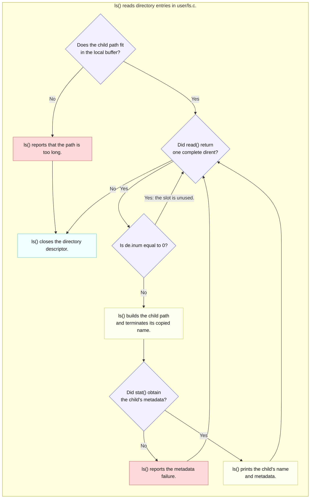
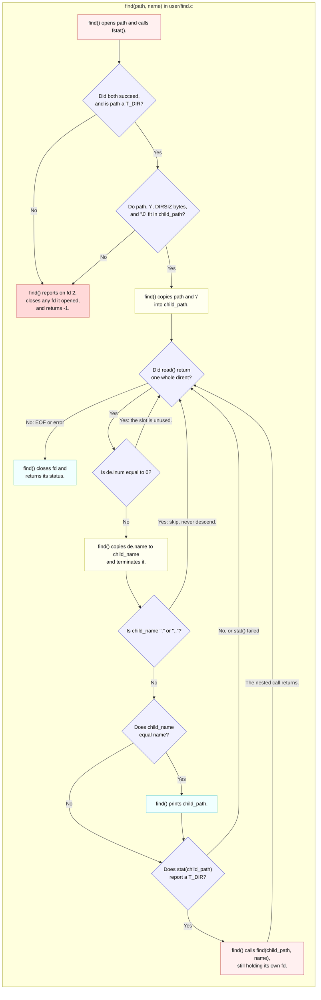

# Lab util: Deriving `find`

---

[toc]

---

MIT's [2026 util lab](https://pdos.csail.mit.edu/6.1810/2026/labs/util.html#find) asks for a directory-tree search in `user/find.c`. This note connects that contract to the existing directory reader in `user/ls.c`; it stops before the new program's implementation.

> [!IMPORTANT]
> This is a derivation guide, not a solution. Its C quotation is an unchanged function from `user/ls.c`, and the decisions for `user/find.c` remain questions. The one exception is the final [Solution walkthrough](#solution-walkthrough), a marked spoiler; stop before it if you are still deriving.

## What the exercise asks for

### Contract

| Contract        | Required behavior                                                                                        |
| --------------- | -------------------------------------------------------------------------------------------------------- |
| **Input**       | A starting directory and a name to find, as in `find . b`.                                               |
| **Search**      | Visit names throughout that directory tree, including names of directories.                              |
| **Match**       | Compare the entry's name, not the whole path, with the requested name.                                   |
| **Output**      | Print the path of each match, including its starting-path prefix, as in `./a/b`.                         |
| **Termination** | Do not descend through the special `.` and `..` entries.                                                 |
| **Build**       | Put the source directly in `user/find.c` and register `$U/_find` in `UPROGS`; this tree has neither yet. |

### What the grader checks

- **Score:** four tests in [`grade-lab-util`](../../grade-lab-util), **40 points** total.
- **Breakpoints:** none.
- **Notation:** `NAME`, `DIR`, and the numbered paths below stand for freshly generated names, not literal input text.

| Test                                                       | Points | Setup and search                                                              | Required matches                                                     | Forbidden matches                 |
| ---------------------------------------------------------- | ------ | ----------------------------------------------------------------------------- | -------------------------------------------------------------------- | --------------------------------- |
| **`find, in current directory`**                           | 10     | Create `NAME` in `.`; run `find . NAME`.                                      | Prefix `./NAME`                                                      | Prefixes `./README`, `README`     |
| **`find, in sub-directory`**                               | 10     | Create the same basename in `.` and `DIR`; run `find DIR NAME`.               | Prefix `DIR/NAME`                                                    | Prefix `./NAME`                   |
| **`find, recursive`**                                      | 10     | Put `NAME` in a child, its grandchild, and another child; run `find . NAME`.  | Prefixes for all three paths                                         | None                              |
| **`find, missing target, no duplicates, directory match`** | 10     | Search for a present file, absent name, and directory name; then `echo DONE`. | Respectively 1, 0, and 1 lines matching `^\./.*NAME`; exact `^DONE$` | Prefixes `path too long`, `panic` |

### What the grader does not prove

| Test group      | Matching mechanism                                               | Limit                                                           |
| --------------- | ---------------------------------------------------------------- | --------------------------------------------------------------- |
| **First three** | [`re.match()` through `assert_lines_match()`](../../gradelib.py) | Dots are unescaped wildcards; path patterns have no end anchor. |
| **Recursive**   | The same prefix assertions                                       | Duplicate or extra lines are not counted.                       |
| **Corner**      | Multiline `re.findall()`, literal `./` prefix, exact counts      | Names still have no end anchor.                                 |

The subdirectory case observes the requested start point and rejects the root-level duplicate basename. A passing score establishes only the [listed observations](#what-the-grader-checks).

**Unproven policies:**

- Output order and every pathname shape.
- A general cycle-detection strategy.
- Argument diagnostics.
- Failure handling for `open`, `fstat`, and `stat`.

## Prerequisites

| When                | Read                                                                                                                                                                                                                                                                                                        | Ownership                                                                                                                                                                                                                        |
| ------------------- | ----------------------------------------------------------------------------------------------------------------------------------------------------------------------------------------------------------------------------------------------------------------------------------------------------------- | -------------------------------------------------------------------------------------------------------------------------------------------------------------------------------------------------------------------------------- |
| **Read first**      | [`02-build-boot-and-usage.md`](../02-build-boot-and-usage.md#adding-and-running-a-user-exercise)                                                                                                                                                                                                            | User-program location, arguments, xv6 C style, `UPROGS`, and image creation.                                                                                                                                                     |
| **Read first**      | [`C_String.md`](../../../c-programming/C_String.md)                                                                                                                                                                                                                                                         | The sibling study note introduces terminated strings and comparison; [`user/ulib.c`](../../user/ulib.c) supplies this tree's actual `strcmp`, `strlen`, and `memmove`.                                                           |
| **Read first**      | [`fixed_width_name_field.c`](../../../c-programming/notes/src/main/arrays_and_strings/strings/fixed_width_name_field.c) and its [`.excalidraw`](../../../c-programming/notes/src/main/arrays_and_strings/strings/fixed_width_name_field.excalidraw)                                                         | A hosted demo of a 14-byte name field: detecting a missing `\0`, bounded printing, the `DIRSIZ + 1` copy, `strcmp` versus `==`, and budgeting a joined path. The drawing opens in Excalidraw and shows each buffer byte by byte. |
| **Read first**      | [`dir_dot_entries.c`](../../../operating-system/codes/src/main/persistence/file-intro/dir_dot_entries.c) and [`dir-dot-entries-loop.svg`](../../../operating-system/images/file-systems/dir-dot-entries-loop.svg) ([source](../../../operating-system/images/file-systems/dir-dot-entries-loop.excalidraw)) | A Linux demo that proves `.` and `..` name the current and parent inodes, and contrasts Linux's `readdir()` with xv6's raw `read()` of `struct dirent`. The figure shows which records lead down and which lead back.            |
| **Read first**      | [`07-exercises.md`'s `ex9ls`](../07-exercises.md#ex9ls--a-directory-is-a-file) and [`user/ex9ls.c`](../../user/ex9ls.c)                                                                                                                                                                                     | A smaller directory reader before the fuller `user/ls.c` walkthrough below.                                                                                                                                                      |
| **Use when needed** | [`05-syscall-reference.md`](../05-syscall-reference.md#files-and-descriptors) and its [path limits](../05-syscall-reference.md#directories-and-paths)                                                                                                                                                       | `open`, `read`, `fstat`, `stat`, `close`, and pathname limits.                                                                                                                                                                   |
| **Use when needed** | [`book/ch10-file-system.md`](../book/ch10-file-system.md) and the book's [`fs.tex`](../../../xv6-riscv-book/fs.tex)                                                                                                                                                                                         | The xv6 directory and pathname mechanisms; the chapter note is still a placeholder, so the narrow record-format explanation below is held here temporarily.                                                                      |
| **Use when needed** | [`03-lab-workflow.md`](../03-lab-workflow.md) and [`06-build-artifacts.md`](../06-build-artifacts.md)                                                                                                                                                                                                       | Lab grading and generated system-call stubs; neither mechanism needs repeating here.                                                                                                                                             |
| **Use when needed** | [`fd_per_open_level.c`](../../../operating-system/codes/src/main/persistence/file-intro/fd_per_open_level.c)                                                                                                                                                                                                | A Linux demo of one descriptor per open nesting level, then `EMFILE` after lowering `RLIMIT_NOFILE` to xv6's `NOFILE` of 16.                                                                                                     |

> [!NOTE]
> The sibling C note and the three sibling demos teach hosted C and Linux concepts, not xv6's callable API. [`user/user.h`](../../user/user.h) is the complete user interface here; `opendir()` and `readdir()` are not available.

## The code to read first

| File                                                                          | Contributes                                                                                                    | Does not contribute                                                    |
| ----------------------------------------------------------------------------- | -------------------------------------------------------------------------------------------------------------- | ---------------------------------------------------------------------- |
| [`user/ls.c`](../../user/ls.c)                                                | `ls()` opens a path, checks its type, reads directory records, builds a child path, and closes the descriptor. | No recursive descent and no requested-name filter.                     |
| [`user/ex9ls.c`](../../user/ex9ls.c)                                          | `list()` exposes one fixed-size record at a time without `ls()`'s metadata formatting.                         | No full paths for entries and no recursive descent.                    |
| [`kernel/fs.h`](../../kernel/fs.h) and [`kernel/stat.h`](../../kernel/stat.h) | `struct dirent`, `DIRSIZ`, `struct stat`, and `T_DIR`.                                                         | No user-level traversal policy.                                        |
| [`user/ulib.c`](../../user/ulib.c)                                            | `stat()` delegates to `open`, `fstat`, and `close`; `strcmp()` compares terminated strings.                    | No host C library.                                                     |
| [`kernel/fs.c`](../../kernel/fs.c)                                            | `namex()` resolves path components, and `dirlookup()` resolves one name in a directory.                        | No `find` operation; the new program must choose which paths to visit. |

## `ls()` line by line

- **Record:** a `dirent` is one fixed-size directory entry from [`kernel/fs.h`](../../kernel/fs.h).
- **Diagram scope:** existing `ls()`'s directory branch after successful `open()` and `fstat()`; no recursion or requested-name filter.



_Blue marks decisions, yellow processes names, cyan closes the descriptor, and red reports failures._

A directory stores records, not complete child paths. Before `stat()`, `ls()` supplies the parent prefix and a NUL-terminated copy of the record name.

| Record outcome             | Normal output | Diagnostic    |
| -------------------------- | ------------- | ------------- |
| **Unused slot**            | Skipped       | None          |
| **Failed metadata lookup** | Skipped       | Error printed |

This is the complete, unchanged `ls()` function from [`user/ls.c`](../../user/ls.c). It is existing source, not a template for the target file.

```c
void
ls(char *path)
{
  char buf[512], *p;
  int fd;
  struct dirent de;
  struct stat st;

  if ((fd = open(path, O_RDONLY)) < 0) {
    fprintf(2, "ls: cannot open %s\n", path);
    return;
  }

  if (fstat(fd, &st) < 0) {
    fprintf(2, "ls: cannot stat %s\n", path);
    close(fd);
    return;
  }

  switch (st.type) {
    case T_DEVICE:
    case T_FILE:
      printf("%s %d %d %d\n", fmtname(path), st.type, st.ino, (int)st.size);
      break;

    case T_DIR:
      if (strlen(path) + 1 + DIRSIZ + 1 > sizeof buf) {
        printf("ls: path too long\n");
        break;
      }
      strcpy(buf, path);
      p = buf + strlen(buf);
      *p++ = '/';
      while (read(fd, &de, sizeof(de)) == sizeof(de)) {
        if (de.inum == 0)
          continue;
        memmove(p, de.name, DIRSIZ);
        p[DIRSIZ] = 0;
        if (stat(buf, &st) < 0) {
          printf("ls: cannot stat %s\n", buf);
          continue;
        }
        printf("%s %d %d %d\n", fmtname(buf), st.type, st.ino, (int)st.size);
      }
      break;
  }
  close(fd);
}
```

| Branch or expression           | Consequence in this source                                                                                 |
| ------------------------------ | ---------------------------------------------------------------------------------------------------------- |
| **`open` and `fstat` failure** | The open failure returns without a descriptor; the `fstat` failure closes the descriptor before returning. |
| **`T_FILE` or `T_DEVICE`**     | `ls` prints metadata for that path rather than reading it as directory records.                            |
| **`T_DIR` and buffer check**   | The check budgets a slash, a full `DIRSIZ` component, and a terminator in its 512-byte local buffer.       |
| **Fixed-size `read`**          | A full `struct dirent` is one record; a short read ends the loop. `de.inum == 0` is an unused slot.        |
| **`memmove` plus terminator**  | A 14-byte name need not contain `\0`, so `strcpy` from `de.name` would read beyond its field.              |
| **`stat(buf, &st)`**           | The constructed path yields the child's type; on failure, `ls` reports it and continues.                   |
| **Final `close`**              | It runs after both the file/device and directory branches, including the too-long-path break.              |

`ls()` does not filter `.` and `..` because displaying them is useful. Their presence becomes consequential only when a tree traversal follows directory entries into further directories.

## The concept underneath

| Constant or record  | Value in this tree                    | Source                                   | Why it matters                                                                                                         |
| ------------------- | ------------------------------------- | ---------------------------------------- | ---------------------------------------------------------------------------------------------------------------------- |
| **`DIRSIZ`**        | 14 bytes per name                     | [`kernel/fs.h`](../../kernel/fs.h)       | A full-width entry name has no spare byte for `\0`.                                                                    |
| **`struct dirent`** | 2-byte inode number plus 14-byte name | [`kernel/fs.h`](../../kernel/fs.h)       | Directory `read()` exposes 16-byte slots, including reusable holes with `inum == 0`.                                   |
| **`T_DIR`**         | 1                                     | [`kernel/stat.h`](../../kernel/stat.h)   | Only this type contains directory entries to inspect.                                                                  |
| **`MAXPATH`**       | 128 bytes                             | [`kernel/param.h`](../../kernel/param.h) | The kernel copies pathname arguments into bounded buffers; `ls()`'s 512-byte local buffer does not enlarge that limit. |

> [!IMPORTANT]
> A directory entry names an inode inside one parent. A displayed path is a separate string assembled from the starting path and successive names; `struct dirent` does not store that path.

### Path lookup and directory aliases

**Path lookup:** `namex()` starts at `/` or the process's current directory, then looks up each path component. Sources: the book's [`fs.tex`](../../../xv6-riscv-book/fs.tex) and this tree's [`kernel/fs.c`](../../kernel/fs.c).

| Entry | Names which inode?    | Effect when followed           |
| ----- | --------------------- | ------------------------------ |
| `.`   | The current directory | Returns to the same directory. |
| `..`  | The parent directory  | Returns to the parent.         |

Both are real entries created by [`create()` in `kernel/sysfile.c`](../../kernel/sysfile.c), including in the starting directory. They are harmless to list; repeatedly following them revisits directories.


_From the sibling Linux demo [`dir_dot_entries.c`](../../../operating-system/codes/src/main/persistence/file-intro/dir_dot_entries.c); open the [editable source](../../../operating-system/images/file-systems/dir-dot-entries-loop.excalidraw) in Excalidraw._

- **Green edges:** descend to children; only these avoid returning to an inode already visited in this tree.
- **Red edges:** every directory has both aliases, including the starting one.
- **Loop evidence:** a different record name has an `inum` already on the path.

Following every directory record repeats the same names until a path or descriptor limit stops the walk. Interpret the missing-target and duplicate checks using the [grader limits](#what-the-grader-does-not-prove).

### Record names versus C strings

| Operation                                        | What it compares           |
| ------------------------------------------------ | -------------------------- |
| `strcmp()` in [`user/ulib.c`](../../user/ulib.c) | Terminated string contents |
| `==` on pointers                                 | Pointer values             |

The 14-byte record field needs a safe conversion before string comparison. [`ls()`](#ls-line-by-line) demonstrates that boundary.

### Metadata and temporary descriptors

- **`stat()` implementation:** a user-library wrapper in [`user/ulib.c`](../../user/ulib.c), rather than a separate kernel primitive.
- **Descriptor lifetime:** it closes the temporary descriptor it opens; `ls()`'s call does not retain that descriptor.

## Deriving it

**Contract:** return to the [requirements](#contract) and [grader evidence](#what-the-grader-checks); the table below identifies decisions, not a second specification.

| Decision for `user/find.c`                 | Source-backed question to settle                                                                                                                                                                                                                                 |
| ------------------------------------------ | ---------------------------------------------------------------------------------------------------------------------------------------------------------------------------------------------------------------------------------------------------------------- |
| **Interpret the two operands**             | How does [`user/echo.c`](../../user/echo.c) or [`02-build-boot-and-usage.md`](../02-build-boot-and-usage.md#how-command-words-reach-main-via-argcargv) distinguish `argv[0]` from the user's path and name? What is a sensible diagnostic for a missing operand? |
| **Inspect only directory records**         | Which [`ls()`](../../user/ls.c) branch and `struct stat.type` value establish that `read()` will return directory entries?                                                                                                                                       |
| **Compare the requested basename exactly** | What does [`strcmp()`](../../user/ulib.c) require of a full-width `de.name`, and why is comparing a full path against the basename different?                                                                                                                    |
| **Report every matching name once**        | How do the four [`grade-lab-util`](../../grade-lab-util) find tests distinguish a path, a directory match, a missing match, and duplicate visits?                                                                                                                |
| **Descend without revisiting ancestors**   | Which real entries in [`kernel/sysfile.c`](../../kernel/sysfile.c) and [`user/ls.c`](../../user/ls.c) must a recursive reader recognize, and why?                                                                                                                |
| **Respect path and resource limits**       | What do [`ls()`'s buffer check](../../user/ls.c), `MAXPATH`, and `NOFILE` in [`kernel/param.h`](../../kernel/param.h) imply for long paths and open descriptors?                                                                                                 |

| Trap                                                            | Observable consequence                                                                                               | Source to inspect                                                                                             |
| --------------------------------------------------------------- | -------------------------------------------------------------------------------------------------------------------- | ------------------------------------------------------------------------------------------------------------- |
| **Treat `de.name` as an ordinary C string**                     | A 14-byte name can make `strcmp` or printing read beyond the field.                                                  | [`kernel/fs.h`](../../kernel/fs.h), [`user/ls.c`](../../user/ls.c)                                            |
| **Descend into `.` or `..`**                                    | The same entry can be reported repeatedly, or traversal may reach a path-length failure.                             | [`kernel/sysfile.c`](../../kernel/sysfile.c), corner test in [`grade-lab-util`](../../grade-lab-util)         |
| **Print only the basename**                                     | The current-directory and nested-path checks cannot recognize the full path.                                         | [`grade-lab-util`](../../grade-lab-util)                                                                      |
| **Treat a failed `open`, `fstat`, or `stat` as valid metadata** | An invalid descriptor or uninitialized type can misdirect the search.                                                | [`user/ls.c`](../../user/ls.c), [`05-syscall-reference.md`](../05-syscall-reference.md#files-and-descriptors) |
| **Keep every ancestor descriptor open**                         | Deep searches can exhaust the per-process descriptor table.                                                          | `NOFILE` in [`kernel/param.h`](../../kernel/param.h), [`kernel/proc.h`](../../kernel/proc.h)                  |
| **Read `DIRSIZ` bytes instead of `sizeof(de)`**                 | `read()` returns 14, never 16, so a `== sizeof(de)` loop never runs; later reads would also start mid-record.        | `struct dirent` in [`kernel/fs.h`](../../kernel/fs.h), `readi()` in [`kernel/fs.c`](../../kernel/fs.c)        |
| **Test `strcmp()`'s result as a boolean**                       | `strcmp()` returns 0 on equality, so `if (strcmp(s, ".."))` is true for every other name.                            | `strcmp()` in [`user/ulib.c`](../../user/ulib.c)                                                              |
| **Compare the dots against the parent or the full path**        | The parent path is the same for every record, and `"path/."` never equals `"."`, so `.` and `..` are still followed. | `ls()`'s `buf` and `p` in [`user/ls.c`](../../user/ls.c)                                                      |
| **Return from inside the record loop**                          | Returning on a child's result or on one failed `stat()` skips its remaining siblings and leaks the directory fd.     | `ls()`'s `continue` and final `close(fd)` in [`user/ls.c`](../../user/ls.c)                                   |

## Verifying it

1. Register `$U/_find`, then build and boot using the [user-program workflow](../02-build-boot-and-usage.md#adding-and-running-a-user-exercise):

    ```bash
    make qemu
    ```

2. In a fresh guest image, create the handout's tree and check plain search, a restricted starting directory, a missing name, and a directory match:

    ```text
    echo > b
    mkdir a
    echo > a/b
    mkdir a/aa
    echo > a/aa/b
    find . b
    find a b
    find . absent-name
    find . aa
    ```

3. Quit QEMU with `Ctrl-a x`, then select the four tests whose titles contain `find`:

    ```bash
    ./grade-lab-util find
    ```

**Evidence:** the commands above are verification steps, not a transcript claiming a completed `user/find.c`. Interpret results using [the evidence limits](#what-the-grader-does-not-prove).

**Saved failure transcripts** ([Docs 03](../03-lab-workflow.md#grading) owns the mechanics):

- `xv6.out.find_curdir`
- `xv6.out.find_subdir`
- `xv6.out.find_recursive`
- `xv6.out.find_corner`

| Command        | Guest-image behavior                                             |
| -------------- | ---------------------------------------------------------------- |
| `make qemu`    | Rebuilds the image, removing files created in the earlier guest. |
| `make qemu-fs` | Preserves the existing image.                                    |

[Docs 02](../02-build-boot-and-usage.md#adding-and-running-a-user-exercise) owns image mechanics. Neither the user-space directory reader nor its future recursion needs a kernel-debugger recipe.

## Questions

1. Why does [`ls()`](../../user/ls.c) call `fstat(fd, &st)` before treating reads as `struct dirent` records?
    - **Format:** `read()` returns raw bytes from any inode. Only `st.type == T_DIR` guarantees 16-byte `struct dirent` slots; file or console bytes would be misread as inode numbers and names.
    - **Validity:** until `fstat()` succeeds, `st` is uninitialized. Testing its type would branch on stack garbage.

2. What are the bytes of a full-length directory name in [`kernel/fs.h`](../../kernel/fs.h), and where does `ls()` add the terminator needed by C string functions?
    - **Record:** two bytes of `inum`, then 14 name bytes with no `\0` among them.
    - **Copy:** `memmove(p, de.name, DIRSIZ)` copies the field; `p[DIRSIZ] = 0` terminates it inside `buf`.
    - **Budget:** the length check's final `+ 1` reserves that terminator byte.

3. Why does [`user/ls.c`](../../user/ls.c) tolerate `.` and `..`, while a traversal cannot follow them as ordinary children?
    - **Listing:** `ls()` never follows a record; `.` and `..` are just two more output lines.
    - **Traversal:** `.` reaches the current inode; `..` reaches the parent, which lists the current directory again.

    Following every directory record therefore repeats output until a path or descriptor limit stops it; see [`dir-dot-entries-loop.svg`](../../../operating-system/images/file-systems/dir-dot-entries-loop.svg).

4. If `open(path, O_RDONLY)` fails, which branch in [`ls()`](../../user/ls.c) runs, and which descriptor cleanup is unnecessary?
    - **Branch:** the first `if` prints `ls: cannot open ...` on fd 2 and returns.
    - **Cleanup:** none; failed `open()` allocated no descriptor. `close(-1)` would itself fail in `argfd()` in [`kernel/sysfile.c`](../../kernel/sysfile.c).

5. If `stat(buf, &st)` fails for one entry, what does [`ls()`](../../user/ls.c) do with the rest of that directory?
    - **Diagnostic:** `printf` prints `ls: cannot stat ...` on fd 1, rather than fd 2.
    - **Next step:** `continue` reads the next record; the directory descriptor stays open.
    - **Cleanup:** the final `close(fd)` still runs after the loop.

6. What does the corner test in [`grade-lab-util`](../../grade-lab-util) prove about missing names, duplicate output, and directories that match?
    - **Present file:** exactly one line matches `^\./.*PRESENT`; it is not reported again through `.` or `..`.
    - **Absent name / directory name:** zero / one matching lines, respectively.
    - **Completion:** neither `path too long` nor `panic` appears before `DONE`.
    - **Limit:** names have no end anchor, so a matched line need not end at the name. See [what the grader does not prove](#what-the-grader-does-not-prove).

7. Why can a 512-byte buffer in [`ls()`](../../user/ls.c) still be rejected by `MAXPATH` in [`kernel/param.h`](../../kernel/param.h)?
    - **Local limit:** 512 bytes is only `ls()`'s buffer size.
    - **Kernel limit:** `sys_open()` in [`kernel/sysfile.c`](../../kernel/sysfile.c) copies into `char path[MAXPATH]` through `argstr()`. It fails if no `\0` appears within 128 bytes.
    - **Example:** a 200-byte path fits `buf` but fails at `open()`; `stat()` calls `open()` too.

## Solution walkthrough

> [!CAUTION]
> **Spoiler.** This section explains the finished [`user/find.c`](../../user/find.c), which passes all four find tests. Stop here if you are still deriving it from the sections above.

- **Source header:** per-entry decision and resource tables.
- **Source `Q:`/`A:` blocks:** one design question answered beside the relevant code.
- **Drawings below:** one call's control flow, then memory and descriptors across nested calls.

### One call of `find()`



_Pink opens or descends, blue decides, yellow builds the path, cyan prints or closes, and red reports a failure. This palette matches the `ls()` diagram above, with pink added for requests._

The loop shape matches the [`ls()` diagram](#ls-line-by-line). Three decisions implement the added [contract](#contract):

- **Skip aliases before matching:** `find . ..` prints nothing; neither `.` nor `..` is descended into.
- **Match the name, print the path:** compare bare `child_name`, print whole `child_path`. The [current-directory test](#what-the-grader-checks) observes the `./NAME` prefix.
- **Continue after a directory match:** a matching directory still reaches `stat()`, so it is printed and then searched. The corner test requires the directory-match count.

A `stat()` failure is reported and marks the return status, but the loop continues with the next record. One unreadable child therefore does not hide the rest of the tree, and `main()` still exits 1 at the end.

### Memory and descriptors at the deepest point

![Three stack frames for find(".", "b"), find("./a", "b"), and find("./a/aa", "b"). Each frame shows its child_path bytes, where child_name points, and the fd it holds. Beside them, p->ofile[] shows fds 0 to 2 for the console, fds 3 to 5 held by the three frames, and fd 6 opened briefly by stat().](fig/util-find-recursion-state.svg)

_[View the SVG](fig/util-find-recursion-state.svg) or open [the editable Excalidraw drawing](fig/util-find-recursion-state.excalidraw) in Excalidraw. It shows `find . b` on the handout's tree at the moment it prints `./a/aa/b`._

- **Per active call:** one stack buffer, `child_path[MAXPATH]`, and one directory descriptor.
- **In the figure:** three frames hold fds 3, 4, and 5; `stat()` briefly adds a fourth descriptor between its own `open()` and `close()`.

Both resources stay live until the nested call returns: the caller still has records to read, and xv6 has no `lseek()` to reopen and resume.

| Resource per active call  | Limit in this tree                                                        | What hits it first                                                               |
| ------------------------- | ------------------------------------------------------------------------- | -------------------------------------------------------------------------------- |
| **Directory descriptor**  | `NOFILE` 16 in [`kernel/param.h`](../../kernel/param.h), 13 after fds 0–2 | About 12 nested directories, leaving one slot for `stat()`'s temporary fd.       |
| **`child_path` on stack** | `USERSTACK` 2 pages under `LAB_UTIL`                                      | Not reached first: 13 frames of roughly 200 bytes fit well inside 8 KB.          |
| **Path length**           | `MAXPATH` 128, enforced by `argstr()` in `sys_open()`                     | A long path is rejected by the length check before `open()` or `stat()` sees it. |

Sizing `child_path` at `MAXPATH` rather than `ls()`'s 512 bytes is what keeps the stack row harmless. A 512-byte buffer would buy nothing, because the kernel rejects any path that long at `open()`.

### Decisions, answered

This table answers the [Deriving it](#deriving-it) checklist row by row; the source comments hold the longer reasoning.

| Decision                                   | What `user/find.c` does                                                                                                  |
| ------------------------------------------ | ------------------------------------------------------------------------------------------------------------------------ |
| **Interpret the two operands**             | `main()` requires `argc == 3`, prints `Usage: find <dir> <name>` on fd 2 otherwise, and passes `argv[1]` and `argv[2]`.  |
| **Inspect only directory records**         | The starting path must be `T_DIR`; children are passed to `find()` only after `stat()` reports `T_DIR`.                  |
| **Compare the requested basename exactly** | `memmove()` copies `DIRSIZ` bytes into `child_name`, a `'\0'` follows, and `strcmp(child_name, name)` decides the match. |
| **Report every matching name once**        | Each record is tested once, and skipping `.` and `..` means no directory is entered twice.                               |
| **Descend without revisiting ancestors**   | `.` and `..` are skipped before both the match and the descent.                                                          |
| **Respect path and resource limits**       | The `DIRSIZ` budget check rejects too-long prefixes; recursion holds one fd per level, bounded by `NOFILE`.              |
