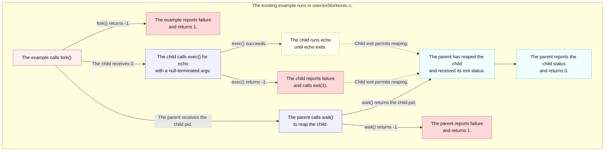

# Lab util: Deriving `find -exec`

---

[toc]

---

MIT's [2026 util lab](https://pdos.csail.mit.edu/6.1810/2026/labs/util.html#exec) extends the `find` exercise so a matched path becomes an argument to another program. This note explains the existing fork, exec, and wait model, then leaves the command-vector and failure decisions to the reader.

> [!IMPORTANT]
> This note contains no `find` implementation or pseudocode. Its C quotation comes verbatim from the existing lecture example `user/ex5forkexec.c`. The one exception is the final [Solution walkthrough](#solution-walkthrough), a marked spoiler; stop before it if you are still deriving.

## What the exercise asks for

### Contract

| Contract             | Required behavior                                                                                                    |
| -------------------- | -------------------------------------------------------------------------------------------------------------------- |
| **Input**            | After the start path and sought name, accept `-exec` followed by a command and any of its fixed arguments.           |
| **Per match**        | Run that command with the matched path as its final argument instead of printing the path.                           |
| **Process lifetime** | Use `fork` and `exec` for each invocation; the parent uses `wait` so it can continue after the child.                |
| **Earlier mode**     | Keep the plain `find` behavior described in [`04-util-find.md`](04-util-find.md) when no `-exec` request is present. |
| **Build**            | Extend the same `user/find.c` and `$U/_find` entry; no second guest program or new system call is requested.         |

The handout's wording says “add a `-exec cmd`,” while its actual example is `find . wc -exec echo hi`: `wc` is the sought name, `echo hi` is the command, and the matched `./wc` is appended after `hi`. This is the exercise's syntax, not the host Unix `find -exec ... ;` grammar. [`user/sh.c`](../../user/sh.c) passes `-exec` as an ordinary argument; it does not interpret it.

### What the grader checks

The three tests in [`grade-lab-util`](../../grade-lab-util) total **30 points**; none installs a breakpoint.

| Test                      | Points | Commands                              | Positive assertion                                    | Negative assertion            |
| ------------------------- | ------ | ------------------------------------- | ----------------------------------------------------- | ----------------------------- |
| **`exec`**                | 10     | `find . wc -exec echo`                | A whole line matches `^./wc$`.                        | None                          |
| **`exec, multiple args`** | 10     | `find . findtest.sh -exec grep hello` | Exactly 5 `hello` occurrences in the full transcript. | No separate negative pattern. |
| **`exec via sh script`**  | 10     | `sh < findtest.sh`, then `echo DONE`  | Exactly 3 `hello` occurrences in the full transcript. | No separate negative pattern. |

In the first regex, the dot is an unescaped wildcard despite the end anchor. In the second test, four occurrences come from matching lines of `findtest.sh`, and one comes from the echoed interactive command. They are occurrences, not five file hits or five independently asserted output lines.

[`user/findtest.sh`](../../user/findtest.sh), installed by `UEXTRA` in the [Makefile](../../Makefile), creates three files containing `hello` and searches for their basename `b`. The script is redirected input to `sh`; its commands are not echoed like terminal input, although the shell still prints prompts. The driver's `DONE` marker ends its scripted interaction; the test's assertion is the occurrence count, not a separate `DONE` match.

### What the grader does not prove

Printing a matching path could satisfy `exec` without executing a child. The other tests count text anywhere in the transcript and do not inspect child status, failures, individual output lines, or parent/child ordering. Extra output without `hello` is not rejected. None directly proves a `fork`, `exec`, or `wait` call; keep the handout's lifetime requirement in the [contract](#contract).

## Prerequisites

| When                | Read                                                                                                                                                                                                                                            | Ownership                                                                                                                                             |
| ------------------- | ----------------------------------------------------------------------------------------------------------------------------------------------------------------------------------------------------------------------------------------------- | ----------------------------------------------------------------------------------------------------------------------------------------------------- |
| **Read first**      | [`04-util-find.md`](04-util-find.md)                                                                                                                                                                                                            | The same target file's traversal, matching, path, and directory constraints.                                                                          |
| **Read first**      | [`The_Process_Abstraction.md`](../../../operating-system/The_Process_Abstraction.md#7-the-process-api-fork--exec--wait)                                                                                                                         | The sibling study repository's portable fork/exec/wait concept; then compare the actual xv6 example [`user/ex5forkexec.c`](../../user/ex5forkexec.c). |
| **Read first**      | [`C_Command_Line_Arguments.md`](../../../c-programming/C_Command_Line_Arguments.md#reading-the-arguments)                                                                                                                                       | How argument indices and pointer arrays represent command words.                                                                                      |
| **Use when needed** | [`book/ch01-operating-system-interfaces.md`](../book/ch01-operating-system-interfaces.md), [`07-exercises.md`](../07-exercises.md#ex5forkexec--the-shells-execution-model), and [`05-syscall-reference.md`](../05-syscall-reference.md#process) | This tree's process mechanism, example behavior, and call contracts.                                                                                  |
| **Use when needed** | [`02-build-boot-and-usage.md`](../02-build-boot-and-usage.md#adding-and-running-a-user-exercise), [`03-lab-workflow.md`](../03-lab-workflow.md), and [`06-build-artifacts.md`](../06-build-artifacts.md)                                        | User-program mechanics, grading, and generated syscall stubs.                                                                                         |

> [!NOTE]
> The sibling notes and their hosted-C examples teach concepts, not xv6 API signatures. [`user/user.h`](../../user/user.h) is the callable interface in this freestanding tree; `exec()` here takes a path and a null-terminated vector.

## The code to read first

| File                                                                                                                               | Contributes                                                                                              | Does not contribute                                     |
| ---------------------------------------------------------------------------------------------------------------------------------- | -------------------------------------------------------------------------------------------------------- | ------------------------------------------------------- |
| [`user/ex5forkexec.c`](../../user/ex5forkexec.c)                                                                                   | A complete example of the parent and child paths, successful image replacement, failed exec, and `wait`. | No search, dynamic command words, or matched pathname.  |
| [`user/sh.c`](../../user/sh.c)                                                                                                     | `runcmd()` shows an argv vector passed to `exec`; `main()` forks and waits for foreground commands.      | No special parser branch for `-exec`.                   |
| [`user/echo.c`](../../user/echo.c) and [`user/grep.c`](../../user/grep.c)                                                          | How the receiving programs use their `argc` and `argv` values.                                           | No knowledge that `find` supplied the final argument.   |
| [`kernel/param.h`](../../kernel/param.h), [`kernel/sysfile.c`](../../kernel/sysfile.c), and [`kernel/exec.c`](../../kernel/exec.c) | `MAXARG`, the null-terminated-vector copy in `sys_exec()`, and `kexec()`'s new user stack.               | No user-level command grammar or automatic PATH search. |

## `ex5forkexec`'s `main()` line by line

This is the complete, unchanged `main()` from [`user/ex5forkexec.c`](../../user/ex5forkexec.c). The fixed `echo` command belongs to that lecture example; the lab must determine its own command vector.

```c
int
main(void)
{
  int status = 0;
  // The child inherits a copy of the parent's descriptor table.
  int pid = fork();

  if (pid < 0) {
    fprintf(2, "ex5forkexec: fork failed\n");
    return 1;
  }

  if (pid == 0) {
    char *argv[] = { "echo", "THIS", "IS", "ECHO", 0 };
    // Only the child execs; the parent must survive to wait and continue.
    exec("echo", argv);

    // Only an exec failure leaves the child running this program.
    fprintf(2, "ex5forkexec: exec echo failed\n");
    exit(1);
  }

  printf("ex5forkexec: parent waiting for child %d\n", pid);

  // wait() blocks if needed, returns a pid, and writes status separately.
  int reaped = wait(&status);
  if (reaped < 0) {
    fprintf(2, "ex5forkexec: wait failed\n");
    return 1;
  }

  printf("ex5forkexec: child %d exited with status %d\n", reaped, status);
  return 0;
}
```

| Branch or value              | Consequence in this source                                                                          |
| ---------------------------- | --------------------------------------------------------------------------------------------------- |
| **Negative `fork()` result** | No child exists to wait for; the example reports failure.                                           |
| **Zero `fork()` result**     | This is the child, which inherits the descriptor table and may replace only its own image.          |
| **`argv[]` ending in `0`**   | The end marker tells `sys_exec()` where its argument vector ends; the command name is `argv[0]`.    |
| **Return from `exec()`**     | Success would have replaced this program, so the following statement is reached only after failure. |
| **Positive parent-side pid** | The original process survives to wait, inspect status, and continue.                                |
| **`wait(&status)`**          | Reaps one child and obtains its exit value through the pointer; this example has exactly one child. |

[`book/ch01-operating-system-interfaces.md`](../book/ch01-operating-system-interfaces.md) owns the kernel-side explanation of `kfork()`, `kexec()`, and `kwait()`. The diagram shows only the existing example's process split, not a new `find` routine.



_Pink requests process creation, blue routes or waits, yellow runs the replacement image, cyan completes the parent, and red reports failures._

The parent and child run concurrently after `fork()`. The parent may call `wait()` before the child finishes, or reap a child that already exited; the dashed arrows mark the child-exit dependency of successful reaping, not when the parent calls `wait()`. The parent's initial status message can interleave with child output because it precedes `wait()`; only the post-wait message is ordered after child exit. The diagram describes existing `ex5forkexec`, not the target search routine.

## The concept underneath

| Limit or interface     | Value in this tree                             | Source                                                                           | Consequence                                                                                         |
| ---------------------- | ---------------------------------------------- | -------------------------------------------------------------------------------- | --------------------------------------------------------------------------------------------------- |
| **`exec(path, argv)`** | `int exec(const char *, char **)`              | [`user/user.h`](../../user/user.h)                                               | `path` names the image; the vector supplies the new program's argument strings.                     |
| **`MAXARG`**           | 32 vector slots                                | [`kernel/param.h`](../../kernel/param.h), [`sys_exec()`](../../kernel/sysfile.c) | One slot must be the terminating null pointer, so at most 31 non-null arguments pass this boundary. |
| **`wait(int *)`**      | One child pid returned; optional status output | [`user/user.h`](../../user/user.h), [`kernel/proc.c`](../../kernel/proc.c)       | The parent must account for the child it created; `wait(0)` discards exit status.                   |
| **`findtest.sh`**      | Three `hello` files and one search command     | [`user/findtest.sh`](../../user/findtest.sh)                                     | The script fixture checks that each matched path can reach `grep` as a file operand.                |

> [!IMPORTANT]
> `exec` replaces the calling process only on success. A direct `exec` in the process that must keep searching would discard that search; a failed `exec` returns to its caller and needs a terminating error path.

`sys_exec()` in [`kernel/sysfile.c`](../../kernel/sysfile.c) fetches pointers until it sees zero or reaches `MAXARG`; [`kexec()` in `kernel/exec.c`](../../kernel/exec.c) copies those strings into the new program's stack. There is no kernel feature that appends a path to the vector. The receiving program sees only the ordered strings it was given. This explains why `echo` and `grep` need no changes for the exercise.

`wait()` reaps an exited child and may block until one exits. The handout's parent-wait hint establishes the lifetime requirement; [the grader limits](#what-the-grader-does-not-prove) explain why a passing output test is weaker evidence. If multiple children were outstanding, `wait()` would return any reaped child's pid; the existing example has only one, which makes its association unambiguous.

## Deriving it

**Contract:** use the [requirements above](#contract), including plain `find` compatibility; derive the command and lifetime choices from these questions.

| Decision for `user/find.c`           | Source-backed question to settle                                                                                                                                                 |
| ------------------------------------ | -------------------------------------------------------------------------------------------------------------------------------------------------------------------------------- |
| **Recognize the optional form**      | Which `argv` entries does [`user/sh.c`](../../user/sh.c) pass for the handout's `find . wc -exec echo hi`, and how will the requested name stay distinct from command words?     |
| **Form the child's argument vector** | Where do the command name, fixed arguments, matched path, and final null pointer belong under [`sys_exec()`](../../kernel/sysfile.c)'s `MAXARG` boundary?                        |
| **Keep the search alive**            | Which branch of [`ex5forkexec.c`](../../user/ex5forkexec.c) survives successful `exec`, and which branch can continue visiting later matches?                                    |
| **Account for one invocation**       | What does [`wait()`](../05-syscall-reference.md#process) return, and how would you handle `fork` failure, `exec` failure, or a child exit without losing the rest of the search? |
| **Preserve plain search**            | Which observations in [`04-util-find.md`](04-util-find.md#what-the-exercise-asks-for) should still hold when there is no `-exec` marker?                                         |

| Trap                                                           | Observable consequence                                                                               | Source to inspect                                                                                               |
| -------------------------------------------------------------- | ---------------------------------------------------------------------------------------------------- | --------------------------------------------------------------------------------------------------------------- |
| **Use host Unix `find` syntax**                                | A terminating `;` or `{}` placeholder is not part of the 2026 handout's sample or grader commands.   | [Handout](https://pdos.csail.mit.edu/6.1810/2026/labs/util.html#exec), [`grade-lab-util`](../../grade-lab-util) |
| **Omit the matched pathname or put it before fixed arguments** | `grep hello` will not receive the file operand in the position illustrated by the handout.           | [`user/findtest.sh`](../../user/findtest.sh), [`user/grep.c`](../../user/grep.c)                                |
| **Read `argv[3]` before testing `argc`**                       | With three arguments `argv[3]` is null, so plain `find` can be rejected without a fault.             | [`kernel/exec.c`](../../kernel/exec.c), [`user/user.ld`](../../user/user.ld)                                    |
| **Forget the terminating null slot**                           | `sys_exec()` keeps fetching pointers, may reject the vector, or may read unrelated memory.           | [`kernel/sysfile.c`](../../kernel/sysfile.c)                                                                    |
| **Replace the searching process**                              | No original image remains to handle another match.                                                   | [`user/ex4exec.c`](../../user/ex4exec.c), [`user/ex5forkexec.c`](../../user/ex5forkexec.c)                      |
| **Continue in the child after a failed `exec`**                | The child can accidentally continue the search as a second searcher on the shared directory offsets. | [`user/ex5forkexec.c`](../../user/ex5forkexec.c)                                                                |
| **Assume a count of five means five file hits**                | The grader counts the echoed command's `hello` as well as the script's four matching lines.          | [`grade-lab-util`](../../grade-lab-util), [`user/findtest.sh`](../../user/findtest.sh)                          |

## Verifying it

1. Build and boot after the plain `find` exercise is registered:

    ```bash
    make qemu
    ```

2. In the guest, exercise fixed arguments, the installed script as input data, and script execution:

    ```text
    find . wc -exec echo hi
    find . findtest.sh -exec grep hello
    sh < findtest.sh
    ```

3. Quit QEMU with `Ctrl-a x`, then run the focused extension tests and the plain-search regression checks:

    ```bash
    ./grade-lab-util exec
    ./grade-lab-util find exec
    ```

`gradelib.py` selects tests by case-insensitive title substrings, so the two filter words select both sets. Use [the evidence limits](#what-the-grader-does-not-prove) rather than treating an occurrence count as direct process evidence. The focused failure logs are `xv6.out.find_exec`, `xv6.out.find_exec_args`, and `xv6.out.test_find_sh`; [docs 03](../03-lab-workflow.md#grading) owns transcript handling.

These are future-implementation checks, not claimed command output. [Docs 02](../02-build-boot-and-usage.md) covers rebuilding or preserving `fs.img`. For process behavior, the source-backed lecture example and [chapter 1](../book/ch01-operating-system-interfaces.md) provide the mechanism; no extra kernel-debugger recipe is needed for this note.

## Questions

1. For `find . wc -exec echo hi`, what are the command-name and fixed-argument words before the matched path is added, according to the [handout](https://pdos.csail.mit.edu/6.1810/2026/labs/util.html#exec)?
2. Why does the line following `exec("echo", argv)` in [`ex5forkexec.c`](../../user/ex5forkexec.c) execute only on failure?
3. How many non-null pointers can [`sys_exec()`](../../kernel/sysfile.c) accept when `MAXARG` is 32, and where does it require a zero pointer?
4. What would a successful direct `exec` do to the process that is still searching, according to [`book/ch01`](../book/ch01-operating-system-interfaces.md)?
5. If `fork()` returns `-1`, which branch of [`ex5forkexec.c`](../../user/ex5forkexec.c) runs, and is there a child to reap?
6. If the command image cannot be loaded, which process is still running after `exec()` returns, and what does the example do next?
7. Why does the `exec, multiple args` test count five `hello` strings when [`findtest.sh`](../../user/findtest.sh) has four lines containing that word?
8. What do `wait()`'s return value and optional status pointer tell the parent in [`user/ex5forkexec.c`](../../user/ex5forkexec.c)?

## Solution walkthrough

> [!CAUTION]
> **Spoiler.** This section explains the finished [`user/find.c`](../../user/find.c), which passes the three `exec` tests and the four plain `find` tests. Stop here if you are still deriving it from the sections above.

| Location in `user/find.c` | Responsibility                                                                                                         |
| ------------------------- | ---------------------------------------------------------------------------------------------------------------------- |
| **Header comment**        | The `-exec` syntax and the `find` versus child argument-vector layout.                                                 |
| **`main()`**              | Chooses plain or `-exec` mode, rejects malformed forms, and checks the `MAXARG` budget once, before any search starts. |
| **`find()`**              | Unchanged traversal; at a match it prints when `cmd` is `0`, otherwise it calls `run()`.                               |
| **`run()`**               | One fork, one child `exec`, and one parent `wait` per matched path.                                                    |

### Where the fork belongs

| Placement of fork/exec                         | Command runs   | Receives the matched path | Search survives                 |
| ---------------------------------------------- | -------------- | ------------------------- | ------------------------------- |
| **Fork and exec in `main()`, before `find()`** | Once           | No                        | Yes, but runs after the command |
| **Direct `exec` in `main()`, after `find()`**  | Once           | No                        | No: the image is replaced       |
| **Fork, exec, and wait in `run()` per match**  | Once per match | Yes, as the last argument | Yes                             |

`main()` executes once per `find` command, so any fork placed there can produce at most one command, and only `find()` knows a matched path. The process split therefore has to happen at the match site. Only the child execs; the parent returns into `find()`'s loop and keeps reading directory records.

### One match with `-exec`

```mermaid
flowchart TD
    subgraph R["run(cmd, path) in user/find.c"]
        F["The parent calls fork()."] -->|"fork() returns -1."| X["run() reports fork failed<br/>and returns -1."]
        F -->|"The child receives 0."| B["The child copies the cmd words,<br/>appends path, and ends with 0."]
        B --> E["The child calls exec(child_argv[0], child_argv)."]
        E -->|"exec() succeeds."| N["The command runs<br/>until it exits."]
        E -->|"exec() returns -1."| C["The child reports exec failed<br/>and calls exit(1)."]
        F -->|"The parent receives the child pid."| W["The parent calls wait(0)."]
        N -.->|"Child exit permits reaping."| W
        C -.->|"Child exit permits reaping."| W
        W -->|"wait() returns a pid."| K["run() returns 0, and find()<br/>reads its next record."]
        W -->|"wait() returns -1."| Y["run() reports wait failed<br/>and returns -1."]
    end
    classDef request fill:#fff0f0,stroke:#c66,color:#111
    classDef routing fill:#f0f0ff,stroke:#66c,color:#111
    classDef processing fill:#fffff0,stroke:#cc6,color:#111
    classDef commit fill:#f0ffff,stroke:#6cc,color:#111
    classDef failure fill:#ffd9d9,stroke:#c66,color:#111
    class F request
    class E,W routing
    class B,N processing
    class K commit
    class X,C,Y failure
```



_Same palette as the [`ex5forkexec` diagram](#ex5forkexecs-main-line-by-line)._

A `-1` from `run()` makes `find()`'s status sticky, as a `stat()` failure does, but the loop continues: a full process table (`NPROC` 64) or one unloadable command does not hide later matches. `wait(0)` discards the command's exit status on purpose; `grep` finding nothing is the command's answer, not a `find` failure. An exec failure is still visible because the child reports it on fd 2.

Waiting before the next match has two effects. Command output appears in search order, and each child is reaped at once instead of holding a process slot until `fork()` fails.

### The argument vectors

For `find . b -exec grep hello` matching `./a/b`:

| Vector            | `[0]`  | `[1]`   | `[2]`   | `[3]`   | `[4]`  | `[5]`   |
| ----------------- | ------ | ------- | ------- | ------- | ------ | ------- |
| **`find`'s argv** | `find` | `.`     | `b`     | `-exec` | `grep` | `hello` |
| **`child_argv`**  | `grep` | `hello` | `./a/b` | `0`     |        |         |

- **Command list:** `main()` passes `argv + 4`. `kexec()` stores `ustack[argc] = 0` in [`kernel/exec.c`](../../kernel/exec.c), so that list is already terminated.
- **Budget:** `(argc - 4)` command words, one path, and one null pointer must not exceed `MAXARG`, so `main()` rejects `argc - 4 + 2 > MAXARG`, which allows at most 30 command words.
- **Terminator:** the last slot is the integer `0`. `"\0"` would be a non-null pointer to an empty string, which `sys_exec()` accepts as one more argument.
- **Fixed array:** `child_argv[MAXARG]` replaces a VLA because C99 (`-std=gnu99`) forbids initializing a variable-length array. Its 256 bytes exist only while `run()` is active, never once per recursion frame.

### Failure modes the source guards

> [!WARNING]
> A failed child must `exit()`, never return into `find()`. `kfork()` in [`kernel/proc.c`](../../kernel/proc.c) gives the child `filedup()` copies of every open directory descriptor, and these share one `struct file` and its read offset with the parent. A second searcher would consume dirents the parent still has to read.

| Condition                       | What `user/find.c` does                                                                                                                   |
| ------------------------------- | ----------------------------------------------------------------------------------------------------------------------------------------- |
| **`argc == 3`**                 | Runs plain `find` without reading `argv[3]`.                                                                                              |
| **`argc == 4`, or not `-exec`** | Prints `Usage: find <dir> <name> [-exec cmd [arg ...]]` and exits 1.                                                                      |
| **Too many command words**      | Prints `find: too many -exec arguments` before searching.                                                                                 |
| **`fork()` fails**              | Reports `find: fork failed`, marks status `-1`, and continues.                                                                            |
| **`exec()` fails**              | The child reports `find: exec <cmd> failed` and calls `exit(1)`; the parent reaps it and continues.                                       |
| **Deep match**                  | The command inherits one directory fd per active `find()` level; at the roughly 12-level limit it still has one fd for `grep`'s `open()`. |

Testing `argc == 3` first is not cosmetic. With three arguments, `argv[3]` is the null pointer, and user text is linked at address `0` by [`user/user.ld`](../../user/user.ld), so `strcmp(argv[3], "-exec")` reads instruction bytes instead of faulting and silently rejects the plain form.

### Decisions, answered

| Decision                             | What `user/find.c` does                                                                                       |
| ------------------------------------ | ------------------------------------------------------------------------------------------------------------- |
| **Recognize the optional form**      | Exactly 3 arguments is plain mode; otherwise `argv[3]` must be `-exec` and at least one command word follows. |
| **Form the child's argument vector** | Command words, then the matched path, then `0`, checked against `MAXARG` in `main()`.                         |
| **Keep the search alive**            | Only the child execs; the parent returns to `find()`'s loop.                                                  |
| **Account for one invocation**       | `wait(0)` per match; fork or wait failure marks status `-1` without stopping the search.                      |
| **Preserve plain search**            | `cmd == 0` prints the path exactly as in [`04-util-find.md`](04-util-find.md#solution-walkthrough).           |
