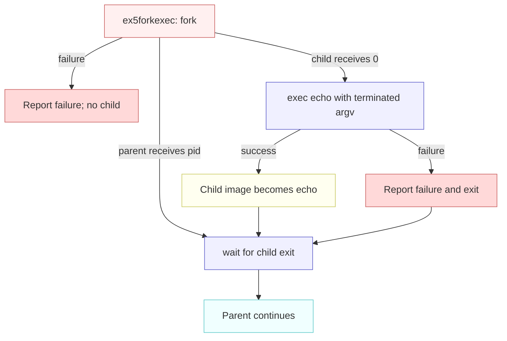

# Lab util: Deriving `find -exec`

---

[toc]

---

MIT's [2026 util lab](https://pdos.csail.mit.edu/6.1810/2026/labs/util.html#exec) extends the `find` exercise so a matched path becomes an argument to another program. This note explains the existing fork, exec, and wait model, then leaves the command-vector and failure decisions to the reader.

> [!IMPORTANT]
> This note contains no `find` implementation or pseudocode. Its C quotation comes verbatim from the existing lecture example `user/ex5forkexec.c`.

## What the exercise asks for

| Contract             | Required behavior                                                                                                    |
| -------------------- | -------------------------------------------------------------------------------------------------------------------- |
| **Input**            | After the start path and sought name, accept `-exec` followed by a command and any of its fixed arguments.           |
| **Per match**        | Run that command with the matched path as its final argument instead of printing the path.                           |
| **Process lifetime** | Use `fork` and `exec` for each invocation; the parent uses `wait` so it can continue after the child.                |
| **Earlier mode**     | Keep the plain `find` behavior described in [`04-util-find.md`](04-util-find.md) when no `-exec` request is present. |
| **Build**            | Extend the same `user/find.c` and `$U/_find` entry; no second guest program or new system call is requested.         |

The handout's wording says “add a `-exec cmd`,” while its actual example is `find . wc -exec echo hi`: `wc` is the sought name, `echo hi` is the command, and the matched `./wc` is appended after `hi`. This is the exercise's syntax, not the host Unix `find -exec ... ;` grammar. [`user/sh.c`](../../user/sh.c) passes `-exec` as an ordinary argument; it does not interpret it.

The 2026 handout gives no difficulty label for this exercise. The three relevant tests in [`grade-lab-util`](../../grade-lab-util) total 30 points:

| Test                      | Points | Exact checks                                                                                                             | What they leave open                                                                                                                                                                                     |
| ------------------------- | -----: | ------------------------------------------------------------------------------------------------------------------------ | -------------------------------------------------------------------------------------------------------------------------------------------------------------------------------------------------------- |
| **`exec`**                |     10 | Runs `find . wc -exec echo` and requires a whole line matching `./wc`.                                                   | Printing the path alone could also satisfy this one check; it does not by itself prove `fork`, `exec`, or `wait`.                                                                                        |
| **`exec, multiple args`** |     10 | Runs `find . findtest.sh -exec grep hello` and counts exactly five occurrences of `hello` in the entire QEMU transcript. | Four occurrences are in `findtest.sh`'s lines, and one is in the echoed shell command; it checks neither individual output lines nor child exit status.                                                  |
| **`exec via sh script`**  |     10 | Runs `sh < findtest.sh`, then `echo DONE`; counts exactly three occurrences of `hello` in the entire transcript.         | The script creates three files containing `hello`, then searches for `b` and runs `grep hello` on each; this checks the resulting count but does not directly inspect parent/child ordering or failures. |

The script is [`user/findtest.sh`](../../user/findtest.sh), installed as a guest data file by `UEXTRA` in the [Makefile](../../Makefile). Its commands are read from redirected input by `sh`, so they are not echoed like an interactively typed command. The test supplies `echo DONE` to let the grader's shell driver finish; its assertion is the `hello` count.

## Prerequisites

| When                | Read                                                                                                                                                                                                                                            | Ownership                                                                                                                                             |
| ------------------- | ----------------------------------------------------------------------------------------------------------------------------------------------------------------------------------------------------------------------------------------------- | ----------------------------------------------------------------------------------------------------------------------------------------------------- |
| **Read first**      | [`04-util-find.md`](04-util-find.md)                                                                                                                                                                                                            | The same target file's traversal, matching, path, and directory constraints.                                                                          |
| **Read first**      | [`The_Process_Abstraction.md`](../../../operating-system/The_Process_Abstraction.md#7-the-process-api-fork--exec--wait)                                                                                                                         | The sibling study repository's portable fork/exec/wait concept; then compare the actual xv6 example [`user/ex5forkexec.c`](../../user/ex5forkexec.c). |
| **Read first**      | [`C_Command_Line_Arguments.md`](../../../c-programming/C_Command_Line_Arguments.md#reading-the-arguments)                                                                                                                                       | How argument indices and pointer arrays represent command words.                                                                                      |
| **Use when needed** | [`book/ch01-operating-system-interfaces.md`](../book/ch01-operating-system-interfaces.md), [`07-exercises.md`](../07-exercises.md#ex5forkexec--the-shells-execution-model), and [`05-syscall-reference.md`](../05-syscall-reference.md#process) | This tree's process mechanism, example behavior, and call contracts.                                                                                  |
| **Use when needed** | [`02-build-boot-and-usage.md`](../02-build-boot-and-usage.md#adding-and-running-a-user-exercise), [`03-lab-workflow.md`](../03-lab-workflow.md), and [`06-build-artifacts.md`](../06-build-artifacts.md)                                        | User-program mechanics, grading, and generated syscall stubs.                                                                                         |

> [!NOTE]
> The sibling notes and their hosted-C examples teach concepts, not xv6 API signatures. [`user/user.h`](../../user/user.h) is the callable interface in this freestanding tree; `exec()` here takes a path and a null-terminated vector.

## The code to read first

| File                                                                                                                               | Contributes                                                                                              | Does not contribute                                     |
| ---------------------------------------------------------------------------------------------------------------------------------- | -------------------------------------------------------------------------------------------------------- | ------------------------------------------------------- |
| [`user/ex5forkexec.c`](../../user/ex5forkexec.c)                                                                                   | A complete example of the parent and child paths, successful image replacement, failed exec, and `wait`. | No search, dynamic command words, or matched pathname.  |
| [`user/sh.c`](../../user/sh.c)                                                                                                     | `runcmd()` shows an argv vector passed to `exec`; `main()` forks and waits for foreground commands.      | No special parser branch for `-exec`.                   |
| [`user/echo.c`](../../user/echo.c) and [`user/grep.c`](../../user/grep.c)                                                          | How the receiving programs use their `argc` and `argv` values.                                           | No knowledge that `find` supplied the final argument.   |
| [`kernel/param.h`](../../kernel/param.h), [`kernel/sysfile.c`](../../kernel/sysfile.c), and [`kernel/exec.c`](../../kernel/exec.c) | `MAXARG`, the null-terminated-vector copy in `sys_exec()`, and `kexec()`'s new user stack.               | No user-level command grammar or automatic PATH search. |

## `ex5forkexec`'s `main()` line by line

This is the complete, unchanged `main()` from [`user/ex5forkexec.c`](../../user/ex5forkexec.c). The fixed `echo` command belongs to that lecture example; the lab must determine its own command vector.

```c
int
main(void)
{
  int status = 0;
  // The child inherits a copy of the parent's descriptor table.
  int pid = fork();

  if (pid < 0) {
    fprintf(2, "ex5forkexec: fork failed\n");
    return 1;
  }

  if (pid == 0) {
    char *argv[] = { "echo", "THIS", "IS", "ECHO", 0 };
    // Only the child execs; the parent must survive to wait and continue.
    exec("echo", argv);

    // Only an exec failure leaves the child running this program.
    fprintf(2, "ex5forkexec: exec echo failed\n");
    exit(1);
  }

  printf("ex5forkexec: parent waiting for child %d\n", pid);

  // wait() blocks if needed, returns a pid, and writes status separately.
  int reaped = wait(&status);
  if (reaped < 0) {
    fprintf(2, "ex5forkexec: wait failed\n");
    return 1;
  }

  printf("ex5forkexec: child %d exited with status %d\n", reaped, status);
  return 0;
}
```

| Branch or value              | Consequence in this source                                                                          |
| ---------------------------- | --------------------------------------------------------------------------------------------------- |
| **Negative `fork()` result** | No child exists to wait for; the example reports failure.                                           |
| **Zero `fork()` result**     | This is the child, which inherits the descriptor table and may replace only its own image.          |
| **`argv[]` ending in `0`**   | The end marker tells `sys_exec()` where its argument vector ends; the command name is `argv[0]`.    |
| **Return from `exec()`**     | Success would have replaced this program, so the following statement is reached only after failure. |
| **Positive parent-side pid** | The original process survives to wait, inspect status, and continue.                                |
| **`wait(&status)`**          | Reaps one child and obtains its exit value through the pointer; this example has exactly one child. |

[`book/ch01-operating-system-interfaces.md`](../book/ch01-operating-system-interfaces.md) owns the kernel-side explanation of `kfork()`, `kexec()`, and `kwait()`. The diagram shows only the existing example's process split, not a new `find` routine.



_Pink is the process request, blue chooses or waits, yellow runs the replacement image, cyan resumes the parent, and red marks failures._

## The concept underneath

| Limit or interface     | Value in this tree                             | Source                                                                           | Consequence                                                                                         |
| ---------------------- | ---------------------------------------------- | -------------------------------------------------------------------------------- | --------------------------------------------------------------------------------------------------- |
| **`exec(path, argv)`** | `int exec(const char *, char **)`              | [`user/user.h`](../../user/user.h)                                               | `path` names the image; the vector supplies the new program's argument strings.                     |
| **`MAXARG`**           | 32 vector slots                                | [`kernel/param.h`](../../kernel/param.h), [`sys_exec()`](../../kernel/sysfile.c) | One slot must be the terminating null pointer, so at most 31 non-null arguments pass this boundary. |
| **`wait(int *)`**      | One child pid returned; optional status output | [`user/user.h`](../../user/user.h), [`kernel/proc.c`](../../kernel/proc.c)       | The parent must account for the child it created; `wait(0)` discards exit status.                   |
| **`findtest.sh`**      | Three `hello` files and one search command     | [`user/findtest.sh`](../../user/findtest.sh)                                     | The script fixture checks that each matched path can reach `grep` as a file operand.                |

> [!IMPORTANT]
> `exec` replaces the calling process only on success. A direct `exec` in the process that must keep searching would discard that search; a failed `exec` returns to its caller and needs a terminating error path.

`sys_exec()` in [`kernel/sysfile.c`](../../kernel/sysfile.c) fetches pointers until it sees zero or reaches `MAXARG`; [`kexec()` in `kernel/exec.c`](../../kernel/exec.c) copies those strings into the new program's stack. There is no kernel feature that appends a path to the vector. The receiving program sees only the ordered strings it was given. This explains why `echo` and `grep` need no changes for the exercise.

`wait()` reaps an exited child and may block until one exits. The exercise's “wait in the parent” hint establishes the desired lifetime relationship, while the three grader tests observe output and do not directly assert a specific wait call. If multiple children were outstanding, `wait()` would return any reaped child's pid; the existing example has only one, which makes its association unambiguous.

## Deriving it

| Contract for `user/find.c`           | Source-backed question to settle                                                                                                                                                 |
| ------------------------------------ | -------------------------------------------------------------------------------------------------------------------------------------------------------------------------------- |
| **Recognize the optional form**      | Which `argv` entries does [`user/sh.c`](../../user/sh.c) pass for the handout's `find . wc -exec echo hi`, and how will the requested name stay distinct from command words?     |
| **Form the child's argument vector** | Where do the command name, fixed arguments, matched path, and final null pointer belong under [`sys_exec()`](../../kernel/sysfile.c)'s `MAXARG` boundary?                        |
| **Keep the search alive**            | Which branch of [`ex5forkexec.c`](../../user/ex5forkexec.c) survives successful `exec`, and which branch can continue visiting later matches?                                    |
| **Account for one invocation**       | What does [`wait()`](../05-syscall-reference.md#process) return, and how would you handle `fork` failure, `exec` failure, or a child exit without losing the rest of the search? |
| **Preserve plain search**            | Which observations in [`04-util-find.md`](04-util-find.md#what-the-exercise-asks-for) should still hold when there is no `-exec` marker?                                         |

| Trap                                                           | Observable consequence                                                                             | Source to inspect                                                                                               |
| -------------------------------------------------------------- | -------------------------------------------------------------------------------------------------- | --------------------------------------------------------------------------------------------------------------- |
| **Use host Unix `find` syntax**                                | A terminating `;` or `{}` placeholder is not part of the 2026 handout's sample or grader commands. | [Handout](https://pdos.csail.mit.edu/6.1810/2026/labs/util.html#exec), [`grade-lab-util`](../../grade-lab-util) |
| **Omit the matched pathname or put it before fixed arguments** | `grep hello` will not receive the file operand in the position illustrated by the handout.         | [`user/findtest.sh`](../../user/findtest.sh), [`user/grep.c`](../../user/grep.c)                                |
| **Forget the terminating null slot**                           | `sys_exec()` keeps fetching pointers, may reject the vector, or may read unrelated memory.         | [`kernel/sysfile.c`](../../kernel/sysfile.c)                                                                    |
| **Replace the searching process**                              | No original image remains to handle another match.                                                 | [`user/ex4exec.c`](../../user/ex4exec.c), [`user/ex5forkexec.c`](../../user/ex5forkexec.c)                      |
| **Continue in the child after a failed `exec`**                | The child can accidentally continue the search as a second searcher.                               | [`user/ex5forkexec.c`](../../user/ex5forkexec.c)                                                                |
| **Assume a count of five means five file hits**                | The grader counts the echoed command's `hello` as well as the script's four matching lines.        | [`grade-lab-util`](../../grade-lab-util), [`user/findtest.sh`](../../user/findtest.sh)                          |

## Verifying it

1. Build and boot with `make qemu` once the `find` exercise has a registered program.
2. In the guest, try the handout's `find . wc -exec echo hi`, then `find . findtest.sh -exec grep hello` and `sh < findtest.sh`.
3. From the host, run the focused `exec` tests, then run the `find` tests because this exercise extends the same file. `gradelib.py` selects tests by case-insensitive title substrings, so two filter words select both sets.

```bash
make qemu
```

```text
find . wc -exec echo hi
find . findtest.sh -exec grep hello
sh < findtest.sh
```

```bash
./grade-lab-util exec
./grade-lab-util find exec
```

The commands are verification recipes for the future implementation; the present repository has no `user/find.c`, so this note does not claim their output. [`03-lab-workflow.md`](../03-lab-workflow.md) covers grading transcripts, and [`02-build-boot-and-usage.md`](../02-build-boot-and-usage.md) covers rebuilding or preserving `fs.img`.

## Questions

1. For `find . wc -exec echo hi`, what are the command-name and fixed-argument words before the matched path is added, according to the [handout](https://pdos.csail.mit.edu/6.1810/2026/labs/util.html#exec)?
2. Why does the line following `exec("echo", argv)` in [`ex5forkexec.c`](../../user/ex5forkexec.c) execute only on failure?
3. How many non-null pointers can [`sys_exec()`](../../kernel/sysfile.c) accept when `MAXARG` is 32, and where does it require a zero pointer?
4. What would a successful direct `exec` do to the process that is still searching, according to [`book/ch01`](../book/ch01-operating-system-interfaces.md)?
5. If `fork()` returns `-1`, which branch of [`ex5forkexec.c`](../../user/ex5forkexec.c) runs, and is there a child to reap?
6. If the command image cannot be loaded, which process is still running after `exec()` returns, and what does the example do next?
7. Why does the `exec, multiple args` test count five `hello` strings when [`findtest.sh`](../../user/findtest.sh) has four lines containing that word?
8. What do `wait()`'s return value and optional status pointer tell the parent in [`user/ex5forkexec.c`](../../user/ex5forkexec.c)?
