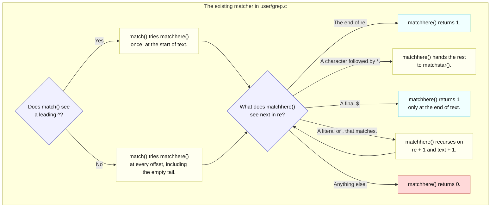

# Lab util: Deriving `find` with regular expressions

---

[toc]

---

An optional challenge in MIT's [2026 util lab](https://pdos.csail.mit.edu/6.1810/2026/labs/util.html) asks `find` to accept a regular expression in place of an exact name, and points at the small matcher already in `user/grep.c`. This note explains that matcher and the decisions its semantics force on `user/find.c`; it does not write the change.

> [!IMPORTANT]
> No solution or pseudocode before the end: the C quotation below is the unchanged matcher from `user/grep.c`, which is not the target, and `user/find.c` gets a contract, decisions, and traps. Its traversal is explained in [`04-util-find.md`](04-util-find.md). The one exception is the final [Solution walkthrough](#solution-walkthrough), a marked spoiler; stop before it if you are still deriving.

## What the exercise asks for

### Contract

| Aspect               | Requirement or local convention                                                                                                                                                                       |
| -------------------- | ----------------------------------------------------------------------------------------------------------------------------------------------------------------------------------------------------- |
| **Target**           | Handout: extend `find`'s name matching. Repository: modify the existing `user/find.c`; no new program or `UPROGS` entry is needed.                                                                    |
| **Pattern language** | Handout: regular expressions, with `user/grep.c` named as primitive prior art. That matcher supports `^`, `.`, `*`, and `$` only; supporting more is your extension, not a requirement.               |
| **What is matched**  | Repository convention from [`04-util-find.md`](04-util-find.md#contract), asserted by the local tests: the entry's own name, never the path that leads to it.                                         |
| **Anchoring**        | Not specified by the handout. Repository decision, asserted by the local tests: grep's rule, so a pattern is unanchored unless it uses `^` or `$`. A plain word therefore matches anywhere in a name. |
| **Earlier modes**    | Keep plain search, directory matches, and `-exec` from [`04-util-find.md`](04-util-find.md) and [`05-util-find-exec.md`](05-util-find-exec.md) working.                                               |
| **Build**            | `find.o` is in `STRICT_OBJS` in the [Makefile](../../Makefile), so it compiles with `-Wall -Werror -Wextra -pedantic`.                                                                                |

### What the grader checks

> [!NOTE]
> **Local tests, not MIT's.** The handout leaves this challenge ungraded. The three `find regex` tests in [`grade-lab-util`](../../grade-lab-util) were added in this repository, total **30 points**, and fix the anchoring rule and name-only matching in the [contract](#contract).

Each test boots a fresh image, builds the same fixture under a directory `DIR` with a random 8-character name, runs its `find` commands, and compares each command's output lines with the expected set, ignoring order. `find_regex_run()` takes a command's output as the text between its `$ command` line and the next one.

| Name in the fixture     | Why it is there                                                    |
| ----------------------- | ------------------------------------------------------------------ |
| **`ab`**                | The exact word: matched by every anchoring of `ab`.                |
| **`abc`**               | Starts with `ab` but continues: separates `^ab` from `ab$`.        |
| **`xab`**, **`aab`**    | End in `ab` after a prefix: separate `ab$` from `^ab`.             |
| **`b`**                 | One character: the zero-repetition case of `a*` and the `^.$` hit. |
| **`axc`**               | Matches `a.c` only through the wildcard.                           |
| **`sub`**, **`sub/ab`** | A directory to descend into, holding a second `ab`.                |

| Test                                          | Points | Patterns checked                         | What a failure means                                                    |
| --------------------------------------------- | ------ | ---------------------------------------- | ----------------------------------------------------------------------- |
| **`find regex, anchors`**                     | 10     | `ab`, `^ab`, `ab$`, `^ab$`               | Exact comparison was kept, or `^` and `$` are not honored.              |
| **`find regex, wildcards`**                   | 10     | `^a.c$`, `^a*b$`, `^.$`, `.*`            | `.` or `*` is mishandled, or `.*` prints or descends into `.` and `..`. |
| **`find regex, names not paths, with -exec`** | 10     | `DIR` itself, then `^a.c -exec echo hit` | The pattern sees the path, or `-exec` no longer receives each match.    |

[Which pattern filters what](#which-pattern-filters-what) lists every expected result. The earlier exact-match comparison, which [`user/find_basic.c`](../../user/find_basic.c) still uses, fails all three tests, and a version that applies the matcher to the full path also fails all three: `^ab` cannot match `DIR/ab`, and `find DIR DIR` prints every entry.

### What the grader does not prove

| Evidence                     | What remains unchecked                                                                                  |
| ---------------------------- | ------------------------------------------------------------------------------------------------------- |
| **Each output set matches**  | Output order, and diagnostics on fd 2, which share the console but are compared only if they appear.    |
| **The fixture names pass**   | Names of the full 14 bytes, which have no terminator in `struct dirent`; the fixture's names are short. |
| **`-exec` receives matches** | Combinations with `$` in an `-exec` command line; see [the harness trap](#verifying-it).                |

The seven literal-name `find` and `exec` tests stay the regression suite. Under grep's rule, `find . b -exec grep hello` in [`user/findtest.sh`](../../user/findtest.sh) also runs `grep` on `zombie`, `find_basic`, and `sf-bad-eof`; none of those files contains `hello` in this image, so the counted occurrences are unchanged. [`04-util-find.md`](04-util-find.md#what-the-grader-checks) and [`05-util-find-exec.md`](05-util-find-exec.md#what-the-grader-checks) own those assertions and their limits.

## Prerequisites

| When                | Read                                                                                                                        | Why it matters here                                                   |
| ------------------- | --------------------------------------------------------------------------------------------------------------------------- | --------------------------------------------------------------------- |
| **Read first**      | [`04-util-find.md`](04-util-find.md)                                                                                        | Where the name comparison sits, and why `de.name` is not a C string.  |
| **Read first**      | [Kernighan and Pike's matcher article](https://www.cs.princeton.edu/courses/archive/spr09/cos333/beautiful.html)            | The origin `user/grep.c` cites, explaining the same three functions.  |
| **Use when needed** | [`05-util-find-exec.md`](05-util-find-exec.md)                                                                              | The `-exec` argument layout a pattern must not disturb.               |
| **Use when needed** | [`book/ch01-operating-system-interfaces.md`](../book/ch01-operating-system-interfaces.md#the-shell-is-just-another-program) | Why `sh` passes `*` through unexpanded: it has no globbing.           |
| **Use when needed** | [`02-build-boot-and-usage.md`](../02-build-boot-and-usage.md#house-style-for-a-new-user-program)                            | Style and strict-flag conventions for code you add to a user program. |

> [!NOTE]
> Host `find -name` uses shell glob patterns and `find -regex` matches the whole path with POSIX regular expressions. Neither is the xv6 matcher; use `user/grep.c` as the specification of what `^ . * $` mean here.

## The code to read first

| File                               | Contributes                                                                                            | Does not contribute                                                         |
| ---------------------------------- | ------------------------------------------------------------------------------------------------------ | --------------------------------------------------------------------------- |
| [`user/grep.c`](../../user/grep.c) | `match()`, `matchhere()`, and `matchstar()`: a complete recursive matcher over NUL-terminated strings. | No library export: the functions live beside grep's own `main()`.           |
| [`user/find.c`](../../user/find.c) | The single name comparison, already made against a NUL-terminated copy of the entry name.              | No pattern semantics; it compares for equality.                             |
| [`user/sh.c`](../../user/sh.c)     | `gettoken()` splits words at whitespace and at `<\|>&;()`.                                             | No quoting and no glob expansion, so quote characters reach `find` as text. |
| [`kernel/fs.h`](../../kernel/fs.h) | `DIRSIZ` 14: the longest name the matcher will ever see.                                               | No terminator guarantee inside `struct dirent`.                             |
| [Makefile](../../Makefile)         | `ULIB` lists `ulib.o usys.o printf.o umalloc.o`, the only code every program links.                    | No shared regex object; `grep.o` links only into `_grep`.                   |

## `match()` and `matchhere()` line by line

This is the unchanged, contiguous pair from [`user/grep.c`](../../user/grep.c); `matchstar()` follows it in the same file.

```c
int
match(char *re, char *text)
{
  if (re[0] == '^')
    return matchhere(re + 1, text);
  do { // must look at empty string
    if (matchhere(re, text))
      return 1;
  } while (*text++ != '\0');
  return 0;
}

// matchhere: search for re at beginning of text
int
matchhere(char *re, char *text)
{
  if (re[0] == '\0')
    return 1;
  if (re[1] == '*')
    return matchstar(re[0], re + 2, text);
  if (re[0] == '$' && re[1] == '\0')
    return *text == '\0';
  if (*text != '\0' && (re[0] == '.' || re[0] == *text))
    return matchhere(re + 1, text + 1);
  return 0;
}
```



_Legend: blue decides, yellow processes, cyan returns a match, and red returns no match. Labels carry the meaning without color._

| Line or case                             | Consequence                                                                                                |
| ---------------------------------------- | ---------------------------------------------------------------------------------------------------------- |
| **`re[0] == '^'`**                       | The only way to anchor at the start. Without it, `match()` reports success if the pattern occurs anywhere. |
| **`do { ... } while (*text++ != '\0')`** | The loop tries the empty tail too, so a pattern such as `$` or `a*` can match an empty remainder.          |
| **`re[1] == '*'`**                       | `*` binds to the single preceding character; `matchstar()` tries zero, one, and more copies of it.         |
| **`re[0] == '$' && re[1] == '\0'`**      | `$` anchors only as the last pattern character; elsewhere it is a literal dollar sign.                     |
| **`re[0] == '.'`**                       | `.` matches any one character except the terminator.                                                       |
| **No backslash case**                    | There is no escape: a literal `.` or `*` cannot be requested.                                              |

Every function reads `text` until `'\0'`, so the text must be a C string. Every recursion step consumes at least one pattern character, and `matchstar()` consumes text, so the work is bounded by the pattern and the 14-byte name; there is no stack-depth concern at that size.

## The concept underneath

| Fact                         | Value or behavior                                  | Source                                                              |
| ---------------------------- | -------------------------------------------------- | ------------------------------------------------------------------- |
| **Operators**                | `^`, `.`, `*`, `$`                                 | The header comment of [`user/grep.c`](../../user/grep.c)            |
| **Default anchoring**        | Unanchored search                                  | `match()` in [`user/grep.c`](../../user/grep.c)                     |
| **Longest name**             | `DIRSIZ` = 14 bytes, possibly without a terminator | [`kernel/fs.h`](../../kernel/fs.h)                                  |
| **Shell word characters**    | Anything except whitespace and `<\|>&;()`          | `whitespace[]` and `symbols[]` in [`user/sh.c`](../../user/sh.c)    |
| **Strict flags on `find.o`** | `-Wall -Werror -Wextra -pedantic`                  | `STRICT_CFLAGS` and `STRICT_OBJS` in the [Makefile](../../Makefile) |

> [!WARNING]
> **A literal name is also a pattern.** Under grep's rule, adopted here, `find . b` matches every name containing `b`; in this image that includes programs such as `zombie` and `find_basic` and the fixture `sf-bad-eof`. Write `^b$` to ask for the exact name.

Two consequences follow from the shell, not the matcher. `sh` performs no globbing, so `find . 'b*'` is unnecessary: `find . b*` already delivers `b*` to `find`. And `sh` performs no quote removal, so the quoted form delivers the quote characters as part of the pattern. None of `^ . * $` is in `symbols[]`, so all four reach `argv` intact.

## Which pattern filters what

> [!TIP]
> Predict a row before you run it. Each result below was computed with a line-for-line port of `match()`, `matchhere()`, and `matchstar()`, and the fixture rows are exactly what the local tests expect.

The fixture from [the grader](#what-the-grader-checks), with `✓` where the name matches. `sub/ab` always behaves like `ab`, because only the final name is matched.

| Pattern | `ab` | `abc` | `xab` | `aab` | `b` | `axc` | `sub` | What the pattern says                                       |
| ------- | ---- | ----- | ----- | ----- | --- | ----- | ----- | ----------------------------------------------------------- |
| `ab`    | ✓    | ✓     | ✓     | ✓     |     |       |       | `ab` anywhere in the name.                                  |
| `^ab`   | ✓    | ✓     |       |       |     |       |       | Starts with `ab`.                                           |
| `ab$`   | ✓    |       | ✓     | ✓     |     |       |       | Ends with `ab`.                                             |
| `^ab$`  | ✓    |       |       |       |     |       |       | Exactly `ab`: the old literal-name behavior.                |
| `b`     | ✓    | ✓     | ✓     | ✓     | ✓   |       | ✓     | Any `b`, including the directory `sub`.                     |
| `^a.c$` |      | ✓     |       |       |     | ✓     |       | `a`, any one character, `c`.                                |
| `^a*b$` | ✓    |       |       | ✓     | ✓   |       |       | Zero or more `a`, then a final `b`.                         |
| `^.$`   |      |       |       |       | ✓   |       |       | Exactly one character.                                      |
| `.*`    | ✓    | ✓     | ✓     | ✓     | ✓   | ✓     | ✓     | Everything; `.` and `..` must still be skipped.             |
| `x*`    | ✓    | ✓     | ✓     | ✓     | ✓   | ✓     | ✓     | Zero `x` is enough, so an unanchored star matches anything. |
| `a$b`   |      |       |       |       |     |       |       | `$` is not last, so it is a literal dollar sign.            |
| `\.`    |      |       |       |       |     |       |       | `\` is a literal backslash; no name contains one.           |

The same rule applied to this image's root directory. These are snapshots: every program added to `UPROGS` can join a row.

| Pattern    | Names it selects in `/`                                                 |
| ---------- | ----------------------------------------------------------------------- |
| `b`        | `find_basic`, `sf-bad-eof`, `zombie`                                    |
| `^find`    | `find`, `find_basic`, `findtest.sh`                                     |
| `^sf-`     | `sf-bad-eof`, `sf-edge`, `sf-empty`, `sf-good-eof`, `sf-seps`           |
| `eof$`     | `sf-bad-eof`, `sf-good-eof`                                             |
| `^sf-.*f$` | `sf-bad-eof`, `sf-good-eof`                                             |
| `^s.*e$`   | `sf-edge`, `sixfive`                                                    |
| `^..$`     | `ln`, `ls`, `rm`, `sh`, `wc`                                            |
| `.sh$`     | `findtest.sh`; the unescaped dot would also accept a name such as `xsh` |
| `^ex.*c`   | `ex1copy`, `ex2create`, `ex4exec`, `ex5forkexec`, `ex6redirect`         |

Four patterns show the operators' limits. `x*` matching everything is the classic surprise: `matchstar()` succeeds after zero repetitions, so an unanchored star pattern constrains nothing. `.sh$` is the closest available way to ask for a `.sh` suffix, because there is no escape. And `a$b` and `\.` match nothing for opposite reasons: one treats an operator as a literal, the other treats a would-be escape as a literal.

## Deriving it

**Contract:** use the [requirements above](#contract); settle each question from the named source.

| Decision for `user/find.c`     | Source-backed question to settle                                                                                                                                                                                                                |
| ------------------------------ | ----------------------------------------------------------------------------------------------------------------------------------------------------------------------------------------------------------------------------------------------- |
| **Apply the anchoring rule**   | The [contract](#contract) fixes grep's rule. Which single function in [`user/grep.c`](../../user/grep.c) already implements it, including the `^` case, so that no anchoring logic of your own is needed?                                       |
| **Reuse the matcher**          | `grep.o` cannot be linked into `_find` because both define `main()`. Will you copy the functions into `find.c`, or move them into a file every program links through `ULIB`? What does each choice change for `grep` and for future lab merges? |
| **Satisfy the strict flags**   | `find()` receives `name` as `const char *`, while the grep functions take `char *`. Which declaration must change so `-Werror` accepts the call without a cast that hides a write?                                                              |
| **Feed it a C string**         | Which buffer in `find()` already holds a terminated copy of the entry name, per [`04-util-find.md`](04-util-find.md#record-names-versus-c-strings)?                                                                                             |
| **Keep `.` and `..` excluded** | Does the skip for `.` and `..` run before the comparison, so that a pattern such as `.` cannot reintroduce the descent [the corner test](04-util-find.md#what-the-grader-checks) guards against?                                                |
| **Preserve `-exec`**           | Does the pattern remain `argv[2]` with `-exec` at `argv[3]`, as [`05-util-find-exec.md`](05-util-find-exec.md#contract) requires?                                                                                                               |

| Trap                                               | Observable consequence                                                                                                   | Source to inspect                                                      |
| -------------------------------------------------- | ------------------------------------------------------------------------------------------------------------------------ | ---------------------------------------------------------------------- |
| **Matching against the full path**                 | The start path becomes text the pattern sees; with substring semantics `find . a` also matches every entry under `./a/`. | [`04-util-find.md`](04-util-find.md#contract)                          |
| **Calling the matcher on `de.name`**               | A 14-byte name has no terminator, so `matchhere()` reads past the field.                                                 | [`kernel/fs.h`](../../kernel/fs.h), [`user/grep.c`](../../user/grep.c) |
| **Calling `matchhere()` instead of `match()`**     | Every pattern becomes start-anchored: `ab$` loses `xab` and `aab`, failing `find regex, anchors`.                        | `match()` in [`user/grep.c`](../../user/grep.c)                        |
| **Keeping the `strcmp()` test beside the matcher** | Only exact names print; all three local tests fail.                                                                      | [`user/find.c`](../../user/find.c)                                     |
| **Passing `const char *` to a `char *` parameter** | `find.o` fails to compile with `-Werror=discarded-qualifiers`.                                                           | [Makefile](../../Makefile)                                             |
| **Quoting the pattern in the shell**               | The quote characters become pattern text, so nothing matches.                                                            | `gettoken()` in [`user/sh.c`](../../user/sh.c)                         |
| **Expecting `\.` to match a literal dot**          | There is no escape case; `\` is an ordinary character followed by the wildcard `.`.                                      | `matchhere()` in [`user/grep.c`](../../user/grep.c)                    |
| **Expecting `+`, `?`, `[]`, or `\|`**              | They are literals, and `\|` is consumed by `sh` as a pipe before `find` runs.                                            | [`user/grep.c`](../../user/grep.c), [`user/sh.c`](../../user/sh.c)     |

## Verifying it

1. Build and boot:

    ```bash
    make qemu
    ```

2. In the guest, check a literal name, each operator, and the anchoring decision you made. Predict each result from the [matcher table](#match-and-matchhere-line-by-line) before running it:

    ```text
    find . README
    find . ^sf-
    find . eof$
    find . ^s.*e$
    find . b
    find . b -exec echo hit
    ```

3. Quit QEMU with `Ctrl-a x`, then run the three local tests, then the literal-name regression tests. The second filter selects all ten `find` and `exec` titles:

    ```bash
    ./grade-lab-util "find regex"
    ./grade-lab-util find exec
    ```

These are checks to run, not a transcript. Compare guest results with [the tables above](#which-pattern-filters-what). The focused failure logs are `xv6.out.find_regex_anchors`, `xv6.out.find_regex_wildcards`, and `xv6.out.find_regex_names_exec`; [docs 03](../03-lab-workflow.md#grading) owns transcript handling.

> [!WARNING]
> **A `$` followed by a space in a scripted command stalls the grader.** `shell_script()` in [`gradelib.py`](../../gradelib.py) types the next command whenever the bytes `$ ` appear in the output, and the console echoes typed text, so `find DIR ^ab$ -exec echo hit` releases the next command before `find` has run. That is why the `-exec` case uses `^a.c`. A `$` at the end of a command is safe, since a newline follows it. [The prompt note](08-util-sh-prompt.md#the-harness-depends-on-the-prompt) owns the pacing rule.

`grep` itself is a convenient oracle: `ls | grep PATTERN` shows which names the same matcher accepts; unanchored patterns behave the same, but `$` patterns do not, because each `ls` line ends with the type, inode, and size columns. No kernel-debugger recipe is needed; the whole change is user space.

## Questions

1. Using only `match()` in [`user/grep.c`](../../user/grep.c), does the pattern `b` match the name `zombie`? Does `^b$`?
2. Why does `match()`'s loop test `*text++ != '\0'` after calling `matchhere()` rather than before, and which pattern depends on that order?
3. Which pattern matches exactly the names that end in `.sh`, given that there is no escape character, and what else does it also match?
4. Why can `find` not simply link `grep.o`, and which Makefile variable decides what every program links?
5. Failure scenario: the matcher is called on `de.name` for a 14-character entry. What does `matchhere()` read after the 14th byte?
6. Failure scenario: a user types `find . 'b*'`. Which function in [`user/sh.c`](../../user/sh.c) explains why nothing matches?
7. What does `$` mean in the pattern `a$b`, and which line of `matchhere()` decides that?
8. If `.` is skipped before the comparison, can any pattern make `find` descend into `.` or `..`?

## Solution walkthrough

> [!CAUTION]
> **Spoiler.** This section explains the finished [`user/find.c`](../../user/find.c), which passes the three local `find regex` tests and the seven literal-name `find` and `exec` tests. Stop here if you are still deriving it from the sections above.

| Location in `user/find.c`                   | Responsibility                                                                                                |
| ------------------------------------------- | ------------------------------------------------------------------------------------------------------------- |
| **Header comment**                          | States grep's rule and tabulates `ab`, `^ab`, `ab$`, and `^ab$` against four names.                           |
| **`match()`, `matchhere()`, `matchstar()`** | grep's three functions, copied with `const char *` parameters and `static` linkage.                           |
| **The match site in `find()`**              | `match(name, child_name_ptr)` replaces `strcmp(child_name_ptr, name) == 0`; nothing else in the loop changes. |
| **`main()`**                                | Unchanged argument layout; the usage line now says `<pattern>`.                                               |

The change is one condition, which is why it can stay small. Everything the earlier notes established still holds around it: the terminated copy at `child_name_ptr`, the `.` and `..` skip before the comparison, the descent into every directory whether or not it matched, and the print-or-run choice at a match.

### Decisions, answered

| Decision                       | What `user/find.c` does                                                                                                                                                                                                 |
| ------------------------------ | ----------------------------------------------------------------------------------------------------------------------------------------------------------------------------------------------------------------------- |
| **Apply the anchoring rule**   | Calls `match()`, whose leading-`^` test and every-offset loop are grep's rule; no wrapper adds or removes anchors.                                                                                                      |
| **Reuse the matcher**          | Copies the functions. Moving them into `ULIB` would change `user/grep.c`, `user/user.h`, and every program's link, and the Makefile and shared files are merge-sensitive ([AGENTS.md](../../AGENTS.md#c-source-style)). |
| **Satisfy the strict flags**   | All three functions take `const char *`, because `-Werror=discarded-qualifiers` rejects passing `name` to `char *`; none of them writes through either pointer.                                                         |
| **Feed it a C string**         | Passes `child_name_ptr`, which `memcpy()` plus the explicit `'\0'` at `child_name_ptr[DIRSIZ]` terminates even for a 14-byte name.                                                                                      |
| **Keep `.` and `..` excluded** | The skip still precedes the match, so `.*` prints neither alias and the corner test's single-report count holds.                                                                                                        |
| **Preserve `-exec`**           | The pattern is still `argv[2]`; `run()` receives `child_path`, so `^a.c -exec echo hit` prints `hit DIR/abc` and `hit DIR/axc`.                                                                                         |

> [!NOTE]
> Literal names keep working only in the sense the [warning above](#the-concept-underneath) describes: `find . b` now also lists `zombie`, `find_basic`, and `sf-bad-eof`. `^b$` restores the exact meaning, and `user/find_basic.c` keeps the exact `strcmp()` version for comparison.

