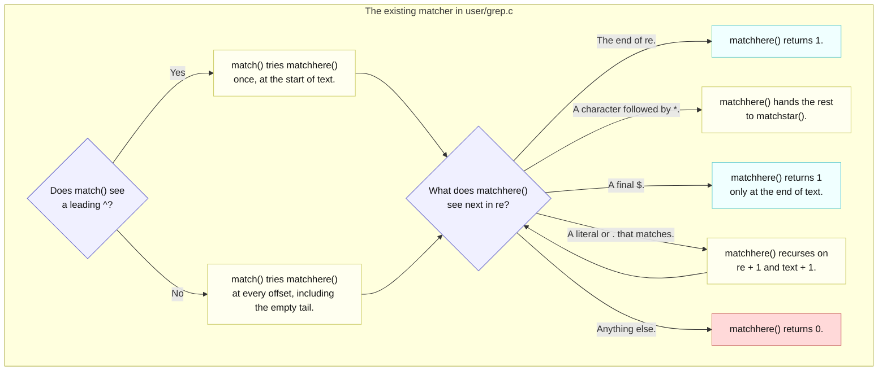

# Lab util: Deriving `find` with regular expressions

---

[toc]

---

An optional challenge in MIT's [2026 util lab](https://pdos.csail.mit.edu/6.1810/2026/labs/util.html) asks `find` to accept a regular expression in place of an exact name, and points at the small matcher already in `user/grep.c`. This note explains that matcher and the decisions its semantics force on `user/find.c`; it does not write the change.

> [!IMPORTANT]
> No solution or pseudocode: the C quotation below is the unchanged matcher from `user/grep.c`, which is not the target. `user/find.c` gets a contract, decisions, and traps. Its existing behavior is explained in [`04-util-find.md`](04-util-find.md), including that note's spoiler-marked walkthrough.

## What the exercise asks for

### Contract

| Aspect               | Requirement or local convention                                                                                                                                                         |
| -------------------- | --------------------------------------------------------------------------------------------------------------------------------------------------------------------------------------- |
| **Target**           | Handout: extend `find`'s name matching. Repository: modify the existing `user/find.c`; no new program or `UPROGS` entry is needed.                                                      |
| **Pattern language** | Handout: regular expressions, with `user/grep.c` named as primitive prior art. That matcher supports `^`, `.`, `*`, and `$` only; supporting more is your extension, not a requirement. |
| **What is matched**  | Repository convention from [`04-util-find.md`](04-util-find.md#contract): the entry's own name, not the whole path. The handout does not say otherwise.                                 |
| **Anchoring**        | Not specified by the handout. Whether a plain word must equal the whole name or may appear anywhere in it is a [decision](#deriving-it) with visible consequences.                      |
| **Earlier modes**    | Keep plain search, directory matches, and `-exec` from [`04-util-find.md`](04-util-find.md) and [`05-util-find-exec.md`](05-util-find-exec.md) working.                                 |
| **Build**            | `find.o` is in `STRICT_OBJS` in the [Makefile](../../Makefile), so it compiles with `-Wall -Werror -Wextra -pedantic`.                                                                  |

### What the grader checks

> [!NOTE]
> **No test for regular expressions.** [`grade-lab-util`](../../grade-lab-util) has no test that passes a pattern to `find`. The seven existing `find` and `exec` tests are the regression suite for this change, and each uses a literal name.

| Regression test group                           | Command shape                               | What a semantics change can disturb                                                                                                       |
| ----------------------------------------------- | ------------------------------------------- | ----------------------------------------------------------------------------------------------------------------------------------------- |
| **Four `find` tests**                           | `find . NAME` with 8-character random names | Exact-count assertions in the corner test; random names make an accidental substring match unlikely, not impossible.                      |
| **`exec`**                                      | `find . wc -exec echo`                      | A whole-line `^./wc$` match; extra output lines are not rejected.                                                                         |
| **`exec, multiple args`, `exec via sh script`** | `find . findtest.sh ...`, `find . b ...`    | Exact `hello` occurrence counts in the transcript. Under substring semantics `b` also matches other names, which then reach `grep hello`. |

[`04-util-find.md`](04-util-find.md#what-the-grader-checks) and [`05-util-find-exec.md`](05-util-find-exec.md#what-the-grader-checks) own the full assertions and their limits. A passing regression run shows the literal-name paths still behave; it says nothing about any pattern.

## Prerequisites

| When                | Read                                                                                                                        | Why it matters here                                                   |
| ------------------- | --------------------------------------------------------------------------------------------------------------------------- | --------------------------------------------------------------------- |
| **Read first**      | [`04-util-find.md`](04-util-find.md)                                                                                        | Where the name comparison sits, and why `de.name` is not a C string.  |
| **Read first**      | [Kernighan and Pike's matcher article](https://www.cs.princeton.edu/courses/archive/spr09/cos333/beautiful.html)            | The origin `user/grep.c` cites, explaining the same three functions.  |
| **Use when needed** | [`05-util-find-exec.md`](05-util-find-exec.md)                                                                              | The `-exec` argument layout a pattern must not disturb.               |
| **Use when needed** | [`book/ch01-operating-system-interfaces.md`](../book/ch01-operating-system-interfaces.md#the-shell-is-just-another-program) | Why `sh` passes `*` through unexpanded: it has no globbing.           |
| **Use when needed** | [`02-build-boot-and-usage.md`](../02-build-boot-and-usage.md#house-style-for-a-new-user-program)                            | Style and strict-flag conventions for code you add to a user program. |

> [!NOTE]
> Host `find -name` uses shell glob patterns and `find -regex` matches the whole path with POSIX regular expressions. Neither is the xv6 matcher; use `user/grep.c` as the specification of what `^ . * $` mean here.

## The code to read first

| File                               | Contributes                                                                                            | Does not contribute                                                         |
| ---------------------------------- | ------------------------------------------------------------------------------------------------------ | --------------------------------------------------------------------------- |
| [`user/grep.c`](../../user/grep.c) | `match()`, `matchhere()`, and `matchstar()`: a complete recursive matcher over NUL-terminated strings. | No library export: the functions live beside grep's own `main()`.           |
| [`user/find.c`](../../user/find.c) | The single name comparison, already made against a NUL-terminated copy of the entry name.              | No pattern semantics; it compares for equality.                             |
| [`user/sh.c`](../../user/sh.c)     | `gettoken()` splits words at whitespace and at `<\|>&;()`.                                             | No quoting and no glob expansion, so quote characters reach `find` as text. |
| [`kernel/fs.h`](../../kernel/fs.h) | `DIRSIZ` 14: the longest name the matcher will ever see.                                               | No terminator guarantee inside `struct dirent`.                             |
| [Makefile](../../Makefile)         | `ULIB` lists `ulib.o usys.o printf.o umalloc.o`, the only code every program links.                    | No shared regex object; `grep.o` links only into `_grep`.                   |

## `match()` and `matchhere()` line by line

This is the unchanged, contiguous pair from [`user/grep.c`](../../user/grep.c); `matchstar()` follows it in the same file.

```c
int
match(char *re, char *text)
{
  if (re[0] == '^')
    return matchhere(re + 1, text);
  do { // must look at empty string
    if (matchhere(re, text))
      return 1;
  } while (*text++ != '\0');
  return 0;
}

// matchhere: search for re at beginning of text
int
matchhere(char *re, char *text)
{
  if (re[0] == '\0')
    return 1;
  if (re[1] == '*')
    return matchstar(re[0], re + 2, text);
  if (re[0] == '$' && re[1] == '\0')
    return *text == '\0';
  if (*text != '\0' && (re[0] == '.' || re[0] == *text))
    return matchhere(re + 1, text + 1);
  return 0;
}
```



_Legend: blue decides, yellow processes, cyan returns a match, and red returns no match. Labels carry the meaning without color._

| Line or case                             | Consequence                                                                                                |
| ---------------------------------------- | ---------------------------------------------------------------------------------------------------------- |
| **`re[0] == '^'`**                       | The only way to anchor at the start. Without it, `match()` reports success if the pattern occurs anywhere. |
| **`do { ... } while (*text++ != '\0')`** | The loop tries the empty tail too, so a pattern such as `$` or `a*` can match an empty remainder.          |
| **`re[1] == '*'`**                       | `*` binds to the single preceding character; `matchstar()` tries zero, one, and more copies of it.         |
| **`re[0] == '$' && re[1] == '\0'`**      | `$` anchors only as the last pattern character; elsewhere it is a literal dollar sign.                     |
| **`re[0] == '.'`**                       | `.` matches any one character except the terminator.                                                       |
| **No backslash case**                    | There is no escape: a literal `.` or `*` cannot be requested.                                              |

Every function reads `text` until `'\0'`, so the text must be a C string. Every recursion step consumes at least one pattern character, and `matchstar()` consumes text, so the work is bounded by the pattern and the 14-byte name; there is no stack-depth concern at that size.

## The concept underneath

| Fact                         | Value or behavior                                  | Source                                                              |
| ---------------------------- | -------------------------------------------------- | ------------------------------------------------------------------- |
| **Operators**                | `^`, `.`, `*`, `$`                                 | The header comment of [`user/grep.c`](../../user/grep.c)            |
| **Default anchoring**        | Unanchored search                                  | `match()` in [`user/grep.c`](../../user/grep.c)                     |
| **Longest name**             | `DIRSIZ` = 14 bytes, possibly without a terminator | [`kernel/fs.h`](../../kernel/fs.h)                                  |
| **Shell word characters**    | Anything except whitespace and `<\|>&;()`          | `whitespace[]` and `symbols[]` in [`user/sh.c`](../../user/sh.c)    |
| **Strict flags on `find.o`** | `-Wall -Werror -Wextra -pedantic`                  | `STRICT_CFLAGS` and `STRICT_OBJS` in the [Makefile](../../Makefile) |

> [!WARNING]
> **A literal name is also a pattern.** Under grep's unanchored semantics, `find . b` matches every name containing `b`; in this image that includes programs such as `zombie` and `find_basic` and the fixture `sf-bad-eof`. Plain search silently changes meaning unless you decide how anchoring works.

Two consequences follow from the shell, not the matcher. `sh` performs no globbing, so `find . 'b*'` is unnecessary: `find . b*` already delivers `b*` to `find`. And `sh` performs no quote removal, so the quoted form delivers the quote characters as part of the pattern. None of `^ . * $` is in `symbols[]`, so all four reach `argv` intact.

## Deriving it

**Contract:** use the [requirements above](#contract); settle each question from the named source.

| Decision for `user/find.c`     | Source-backed question to settle                                                                                                                                                                                                                |
| ------------------------------ | ----------------------------------------------------------------------------------------------------------------------------------------------------------------------------------------------------------------------------------------------- |
| **Choose anchoring semantics** | Should `find . b` keep meaning "named exactly `b`", as in [`04-util-find.md`](04-util-find.md#contract), or adopt `match()`'s substring meaning? How will a user ask for the other behavior?                                                    |
| **Reuse the matcher**          | `grep.o` cannot be linked into `_find` because both define `main()`. Will you copy the functions into `find.c`, or move them into a file every program links through `ULIB`? What does each choice change for `grep` and for future lab merges? |
| **Satisfy the strict flags**   | `find()` receives `name` as `const char *`, while the grep functions take `char *`. Which declaration must change so `-Werror` accepts the call without a cast that hides a write?                                                              |
| **Feed it a C string**         | Which buffer in `find()` already holds a terminated copy of the entry name, per [`04-util-find.md`](04-util-find.md#record-names-versus-c-strings)?                                                                                             |
| **Keep `.` and `..` excluded** | Does the skip for `.` and `..` run before the comparison, so that a pattern such as `.` cannot reintroduce the descent [the corner test](04-util-find.md#what-the-grader-checks) guards against?                                                |
| **Preserve `-exec`**           | Does the pattern remain `argv[2]` with `-exec` at `argv[3]`, as [`05-util-find-exec.md`](05-util-find-exec.md#contract) requires?                                                                                                               |

| Trap                                               | Observable consequence                                                                                                   | Source to inspect                                                                      |
| -------------------------------------------------- | ------------------------------------------------------------------------------------------------------------------------ | -------------------------------------------------------------------------------------- |
| **Matching against the full path**                 | The start path becomes text the pattern sees; with substring semantics `find . a` also matches every entry under `./a/`. | [`04-util-find.md`](04-util-find.md#contract)                                          |
| **Calling the matcher on `de.name`**               | A 14-byte name has no terminator, so `matchhere()` reads past the field.                                                 | [`kernel/fs.h`](../../kernel/fs.h), [`user/grep.c`](../../user/grep.c)                 |
| **Adopting substring semantics without noticing**  | `find . b -exec grep hello` also runs `grep` on unrelated names, which can change the transcript the exec tests count.   | [`grade-lab-util`](../../grade-lab-util), [`user/findtest.sh`](../../user/findtest.sh) |
| **Passing `const char *` to a `char *` parameter** | `find.o` fails to compile with `-Werror=discarded-qualifiers`.                                                           | [Makefile](../../Makefile)                                                             |
| **Quoting the pattern in the shell**               | The quote characters become pattern text, so nothing matches.                                                            | `gettoken()` in [`user/sh.c`](../../user/sh.c)                                         |
| **Expecting `\.` to match a literal dot**          | There is no escape case; `\` is an ordinary character followed by the wildcard `.`.                                      | `matchhere()` in [`user/grep.c`](../../user/grep.c)                                    |
| **Expecting `+`, `?`, `[]`, or `\|`**              | They are literals, and `\|` is consumed by `sh` as a pipe before `find` runs.                                            | [`user/grep.c`](../../user/grep.c), [`user/sh.c`](../../user/sh.c)                     |

## Verifying it

1. Build and boot:

    ```bash
    make qemu
    ```

2. In the guest, check a literal name, each operator, and the anchoring decision you made. Predict each result from the [matcher table](#match-and-matchhere-line-by-line) before running it:

    ```text
    find . README
    find . ^sf-
    find . eof$
    find . ^s.*e$
    find . b
    find . b -exec echo hit
    ```

3. Quit QEMU with `Ctrl-a x`, then run the literal-name regression tests:

    ```bash
    ./grade-lab-util find exec
    ```

These are checks to run, not a transcript. The regression tests pass or fail on literal names only; see [What the grader checks](#what-the-grader-checks). `grep` itself is a convenient oracle: `ls | grep PATTERN` shows which names the unanchored matcher accepts, although `ls` lines include the type, inode, and size columns too. No kernel-debugger recipe is needed; the whole change is user space.

## Questions

1. Using only `match()` in [`user/grep.c`](../../user/grep.c), does the pattern `b` match the name `zombie`? Does `^b$`?
2. Why does `match()`'s loop test `*text++ != '\0'` after calling `matchhere()` rather than before, and which pattern depends on that order?
3. Which pattern matches exactly the names that end in `.sh`, given that there is no escape character, and what else does it also match?
4. Why can `find` not simply link `grep.o`, and which Makefile variable decides what every program links?
5. Failure scenario: the matcher is called on `de.name` for a 14-character entry. What does `matchhere()` read after the 14th byte?
6. Failure scenario: a user types `find . 'b*'`. Which function in [`user/sh.c`](../../user/sh.c) explains why nothing matches?
7. What does `$` mean in the pattern `a$b`, and which line of `matchhere()` decides that?
8. If `.` is skipped before the comparison, can any pattern make `find` descend into `.` or `..`?
