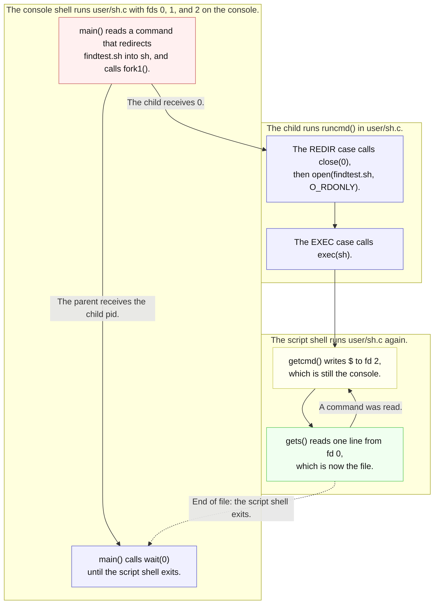

# Lab util: Deriving a shell that prompts only for a person

---

[toc]

---

The shell challenge in MIT's [2026 util lab](https://pdos.csail.mit.edu/6.1810/2026/labs/util.html) lists several improvements to `user/sh.c`. This note covers the first, rated moderate: do not print `$ ` while the shell is reading commands from a file. It also owns the material the other shell notes share: how the grader depends on the prompt, and how these notes quote `user/sh.c`.

| Shell improvement       | Note                                                           |
| ----------------------- | -------------------------------------------------------------- |
| **No `$ ` from a file** | This note                                                      |
| **`wait`**              | [`09-util-sh-wait.md`](09-util-sh-wait.md)                     |
| **Tab completion**      | [`10-util-sh-tab-completion.md`](10-util-sh-tab-completion.md) |
| **History**             | [`11-util-sh-history.md`](11-util-sh-history.md)               |

> [!IMPORTANT]
> No solution or pseudocode. `user/sh.c` is both the starter code and the file you will change, so the shell notes quote it only as it stands unmodified in this tree. If you have already edited it, compare against `git show HEAD:user/sh.c`. The other C quotation is from the lecture example `user/ex1copy.c`, which is not a target.

## What the exercise asks for

### Contract

| Aspect                   | Requirement or local convention                                                                                                                                                              |
| ------------------------ | -------------------------------------------------------------------------------------------------------------------------------------------------------------------------------------------- |
| **Target**               | Handout: modify `user/sh.c`. It is already `$U/_sh` in `UPROGS`; no new program or Makefile change is needed.                                                                                |
| **Behavior from a file** | Handout: no `$ ` while processing commands from a file, as in `sh < findtest.sh`.                                                                                                            |
| **Interactive behavior** | Implied by the handout and required by the grader: the shell `init` starts on the console must keep printing exactly `$ `. See [the harness dependency](#the-harness-depends-on-the-prompt). |
| **Pipe input**           | Not specified. `cat script \| sh` is neither a file nor a person; choosing its behavior is a [decision](#deriving-it).                                                                       |
| **Command behavior**     | Everything else in the shell stays as it is: parsing, `cd`, redirection, pipes, and exit at end of input.                                                                                    |
| **Kernel**               | No kernel change is needed; `fstat` already reports what a descriptor refers to.                                                                                                             |

### What the grader checks

> [!NOTE]
> **No test for this behavior.** No test in [`grade-lab-util`](../../grade-lab-util) asserts that a script shell is silent. The `exec via sh script` test runs `sh < findtest.sh` but counts only `hello` occurrences, so it passes with or without prompts.

### The harness depends on the prompt

> [!WARNING]
> **Every util test that boots QEMU types its commands only after it sees `$ `.** `shell_script()` in [`gradelib.py`](../../gradelib.py) writes the next command each time the bytes `$ ` appear in QEMU's output, and `assert_command_output()` in [`grade-lab-util`](../../grade-lab-util) locates output between `$ command` lines. A shell change that removes or alters the console prompt stalls or breaks the whole suite, not one test.

| Harness behavior            | Consequence for any `sh.c` change                                                                                                                                            |
| --------------------------- | ---------------------------------------------------------------------------------------------------------------------------------------------------------------------------- |
| **Paces input on `$ `**     | The interactive shell must print the two bytes `$ ` before each read. Extra text before them is tolerated; their absence is not.                                             |
| **Counts any `$ `**         | A script shell's prompts also release the next scripted command, while that shell is still reading its file; the typed text waits in the console buffer for the outer shell. |
| **Splits on `$ command\n`** | Prompt text must stay `$ ` exactly, or the sixfive and memdump output comparisons lose their boundaries.                                                                     |

Suppressing the script shell's prompts changes when `echo DONE` is typed during `exec via sh script`, not what the test counts. Rerun that test after the change rather than predicting its timing. The [wait](09-util-sh-wait.md), [tab-completion](10-util-sh-tab-completion.md), and [history](11-util-sh-history.md) notes link here for the same constraint.

## Prerequisites

| When                | Read                                                                                                                                                     | Why it matters here                                                                       |
| ------------------- | -------------------------------------------------------------------------------------------------------------------------------------------------------- | ----------------------------------------------------------------------------------------- |
| **Read first**      | [`book/ch01-operating-system-interfaces.md`](../book/ch01-operating-system-interfaces.md#the-shell-is-just-another-program)                              | Owns the shell's structure: `getcmd()`, `fork1()`, `runcmd()`, and the `cd` exception.    |
| **Read first**      | [`07-exercises.md`](../07-exercises.md#ex1copy--the-lecture-1-input-filter)                                                                              | `ex1copy` already asks "is a person typing?" with `fstat(0, ...)`, and explains why fd 0. |
| **Use when needed** | [`05-syscall-reference.md`](../05-syscall-reference.md#files-and-descriptors)                                                                            | `fstat`'s declaration and failure behavior.                                               |
| **Use when needed** | [`02-build-boot-and-usage.md`](../02-build-boot-and-usage.md#keyboard-controls)                                                                          | `Ctrl-d` ends a shell, and `init` starts another.                                         |
| **Use when needed** | [`The_Process_Abstraction.md`](../../../operating-system/The_Process_Abstraction.md#75-dup--dup2--duplicate-a-descriptor-onto-a-chosen-slot-54--xv6-ch1) | The sibling repository's portable descriptor and redirection concept.                     |

> [!NOTE]
> A hosted shell would call `isatty(0)`. xv6 has no `isatty()`; [`07-exercises.md`](../07-exercises.md#ex1copy--the-lecture-1-input-filter) explains why the inode type is a sufficient substitute in a tree with one device file.

## The code to read first

| File                                     | Contributes                                                                                                         | Does not contribute                                                |
| ---------------------------------------- | ------------------------------------------------------------------------------------------------------------------- | ------------------------------------------------------------------ |
| [`user/sh.c`](../../user/sh.c)           | `getcmd()` writes the prompt and reads a line; `main()` calls it in a loop; `runcmd()`'s `REDIR` case rewires fd 0. | No record of where its input comes from.                           |
| [`user/ex1copy.c`](../../user/ex1copy.c) | A working `fstat(0, &st)` test for the console, with a table of the three input cases.                              | No prompt; it prints a one-time hint.                              |
| [`kernel/file.c`](../../kernel/file.c)   | `filestat()` fills `struct stat` for inode and device files and returns `-1` for pipes.                             | No "is interactive" flag.                                          |
| [`kernel/stat.h`](../../kernel/stat.h)   | `T_DIR` 1, `T_FILE` 2, `T_DEVICE` 3.                                                                                | No terminal-specific type.                                         |
| [`user/init.c`](../../user/init.c)       | Opens `console` as fds 0, 1, and 2 before starting `sh`.                                                            | No arguments to `sh`; the shell cannot learn its mode from `argv`. |

## `getcmd()` line by line

This is the unchanged function from [`user/sh.c`](../../user/sh.c):

```c
int
getcmd(char *buf, int nbuf)
{
  write(2, "$ ", 2);
  memset(buf, 0, nbuf);
  gets(buf, nbuf);
  if (buf[0] == 0) // EOF
    return -1;
  return 0;
}
```

| Line                       | Consequence                                                                                                                                          |
| -------------------------- | ---------------------------------------------------------------------------------------------------------------------------------------------------- |
| **`write(2, "$ ", 2)`**    | The prompt goes to fd 2 unconditionally, before anything is known about this read. In `sh < file`, fd 2 is still the console, so the prompt appears. |
| **`memset(buf, 0, nbuf)`** | Clears the buffer so a short read leaves no bytes from the previous command.                                                                         |
| **`gets(buf, nbuf)`**      | Reads fd 0 one byte at a time until a newline or carriage return, whatever fd 0 refers to.                                                           |
| **`buf[0] == 0`**          | End of input: `main()` leaves its loop and the shell exits.                                                                                          |

The prompt is on fd 2, not fd 1, so `sh < script > out` would keep prompts out of `out` already. The exercise is about fd 0: what the shell reads from decides whether a prompt is meaningful.



_Legend: pink requests a new process, blue routes or waits, green moves input bytes, and yellow does the work this exercise changes. Labels carry the meaning without color._

`exec` keeps the descriptor table, so the script shell inherits fd 0 on the file and fds 1 and 2 on the console. `init` started the outer shell with no arguments, and `parseexec()` gives the inner one only `sh`, so neither shell can learn its mode from `argv`; only the descriptor can tell it. Every command the script shell runs is a further fork, each inheriting the same fd 0.

## The concept underneath

The `fstat(0, ...)` test in [`user/ex1copy.c`](../../user/ex1copy.c) already separates the three cases, quoted unchanged:

```c
  if (fstat(0, &st) == 0 && st.type == T_DEVICE) {
    fprintf(2, "ex1copy: copying standard input to standard output.\n");
    fprintf(2, "ex1copy: type a line and press Enter. Ctrl-d on an empty "
               "line finishes.\n");
  }
```

| fd 0 refers to                       | `fstat(0, &st)` | `st.type`  | Source                            |
| ------------------------------------ | --------------- | ---------- | --------------------------------- |
| **The console, as `init` opened it** | returns `0`     | `T_DEVICE` | `user/init.c`, `kernel/file.c`    |
| **A file, after `sh < script`**      | returns `0`     | `T_FILE`   | `runcmd()` `REDIR` in `user/sh.c` |
| **A pipe, after `cat script \| sh`** | returns `-1`    | not filled | `filestat()` in `kernel/file.c`   |

> [!NOTE]
> `T_DEVICE` means "the console" only because `user/init.c` makes the only `mknod()` call in the tree. That is an observation about this image, not a guarantee of the interface; [`07-exercises.md`](../07-exercises.md#ex1copy--the-lecture-1-input-filter) records the reasoning.

The descriptor's type is a property of fd 0 at the moment of the call. Nothing inside the shell changes fd 0 between commands, because redirection happens in forked children; the main loop's fd 0 is the one it started with. That is what makes a single answer valid for the shell's lifetime, and also why asking again per command is merely redundant, not wrong.

## Deriving it

**Contract:** use the [requirements above](#contract), and keep [the harness dependency](#the-harness-depends-on-the-prompt) intact.

| Decision for `user/sh.c`             | Source-backed question to settle                                                                                                                                        |
| ------------------------------------ | ----------------------------------------------------------------------------------------------------------------------------------------------------------------------- |
| **Detect the input source**          | Which descriptor answers "is a person typing?", and why does [`07-exercises.md`](../07-exercises.md#ex1copy--the-lecture-1-input-filter) reject fd 1 for that question? |
| **Classify a pipe**                  | `filestat()` in [`kernel/file.c`](../../kernel/file.c) fails for a pipe. Should `cat script \| sh` prompt, and which branch of your test produces that answer?          |
| **Decide once or per command**       | Can fd 0 in `main()`'s loop change between commands, given that `REDIR` runs only in children?                                                                          |
| **Keep the interface of `getcmd()`** | `main()` treats a negative return as end of input. How will the prompt decision reach `getcmd()` without changing that meaning?                                         |
| **Leave diagnostics alone**          | Should errors such as `exec ... failed` and `cannot cd` still appear for a script? They are written by other code, also to fd 2.                                        |

| Trap                                       | Observable consequence                                                              | Source to inspect                                                           |
| ------------------------------------------ | ----------------------------------------------------------------------------------- | --------------------------------------------------------------------------- |
| **Suppressing the prompt everywhere**      | The console shell stops prompting, and every grader test stalls waiting for `$ `.   | `shell_script()` in [`gradelib.py`](../../gradelib.py)                      |
| **Testing fd 1 or fd 2**                   | `sh < script` still prompts, because fds 1 and 2 remain on the console.             | [`07-exercises.md`](../07-exercises.md#ex1copy--the-lecture-1-input-filter) |
| **Reading `st.type` after `fstat` failed** | For pipe input, `st` holds stack garbage, so the decision is unpredictable.         | `filestat()` in [`kernel/file.c`](../../kernel/file.c)                      |
| **Changing the prompt text**               | `assert_command_output()` loses the `$ command` boundaries for sixfive and memdump. | [`grade-lab-util`](../../grade-lab-util)                                    |
| **Running `make fmt` after editing**       | Every source under `kernel/`, `user/`, and `mkfs/` is reformatted, not only `sh.c`. | [AGENTS.md](../../AGENTS.md#c-source-style)                                 |

## Verifying it

1. Build and boot:

    ```bash
    make qemu
    ```

2. In the guest, compare console, file, and pipe input. `findtest.sh` is installed by `UEXTRA` in the [Makefile](../../Makefile):

    ```text
    sh < findtest.sh
    cat findtest.sh | sh
    sh
    ```

    The last command starts an interactive nested shell; it should still prompt. Leave it with `Ctrl-d`.

3. Quit QEMU with `Ctrl-a x`, then run the test that uses a script shell and the full suite, because [every test depends on the prompt](#the-harness-depends-on-the-prompt):

    ```bash
    ./grade-lab-util "sh script"
    make grade
    ```

These are checks to run, not a transcript. Files created by the first command persist only for this boot; [docs 02](../02-build-boot-and-usage.md#adding-and-running-a-user-exercise) covers `make qemu` versus `make qemu-fs`. [Docs 03](../03-lab-workflow.md#grading) owns failed-transcript handling. No kernel-debugger recipe is needed; the change is entirely in user space.

## Questions

1. In `sh < findtest.sh`, which process performs `close(0)` and `open()`, and which process prints the prompts you want to remove?
2. Why does `getcmd()` write the prompt to fd 2 rather than fd 1, and what does that already achieve for `sh < script > out`?
3. What does `fstat(0, &st)` return when fd 0 is a pipe, according to `filestat()` in [`kernel/file.c`](../../kernel/file.c)?
4. Why can the console shell not learn that it is interactive from `argv`? Check what [`user/init.c`](../../user/init.c) passes.
5. Failure scenario: the prompt is removed unconditionally. Which function in [`gradelib.py`](../../gradelib.py) waits forever, and why does that affect the sleep tests too?
6. Failure scenario: the shell tests `st.type` without checking `fstat`'s return value. What does `cat findtest.sh | sh` do?
7. Can fd 0 of the main shell loop change between two commands? Which `runcmd()` case would have to run in the parent for that to happen?
