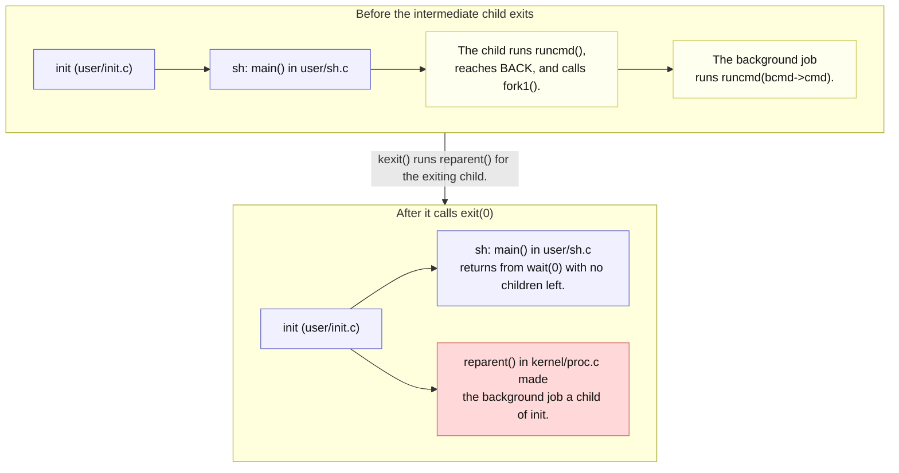

# Lab util: Deriving a shell `wait` command

---

[toc]

---

The shell challenge in MIT's [2026 util lab](https://pdos.csail.mit.edu/6.1810/2026/labs/util.html) suggests, among other improvements, "modify the shell to support wait", rated easy. In a Unix shell, `wait` blocks until background jobs started with `&` have finished. This note explains why the existing `user/sh.c` cannot do that at all, which is the whole difficulty, and leaves the change to the reader.

> [!IMPORTANT]
> No solution or pseudocode. `user/sh.c` is quoted only as it stands unmodified in this tree; [the prompt note](08-util-sh-prompt.md) records that quoting rule and the other shell notes. Kernel quotations are not targets.

## What the exercise asks for

### Contract

| Aspect                  | Requirement or local convention                                                                                                                                    |
| ----------------------- | ------------------------------------------------------------------------------------------------------------------------------------------------------------------ |
| **Target**              | Handout: modify `user/sh.c`. No new program, Makefile entry, or kernel change is required.                                                                         |
| **Command**             | Handout: support `wait`. Conventional meaning, adopted here: a command that returns once the shell's background jobs have exited.                                  |
| **Background jobs**     | Existing behavior to keep: `cmd &` returns to the prompt without waiting for `cmd`.                                                                                |
| **Foreground commands** | Existing behavior to keep: the shell prompts again only after a foreground command has finished.                                                                   |
| **No background jobs**  | Not specified. `wait` with nothing to wait for should return promptly; whether it prints anything is your policy.                                                  |
| **Status reporting**    | Not specified. Printing each job's pid or exit status is an optional extension.                                                                                    |
| **Prompt**              | Required by the grader for every test: keep the console prompt exactly `$ `. See [the harness dependency](08-util-sh-prompt.md#the-harness-depends-on-the-prompt). |

### What the grader checks

> [!NOTE]
> **No test.** No test in [`grade-lab-util`](../../grade-lab-util) uses `&` or `wait`. Because every QEMU test is paced on the prompt, the whole suite is still the regression check that foreground commands finish before the shell prompts again.

## Prerequisites

| When                | Read                                                                                                                        | Why it matters here                                                             |
| ------------------- | --------------------------------------------------------------------------------------------------------------------------- | ------------------------------------------------------------------------------- |
| **Read first**      | [`book/ch01-operating-system-interfaces.md`](../book/ch01-operating-system-interfaces.md#the-shell-is-just-another-program) | Owns `runcmd()`'s cases, including `BACK`, and why `cd` runs without forking.   |
| **Read first**      | [`The_Process_Abstraction.md`](../../../operating-system/The_Process_Abstraction.md#init--pid-1)                            | The sibling repository's portable account of orphans, reparenting, and reaping. |
| **Read first**      | [`05-util-find-exec.md`](05-util-find-exec.md#ex5forkexecs-main-line-by-line)                                               | `wait()`'s pid and status results, walked through on `ex5forkexec`.             |
| **Use when needed** | [`05-syscall-reference.md`](../05-syscall-reference.md#process)                                                             | `wait`'s declaration and its `-1` result.                                       |
| **Use when needed** | [`08-util-sh-prompt.md`](08-util-sh-prompt.md#the-harness-depends-on-the-prompt)                                            | Why the console prompt is a grading interface.                                  |

## The code to read first

| File                                     | Contributes                                                                                                      | Does not contribute                                       |
| ---------------------------------------- | ---------------------------------------------------------------------------------------------------------------- | --------------------------------------------------------- |
| [`user/sh.c`](../../user/sh.c)           | `main()`'s fork-and-wait loop and `cd` builtin; `runcmd()`'s `BACK` case; `parseline()`, which builds `BACK`.    | No record of background pids; no builtin other than `cd`. |
| [`kernel/proc.c`](../../kernel/proc.c)   | `kexit()` calls `reparent()`, which hands an exiting process's children to `initproc`; `kwait()` reaps children. | No way for a process to wait for a grandchild.            |
| [`user/init.c`](../../user/init.c)       | Its inner loop reaps "parentless" processes and ignores them.                                                    | No report to the shell.                                   |
| [`kernel/param.h`](../../kernel/param.h) | `NPROC` 64: the process-table size, which unreaped zombies occupy.                                               | No per-user or per-shell limit.                           |

## `main()` and the `BACK` case line by line

This is the unchanged `main()` from [`user/sh.c`](../../user/sh.c):

```c
int
main(void)
{
  static char buf[100];
  int fd;

  // Ensure that three file descriptors are open.
  while ((fd = open("console", O_RDWR)) >= 0) {
    if (fd >= 3) {
      close(fd);
      break;
    }
  }

  // Read and run input commands.
  while (getcmd(buf, sizeof(buf)) >= 0) {
    char *cmd = buf;
    while (*cmd == ' ' || *cmd == '\t')
      cmd++;
    if (*cmd == '\n') // is a blank command
      continue;
    if (cmd[0] == 'c' && cmd[1] == 'd' && cmd[2] == ' ') {
      // Chdir must be called by the parent, not the child.
      cmd[strlen(cmd) - 1] = 0; // chop \n
      if (chdir(cmd + 3) < 0)
        fprintf(2, "cannot cd %s\n", cmd + 3);
    } else {
      if (fork1() == 0)
        runcmd(parsecmd(cmd));
      wait(0);
    }
  }
  exit(0);
}
```

And this is the `BACK` case of `runcmd()` in the same file, which runs inside the child that `main()` just forked:

```c
  case BACK:
    bcmd = (struct backcmd *)cmd;
    if (fork1() == 0)
      runcmd(bcmd->cmd);
    break;
  }
  exit(0);
}
```

| Line                                       | Consequence                                                                                                                                                  |
| ------------------------------------------ | ------------------------------------------------------------------------------------------------------------------------------------------------------------ |
| **The `cd` test in `main()`**              | The one builtin. It runs in the shell process itself because the effect, a new `p->cwd`, must outlive the command. A `wait` builtin has the same constraint. |
| **`fork1()` then `runcmd(parsecmd(cmd))`** | Parsing happens in the child. A syntax error reaches `panic()`, which calls `exit(1)` and ends only that child.                                              |
| **`wait(0)` in `main()`**                  | Waits for *any one* child, discards its status, and ignores which pid returned.                                                                              |
| **`fork1()` in `BACK`**                    | The background job is a *grandchild* of the shell.                                                                                                           |
| **`break` then `exit(0)` in `BACK`**       | The intermediate child exits at once, so `main()`'s `wait(0)` returns and the shell prompts while the job runs.                                              |



_Legend: blue marks long-lived processes, yellow the processes `&` creates, and red the job the shell can no longer wait for. Arrows inside a group point from parent to child; labels carry the meaning without color._

`kwait()` in [`kernel/proc.c`](../../kernel/proc.c) scans only for processes whose `parent` is the caller. After `reparent()`, the job's `parent` is `initproc`, so the shell has no record of it in the kernel either. `init`'s inner loop eventually reaps it as "a parentless process" and does nothing else.

## The concept underneath

| Kernel fact               | Behavior                                                                                  | Source                                   |
| ------------------------- | ----------------------------------------------------------------------------------------- | ---------------------------------------- |
| **Who can be waited for** | Only direct children: `kwait()` tests `pp->parent == p`.                                  | [`kernel/proc.c`](../../kernel/proc.c)   |
| **No children**           | `kwait()` returns `-1` immediately when `havekids` is `0`.                                | [`kernel/proc.c`](../../kernel/proc.c)   |
| **Which child returns**   | The first `ZOMBIE` found in the process-table scan, not the oldest or the most recent.    | [`kernel/proc.c`](../../kernel/proc.c)   |
| **Orphans**               | `kexit()` calls `reparent()`, which sets each child's `parent` to `initproc`.             | [`kernel/proc.c`](../../kernel/proc.c)   |
| **Zombies occupy slots**  | An exited, unreaped child keeps its `struct proc` until a `wait` frees it; `NPROC` is 64. | [`kernel/param.h`](../../kernel/param.h) |

> [!IMPORTANT]
> **The shell can wait only for processes it forked itself.** As long as `&` is implemented by an intermediate child, a `wait` builtin in the shell finds no children and returns `-1` at once, however many jobs are running.

That rule creates the second constraint. Once background jobs are the shell's own children, `main()`'s foreground `wait(0)` can return a finished background job instead of the foreground command, because `kwait()` returns whichever child it finds first. The shell would then prompt while the foreground command is still running. A design that makes jobs direct children must also decide which pid each wait is for.

## Deriving it

**Contract:** use the [requirements above](#contract); settle each question from the named source.

| Decision for `user/sh.c`                 | Source-backed question to settle                                                                                                                                            |
| ---------------------------------------- | --------------------------------------------------------------------------------------------------------------------------------------------------------------------------- |
| **Recognize the command**                | `main()` matches `cd` only when it is followed by a space. What does the buffer hold when a user types `wait` alone, and where does the newline sit?                        |
| **Run it in the right process**          | Which process must call `wait()` for it to find the jobs, and why does the `cd` comment's reasoning apply?                                                                  |
| **Make jobs children of the shell**      | Where must the fork for `&` happen? Which information does `main()` need before it forks, given that `parsecmd()` currently runs in the child?                              |
| **Parse safely**                         | `parsecmd()` and its helpers call `panic()`, which calls `exit(1)`. What happens to the shell if a parse error occurs in the parent?                                        |
| **Keep foreground commands synchronous** | Which pid does a foreground `wait` need, and what must happen to a background job reaped while waiting for it?                                                              |
| **Scope `&`**                            | `a & ; b` and `(a &)` run their `BACK` inside further children created by `LIST` and `parseblock()`. Which of these will your `wait` cover, and will you document the rest? |

| Trap                                                    | Observable consequence                                                                                       | Source to inspect                                                                     |
| ------------------------------------------------------- | ------------------------------------------------------------------------------------------------------------ | ------------------------------------------------------------------------------------- |
| **Adding `wait` only as a builtin**                     | It always returns immediately: the jobs already belong to `init`.                                            | `reparent()` in [`kernel/proc.c`](../../kernel/proc.c)                                |
| **Running `wait` in a forked child**                    | The child has no children of its own, so `wait()` returns `-1`.                                              | `kwait()` in [`kernel/proc.c`](../../kernel/proc.c)                                   |
| **Matching `"wait "` with a trailing space**            | Plain `wait` falls through to `exec`, which prints `exec wait failed`.                                       | `main()` in [`user/sh.c`](../../user/sh.c)                                            |
| **Ignoring the pid from the foreground `wait`**         | A finished background job releases the prompt early, and the grader may type the next command too soon.      | [`08-util-sh-prompt.md`](08-util-sh-prompt.md#the-harness-depends-on-the-prompt)      |
| **Calling `parsecmd()` in the shell process unguarded** | A typo such as `echo (` makes `panic()` exit the shell; `init` then starts a new one, losing its `cd` state. | `panic()` in [`user/sh.c`](../../user/sh.c), [`user/init.c`](../../user/init.c)       |
| **Never reaping finished jobs**                         | Zombies accumulate until `fork()` fails with `NPROC` slots in use, and `fork1()` panics.                     | [`kernel/param.h`](../../kernel/param.h), `fork1()` in [`user/sh.c`](../../user/sh.c) |

## Verifying it

1. Build and boot:

    ```bash
    make qemu
    ```

2. In the guest, check the baseline first, then the new command. `Ctrl-p` prints the process table, one `pid state name` line per process:

    ```text
    sleep 30 &
    wait
    echo after
    wait
    sleep 20 &
    sleep 5
    echo foreground-done
    ```

    With the change, the first `wait` should hold the prompt until the job exits, and the second should return at once. In the last three lines, `foreground-done` must not appear before the five-tick `sleep` has finished, even though the background job is also a child. `Ctrl-p` lists pid, state, and name only, not the parent; a job that should be waited for shows as `sleep` in state `sleep` or `zombie`.

3. Quit QEMU with `Ctrl-a x`, then run the suite as the foreground-ordering regression check:

    ```bash
    make grade
    ```

These are checks to run, not a transcript. Before the change, `wait` prints `exec wait failed`, which is a useful baseline.

To observe the reparenting directly, stop in the kernel when the intermediate child exits on the unmodified shell:

1. Start the halted guest with one hart in terminal 1:

    ```bash
    make CPUS=1 qemu-gdb
    ```

2. Connect in terminal 2 and continue through boot:

    ```bash
    gdb-multiarch -x .gdbinit kernel/kernel
    ```

    ```gdb
    continue
    ```

3. Interrupt GDB with `Ctrl-c` once the guest prompts, set the breakpoint, and continue. Then run `sleep 50 &` in the guest. When GDB stops, the current process is the intermediate child:

    ```gdb
    break reparent
    continue
    print p->pid
    print p->parent->pid
    finish
    ```

The breakpoint is set after boot so that unrelated exits during startup do not stop it. `reparent()` is also called by every later `exit`, so compare `p->pid` with the pids `Ctrl-p` printed. [Docs 09](../09-debugging-xv6.md#manually-debugging-an-xv6-user-program) covers stopping in user code instead.

## Questions

1. In the unmodified shell, which process forks the background job, and which process is its parent one tick after the prompt returns?
2. Why does `cd` have to run in `main()` itself, and which part of that reasoning applies to `wait`?
3. What does `kwait()` return when the caller has no children, and what would a `wait` builtin print in the unmodified design?
4. If the shell has one finished background job and one running foreground job, which pid can `wait(0)` return first? Check the scan order in `kwait()`.
5. Failure scenario: parsing moves into the shell process and the user types `echo )`. Which function ends the process, and what does `init` do next?
6. Failure scenario: background jobs become direct children, and nothing ever reaps them. Which limit in [`kernel/param.h`](../../kernel/param.h) is reached, and what does `fork1()` do then?
7. Why does `a & ; b` still create an orphan even after a change that handles a top-level `a &`?
