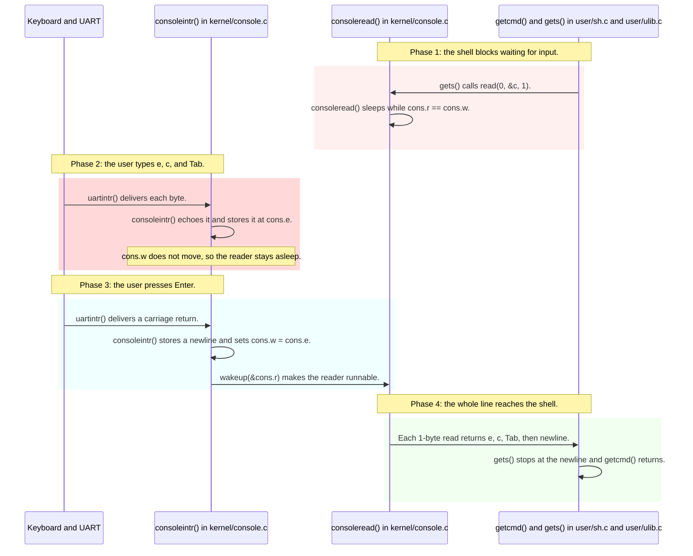

# Lab util: Deriving shell tab completion

---

[toc]

---

The shell challenge in MIT's [2026 util lab](https://pdos.csail.mit.edu/6.1810/2026/labs/util.html) suggests "modify the shell to support tab completion", rated easy. The shell part is small; the obstacle is that `user/sh.c` never sees the Tab key until the user presses Enter, because the kernel's console driver holds input until a line is complete. This note explains that driver, where the handout's remark that "you may have to modify the kernel" applies, and the decisions either route leaves.

> [!IMPORTANT]
> No solution or pseudocode. `user/sh.c` is quoted only as it stands unmodified; [the prompt note](08-util-sh-prompt.md) records that rule. The kernel quotation is the unchanged `consoleintr()`. If you choose the kernel route, `kernel/console.c` becomes a target too, so the quotation shows only its current state.

> [!NOTE]
> **Concept on loan.** [`book/ch06-interrupts-and-device-drivers.md`](../book/ch06-interrupts-and-device-drivers.md) will own the console driver but is still a placeholder, so [the console section below](#consoleintr-line-by-line) holds the line-discipline material for now. When ch06 is written, move it there and leave a link.

## What the exercise asks for

### Contract

| Aspect             | Requirement or local convention                                                                                                                                          |
| ------------------ | ------------------------------------------------------------------------------------------------------------------------------------------------------------------------ |
| **Target**         | Handout: modify `user/sh.c`. The handout permits kernel changes when a feature needs them; this one does if completion must happen when Tab is pressed.                  |
| **Behavior**       | Handout: support tab completion. Conventional meaning: a partially typed word is extended to a unique matching name, and the user can keep typing before pressing Enter. |
| **Candidates**     | Not specified. Command names, file operands, or both are your scope decision.                                                                                            |
| **Ambiguity**      | Not specified. Several matches may list candidates, extend to a common prefix, or do nothing.                                                                            |
| **Other programs** | Repository requirement if you change the kernel: `cat`, `grep`, `ex1copy`, and every other console reader must keep working.                                             |
| **Prompt**         | Required by the grader: keep the console prompt exactly `$ `. See [the harness dependency](08-util-sh-prompt.md#the-harness-depends-on-the-prompt).                      |
| **Kernel style**   | If you edit `kernel/console.c`, match `.clang-format` by hand; never run `make fmt` for one file ([AGENTS.md](../../AGENTS.md#c-source-style)).                          |

### What the grader checks

> [!NOTE]
> **No test.** No test in [`grade-lab-util`](../../grade-lab-util) sends a Tab byte. The harness types whole lines ending in a newline, so the suite is a regression check that ordinary line input, and the prompt, still work after a shell or console change.

## Prerequisites

| When                | Read                                                                                                                      | Why it matters here                                                                      |
| ------------------- | ------------------------------------------------------------------------------------------------------------------------- | ---------------------------------------------------------------------------------------- |
| **Read first**      | [`08-util-sh-prompt.md`](08-util-sh-prompt.md)                                                                            | `getcmd()` and the grader's reliance on `$ `.                                            |
| **Read first**      | [`02-build-boot-and-usage.md`](../02-build-boot-and-usage.md#xv6-console-keys)                                            | The console keys `consoleintr()` already treats specially.                               |
| **Read first**      | [`04-util-find.md`](04-util-find.md#ls-line-by-line)                                                                      | Reading directory records, which is how a candidate list is built in user space.         |
| **Use when needed** | `../xv6-riscv-book/interrupt.tex`, section "Code: Console input"                                                          | The book's account of `uartintr()`, `consoleintr()`, and `consoleread()`.                |
| **Use when needed** | [`book/ch07-locking.md`](../book/ch07-locking.md) and [`book/ch09-sleep-and-wakeup.md`](../book/ch09-sleep-and-wakeup.md) | `cons.lock` and the `sleep_prepare()`, `sleep()`, `wakeup()` pattern in `consoleread()`. |

> [!NOTE]
> On Linux, the kernel's terminal line discipline plays the role of `consoleintr()`, and shells such as bash switch it to non-canonical mode with `tcsetattr()` so each key arrives at once. xv6 has no such switch; adding one is exactly the kind of kernel change the handout anticipates.

## The code to read first

| File                                         | Contributes                                                                                           | Does not contribute                                                         |
| -------------------------------------------- | ----------------------------------------------------------------------------------------------------- | --------------------------------------------------------------------------- |
| [`kernel/console.c`](../../kernel/console.c) | `consoleintr()` edits and echoes typed bytes; `consoleread()` releases them only after a line ends.   | No per-key delivery mode and no special case for Tab.                       |
| [`kernel/uart.c`](../../kernel/uart.c)       | `uartintr()` passes each received byte to `consoleintr()`.                                            | No buffering of its own beyond the hardware.                                |
| [`user/ulib.c`](../../user/ulib.c)           | `gets()` calls `read(0, &c, 1)` until it sees `\n` or `\r`.                                           | No stop at Tab.                                                             |
| [`user/sh.c`](../../user/sh.c)               | `getcmd()` and `main()`'s loop; `whitespace[]` already includes `\t`, so a stray Tab separates words. | No knowledge of the screen or cursor.                                       |
| [`user/ls.c`](../../user/ls.c)               | The directory-record loop that lists names.                                                           | No prefix filter.                                                           |
| [`kernel/fs.c`](../../kernel/fs.c)           | `namex()` resolves a relative path from `myproc()->cwd`.                                              | No search path: `exec("ls", ...)` finds `ls` only in the current directory. |

## `consoleintr()` line by line

This is the unchanged interrupt-side half of the console driver, from [`kernel/console.c`](../../kernel/console.c):

```c
consoleintr(int c)
{
  acquire(&cons.lock);

  switch (c) {
  case C('P'): // Print process list.
    procdump();
    break;
  case C('U'): // Kill line.
    while (cons.e != cons.w &&
           cons.buf[(cons.e - 1) % INPUT_BUF_SIZE] != '\n') {
      cons.e--;
      consputc(BACKSPACE);
    }
    break;
  case C('H'): // Backspace
  case '\x7f': // Delete key
    if (cons.e != cons.w) {
      cons.e--;
      consputc(BACKSPACE);
    }
    break;
  default:
    if (c != 0 && cons.e - cons.r < INPUT_BUF_SIZE) {
      c = (c == '\r') ? '\n' : c;

      // echo back to the user.
      consputc(c);

      // store for consumption by consoleread().
      cons.buf[cons.e++ % INPUT_BUF_SIZE] = c;

      if (c == '\n' || c == C('D') || cons.e - cons.r == INPUT_BUF_SIZE) {
        /*
         * wake up consoleread() if a whole line (or end-of-file)
         * has arrived.
         */
        cons.w = cons.e;
        wakeup(&cons.r);
      }
    }
    break;
  }

  release(&cons.lock);
}
```

| Index or case       | Meaning                                                                                                                                  |
| ------------------- | ---------------------------------------------------------------------------------------------------------------------------------------- |
| **`cons.r`**        | Next byte `consoleread()` will copy out.                                                                                                 |
| **`cons.w`**        | End of the bytes released to readers. `consoleread()` sleeps while `cons.r == cons.w`.                                                   |
| **`cons.e`**        | End of the bytes typed so far, including the unreleased line still being edited.                                                         |
| **`default` case**  | Tab falls here: it is echoed by `consputc()`, stored at `cons.e`, and does not move `cons.w`.                                            |
| **The wakeup test** | Only a newline, `Ctrl-d`, or a full 128-byte buffer (`INPUT_BUF_SIZE`) moves `cons.w` and wakes the reader.                              |
| **Backspace guard** | `cons.e != cons.w`: editing can erase only unreleased bytes. Once a byte is released to a reader, the driver can no longer take it back. |



_Legend: pink is the request, red the stall this exercise must overcome, cyan the commit of a line, and green the data reaching the shell. Each phase is named by its note, so the meaning survives monochrome._

By the time the shell can see the Tab, the user has already pressed Enter and the terminal shows a newline. The driver also echoed the Tab itself, so the terminal cursor has jumped to the next tab stop before any program could react. Neither is a shell bug; both come from where line editing lives.

## The concept underneath

| Constant or rule        | Value or behavior                                     | Source                                                                                               |
| ----------------------- | ----------------------------------------------------- | ---------------------------------------------------------------------------------------------------- |
| **`INPUT_BUF_SIZE`**    | 128 bytes, a ring indexed by `% INPUT_BUF_SIZE`       | [`kernel/console.c`](../../kernel/console.c)                                                         |
| **Release events**      | `\n`, `Ctrl-d`, or a full buffer                      | `consoleintr()`                                                                                      |
| **`\r` handling**       | Converted to `\n` before echo and storage             | `consoleintr()`                                                                                      |
| **Shell line buffer**   | `static char buf[100]` in `main()`                    | [`user/sh.c`](../../user/sh.c)                                                                       |
| **`gets()` stop bytes** | `\n` and `\r` only                                    | [`user/ulib.c`](../../user/ulib.c)                                                                   |
| **Command lookup**      | Relative to the current directory; there is no `PATH` | `namex()` in [`kernel/fs.c`](../../kernel/fs.c), `kexec()` in [`kernel/exec.c`](../../kernel/exec.c) |

> [!IMPORTANT]
> **A user-space-only shell sees Tab only after Enter.** Any design that completes while the user is still typing needs the kernel to release input at a Tab, or to deliver keys one at a time, and that change affects every program that reads the console.

Two consequences of the indices matter for any kernel route. First, once bytes before a Tab are released, `cons.w` moves past them, so the backspace guard stops the user from erasing them; the shell that consumed them must provide that editing, or accept the limitation. Second, the shell must itself write any completion text it adds, because the kernel echoes only bytes that arrived from the UART; the completed characters are not in `cons.buf` and will never be read back.

## Deriving it

**Contract:** use the [requirements above](#contract); settle each question from the named source.

| Decision                     | Source-backed question to settle                                                                                                                                                   |
| ---------------------------- | ---------------------------------------------------------------------------------------------------------------------------------------------------------------------------------- |
| **Choose the route**         | Will completion happen at Enter, using only `user/sh.c`, or when Tab is pressed, which needs `kernel/console.c` to release input on Tab? What does each route cost the user?       |
| **Scope the kernel change**  | If Tab releases input, does it do so for every reader, or only when the shell asks? Which programs in `user/` would see a shorter `read()` than before, and does any of them care? |
| **Echo policy**              | Should `consoleintr()` still echo a Tab it releases, given that the shell will print the completion?                                                                               |
| **Stop reading at Tab**      | `gets()` stops only at `\n` or `\r`. What would it do after the kernel returns `e`, `c`, and a Tab, and which loop must the shell use instead?                                     |
| **Keep the partial line**    | After completion, where does the text typed so far live, and how is it joined with the bytes of the next `read()` within `buf`'s 100 bytes?                                        |
| **Build the candidate list** | Which directory supplies command names, given that `exec` resolves names from the current directory? Which supplies file operands?                                                 |
| **Resolve ambiguity**        | With several matches, will you extend to the common prefix, list them and reprint the prompt and partial line, or do nothing?                                                      |

| Trap                                                      | Observable consequence                                                                                                             | Source to inspect                                                                |
| --------------------------------------------------------- | ---------------------------------------------------------------------------------------------------------------------------------- | -------------------------------------------------------------------------------- |
| **Waiting for a Tab in `gets()` without a kernel change** | Nothing happens on Tab; the line arrives only after Enter, with the Tab embedded.                                                  | [The wakeup test](#consoleintr-line-by-line)                                     |
| **Keeping `gets()` after making Tab release input**       | `gets()` reads past the Tab and blocks for the rest of the line, so the shell never completes.                                     | [`user/ulib.c`](../../user/ulib.c)                                               |
| **Expecting Backspace to erase completed text**           | The driver refuses: completed text was never in `cons.buf`, and the released prefix is behind `cons.w`.                            | `consoleintr()` backspace guard                                                  |
| **Completing commands from `/`**                          | After `cd a`, the completed name still fails with `exec ... failed`, because lookup is relative to `a`.                            | `namex()` in [`kernel/fs.c`](../../kernel/fs.c)                                  |
| **Treating `de.name` as a C string**                      | A 14-byte name has no terminator, so prefix comparison reads past the record.                                                      | [`04-util-find.md`](04-util-find.md#record-names-versus-c-strings)               |
| **Writing the completion to fd 1**                        | A shell started as `sh > log` sends the completion into `log` instead of the terminal; `getcmd()` writes interactive text to fd 2. | `getcmd()` in [`user/sh.c`](../../user/sh.c)                                     |
| **Altering the prompt to redraw a line**                  | `$ ` must still appear exactly, or the grader stalls.                                                                              | [`08-util-sh-prompt.md`](08-util-sh-prompt.md#the-harness-depends-on-the-prompt) |
| **Breaking script shells**                                | `sh < findtest.sh` reads a file, where a Tab is ordinary whitespace; completion must not trigger there.                            | [`08-util-sh-prompt.md`](08-util-sh-prompt.md#the-concept-underneath)            |

## Verifying it

1. Build and boot:

    ```bash
    make qemu
    ```

2. In the guest, establish the baseline before changing anything: type `ec`, press Tab, then press Enter. The current shell prints `exec ec failed` after Enter, because the Tab is whitespace in `whitespace[]`. After your change, check a unique prefix, an ambiguous prefix such as `s`, no match, a file operand if you support one, and a different directory:

    ```text
    cat README
    mkdir d
    cd d
    ```

3. If you changed the kernel, confirm ordinary console readers still behave, including Backspace and `Ctrl-u` on an unfinished line:

    ```text
    ex1copy
    cat
    ```

    End each with `Ctrl-d`.

4. Quit QEMU with `Ctrl-a x`, then run the suite as the line-input and prompt regression check:

    ```bash
    make grade
    ```

These are checks to run, not a transcript. To see the released bytes the shell receives, stop in the driver:

1. Start the halted guest with one hart in terminal 1:

    ```bash
    make CPUS=1 qemu-gdb
    ```

2. Connect in terminal 2 and continue through boot:

    ```bash
    gdb-multiarch -x .gdbinit kernel/kernel
    ```

    ```gdb
    continue
    ```

3. Interrupt with `Ctrl-c` at the prompt, set a breakpoint on the reader, and continue. Type `ec`, a Tab, and Enter in the guest:

    ```gdb
    break consoleread
    continue
    print cons
    print/c cons.buf[(cons.w - 2) % 128]
    ```

The shell was already asleep inside one `consoleread()` call when the breakpoint was set, so the stop comes on `gets()`'s next one-byte read, after the line was released. `print cons` shows `r`, `w`, and `e`; the byte before the newline should be the Tab, `'\t'`. Use `list consoleintr` to confirm the current source rather than relying on line numbers. [Docs 09](../09-debugging-xv6.md#manually-debugging-an-xv6-user-program) covers stopping in user code.

## Questions

1. Which three conditions in `consoleintr()` move `cons.w`, and which index does `consoleread()` compare with `cons.r` before sleeping?
2. Why does the terminal cursor move when you press Tab, before any user program has run?
3. After the kernel releases `ec` and a Tab to the shell, why can Backspace no longer erase the `c`? Name the guard.
4. Which characters must the shell write to the console itself after completing `ec` to `echo`, and why will they never be read back from `cons.buf`?
5. Failure scenario: the kernel releases input at Tab, but the shell still calls `gets()`. Where does the shell block?
6. Failure scenario: after `cd d`, completion offers names from `/`. What does running the completed command print, and which function in [`kernel/fs.c`](../../kernel/fs.c) explains it?
7. If Tab releases input for every reader, what does `cat` print when you type `a`, Tab, `b`, Enter? Is any output lost or only split across reads?
8. Why should completion not trigger in `sh < findtest.sh`, and which check from [`08-util-sh-prompt.md`](08-util-sh-prompt.md) tells the two modes apart?
