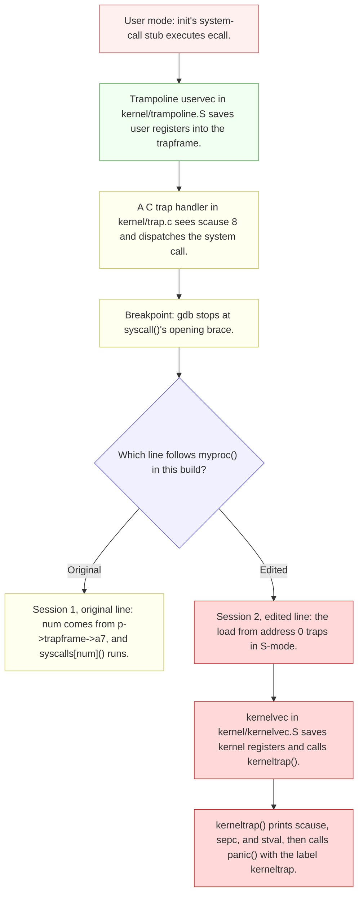
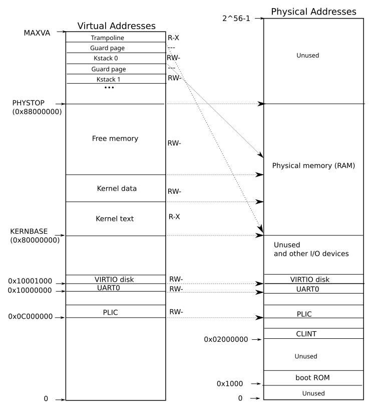
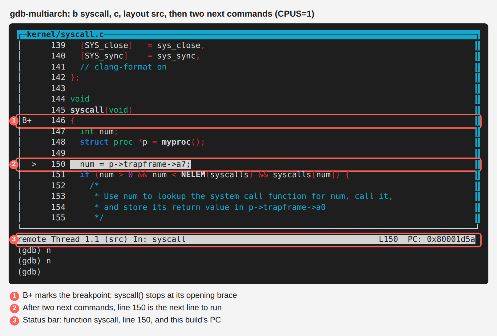
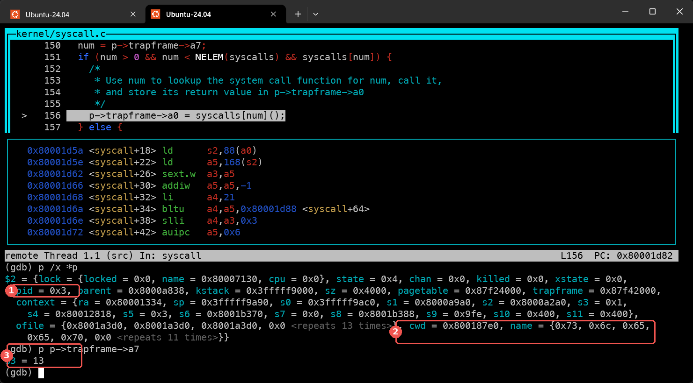
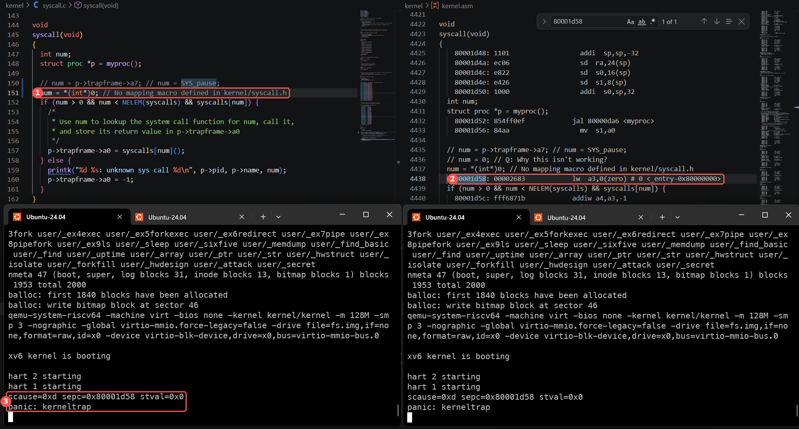
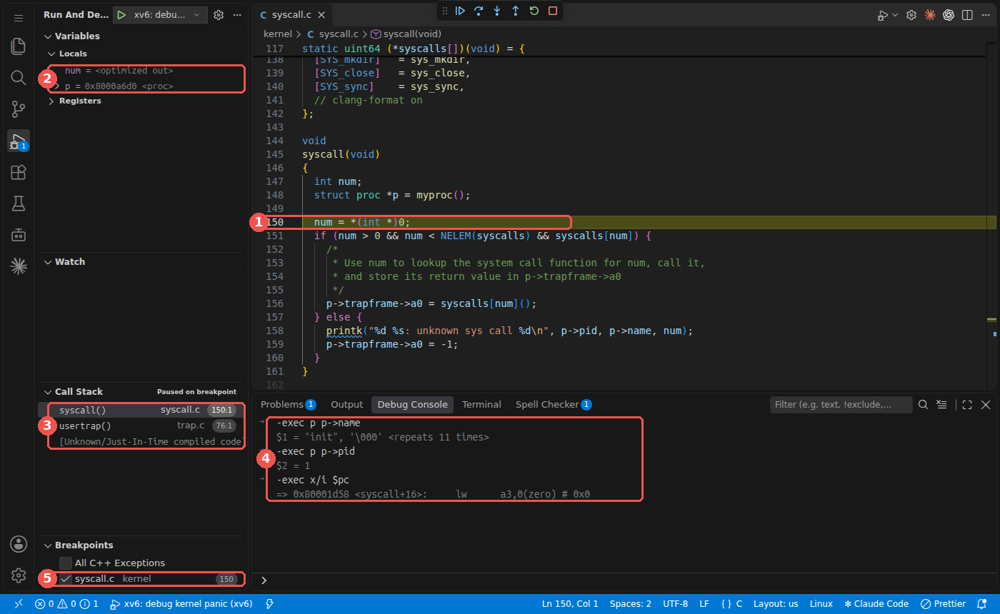
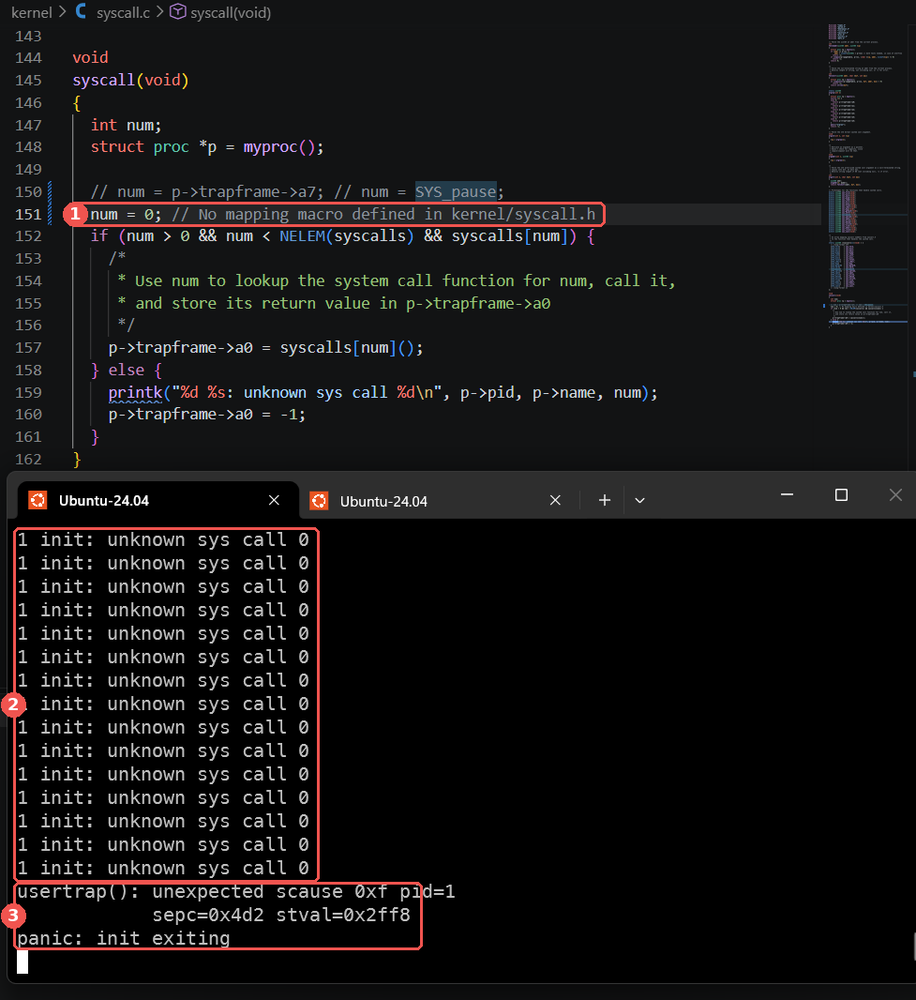
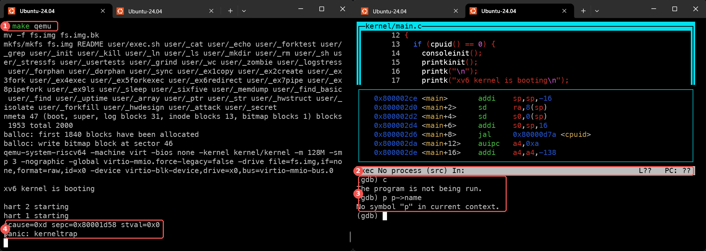

# Lab syscall: Deriving the `Using gdb` answers

---

[toc]

---

Derive the answers to the first exercise of MIT's [syscall lab](https://pdos.csail.mit.edu/6.1810/2026/labs/syscall.html), _Using gdb_ (easy), by stopping the kernel inside an existing system call and inside a deliberately broken one. The deliverable is `answers-syscall.txt`; this note explains where each answer comes from and which readings mislead, and only its final spoiler section writes the answers down.

| If you are...                      | Start at                                                                                                                        |
| ---------------------------------- | ------------------------------------------------------------------------------------------------------------------------------- |
| **Starting the exercise**          | [The contract](#using-gdb-contract), then [the six questions](#using-gdb-questions-and-their-evidence)                          |
| **Setting up the debugger**        | [Prerequisites](#using-gdb-prerequisites-and-references), then [Verifying it](#verifying-using-gdb-sessions-revert-and-grading) |
| **Matching the handout's output**  | [Where this tree differs from the handout](#where-this-tree-differs-from-the-handout)                                           |
| **Reading a register in gdb**      | [Live CSRs versus saved user registers](#live-csrs-versus-saved-user-registers)                                                 |
| **Looking up a gdb command**       | [GDB command reference in 09](../09-debugging-xv6.md#gdb-command-reference-run-control-breakpoints-inspection-and-harts)        |
| **Stuck on a reading that is odd** | [Traps](#using-gdb-traps-misleading-readings-and-stale-addresses)                                                               |
| **Checking finished answers**      | [Solution walkthrough](#solution-walkthrough), a spoiler                                                                        |

> [!IMPORTANT]
> No answers before the final [solution walkthrough](#solution-walkthrough). Until then, the gdb transcripts show only setup lines, and each question gets the evidence to collect and the readings that mislead, not the reading itself.

## What the exercise asks for: Using gdb

### Using gdb contract

| Aspect                    | Requirement or local convention                                                                                                                                                                                                                                                                 |
| ------------------------- | ----------------------------------------------------------------------------------------------------------------------------------------------------------------------------------------------------------------------------------------------------------------------------------------------- |
| **Deliverable**           | `answers-syscall.txt` at the repository root, answering [the six questions](#using-gdb-questions-and-their-evidence). The handout's _Submit_ section says to `git add` and commit it. Here it is a symlink to this note, whose [solution walkthrough](#solution-walkthrough) holds the answers. |
| **Session 1**             | Run `make qemu-gdb`, break on `syscall`, and inspect the first system call: backtrace, `p /x *p`, and `$sstatus`.                                                                                                                                                                               |
| **Session 2**             | Temporarily replace `num = p->trapframe->a7;` in `syscall()` with `num = * (int *) 0;`, observe the panic, and inspect the faulting instruction in `kernel/kernel.asm` and gdb.                                                                                                                 |
| **Revert**                | Undo the session-2 edit before the sandbox exercises. This is a repository convention: the handout never says so, but every later test would panic on the first system call.                                                                                                                    |
| **Tools**                 | `gdb-multiarch` (or `riscv64-linux-gnu-gdb`), run from the repository root so it finds `.gdbinit`.                                                                                                                                                                                              |
| **Lab setup**             | This tree merges `labs/syscall` and sets `LAB=syscall` in `conf/lab.mk`, instead of the handout's `git checkout syscall`; [03-lab-workflow.md](../03-lab-workflow.md#starting-a-lab) owns that.                                                                                                 |
| **Answers are per build** | Addresses, line numbers, and the register the compiler picks for `num` belong to **your** build. Answer from what your build shows, not from the handout's or this note's addresses.                                                                                                            |

### Using gdb questions and their evidence

| #     | Handout question (paraphrased)                           | Evidence to collect                                                                          | Owning explanation                                                                                                                              |
| ----- | -------------------------------------------------------- | -------------------------------------------------------------------------------------------- | ----------------------------------------------------------------------------------------------------------------------------------------------- |
| **1** | Which function called `syscall`?                         | `backtrace` at the `syscall` breakpoint, frame `#1`                                          | [The trap path](01-util-sleep.md#the-foundation-a-c-call-that-becomes-a-trap)                                                                   |
| **2** | Value of `p->trapframe->a7`, and what it represents      | `p /x *p` after stepping past `myproc()`; `user/init.c`, `user/init.asm`, `kernel/syscall.h` | [`a0` versus `a7`](01-util-sleep.md#a0-versus-a7)                                                                                               |
| **3** | The CPU's previous mode                                  | `p /x $sstatus`, decoded with `SSTATUS_SPP` in `kernel/riscv.h`                              | [Decoding `sstatus`](#decoding-sstatus-the-previous-mode-bit)                                                                                   |
| **4** | The faulting instruction, and which register holds `num` | The console's `sepc`, looked up in `kernel/kernel.asm`; confirmed with `b *<sepc>`           | [Map `sepc` to a source line](../06-build-artifacts.md#map-sepc-to-a-function-and-c-source-line)                                                |
| **5** | Why the kernel crashes; whether `scause` confirms it     | The kernel page table built by `kvmmake()`; the console's `scause` and `stval`               | [Kernel mappings](#what-the-kernel-page-table-maps) and [CSR table](../06-build-artifacts.md#panic-invariant-failures-output-and-hart-shutdown) |
| **6** | Name and pid of the process running at the panic         | `p p->name` and `p p->pid` at the `b *<sepc>` stop                                           | [`struct proc` in `kernel/proc.h`](../../kernel/proc.h)                                                                                         |

Question 5 has three parts: the cause, whether address 0 is mapped in the kernel's address space (the handout points to the book's kernel-address-space figure, Figure 3.3 in `mem.tex`), and whether `scause` agrees.

### Using gdb grader checks

| Test                      | Points | What it runs                                                          | What it asserts                                                             |
| ------------------------- | ------ | --------------------------------------------------------------------- | --------------------------------------------------------------------------- |
| **`answers-syscall.txt`** | 5      | `check_answers("answers-syscall.txt")` in `gradelib.py`; no QEMU boot | The file opens, and its contents are at least 10 characters after `strip()` |

The test body's own comment says it is "just a simple sanity check, will be graded manually".

### Using gdb grader evidence limits

| Evidence                     | What remains unchecked                                                                         |
| ---------------------------- | ---------------------------------------------------------------------------------------------- |
| **The test passes**          | Any answer's correctness, that all six questions are answered, and that the file is committed. |
| **Sandbox tests pass later** | Only indirectly that the session-2 edit was reverted: a leftover edit panics every test.       |

## Using gdb prerequisites and references

| When                              | Read                                                                                                     | Why it matters here                                                                                          |
| --------------------------------- | -------------------------------------------------------------------------------------------------------- | ------------------------------------------------------------------------------------------------------------ |
| **Read first**                    | [Debugging with gdb](../09-debugging-xv6.md#start-a-kernel-gdb-session-qemu-gdb-and-gdbinit)             | Owns `make qemu-gdb`, `.gdbinit`, the per-user port, `Ctrl-C`, `detach`, and quitting.                       |
| **Read first**                    | [The trap path, on loan](01-util-sleep.md#the-foundation-a-c-call-that-becomes-a-trap)                   | How `ecall` reaches `syscall()`, and what the trapframe holds. `ch04` is still a placeholder.                |
| **Read before session 2**         | [`panic()` and the CSR line](../06-build-artifacts.md#panic-invariant-failures-output-and-hart-shutdown) | Which console line is the evidence and which is the verdict; what `scause`, `sepc`, and `stval` mean.        |
| **Use when mapping an address**   | [Map `sepc` to a source line](../06-build-artifacts.md#map-sepc-to-a-function-and-c-source-line)         | The `.sym` then `.asm` lookup, and why addresses go stale after a rebuild.                                   |
| **Use when gdb shows "Thread 2"** | [Why use `CPUS=1`](../09-debugging-xv6.md#why-use-cpus1)                                                 | gdb threads are QEMU harts, not xv6 processes or user threads.                                               |
| **Use when gdb misbehaves**       | [GDB troubleshooting](../09-debugging-xv6.md#gdb-troubleshooting-symbols-reused-addresses-and-harts)     | Wrong binary, stale port, gray breakpoints.                                                                  |
| **Use for system-call numbers**   | [`05-syscall-reference.md`](../05-syscall-reference.md) and `kernel/syscall.h`                           | The number-to-name table that question 2's value indexes.                                                    |
| **Use when a term is unclear**    | [`04-terminology.md`](../04-terminology.md#risc-v-architecture)                                          | CSR, hart, `sstatus`, `scause`, `sepc`, `stval`, trapframe.                                                  |
| **Use for the page-table figure** | [Figure 3.3](../book/fig/xv6_layout.svg), from `fig:xv6_layout` in `../../../xv6-riscv-book/mem.tex`     | [`ch03`](../book/ch03-page-tables.md) is still a placeholder, so the mapping table below uses `kernel/vm.c`. |
| **Use for `scause` codes**        | [RISC-V privileged spec](../riscv-privileged-20211203.pdf), Table 4.2 (PDF page 85)                      | The authoritative list of exception codes behind question 5's "confirmed by `scause`".                       |

## Where this tree differs from the handout

| Handout shows                                             | This tree (measured on 2026-11-03, `LAB=syscall`, 3 harts)                        | Why it matters                                                               |
| --------------------------------------------------------- | --------------------------------------------------------------------------------- | ---------------------------------------------------------------------------- |
| **`Breakpoint 1 at 0x80002142: ... syscall.c, line 243`** | `Breakpoint 1 at 0x80001d48: file kernel/syscall.c, line 146.`                    | Line numbers and addresses differ by build; both are setup, not answers.     |
| **`b *0x80001bfe ... line 138`**                          | Use the `sepc` your own console prints; the faulting line is the edited line 150. | Copying the handout's address sets a breakpoint on an unrelated instruction. |
| **`panic` in `kernel/printf.c`**                          | `panic()` is in `kernel/printk.c`, and the kernel prints with `printk()`.         | `b panic` still works; grepping for `printf.c` does not.                     |
| **`Thread 2 hit Breakpoint 1`**                           | Any of the three harts may hit it first.                                          | The thread number is not part of any answer.                                 |

## The code to read first

| File                               | Contributes                                                                                                          | Deliberately does not                                          |
| ---------------------------------- | -------------------------------------------------------------------------------------------------------------------- | -------------------------------------------------------------- |
| **`kernel/syscall.c`**             | `syscall()`: the breakpoint, the `a7` load you replace, and the dispatch through `syscalls[]`                        | Validate argument values; handlers check them after extraction |
| **`kernel/trap.c`**                | `usertrap()` for traps from user mode; `kerneltrap()`, which prints `scause sepc stval` before `panic("kerneltrap")` | Recover from a kernel-mode fault: there is no handler for one  |
| **`kernel/proc.h`**                | `struct proc`, including `trapframe`, `name`, and `pid`, which `p /x *p` prints                                      | Hold user registers directly; they live in the trapframe page  |
| **`user/init.c`, `user/init.asm`** | The first user program, and the stub call its first system call compiles into                                        | Run before the kernel finishes booting                         |
| **`kernel/syscall.h`**             | The `SYS_*` numbers                                                                                                  | Say anything about arguments                                   |
| **`kernel/riscv.h`**               | `SSTATUS_SPP`, `SSTATUS_SPIE`, and `SSTATUS_SIE` bit masks                                                           | Describe the fields above bit 8                                |
| **`kernel/vm.c`**                  | `kvmmake()`: every range the kernel page table maps                                                                  | Map anything lazily: what it does not map stays unmapped       |

## `syscall()`: the stop point and the line you replace

From [`kernel/syscall.c`](../../kernel/syscall.c):

| Line                             | Consequence for the exercise                                                                                                                    |
| -------------------------------- | ----------------------------------------------------------------------------------------------------------------------------------------------- |
| **The opening `{`**              | `b syscall` stops here, before `p` is assigned. Printing `*p` now reads whatever the stack slot or register held.                               |
| **`struct proc *p = myproc();`** | After `next` steps past it, `p` points at the running process's `proc[]` entry, so `p /x *p` and `p p->name` become meaningful.                 |
| **`num = p->trapframe->a7;`**    | Reads the **saved** user `a7` from the trapframe page, which is kernel memory. Session 2 replaces exactly this line, so the fault happens here. |
| **The bounds check**             | In normal operation a bad `a7` is refused with `unknown sys call`. Session 2 never reaches it: the load traps first.                            |

**Two consequences determine where to inspect:**

- **Step before printing `p`:** the breakpoint is on the function's opening brace, so the handout's "type `n` a few times" is required, not optional.
- **Follow the kernel trap path in session 2:** the replacement load is a kernel-mode access, so it goes to `kerneltrap()` rather than to `usertrap()`.

> [!NOTE]
> **Find the statement by its text, not a screenshot's line number.** The recorded sessions show the `a7` load on line 150 and the handler call on line 156. The teaching comment now puts those statements on lines 156 and 162, respectively; source-line labels in the retained transcripts and screenshots describe the earlier source revision. Rebuilding can also change addresses and register allocation.

## The concept underneath: what gdb can and cannot show you

### Session 1 and session 2 on the trap path



_Legend: request red-white, data movement green, processing yellow, decision blue, failure red; every node also states its meaning in text. S-mode is supervisor mode, where the kernel runs; U-mode is user mode._

Session 1 stops on the left path's way in; session 2 shows the right path's way out. The fault happens **before** any system call handler runs, which is why the very first system call after boot panics the kernel.

### Live CSRs versus saved user registers

[09-debugging-xv6.md](../09-debugging-xv6.md#live-csrs-versus-saved-user-registers) owns the distinction between the hart's live registers and the trapframe's saved copies. In this exercise it decides two readings:

| Reading                                  | Saved or live                         | Consequence                                                                                                    |
| ---------------------------------------- | ------------------------------------- | -------------------------------------------------------------------------------------------------------------- |
| **Question 2's `p->trapframe->a7`**      | Saved by `uservec` at the `ecall`     | It is the user's value; `$a7` at the same stop is live and matches it only by chance.                          |
| **`$scause` at session 2's `b *<sepc>`** | Live, describing the most recent trap | The faulting load has not run yet, so it describes the system call or an intervening interrupt, not the fault. |

### Decoding `sstatus`: the previous-mode bit

| Constant in `kernel/riscv.h` | Value     | Comment in the source                |
| ---------------------------- | --------- | ------------------------------------ |
| `SSTATUS_SPP`                | `1L << 8` | Previous mode, 1=Supervisor, 0=User  |
| `SSTATUS_SPIE`               | `1L << 5` | Supervisor Previous Interrupt Enable |
| `SSTATUS_SIE`                | `1L << 1` | Supervisor Interrupt Enable          |

**Test bit 8 for the previous mode.** The other set bits do not answer that question; [09](../09-debugging-xv6.md#live-csrs-versus-saved-user-registers) explains why the value is large on RV64.

`usertrap()` itself checks the same bit, `(r_sstatus() & SSTATUS_SPP) != 0`, to refuse a trap that did not come from user mode.

### What the kernel page table maps

From `kvmmake()` in [`kernel/vm.c`](../../kernel/vm.c), with constants from `kernel/memlayout.h`:

| Range starts at | Constant     | Size            | Permissions      |
| --------------- | ------------ | --------------- | ---------------- |
| `0x0c000000`    | `PLIC`       | `0x4000000`     | `PTE_R \| PTE_W` |
| `0x10000000`    | `UART0`      | one page        | `PTE_R \| PTE_W` |
| `0x10001000`    | `VIRTIO0`    | one page        | `PTE_R \| PTE_W` |
| `0x80000000`    | `KERNBASE`   | up to `etext`   | `PTE_R \| PTE_X` |
| `etext`         | none         | up to `PHYSTOP` | `PTE_R \| PTE_W` |
| `0x3ffffff000`  | `TRAMPOLINE` | one page        | `PTE_R \| PTE_X` |

**Mappings beyond the table:**

- **Kernel stacks:** `kvmmake()` maps each process's kernel stack high in the address space through `proc_mapstacks()`.
- **PCI ranges:** `0x30000000` and `0x40000000` are mapped only under `#ifdef LAB_NET`, which this lab does not define.

**Nothing else is mapped.** xv6 has no lazy kernel mappings, so an address outside these mappings has no valid PTE.

**The book draws the same layout as Figure 3.3**, the figure the handout's question 5 points to. Virtual address 0 sits at the bottom of the left column, below every mapped device:



_Figure 3.3, Chapter 3, Page tables: kernel virtual mappings and the physical address space, with R/W/X permissions. This [repository copy of the book's SVG](../book/fig/xv6_layout.svg) preserves the source labels; [figure provenance and license](../book/fig/README.md)._

**`PHYSTOP` is `0x88000000`, distinct from `KERNBASE` at `0x80000000`.** These are the values in `kernel/memlayout.h`; the SVG's virtual and physical columns mark the same boundary.

`scause` codes for the faults you may meet are in the [CSR table in docs/06](../06-build-artifacts.md#panic-invariant-failures-output-and-hart-shutdown): `0xc`, `0xd`, and `0xf` are instruction, load, and store page faults. Code 8 is an environment call from U-mode, the system-call cause `usertrap()` tests for.

## Deriving the answers: what to decide for each question

Link each answer back to [its evidence row](#using-gdb-questions-and-their-evidence). For each question, decide:

1. **Question 1:** in the backtrace, which frame number is the caller of frame `#0`, and why is the frame after it unnamed? `kernel/trap.c` and the trampoline's virtual address `TRAMPOLINE` in `kernel/memlayout.h` explain both.
2. **Question 2:** after stepping past `myproc()`, which `SYS_*` constant in `kernel/syscall.h` has the printed value, and which line of `user/init.c` makes that call? `user/init.asm` shows the stub's `li a7, ...` being reached through a `jal`.
3. **Question 3:** is bit 8 of `$sstatus` set or clear, and what does the comment on `SSTATUS_SPP` say that means?
4. **Question 4:** which instruction does `kernel/kernel.asm` list at your console's `sepc`, and which of its operands is the destination that later instructions use as `num`?
5. **Question 5:** which row of [the mapping table](#what-the-kernel-page-table-maps) covers the address the instruction loads from? Does your console's `scause` name a load page fault, and does `stval` agree with the address?
6. **Question 6:** at the `b *<sepc>` stop, what do `p p->name` and `p p->pid` print, and is that consistent with question 2's caller?

### Using gdb traps: misleading readings and stale addresses

| Trap                                                | What you see                                                         | What to do                                                                                                                                                |
| --------------------------------------------------- | -------------------------------------------------------------------- | --------------------------------------------------------------------------------------------------------------------------------------------------------- |
| **gdb itself will not start or attach**             | `Undefined item: "riscv:rv64"`, no `riscv:rv64` line, or a busy port | Wrong binary, wrong directory, or a stale QEMU: see [GDB troubleshooting](../09-debugging-xv6.md#gdb-troubleshooting-symbols-reused-addresses-and-harts). |
| **Printing `*p` at the breakpoint**                 | Garbage, or an error                                                 | `next` past `myproc()` first; the stop is at the opening brace.                                                                                           |
| **Reading `$a7` for question 2**                    | A kernel value                                                       | Read `p->trapframe->a7`, the saved user register.                                                                                                         |
| **Answering question 2 from a later stop**          | Another process's call, such as `sleep`'s at a `sys_pause` stop      | Use the first `b syscall` hit after boot; `p p->name` confirms which program made the call.                                                               |
| **`print num` in `syscall()`**                      | `<optimized out>`                                                    | Expected under `-O`; see [why in 09](../09-debugging-xv6.md#why-print-num-shows-optimized-out). Question 4 asks for the register, not the value.          |
| **`b *80001d58` without `0x`**                      | `Invalid number "80001d58".`                                         | GDB uses decimal input by default: write `b *0x80001d58`.                                                                                                 |
| **Attaching GDB after `make qemu`**                 | `The program is not being run.`, then `No symbol "p"`                | `make qemu` has no GDB stub. Use `make qemu-gdb` and set the breakpoint before `c`; the fault happens during boot.                                        |
| **Reading `$scause` at the `b *<sepc>` stop**       | The system-call cause or an intervening interrupt, not the fault     | Use the console line; see [the saved-versus-live table](#live-csrs-versus-saved-user-registers).                                                          |
| **`bt` after `b panic`**                            | It stops at `kernelvec`, never reaching `syscall()`                  | Read `$sepc` at that stop instead; see [Backtraces](../09-debugging-xv6.md#backtraces-panics-kernel-mode-faults-and-hangs).                               |
| **`p p->name` at the `panic` stop**                 | `p` is not in scope                                                  | Ask question 6 at the `b *<sepc>` stop, inside `syscall()`.                                                                                               |
| **Using the handout's or an old build's addresses** | A breakpoint on an unrelated instruction                             | Take `sepc` from the current run; addresses move with every rebuild.                                                                                      |
| **Leaving `num = * (int *) 0;` in place**           | Every boot panics; every sandbox test fails                          | Revert, then check `git diff --exit-code kernel/syscall.c`.                                                                                               |

## Verifying Using gdb: sessions, revert, and grading

### Session 1: stop in `syscall()` and step to the `a7` load

Each step names its terminal; [the two-terminal handoff in 09](../09-debugging-xv6.md#the-two-terminal-handoff-which-terminal-acts-next) explains why a terminal goes silent. `CPUS=1` makes the stop predictable but is optional.

1. **Terminal 1:** run `make qemu-gdb`. The console stays blank because QEMU waits, halted, for a debugger.
2. **Terminal 2:** run `gdb-multiarch -x .gdbinit kernel/kernel` from the repository root, then `b syscall` and `c`. GDB prints `Continuing.` and no prompt while the kernel boots.
3. **Terminal 1: type nothing.** The breakpoint fires on the first system call after boot, before any `$ ` prompt appears, so terminal 1 shows only the boot banner.
4. **Terminal 2:** the prompt returns at `syscall()`'s opening brace. Run the inspection commands below, stepping with `n` before printing anything that uses `p`:

    ```gdb
    (gdb) layout src
    (gdb) backtrace
    (gdb) n
    (gdb) n
    (gdb) p /x *p
    (gdb) p /x p->trapframe->a7
    (gdb) p /x $sstatus
    ```

5. **Both terminals:** `detach` and `quit` in terminal 2, then `Ctrl-a x` in terminal 1, so the next session can use the port and `fs.img`.

**Stop after `myproc()` and before the `a7` load.** In the recorded build, installing the breakpoint printed `Breakpoint 1 at 0x80001d48: file kernel/syscall.c, line 146.`, and two `next` commands reached line 150, `num = p->trapframe->a7;`. Follow the highlighted statement in your build; [session controls](../09-debugging-xv6.md#gdb-and-qemu-session-controls) cover `layout` and leaving the TUI.



_Where to be before printing anything, `CPUS=1`. **1** `B+` marks the breakpoint on the opening brace, where `p` is not yet assigned. **2** After two `next` commands, `>` sits on line 150: `myproc()` has run and the `a7` load has not. **3** The status bar confirms the function and line. The screenshot deliberately stops before the commands that answer the questions._

### Session 2: break the load, then stop at `sepc` and at `panic`

1. **Edit:** replace `num = p->trapframe->a7;` with `num = *(int *)0;` in `syscall()`. Locate the statement by text; line 150 in the recorded screenshots is now a comment.
2. **Terminal 1:** run `make qemu`, without GDB. The kernel prints a `scause=... sepc=... stval=...` line and `panic: kerneltrap` before any `$ ` prompt. Copy the `sepc`, then exit with `Ctrl-a x`, since a panicked kernel never returns to a prompt.
3. **Any terminal:** look the address up; it is valid only for this build:

    ```bash
    grep -n '<sepc without 0x>:' kernel/kernel.asm
    riscv64-linux-gnu-addr2line -f -e kernel/kernel 0x<sepc>
    ```

4. **Terminal 1:** run `make qemu-gdb`. It stays blank, waiting for the debugger.
5. **Terminal 2:** attach a fresh `gdb-multiarch -x .gdbinit kernel/kernel`, then set the breakpoint and continue. As in session 1, nothing is typed in terminal 1: the faulting load runs on the first system call after boot.

    ```gdb
    (gdb) b *0x<sepc>
    (gdb) layout asm
    (gdb) c
    (gdb) x/i $pc
    (gdb) p p->name
    (gdb) p p->pid
    ```

6. **Both terminals:** `quit` GDB and exit QEMU with `Ctrl-a x` before reverting the edit below.

To recover the fault's CSRs instead, stop at `panic`; [Backtraces](../09-debugging-xv6.md#backtraces-panics-kernel-mode-faults-and-hangs) shows the commands and why the values survive there.

### Revert the edit and run the grader

```bash
git checkout kernel/syscall.c          # or undo the edit by hand
git diff --exit-code kernel/syscall.c  # no output, exit status 0
./grade-lab-syscall answers            # runs only the answers-syscall.txt test
```

The grader's name filter is a case-insensitive substring match on test titles, so `answers` selects the one test. Its limits are [above](#using-gdb-grader-evidence-limits).

## Questions about Using gdb: traps, mappings, and faults

1. The session-2 load reads address 0. Would `num = * (int *) 0x80000000;` also panic? Use the `KERNBASE` row of [the mapping table](#what-the-kernel-page-table-maps) and its permissions.
2. **Failure scenario:** if the edit were a store, `* (int *) 0 = 1;`, which `scause` would the console print, and why does the kernel still panic rather than kill the process?
3. **Failure scenario:** if a user program instead loaded from an unmapped address outside its valid lazy-allocation region, which function in `kernel/trap.c` would handle it, and why does the machine survive? How would a fault inside that region differ? See the note under [the CSR table](../06-build-artifacts.md#panic-invariant-failures-output-and-hart-shutdown).
4. Why can gdb print `p->trapframe->a7` at all, given that the trapframe is mapped at `TRAPFRAME` in the **user** page table? Check which kernel mapping covers the physical page `p->trapframe` points to.
5. Why does the session-1 backtrace end with an unnamed frame at an address just above `0x3ffffff000`? Compare `TRAMPOLINE` with the address `kernel/kernel.sym` gives the `trampoline` symbol.
6. With three harts, why does the recorded boot show one `scause=... sepc=...` line? Which processes exist before the first system call, and does `panicked` stop other harts or only block their UART output? Check `userinit()` in `kernel/proc.c`, `panic()` in `kernel/printk.c`, and `uartputc_sync()` in `kernel/uart.c`; do not assume that every multicore fault produces exactly one diagnostic.
7. Why does the session-2 panic happen on the very first system call after boot, before the shell prints `$ `?

## Solution walkthrough

> [!CAUTION]
> **Spoiler: the six answers follow.** Stop here if you are still deriving them. Everything above this section stays answer-free.

**This section is the deliverable.** `answers-syscall.txt` at the repository root, the name `grade-lab-syscall` hard-codes, is a symlink to this note, so `./grade-lab-syscall answers` reports `answers-syscall.txt: OK`. The answers are graded manually, so each one below is followed by the evidence that makes it defensible. Values were measured on 2026-11-04 with `LAB=syscall` and 3 harts; addresses belong to this build.

### Using gdb short answers

| #     | Handout question                                  | Answer                                                                      |
| ----- | ------------------------------------------------- | --------------------------------------------------------------------------- |
| **1** | Which function called `syscall`?                  | `usertrap()`, at `kernel/trap.c:76`                                         |
| **2** | Value of `p->trapframe->a7`, and what it means    | `15` (`0xf`): `SYS_open`, from init's first call, `open("console", O_RDWR)` |
| **3** | The CPU's previous mode                           | User mode: `SPP`, bit 8 of `sstatus`, is 0                                  |
| **4** | Faulting instruction, and the register for `num`  | `lw a3,0(zero)` at `0x80001d58`; `a3` is the destination for `num`          |
| **5** | Why the kernel crashes; does `scause` confirm it? | Address 0 is unmapped in the kernel page table; yes, `scause=0xd`           |
| **6** | Process running at the panic, and its pid         | `init`, pid `1`                                                             |

### Answers 1–3: session 1 evidence at the first system call

The first `b syscall` hit after boot, stepped past `myproc()`:

```gdb
(gdb) b syscall
Breakpoint 1 at 0x80001d48: file kernel/syscall.c, line 146.
(gdb) c
Thread 1 hit Breakpoint 1, syscall () at kernel/syscall.c:146
146	{
(gdb) bt
#0  syscall () at kernel/syscall.c:146
#1  0x0000000080001b02 in usertrap () at kernel/trap.c:76
#2  0x0000003ffffff09c in ?? ()
(gdb) n
148	  struct proc *p = myproc();
(gdb) n
150	  num = p->trapframe->a7;
(gdb) p p->name
$1 = "init", '\000' <repeats 11 times>
(gdb) p p->pid
$2 = 1
(gdb) p /x p->trapframe->a7
$3 = 0xf
(gdb) p /x $sstatus
$4 = 0x200000022
```

**Answer 1 reads frame `#1`.** `usertrap()` called `syscall()` from `kernel/trap.c:76`. Frame `#2` has no name because it is the trampoline page, which runs at `TRAMPOLINE` rather than at the address `kernel/kernel` links it at.

**Answer 2 is the saved user `a7`.** The user stub loads the system-call number into `a7` before `ecall`, and `uservec` saves it in the trapframe. At this first stop the caller is `init`, whose first call is `open("console", O_RDWR)` in `user/init.c`; the `open` stub in `user/init.asm` executes `li a7,15`, and `kernel/syscall.h` defines `SYS_open` as 15.

> [!WARNING]
> **`13` is the right number at the wrong stop.** A `sys_pause` stop after `sleep 10` shows `a7 = 13`, `SYS_pause`, but that stop belongs to the `sleep` process, not to the first system call:
>
> 
>
> _**1** `pid = 0x3`, not init's pid 1. **2** The `name` bytes `0x73 0x6c 0x65 0x65 0x70` spell `sleep`. **3** `a7 = 13` is `SYS_pause`._
>
> > 

**Answer 3 is a mode, not the register value.** Decode `0x200000022` with the masks in `kernel/riscv.h`, [as above](#decoding-sstatus-the-previous-mode-bit):

| Bits           | Field  | Set? | Meaning                                          |
| -------------- | ------ | ---- | ------------------------------------------------ |
| **Bit 8**      | `SPP`  | No   | Previous mode: 0 = User. **This is the answer.** |
| **Bit 5**      | `SPIE` | Yes  | Supervisor Previous Interrupt Enable             |
| **Bit 1**      | `SIE`  | Yes  | Supervisor Interrupt Enable                      |
| **Bits 33:32** | `UXL`  | `2`  | User XLEN is 64 bits.                            |

The [privileged spec](../riscv-privileged-20211203.pdf), §4.1.1.1 (PDF page 78), permits implementations to make `UXL` read-only. The printed value establishes the user register width; it does not establish whether this field is writable.

### Answers 4–6: session 2 evidence at the faulting load

**The console names the instruction before GDB is involved.** With `num = *(int *)0;` in place, `make qemu` printed `scause=0xd sepc=0x80001d58 stval=0x0` and `panic: kerneltrap`, and `kernel/kernel.asm` has this at `sepc`:

```text
80001d58:	00002683          	lw	a3,0(zero) # 0 <_entry-0x80000000>
```



_Answer 4 without GDB. **1** The session-2 edit; the screenshot's extra comment line moves it to line 151. **2** Searching `kernel/kernel.asm` for the console's `sepc` lands on `lw a3,0(zero)`. **3** The console line supplies `sepc` and, for answer 5, `scause=0xd` and `stval=0x0`._

**Answer 4: `a3` is the register the load would write for `num`.** The load faults before producing a value. A fresh `make qemu-gdb` run stopped on that instruction before it executed, which also gives answer 6:

```gdb
(gdb) b *0x80001d58
Breakpoint 1 at 0x80001d58: file kernel/syscall.c, line 150.
(gdb) c
Thread 2 hit Breakpoint 1, syscall () at kernel/syscall.c:150
150	  num = *(int *)0;
(gdb) x/i $pc
=> 0x80001d58 <syscall+16>:	lw	a3,0(zero) # 0x0
(gdb) p p->name
$1 = "init", '\000' <repeats 11 times>
(gdb) p p->pid
$2 = 1
```

**Answer 5 follows from four facts:**

1. **The load reads virtual address 0.** `*(int *)0` makes 0 an address and dereferences it.
2. **Address 0 is not mapped in the kernel's address space.** `kvmmake()` maps nothing below `PLIC` at `0x0c000000`; see [the mapping table and Figure 3.3](#what-the-kernel-page-table-maps).
3. **`scause` confirms it.** Code 13 (`0xd`) is a load page fault in Table 4.2 of the [privileged spec](../riscv-privileged-20211203.pdf), and `stval=0x0` is the faulting address.
4. **This S-mode page fault is fatal.** `kerneltrap()` has no page-fault recovery path and calls `panic("kerneltrap")`. In U-mode, `usertrap()` can resolve a valid lazy-allocation fault through `vmfault()`; an unrecoverable fault kills the process. Killing `init` is still fatal to xv6.

**Answer 6 is consistent with answer 2.** The faulting load runs on the first system call after boot, which `init` makes.

**The same stop in VS Code** uses the **xv6: debug kernel panic** configuration; [the walkthrough in 09](../09-debugging-xv6.md#vs-code-panic-stop-panic-and-the-faulting-sepc) covers its steps:



_Answers 4 and 6 in one VS Code stop. **1** Stopped on line 150 before the load runs. **2** `p` is in scope; `num` is `<optimized out>`. **3** Call Stack reaches `syscall()` through `usertrap()`. **4** `init`, pid `1`, and `lw a3,0(zero)` at `0x80001d58`. **5** The gutter breakpoint on the faulting line._

### Why `num = 0;` does not panic but `num = *(int *)0;` does

**Both expressions mention 0, but only one touches memory.** The comment above the `a7` load in `kernel/syscall.c` points here:

| Edited line            | What the compiler emits                               | What happens                                                                             |
| ---------------------- | ----------------------------------------------------- | ---------------------------------------------------------------------------------------- |
| **`num = 0;`**         | The constant 0 in a register; **no memory access**    | The bounds check rejects 0, prints `unknown sys call 0`, and returns `-1` to the caller. |
| **`num = *(int *)0;`** | `lw a3,0(zero)`: a 4-byte load from virtual address 0 | Load page fault in S-mode, then `kerneltrap()` and `panic`.                              |

**The cast turns 0 into an address, and `*` reads through it.** Without the cast and dereference, 0 is only a value. There is no `SYS_*` number 0 in `kernel/syscall.h` either, so `syscalls[0]` is empty and `num > 0` fails first.

**In the recorded binary, `num = 0;` makes every system call fail and init eventually crashes in user mode:**



_**1** `num = 0;` replaces the `a7` load. **2** Every call from init is refused with `-1`. **3** A user-mode store page fault kills init, and the kernel refuses to lose init._

1. **Every call returns `-1`.** In `user/init.c`, `open`, `mknod`, `dup`, `fork`, `exec`, and `printf`'s writes all fail, each printing one `unknown sys call 0` line.
2. **`exit(1)` returns despite its `noreturn` declaration.** The compiler generated no valid continuation for a returning `exit`. In this binary, execution falls through into the child branch and then into `start`, which calls `main` again; inspect `user/init.asm` for that layout.
3. **Each lap leaves frames on the stack.** Neither `start` nor `main` returns, so the single user stack page (`USERSTACK 1` in `kernel/param.h`) fills up.
4. **The stack overflows into the guard page.** `sepc=0x4d2` is `vprintf`'s prologue `sd s9,8(sp)`, and `stval=0x2ff8` lies in the inaccessible guard page below the stack page. `scause=0xf` is a store page fault from U-mode, so `usertrap()` kills init instead of panicking.
5. **Init's death is fatal.** `kexit()` in `kernel/proc.c` calls `panic("init exiting")` when the exiting process is init.

**The fall-through sequence is specific to this compiled artifact.** Returning from a function declared `noreturn` violates the compiler's assumptions, so the repeated calls and exact fault address are not behavior to rely on after a rebuild.

### Why GDB could not continue after `make qemu`, and what `*` means in `b *`



_**1** `make qemu` starts QEMU without a GDB stub. **2** GDB's TUI status reads `exec No process`, showing that no live target is attached; the screenshot does not show a `target remote` error. **3** `c` has nothing to resume, and with no frame there is no `p`. **4** The kernel had already panicked during boot._

**GDB needs QEMU's remote debugging stub enabled.** This repository's `make qemu-gdb` adds `-S -gdb tcp::<port>`, which halts the machine at reset and lets GDB attach. A custom QEMU command can enable the same facility; see [QEMU's GDB documentation](https://www.qemu.org/docs/master/system/gdb.html).

Set the breakpoint **before** `c`, because the faulting load runs on the first system call during boot. Once `panic()` runs, the hart spins and the unwinder cannot reach `syscall()` across the trap frame; rerun to inspect its locals before the load.

**`*` makes the breakpoint location an address.** `b syscall` names a function, and `b 150` names a line; `b *0x80001d58` stops at that exact instruction. A bare `b *80001d58` fails with `Invalid number "80001d58".`, because GDB uses decimal input by default. [The GDB guide](../09-debugging-xv6.md#breakpoints-break-tbreak-hbreak-and-watch) lists the forms.
