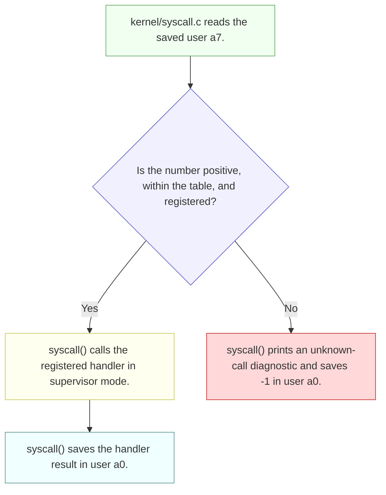

# Lab syscall: Deriving Sandbox a command

Derive the mask-only exercise from MIT's [2026 system-call lab](https://pdos.csail.mit.edu/6.1810/2026/labs/syscall.html#sandbox-a-command). This guide explains existing code and asks implementation questions; it leaves the kernel changes to you.

---

[toc]

---

## What the exercise asks: the sandbox contract

**Scope: mask-based rejection.** The following “Sandbox with allowed pathnames” exercise is separate.

| Aspect | Contract | Authority |
| --- | --- | --- |
| **Interface** | Add `interpose` with an integer mask and a pathname argument. | Handout |
| **Bit meaning** | Each set bit rejects the system call with that number. | Handout |
| **Path argument** | This exercise uses `"-"`; pathname exceptions belong to the next exercise. | Handout |
| **Process scope** | Restrictions belong to the calling process and are inherited through `fork`. | Handout |
| **Command execution** | Restrictions must still apply after the wrapper executes the requested command. | Required by the handout's examples |
| **Failure behavior** | Reject the operation without running its handler; report failure through the syscall return value (`-1` in this tree). | Grader-observed behavior and local syscall convention |
| **Fresh processes** | A reused process-table slot must not acquire a previous occupant's restrictions. | Repository lifecycle invariant |
| **Build and API style** | Follow the existing user-program build and syscall registration conventions. | Repository; see [program registration](../02-build-boot-and-usage.md#adding-and-running-a-user-exercise) |

### Grader assertions and their limits

**Read the Python test bodies in [`grade-lab-syscall`](../../grade-lab-syscall), not just their names.** The mask exercise's advertised check is `sandbox_mask`; `sandbox_fork` supplies additional inheritance evidence.

| Test | Points | Guest commands | Positive assertions | Negative assertions |
| --- | --- | --- | --- | --- |
| **`sandbox_mask`** | 5 | The six commands below | Lines beginning with `"hello"`, `cat: cannot open README`, `grep: cannot open README`, `sandbox: exec grep failed`, and `sandbox: exec sh failed` | No explicit forbidden-output assertions |
| **`sandbox_fork`** | 5 | `sandbox 32768 - sh < exec.sh`, then `echo DONE` | Exactly one occurrence each of `hello world` and regex `cannot open .` | Additional occurrences of either regex fail the count |

The mask test sends these commands in order:

```text
sandbox 32768 - echo "hello"
sandbox 32768 - cat README
sandbox 32768 - grep xv6 README
sandbox 128 - grep xv6 README
sandbox 32896 - grep xv6 README
sandbox 128 - sh < exec.sh
```

| Evidence | Limit |
| --- | --- |
| **Matching diagnostics** | The checks are aggregated across the transcript, not attributed to individual commands. They do not assert the exact kernel return value, command exit statuses, or absence of handler side effects. |
| **Inheritance output counts** | They exercise the provided shell script; they do not exhaust nested forks, repeated policy changes, or process-slot reuse. |
| **No breakpoint monitors** | Neither test installs `stop_breakpoint`; a passing text assertion does not prove a particular handler was entered or skipped. |
| **Test completion** | `shell_script` follows shell prompts; the fork test supplies `DONE` as its termination regex. `Runner` also has a timeout, so there is no separate assertion that a particular stop event occurred. |

**Regex caveats:** `sandbox_mask`'s expressions start with `^` but lack end anchors. The fork test uses `re.findall` across the whole transcript; the dot in `cannot open .` is an unescaped wildcard, even though its assertion label mentions `ls: cannot open .`.

The later `sandbox_path`, `sandbox_most`, and `sandbox_minus` tests require pathname exceptions and are outside this note. General test execution and transcript handling belong to [the lab workflow](../03-lab-workflow.md#run-graders-and-interpret-failure-transcripts); exercise-specific monitor behavior is discussed [beside verification](#grader-monitor-details).

## Prerequisites and shared-document ownership

| When | Read | Use here |
| --- | --- | --- |
| **Read first** | [C bitwise operations](../../../c-programming/C_Bitwise_Module.md) | Understand bit positions, combining flags, and testing membership. Hosted-C examples are conceptual background, not xv6 API templates. |
| **Read first** | [Chapter 2: OS organization](../book/ch02-operating-system-organization.md) | Understand why the kernel owns permission checks and process state. |
| **Read first** | [Process abstraction](../../../operating-system/The_Process_Abstraction.md) and [xv6 process calls](../05-syscall-reference.md#process-creation-exit-waiting-and-execution) | Distinguish a new process from a replacement program image. |
| **Consult for the ABI** | [Build artifacts](../06-build-artifacts.md) and [the sleep note's trap foundation](01-util-sleep.md#the-foundation-a-c-call-that-becomes-a-trap) | Decode the generated stub and saved argument and return registers. |
| **Consult for arguments** | [System-call arguments and user memory](../11-os-design-in-xv6.md#system-call-arguments-and-user-memory) | Separate extracting an integer from safely reading a user string. |
| **Consult for setup** | [Build conventions](../02-build-boot-and-usage.md#adding-and-running-a-user-exercise) and [lab selection](../03-lab-workflow.md#the-lab-switch-conflabmk) | Register programs and select the right lab without restructuring the build. |

**Book-source reading:** Chapter 2's isolation discussion is in `../xv6-riscv-book/first.tex`; Chapter 4's “Code: Calling system calls” and “Code: System call arguments” are in `../xv6-riscv-book/trap.tex`. [The Chapter 4 note](../book/ch04-traps-and-system-calls.md) remains a placeholder; its linked sleep and OS-design notes hold those mechanisms on loan. This exercise owns only its sandbox decisions.

## Setup differences in this checkout

| Item | What to check |
| --- | --- |
| **Fork implementation** | The user API is `fork`, but the kernel routine is `kfork()` in `kernel/proc.c`. |
| **Diagnostic routine** | Kernel diagnostics use `printk` in `kernel/printk.c`. |
| **Handout's `sbtest` hint** | `user/sbtest.c` is absent here. The checked-in grader invokes `sandbox`, ordinary commands, and `exec.sh`; it does not invoke `sbtest`. |
| **Current Makefile edits** | The working tree lists `sandbox` and `sbtest` in `LAB_PRACTICE_PROGS`, which feeds `UPROGS`. A missing source is a build issue to resolve before grading; it is not evidence of a broken mask. |
| **Current API edit** | `user/user.h` has an in-progress `interpose()` declaration. Compare it with the contract's two arguments; a declaration alone supplies no stub or handler. |

These are observations of the starting working tree. No kernel implementation is assumed, and this note does not modify those in-progress source changes.

## Code to read first: each file's responsibility

| Source | What to inspect | What it does not supply |
| --- | --- | --- |
| [`user/sandbox.c`](../../user/sandbox.c) | Argument stripping; `fork`; child call to `interpose`; `exec`; parent `wait` | Kernel enforcement |
| [`user/user.h`](../../user/user.h) and [`user/usys.pl`](../../user/usys.pl) | Existing declarations and generated-stub entries | Kernel policy storage |
| [`kernel/syscall.h`](../../kernel/syscall.h) and [`kernel/syscall.c`](../../kernel/syscall.c) | Call numbers, handler table, argument helpers, dispatch | Automatic registration of a newly written handler |
| [`kernel/sysproc.c`](../../kernel/sysproc.c) | Existing process-call handler signatures and return conventions | A new process field's lifetime |
| [`kernel/proc.h`](../../kernel/proc.h) and [`kernel/proc.c`](../../kernel/proc.c) | `struct proc`, `allocproc`, `freeproc`, `kfork`, and publication as `RUNNABLE` | Automatic copying or resetting of an added member |
| [`kernel/exec.c`](../../kernel/exec.c) | `kexec` replaces the address space within the current process | A new process-table allocation |
| [`user/exec.sh`](../../user/exec.sh) and [`user/sh.c`](../../user/sh.c) | Script commands and the shell's own fork/exec behavior | An exemption from the sandbox |

## Existing function walkthrough: `sys_getpid`

**A syscall handler has no C parameters even when the user-facing call does.** Start with an unchanged, non-target handler, quoted verbatim from [`kernel/sysproc.c`](../../kernel/sysproc.c):

```c
uint64
sys_getpid(void)
{
  return myproc()->pid;
}
```

1. **`uint64` matches the dispatch table.** The table in `kernel/syscall.c` stores pointers to handlers of this shape.
2. **`myproc()` finds the caller's process.** In `kernel/proc.c`, it uses `mycpu()->proc` while interrupts are disabled, then restores the interrupt state.
3. **The handler returns to `syscall()`.** That dispatcher writes the result into the saved user `a0`. The existing `argint` and `argstr` helpers retrieve arguments from saved registers rather than handler C parameters.

### Existing dispatch branches before sandboxing

**This diagram shows the current dispatcher, with no sandbox decision added.** User mode and supervisor mode are the unprivileged application and privileged kernel execution modes, respectively.



*Palette: green means data movement, lavender means a decision, yellow means processing, cyan means committing a result, and red means failure.*

**Recognition and permission are different questions.** A registered call can be forbidden for one process. The current unknown-call branch handles invalid or missing registrations; its existence does not enforce a policy on valid entries.

Calling a handler can create irreversible effects before it returns. Returning an error afterward cannot undo an `open` with creation flags, a `write`, or a successful `exec`. Use the contract to decide which existing boundary must remain uncrossed for rejection.

## Concepts underneath: bits and process lifetime

### A mask contains positions, not syscall numbers

| Value | Meaning | Source |
| --- | --- | --- |
| `15` | Number of `open` | `SYS_open` in `kernel/syscall.h` |
| `32768` (`0x8000`) | Bit 15 alone | Derived from that call number |
| `7` | Number of `exec` | `SYS_exec` in `kernel/syscall.h` |
| `128` (`0x80`) | Bit 7 alone | Derived from that call number |
| `32896` (`0x8080`) | Bits 15 and 7 together | Sum of the two disjoint bit values |
| `22` | Highest registered number before this exercise: `sync` | `kernel/syscall.h` and the dispatch table |

**A set bit means denied; zero bits permit ordinary dispatch.** Distinguish bitwise membership from logical truth and from equality with the entire mask. A mask can contain several restrictions at once.

**Check the number before using it as an index or shift count.** The saved register is user-controlled. C shifts outside the operand width are undefined, and signed shifts have further limits; choose the operand type and bounds deliberately rather than assuming a 64-bit register makes every C expression 64 bits.

### `fork` copies state; `exec` replaces an image

| Existing operation | Source evidence | Sandbox design question |
| --- | --- | --- |
| **Allocate** | `allocproc()` claims an `UNUSED` slot and initializes selected fields. | What policy must a fresh occupant start with? |
| **Fork** | `kfork()` explicitly copies user memory, saved registers, descriptors, `cwd`, and name. | Does any of that copy a newly added `struct proc` member? |
| **Make runnable** | `kfork()` sets `np->state = RUNNABLE` after preparing the child. | What state must already be valid when another CPU can run it? |
| **Exec** | `kexec()` commits a replacement page table, size, and entry registers in the same `struct proc`. | Which policy must survive that replacement? |
| **Free and reuse** | `freeproc()` clears individual fields and sets `UNUSED`; it does not zero the whole structure. | Where will stale policy be reset, including failed-allocation paths? |

**User-memory copying is not process-structure copying.** The `uvmcopy` call in `kfork` operates on page tables. A new kernel member needs its own lifetime reasoning even though the child already receives a copy of user memory.

In the supplied wrapper, the parent waits while the child applies restrictions and executes the command. Keeping policy in a global variable would mix unrelated processes. Keeping it only in the old user address space would lose it when `exec` replaces that space.

## Deriving the changes: decisions and traps

**Work from the [single contract](#what-the-exercise-asks-the-sandbox-contract), then answer these questions against the source.** This checklist identifies decisions without supplying an ordered target algorithm.

- [ ] **Interface completeness:** Which existing call demonstrates every registration layer, and how will the new declaration express both arguments?
- [ ] **Ownership:** Which object represents the caller independently of its current program image?
- [ ] **Initialization:** Which paths create or recycle that object, and what default preserves normal shell behavior?
- [ ] **Inheritance:** Where does `kfork()` finish child initialization before scheduling becomes possible?
- [ ] **Argument extraction:** What does `argint` return in this checkout, and where does it obtain argument zero?
- [ ] **Rejection boundary:** Which statement in the current dispatcher first invokes the requested operation, and how can refusal preserve the normal return path?
- [ ] **Mask representation:** What C type and valid-number range make membership checking defined?
- [ ] **Scope:** What remains unimplemented until the separate pathname exercise, and what behavior is unspecified here for repeated `interpose` calls?

| Trap | Consequence | Evidence to inspect |
| --- | --- | --- |
| **Treating the mask as a call number** | A combined mask cannot express both denials. | The numeric table above and `sandbox_mask` |
| **A check only in the wrapper** | Other callers can still enter kernel handlers directly. | Stub and dispatch ownership |
| **Denying after dispatch** | An error return can hide a completed operation. | `syscalls[num]()` and the requested handler |
| **A global mask** | One process changes the behavior of unrelated processes. | `myproc()` and `struct proc` |
| **Assuming fork copies every member** | The child can escape the intended restriction. | Explicit assignments in `kfork()` |
| **Relying on boot-time zeros** | A recycled slot can retain restrictions. | `allocproc()` and `freeproc()` |
| **Resetting on every exec** | The sandboxed command loses its restriction. | `user/sandbox.c` and `kexec()` |
| **Editing generated `usys.S`** | A later build overwrites the stub. | `user/usys.pl` and [build artifacts](../06-build-artifacts.md) |
| **Copying another version's helper signature** | Code may treat a `void` function as returning an error. | This tree's `argint()` definition |

**Unspecified policy is not a security guarantee.** The mask exercise does not establish that restrictions can only become stricter, that a program cannot replace its policy through another `interpose` call, or that every possible syscall number is supported by an integer mask. Do not infer those properties from the selected tests.

## Verification: build, guest checks, and grading

### Build readiness and guest observations

**First resolve registration and source availability.** In the starting tree, a generated `interpose` stub and the kernel implementation are still missing, and the Makefile references absent `sbtest.c`. Those are setup observations, not a completed exercise result.

Run on the host after implementing and checking the active lab:

```bash
cat conf/lab.mk
make qemu
```

In the xv6 guest, compare unrestricted behavior with the exercise cases:

```text
cat README
sandbox 32768 - cat README
sandbox 32768 - echo hello
sandbox 128 - echo hello
sandbox 32896 - cat README
sandbox 32768 - sh < exec.sh
cat README
```

**Compare the observations, not only diagnostics.** An unrestricted command after the sandbox helps expose accidental global state; the script exercises descendants. These are manual probes, not an exhaustive process-reuse or side-effect test. Do not label predicted output as a captured transcript.

### Focused grader commands

**Run the advertised mask check, then the inheritance check.** Exit QEMU with `Ctrl-a`, then `x`, before launching the host grader.

```bash
./grade-lab-syscall sandbox_mask
./grade-lab-syscall sandbox_fork
```

Use the [assertion table and evidence limits](#grader-assertions-and-their-limits) to interpret results. Full `make grade` also includes pathname sandboxing and the attack exercise; its failures need not belong to this mask-only task.

### Optional GDB observations

**Inspect saved user registers at dispatch.** Follow [the existing GDB setup](12-syscall-using-gdb.md) to launch `make qemu-gdb` and attach; use the correct debugger for your toolchain.

```gdb
break syscall
continue
```

Advance past the initialization of local `p` before inspecting it:

```gdb
print p->pid
print p->name
print /x p->trapframe->a7
print /x p->trapframe->a0
print /x p->trapframe->a1
```

**Interpret `a0` by the saved call number.** At `interpose` entry it contains the mask; at `open` entry it contains a user pathname address. After dispatch it contains the result. The live supervisor `$a0` may hold an unrelated compiler temporary; do not substitute it for the saved user register.

A breakpoint on `sys_open` can help investigate whether a supposedly denied call reaches its handler, but unrestricted boot and shell activity also use it. Correlate the caller and call number, and remember that absence of a breakpoint hit alone does not prove correct rejection.

### Grader monitor details

**No sandbox-specific GDB breakpoint drives these tests.** [`gradelib.py`](../../gradelib.py) starts QEMU through its GDB-enabled runner and sends commands when prompts appear. For the default mask test, it stops when another prompt arrives after all commands have been sent.

For `sandbox_fork`, the supplied `DONE` termination regex is matched with `re.match` against the monitor's accumulated buffer. It is a monitor instruction, not a separate output assertion in the test body. `Runner.__react()` can also return after its time budget, and the test then inspects whatever transcript was captured; preserve the distinction between intended termination and asserted output.

## Questions to answer from the source

1. Why does the wrapper install policy in its child rather than before its own `fork()`?
2. Why can `sys_getpid(void)` identify its caller without accepting a process pointer from user space?
3. Which values distinguish call number 15 from bit 15 and from a mask containing both `open` and `exec`?
4. If a denied `open` handler runs before an error is returned, which effects could already have occurred?
5. If a recycled process slot retains an old mask, why might a later unrelated command fail?
6. Why does copying the trapframe in `kfork()` fail to initialize an added policy field in `struct proc`?
7. If restrictions vanish on successful `exec`, which supplied wrapper behavior exposes that mistake?
8. What would the grader still leave unproved after both focused tests pass?
