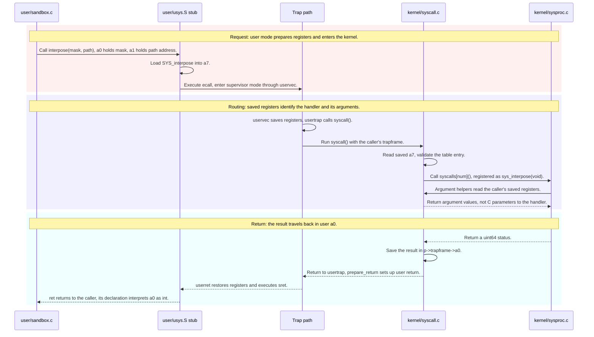
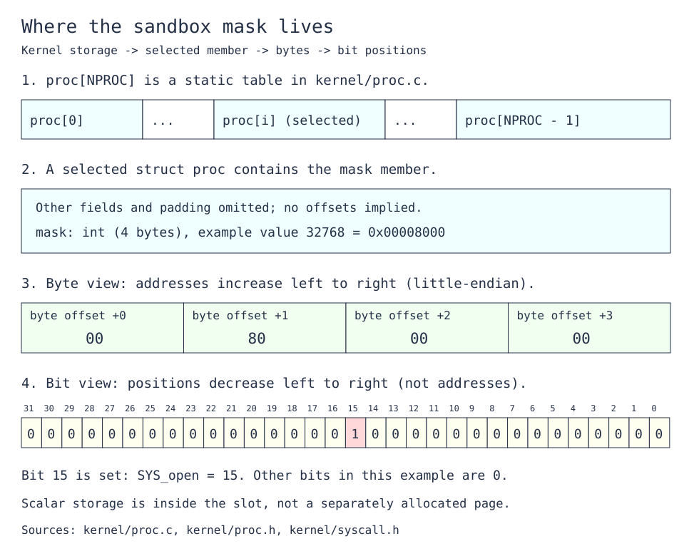

# Lab syscall: Deriving Sandbox a command

Derive the mask-only exercise from MIT's [2026 system-call lab](https://pdos.csail.mit.edu/6.1810/2026/labs/syscall.html#sandbox-a-command). This guide explains existing code and asks implementation questions; it leaves the kernel changes to you.

---

[toc]

---

## What the exercise asks: the sandbox contract

**Scope: mask-based rejection.** The following “Sandbox with allowed pathnames” exercise is separate.

| Aspect                  | Contract                                                                                                               | Authority                                                                                                |
| ----------------------- | ---------------------------------------------------------------------------------------------------------------------- | -------------------------------------------------------------------------------------------------------- |
| **Interface**           | Add `interpose` with an integer mask and a pathname argument.                                                          | Handout                                                                                                  |
| **Bit meaning**         | Each set bit rejects the system call with that number.                                                                 | Handout                                                                                                  |
| **Path argument**       | This exercise uses `"-"`; pathname exceptions belong to the next exercise.                                             | Handout                                                                                                  |
| **Process scope**       | Restrictions belong to the calling process and are inherited through `fork`.                                           | Handout                                                                                                  |
| **Command execution**   | Restrictions must still apply after the wrapper executes the requested command.                                        | Required by the handout's examples                                                                       |
| **Failure behavior**    | Reject the operation without running its handler; report failure through the syscall return value (`-1` in this tree). | Grader-observed behavior and local syscall convention                                                    |
| **Fresh processes**     | A reused process-table slot must not acquire a previous occupant's restrictions.                                       | Repository lifecycle invariant                                                                           |
| **Build and API style** | Follow the existing user-program build and syscall registration conventions.                                           | Repository; see [program registration](../02-build-boot-and-usage.md#adding-and-running-a-user-exercise) |

### Grader assertions and their limits

**Read the Python test bodies in [`grade-lab-syscall`](../../grade-lab-syscall), not just their names.** The mask exercise's advertised check is `sandbox_mask`; `sandbox_fork` supplies additional inheritance evidence.

| Test               | Points | Guest commands                                   | Positive assertions                                                                                                                               | Negative assertions                                   |
| ------------------ | ------ | ------------------------------------------------ | ------------------------------------------------------------------------------------------------------------------------------------------------- | ----------------------------------------------------- |
| **`sandbox_mask`** | 5      | The six commands below                           | Lines beginning with `"hello"`, `cat: cannot open README`, `grep: cannot open README`, `sandbox: exec grep failed`, and `sandbox: exec sh failed` | No explicit forbidden-output assertions               |
| **`sandbox_fork`** | 5      | `sandbox 32768 - sh < exec.sh`, then `echo DONE` | Exactly one occurrence each of `hello world` and regex `cannot open .`                                                                            | Additional occurrences of either regex fail the count |

The mask test sends these commands in order:

```text
sandbox 32768 - echo "hello"
sandbox 32768 - cat README
sandbox 32768 - grep xv6 README
sandbox 128 - grep xv6 README
sandbox 32896 - grep xv6 README
sandbox 128 - sh < exec.sh
```

| Evidence                      | Limit                                                                                                                                                                                                |
| ----------------------------- | ---------------------------------------------------------------------------------------------------------------------------------------------------------------------------------------------------- |
| **Matching diagnostics**      | The checks are aggregated across the transcript, not attributed to individual commands. They do not assert the exact kernel return value, command exit statuses, or absence of handler side effects. |
| **Inheritance output counts** | They exercise the provided shell script; they do not exhaust nested forks, repeated policy changes, or process-slot reuse.                                                                           |
| **No breakpoint monitors**    | Neither test installs `stop_breakpoint`; a passing text assertion does not prove a particular handler was entered or skipped.                                                                        |
| **Test completion**           | `shell_script` follows shell prompts; the fork test supplies `DONE` as its termination regex. `Runner` also has a timeout, so there is no separate assertion that a particular stop event occurred.  |

**Regex caveats:** `sandbox_mask`'s expressions start with `^` but lack end anchors. The fork test uses `re.findall` across the whole transcript; the dot in `cannot open .` is an unescaped wildcard, even though its assertion label mentions `ls: cannot open .`.

The later `sandbox_path`, `sandbox_most`, and `sandbox_minus` tests require pathname exceptions and are outside this note. General test execution and transcript handling belong to [the lab workflow](../03-lab-workflow.md#run-graders-and-interpret-failure-transcripts); exercise-specific monitor behavior is discussed [beside verification](#grader-monitor-details).

## Prerequisites and shared-document ownership

| When                      | Read                                                                                                                                                                        | Use here                                                                                                                               |
| ------------------------- | --------------------------------------------------------------------------------------------------------------------------------------------------------------------------- | -------------------------------------------------------------------------------------------------------------------------------------- |
| **Read first**            | [C bitwise operations](../../../c-programming/C_Bitwise_Module.md)                                                                                                          | Understand bit positions, combining flags, and testing membership. Hosted-C examples are conceptual background, not xv6 API templates. |
| **Read first**            | [Chapter 2: OS organization](../book/ch02-operating-system-organization.md)                                                                                                 | Understand why the kernel owns permission checks and process state.                                                                    |
| **Read first**            | [Process abstraction](../../../operating-system/The_Process_Abstraction.md) and [xv6 process calls](../05-syscall-reference.md#process-creation-exit-waiting-and-execution) | Distinguish a new process from a replacement program image.                                                                            |
| **Consult for the ABI**   | [Build artifacts](../06-build-artifacts.md) and [the sleep note's trap foundation](01-util-sleep.md#the-foundation-a-c-call-that-becomes-a-trap)                            | Decode the generated stub and saved argument and return registers.                                                                     |
| **Consult for arguments** | [System-call arguments and user memory](../11-os-design-in-xv6.md#system-call-arguments-and-user-memory)                                                                    | Separate extracting an integer from safely reading a user string.                                                                      |
| **Consult for setup**     | [Build conventions](../02-build-boot-and-usage.md#adding-and-running-a-user-exercise) and [lab selection](../03-lab-workflow.md#the-lab-switch-conflabmk)                   | Register programs and select the right lab without restructuring the build.                                                            |

**Book-source reading:** Chapter 2's isolation discussion is in `../xv6-riscv-book/first.tex`; Chapter 4's “Code: Calling system calls” and “Code: System call arguments” are in `../xv6-riscv-book/trap.tex`. [The Chapter 4 note](../book/ch04-traps-and-system-calls.md) remains a placeholder; its linked sleep and OS-design notes hold those mechanisms on loan. This exercise owns only its sandbox decisions.

## Setup differences in this checkout

| Item                        | What to check                                                                                                                           |
| --------------------------- | --------------------------------------------------------------------------------------------------------------------------------------- |
| **Fork implementation**     | The user API is `fork`, but the kernel routine is `kfork()` in `kernel/proc.c`.                                                         |
| **Diagnostic routine**      | Kernel diagnostics use `printk` in `kernel/printk.c`.                                                                                   |
| **Handout's `sbtest` hint** | `user/sbtest.c` is absent here. The checked-in grader invokes `sandbox`, ordinary commands, and `exec.sh`; it does not invoke `sbtest`. |
| **Program registration**    | `sandbox` is listed in `LAB_PRACTICE_PROGS`, which feeds `UPROGS`. Listing a program without its source breaks the build.               |

## Code to read first: each file's responsibility

| Source                                                                                        | What to inspect                                                                | What it does not supply                           |
| --------------------------------------------------------------------------------------------- | ------------------------------------------------------------------------------ | ------------------------------------------------- |
| [`user/sandbox.c`](../../user/sandbox.c)                                                      | Argument stripping; `fork`; child call to `interpose`; `exec`; parent `wait`   | Kernel enforcement                                |
| [`user/user.h`](../../user/user.h) and [`user/usys.pl`](../../user/usys.pl)                   | Existing declarations and generated-stub entries                               | Kernel policy storage                             |
| [`kernel/syscall.h`](../../kernel/syscall.h) and [`kernel/syscall.c`](../../kernel/syscall.c) | Call numbers, handler table, argument helpers, dispatch                        | Automatic registration of a newly written handler |
| [`kernel/sysproc.c`](../../kernel/sysproc.c)                                                  | Existing process-call handler signatures and return conventions                | A new process field's lifetime                    |
| [`kernel/proc.h`](../../kernel/proc.h) and [`kernel/proc.c`](../../kernel/proc.c)             | `struct proc`, `allocproc`, `freeproc`, `kfork`, and publication as `RUNNABLE` | Automatic copying or resetting of an added member |
| [`kernel/exec.c`](../../kernel/exec.c)                                                        | `kexec` replaces the address space within the current process                  | A new process-table allocation                    |
| [`user/exec.sh`](../../user/exec.sh) and [`user/sh.c`](../../user/sh.c)                       | Script commands and the shell's own fork/exec behavior                         | An exemption from the sandbox                     |

## Existing function walkthrough: `sys_getpid`

**A syscall handler has no C parameters even when the user-facing call does.** Start with an unchanged, non-target handler, quoted verbatim from [`kernel/sysproc.c`](../../kernel/sysproc.c):

```c
uint64
sys_getpid(void)
{
  return myproc()->pid;
}
```

1. **`uint64` matches the dispatch table.** The table in `kernel/syscall.c` stores pointers to handlers of this shape.
2. **`myproc()` finds the caller's process.** In `kernel/proc.c`, it uses `mycpu()->proc` while interrupts are disabled, then restores the interrupt state.
3. **The handler returns to `syscall()`.** That dispatcher writes the result into the saved user `a0`. The existing `argint` and `argstr` helpers retrieve arguments from saved registers rather than handler C parameters.

### Existing dispatch branches before sandboxing

**This table shows the dispatcher before any sandbox decision is added.** User mode and supervisor mode are the unprivileged application and privileged kernel execution modes, respectively.

| Existing dispatch condition                                      | Behavior before enforcement is added                         |
| ---------------------------------------------------------------- | ------------------------------------------------------------ |
| **Positive number, within the table, with a registered handler** | Invoke the handler and save its result in user `a0`.         |
| **Invalid number or missing handler**                            | Print an unknown-call diagnostic and save `-1` in user `a0`. |

### From interpose to sys_interpose

**The generated stub crosses a register-based ABI; it does not call the kernel handler as a C function.** This figure shows the registered call path, without the exercise's mask-enforcement algorithm.



_Palette for both figures: pink means request, lavender means routing, green means data movement, yellow means processing, cyan means stored state or a committed result, and red means failure or denial._

**The names are connected by a number and a table entry.** `user/usys.pl` generates the assembly label `interpose`; `kernel/syscall.h` defines the number, and `syscalls[]` in `kernel/syscall.c` maps it to `sys_interpose`. There is no linker alias that turns one name into the other.

**The signatures describe different boundaries.** The caller's declaration takes two arguments, so its C call prepares `a0` and `a1`. The handler takes no C parameters because its argument helpers retrieve values from the saved user registers. Its `uint64` return type matches the kernel dispatch table; the caller sees an `int` status through its own declaration.

**Analogy: an order ticket in a kitchen.** The customer and the cook never talk directly, so their "signatures" differ:

| Kitchen                                        | System call                                                                                                      |
| ---------------------------------------------- | ---------------------------------------------------------------------------------------------------------------- |
| **Customer states the order**                  | `interpose(mask, path)`: the C call places the arguments in `a0` and `a1`.                                       |
| **Clerk adds a menu number and pins a ticket** | The stub loads `SYS_interpose` into `a7` and runs `ecall`; `uservec` saves every register into the trapframe.    |
| **Expediter routes by menu number**            | `syscall()` indexes `syscalls[]` with saved `a7`.                                                                |
| **Cook reads the ticket, not the customer**    | `sys_interpose(void)` takes no parameters; `argint(0, ...)` and `argaddr`/`argstr` read the saved registers.     |
| **Every cook uses one ticket format**          | One table holds every handler, so each shares the type `uint64 (*)(void)` whatever its user-side arguments.      |
| **Result written on the ticket's first line**  | The handler's `uint64` goes into saved `a0`; the caller's `int` declaration reads its low 32 bits as the status. |

**Where the analogy breaks down:** a clerk is trusted, but here the user program wrote every register itself. The handler must therefore validate each value, such as `sys_interpose()` rejecting a negative mask, and must read a user address like `a1` through `copyin`-based helpers rather than dereferencing it.

| Saved user register                         | Meaning at syscall entry                                     | Meaning after syscall completion |
| ------------------------------------------- | ------------------------------------------------------------ | -------------------------------- |
| `a0`                                        | First argument: mask for `interpose`, tick count for `pause` | Return value                     |
| `a1`                                        | Second argument: user pathname address for `interpose`       | Not the status return slot       |
| `a2`–`a5`                                   | Further argument slots when required                         | Restored execution state         |
| `a6`                                        | No argument slot in this xv6 syscall interface               | Restored execution state         |
| `a7`                                        | Syscall number, such as `SYS_interpose`                      | Restored execution state         |
| `ra`, `sp`, and the other integer registers | User execution state saved by `uservec`                      | Restored by `userret`            |

**The six-argument limit is xv6's interface choice.** `argraw` handles indices 0 through 5 and panics for others; it does not expose every saved register as an argument. A pathname address in `a1` is still a user address, not a kernel string pointer to dereference directly.

For ordinary registers versus control and status registers, read [the assembly companion's CSR and privilege note](../../../assembly-language/docs/riscv/06-csrs-and-privilege.md#csrs-how-they-differ-from-integer-registers-and-memory). The full stub and instruction walkthrough belongs to [build artifacts](../06-build-artifacts.md); this figure focuses on the new call's name and signature handoff.

**Recognition and permission are different questions.** A registered call can be forbidden for one process. The current unknown-call branch handles invalid or missing registrations; its existence does not enforce a policy on valid entries.

Calling a handler can create irreversible effects before it returns. Returning an error afterward cannot undo an `open` with creation flags, a `write`, or a successful `exec`. Use the contract to decide which existing boundary must remain uncrossed for rejection.

## Concepts underneath: bits and process lifetime

### A mask contains positions, not syscall numbers

**The mask occupies storage inside a process slot; its bits name operations.** The sketch below distinguishes a process-table allocation from byte addresses and bit positions.



_The [SVG view](fig/syscall-sandbox-mask-layout.svg) shows containment and byte placement; the [editable source](fig/syscall-sandbox-mask-layout.excalidraw) opens in Excalidraw. Colors follow the call-flow legend above. Sources: `proc[NPROC]` in `kernel/proc.c`, `struct proc` in `kernel/proc.h`, and call numbers in `kernel/syscall.h`._

**No separate allocation is implied by a scalar member.** This tree declares a static process table in kernel memory. `allocproc()` claims an existing slot and separately allocates supporting objects such as the trapframe; a scalar `mask` member is part of the slot's storage. The drawing omits other fields and padding and makes no claim about their offsets.

**Byte order and bit numbering answer different questions.** On this RV64 little-endian target, an `int` is four bytes, so value `0x00008000` has bytes `00 80 00 00` at increasing addresses. Bit 15 denotes `SYS_open` regardless of the order in which those bytes are stored; it is not byte offset 15.

| Value                                            | Meaning                                                | Source                                    |
| ------------------------------------------------ | ------------------------------------------------------ | ----------------------------------------- |
| `15`                                             | Number of `open`                                       | `SYS_open` in `kernel/syscall.h`          |
| `32768` (`0x8000` = `1 << 15` = `1 << SYS_open`) | Bit 15 alone                                           | Derived from that call number             |
| `7`                                              | Number of `exec`                                       | `SYS_exec` in `kernel/syscall.h`          |
| `128` (`0x80` = `1 << 7` = `1 << SYS_exec`)      | Bit 7 alone                                            | Derived from that call number             |
| `32896` (`0x8080`)                               | Bits 15 and 7 together                                 | Sum of the two disjoint bit values        |
| `22`                                             | Highest registered number before this exercise: `sync` | `kernel/syscall.h` and the dispatch table |

**A set bit means denied; zero bits permit ordinary dispatch.** Distinguish bitwise membership from logical truth and from equality with the entire mask. A mask can contain several restrictions at once.

**Check the number before using it as an index or shift count.** The saved register is user-controlled. C shifts outside the operand width are undefined, and signed shifts have further limits; choose the operand type and bounds deliberately rather than assuming a 64-bit register makes every C expression 64 bits.

### `fork` copies state; `exec` replaces an image

| Existing operation | Source evidence                                                                                  | Sandbox design question                                              |
| ------------------ | ------------------------------------------------------------------------------------------------ | -------------------------------------------------------------------- |
| **Allocate**       | `allocproc()` claims an `UNUSED` slot and initializes selected fields.                           | What policy must a fresh occupant start with?                        |
| **Fork**           | `kfork()` explicitly copies user memory, saved registers, descriptors, `cwd`, and name.          | Does any of that copy a newly added `struct proc` member?            |
| **Make runnable**  | `kfork()` sets `np->state = RUNNABLE` after preparing the child.                                 | What state must already be valid when another CPU can run it?        |
| **Exec**           | `kexec()` commits a replacement page table, size, and entry registers in the same `struct proc`. | Which policy must survive that replacement?                          |
| **Free and reuse** | `freeproc()` clears individual fields and sets `UNUSED`; it does not zero the whole structure.   | Where will stale policy be reset, including failed-allocation paths? |

**User-memory copying is not process-structure copying.** The `uvmcopy` call in `kfork` operates on page tables. A new kernel member needs its own lifetime reasoning even though the child already receives a copy of user memory.

#### Why `kfork` copies `struct proc` field by field

**`kfork()` never runs `*np = *p`, because most fields must differ in the child.** Only a few are plain values; the rest name a resource the child must own or reference-count. Each existing field falls into one row:

| `struct proc` field            | What the child gets                                                                                   | Why a whole-struct copy would be wrong                                                    |
| ------------------------------ | ----------------------------------------------------------------------------------------------------- | ----------------------------------------------------------------------------------------- |
| **`lock`**                     | Its own slot's lock, which `allocproc()` returns held                                                 | Overwriting a held spinlock corrupts its `locked` and `cpu` fields.                       |
| **`kstack`**                   | Its own slot's stack, assigned once by `procinit()`                                                   | Two processes would run on one kernel stack.                                              |
| **`state`, `pid`**             | `USED` and a fresh pid from `allocproc()`; `RUNNABLE` at the end of `kfork()`                         | The child needs its own identity; the parent's state is `RUNNING`.                        |
| **`parent`**                   | `p`, set under `wait_lock`                                                                            | Copying would make the child a sibling of its parent.                                     |
| **`chan`, `killed`, `xstate`** | The cleared values that `freeproc()` left                                                             | A pending sleep, kill, or exit status belongs to the parent only.                         |
| **`pagetable`, `trapframe`**   | New pages from `allocproc()`; contents copied by `uvmcopy()` and `*(np->trapframe) = *(p->trapframe)` | Copying the pointers would share the parent's memory instead of duplicating it.           |
| **`context`**                  | `ra` = `forkret` and `sp` at the top of its own stack, from `allocproc()`                             | The parent's context records where the parent last switched out.                          |
| **`ofile[]`, `cwd`**           | The same objects, through `filedup()` and `idup()`                                                    | A raw pointer copy skips the reference count, so the first `close` frees a shared object. |
| **`sz`, `name`**               | Copies of the parent's values                                                                         | None: these are plain values.                                                             |

**A member you add needs a deliberate row too.** Nothing in `kfork()` copies it unless you write the assignment, and nothing resets it unless `freeproc()` does.

In the supplied wrapper, the parent waits while the child applies restrictions and executes the command. Keeping policy in a global variable would mix unrelated processes. Keeping it only in the old user address space would lose it when `exec` replaces that space.

## Deriving the changes: decisions and traps

**Work from the [single contract](#what-the-exercise-asks-the-sandbox-contract), then answer these questions against the source.** This checklist identifies decisions without supplying an ordered target algorithm.

- [ ] **Interface completeness:** Which existing call demonstrates every registration layer, and how will the new declaration express both arguments?
- [ ] **Ownership:** Which object represents the caller independently of its current program image?
- [ ] **Initialization:** Which paths create or recycle that object, and what default preserves normal shell behavior?
- [ ] **Inheritance:** Where does `kfork()` finish child initialization before scheduling becomes possible?
- [ ] **Argument extraction:** What does `argint` return in this checkout, and where does it obtain argument zero?
- [ ] **Rejection boundary:** Which statement in the current dispatcher first invokes the requested operation, and how can refusal preserve the normal return path?
- [ ] **Mask representation:** What C type and valid-number range make membership checking defined?
- [ ] **Scope:** What remains unimplemented until the separate pathname exercise, and what behavior is unspecified here for repeated `interpose` calls?

| Trap                                           | Consequence                                              | Evidence to inspect                                            |
| ---------------------------------------------- | -------------------------------------------------------- | -------------------------------------------------------------- |
| **Treating the mask as a call number**         | A combined mask cannot express both denials.             | The numeric table above and `sandbox_mask`                     |
| **A check only in the wrapper**                | Other callers can still enter kernel handlers directly.  | Stub and dispatch ownership                                    |
| **Denying after dispatch**                     | An error return can hide a completed operation.          | `syscalls[num]()` and the requested handler                    |
| **A global mask**                              | One process changes the behavior of unrelated processes. | `myproc()` and `struct proc`                                   |
| **Assuming fork copies every member**          | The child can escape the intended restriction.           | Explicit assignments in `kfork()`                              |
| **Relying on boot-time zeros**                 | A recycled slot can retain restrictions.                 | `allocproc()` and `freeproc()`                                 |
| **Resetting on every exec**                    | The sandboxed command loses its restriction.             | `user/sandbox.c` and `kexec()`                                 |
| **Editing generated `usys.S`**                 | A later build overwrites the stub.                       | `user/usys.pl` and [build artifacts](../06-build-artifacts.md) |
| **Copying another version's helper signature** | Code may treat a `void` function as returning an error.  | This tree's `argint()` definition                              |

**Unspecified policy is not a security guarantee.** The mask exercise does not establish that restrictions can only become stricter, that a program cannot replace its policy through another `interpose` call, or that every possible syscall number is supported by an integer mask. Do not infer those properties from the selected tests.

## Verification: build, guest checks, and grading

### Build readiness and guest observations

**First confirm registration.** A missing `usys.pl` entry, dispatch-table entry, or `UPROGS` source fails the build or makes `interpose` an unknown call; neither is evidence about the mask logic.

Run on the host after implementing and checking the active lab:

```bash
cat conf/lab.mk
make qemu
```

In the xv6 guest, compare unrestricted behavior with the exercise cases:

```text
cat README
sandbox 32768 - cat README
sandbox 32768 - echo hello
sandbox 128 - echo hello
sandbox 32896 - cat README
sandbox 32768 - sh < exec.sh
cat README
```

**Compare the observations, not only diagnostics.** An unrestricted command after the sandbox helps expose accidental global state; the script exercises descendants. These are manual probes, not an exhaustive process-reuse or side-effect test. Do not label predicted output as a captured transcript.

### Focused grader commands

**Run the advertised mask check, then the inheritance check.** Exit QEMU with `Ctrl-a`, then `x`, before launching the host grader.

```bash
./grade-lab-syscall sandbox_mask
./grade-lab-syscall sandbox_fork
```

Use the [assertion table and evidence limits](#grader-assertions-and-their-limits) to interpret results. Full `make grade` also includes pathname sandboxing and the attack exercise; its failures need not belong to this mask-only task.

### Optional GDB observations

**Inspect saved user registers at dispatch.** Follow [the existing GDB setup](12-syscall-using-gdb.md) to launch `make qemu-gdb` and attach; use the correct debugger for your toolchain.

```gdb
// Kernel stop
break syscall
continue

// User stop
add-symbol-file user/_sandbox 0
break -source sandbox.c -function main
break interpose
continue
# Type in xv6 terminal $ sandbox 32768 - cat README
```

Advance past the initialization of local `p` before inspecting it:

```gdb
print p->pid
print p->name
print /x p->trapframe->a7
print /x p->trapframe->a0
print /x p->trapframe->a1

print argc
print *argv
print *(argv+1)
```

**Interpret `a0` by the saved call number.** At `interpose` entry it contains the mask; at `open` entry it contains a user pathname address. After dispatch it contains the result. The live supervisor `$a0` may hold an unrelated compiler temporary; do not substitute it for the saved user register.

A breakpoint on `sys_open` can help investigate whether a supposedly denied call reaches its handler, but unrestricted boot and shell activity also use it. Correlate the caller and call number, and remember that absence of a breakpoint hit alone does not prove correct rejection.

### Grader monitor details

**No sandbox-specific GDB breakpoint drives these tests.** [`gradelib.py`](../../gradelib.py) starts QEMU through its GDB-enabled runner and sends commands when prompts appear. For the default mask test, it stops when another prompt arrives after all commands have been sent.

For `sandbox_fork`, the supplied `DONE` termination regex is matched with `re.match` against the monitor's accumulated buffer. It is a monitor instruction, not a separate output assertion in the test body. `Runner.__react()` can also return after its time budget, and the test then inspects whatever transcript was captured; preserve the distinction between intended termination and asserted output.

## Questions to answer from the source

1. Why does the wrapper install policy in its child rather than before its own `fork()`?
2. Why can `sys_getpid(void)` identify its caller without accepting a process pointer from user space?
3. Which values distinguish call number 15 from bit 15 and from a mask containing both `open` and `exec`?
4. If a denied `open` handler runs before an error is returned, which effects could already have occurred?
5. If a recycled process slot retains an old mask, why might a later unrelated command fail?
6. Why does copying the trapframe in `kfork()` fail to initialize an added policy field in `struct proc`?
7. If restrictions vanish on successful `exec`, which supplied wrapper behavior exposes that mistake?
8. What would the grader still leave unproved after both focused tests pass?

## Solution walkthrough

> [!CAUTION]
> **Spoiler: this section shows the passing implementation.** Stop here to derive it yourself from the sections above.

**One `int` in `struct proc`, tested before dispatch, covers the whole mask exercise.** `./grade-lab-syscall sandbox_mask` and `./grade-lab-syscall sandbox_fork` both pass with the changes below; the pathname tests are out of scope.

> [!NOTE]
> **These quotations are the mask-only snapshot at commit `c511493`.** The pathname exercise later moved the bit test into `sandbox_denies()` and made `sys_interpose()` record a path, so two quoted lines no longer appear in the current tree. View the snapshot with `git show c511493:kernel/syscall.c` and `git show c511493:kernel/sysproc.c`; the current code is in [the pathname note's walkthrough](14-syscall-sandbox-path.md#solution-walkthrough).

| Checklist decision      | Answer in this tree                                                   | Source                                  |
| ----------------------- | --------------------------------------------------------------------- | --------------------------------------- |
| **Ownership**           | An `int mask` member of `struct proc`                                 | `kernel/proc.h`                         |
| **Argument extraction** | `argint(0, &mask)` reads saved `a0`; `argint` returns `void` here     | `sys_interpose()` in `kernel/sysproc.c` |
| **Rejection boundary**  | Test the bit inside the valid-number branch, before `syscalls[num]()` | `syscall()` in `kernel/syscall.c`       |
| **Mask representation** | `1 << num` on `int`; the bounds check keeps `num` below 24            | `syscall()` in `kernel/syscall.c`       |
| **Inheritance**         | Copy the parent's mask before the child becomes `RUNNABLE`            | `kfork()` in `kernel/proc.c`            |
| **Initialization**      | Clear it in `freeproc()`, which also runs on failed allocation        | `freeproc()` in `kernel/proc.c`         |
| **Exec**                | No change: `kexec()` replaces the image, not `struct proc`            | `kernel/exec.c`                         |

### Storing the mask: `sys_interpose`

From [`kernel/sysproc.c`](../../kernel/sysproc.c):

```c
uint64
sys_interpose(void)
{
  int mask;

  argint(0, &mask);
  if (mask < 0)
    return -1;
  myproc()->mask = mask;
  return 0;
}
```

**Rejecting a negative mask is a local policy**, not a handout requirement, so bit 31 is unusable; `sandbox_most`'s `2147483643` (`0x7ffffffb`) stays positive. With `SYS_interpose` (23) the highest call number, no call is lost today: the cost is that an all-ones "deny everything" mask such as `-1` is refused, and a future call numbered 31 could never be denied. Bits 24 through 30 are accepted but `syscall()` never tests them. A second call replaces the mask, so a sandboxed program that is not itself denied `interpose` (bit 23) can lift its own restrictions; the [unspecified-policy warning](#deriving-the-changes-decisions-and-traps) still applies.

### Denying before dispatch: `syscall`

From [`kernel/syscall.c`](../../kernel/syscall.c), inside the branch that has already validated `num`:

```c
    if (p->mask & (1 << num)) {
      printk("%d %s: sys call %d is forbidden\n", p->pid, p->name, num);
      p->trapframe->a0 = -1;
    } else {
      // Call the handler for num; its return value becomes user a0.
      p->trapframe->a0 = syscalls[num]();
    }
```

**Membership, not equality.** An earlier checkpoint tested `(1 << num) == p->mask`, which denies only single-bit masks. It still passed `sandbox_mask`: under `32896` the `grep` simply ran, and the test's `sandbox: exec grep failed` match was already satisfied by the `128` command. This is the [aggregated-transcript limit](#grader-assertions-and-their-limits) in practice.

### Inheriting and clearing: `kfork` and `freeproc`

From `kfork()` in [`kernel/proc.c`](../../kernel/proc.c), while the child's lock is still held and before `np->state = RUNNABLE`:

```c
  safestrcpy(np->name, p->name, sizeof(p->name));
  np->mask = p->mask; // copy before RUNNABLE so the child never runs unmasked
```

From `freeproc()` in the same file:

```c
  p->state = UNUSED;
  p->mask = 0;
```

**Without the `kfork` copy, `sandbox_fork` fails:** the shell running `exec.sh` keeps the mask, but each command it forks runs unrestricted, so `exec.sh`'s `ls` opens `.` successfully and the `cannot open .` count is `0`, not `1`.

### Answers to the source questions

| #     | Short answer                                                                                                    |
| ----- | --------------------------------------------------------------------------------------------------------------- |
| **1** | Installing it before `fork()` also restricts the wrapper: a mask containing `fork` or `wait` breaks it.         |
| **2** | `myproc()` reads the current CPU's process; the kernel never trusts a user-supplied identity.                   |
| **3** | `15` is a number, `32768` is bit 15 alone, and `32896` is bits 15 and 7.                                        |
| **4** | `open` may already have created or truncated a file and allocated a descriptor.                                 |
| **5** | The new occupant starts with the old denials, so ordinary calls such as `open` fail.                            |
| **6** | The trapframe holds saved user registers; `mask` is a separate `struct proc` member.                            |
| **7** | The wrapper calls `interpose` and then `exec`; the command itself would run unrestricted.                       |
| **8** | Nested forks, slot reuse, absence of handler side effects, exact return values, and repeated `interpose` calls. |
