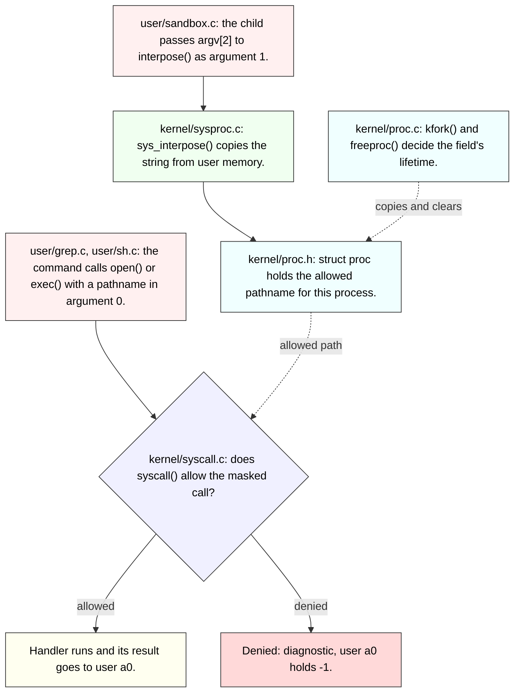

# Lab syscall: Deriving Sandbox with allowed pathnames

Derive the pathname exception from MIT's [2026 system-call lab](https://pdos.csail.mit.edu/6.1810/2026/labs/syscall.html). It extends the mask sandbox, so finish [Sandbox a command](13-syscall-sandbox.md) first; this guide explains existing code and asks implementation questions, and it leaves the kernel changes to you.

---

[toc]

---

## What the exercise asks: the pathname contract

**Scope: one allowed pathname that can override an `open` or `exec` denial.** Everything the mask exercise established — bit meaning, rejection before dispatch, `kfork` inheritance, `freeproc` reset — stays in force and is owned by [the mask note's contract](13-syscall-sandbox.md#what-the-exercise-asks-the-sandbox-contract).

| Aspect                 | Contract                                                                                                        | Authority                                                                  |
| ---------------------- | --------------------------------------------------------------------------------------------------------------- | -------------------------------------------------------------------------- |
| **Second argument**    | `interpose(mask, path)` now records `path` as the one allowed pathname.                                         | Handout                                                                    |
| **Exception scope**    | Only `open` and `exec` get the exception, and only when their bit is set in the mask.                           | Handout                                                                    |
| **Match result**       | A masked `open` or `exec` whose pathname matches the allowed one runs normally; a mismatch is denied as before. | Handout                                                                    |
| **Unmasked calls**     | A call whose bit is clear runs whatever its arguments are; the pathname never adds a restriction.               | Handout: the path only ever allows                                         |
| **Other masked calls** | Every masked call other than `open` and `exec` is still denied; the pathname does not apply to them.            | Handout, exercised by `sandbox_most`                                       |
| **Inheritance**        | Children inherit the pathname exactly as they inherit the mask.                                                 | Handout                                                                    |
| **Storage**            | Keep the pathname in a `MAXPATH`-sized buffer in `struct proc`, fetched with `argstr`.                          | Handout hint                                                               |
| **`-` as a path**      | The previous exercise passed `-` as a placeholder; the handout gives it no special meaning here.                | Handout; see [the `-` question](#deriving-the-changes-decisions-and-traps) |
| **Fresh processes**    | A recycled slot must not keep the previous occupant's pathname.                                                 | Repository lifecycle invariant, as in the mask note                        |

### Outcomes the contract defines

**This table states the required outcome for each case; it is the specification, not an ordering of statements.**

| Bit for `num` set in mask? | `num` is `SYS_open` or `SYS_exec`? | Argument 0 equals the allowed path? | Required outcome                   |
| -------------------------- | ---------------------------------- | ----------------------------------- | ---------------------------------- |
| **No**                     | Any                                | Not consulted                       | Run the handler                    |
| **Yes**                    | No                                 | Not consulted                       | Deny: diagnostic, user `a0` = `-1` |
| **Yes**                    | Yes                                | Yes                                 | Run the handler                    |
| **Yes**                    | Yes                                | No, or the string cannot be fetched | Deny: diagnostic, user `a0` = `-1` |

> [!IMPORTANT]
> **The pathname is consulted only for the call being dispatched now, `num`.** Whether `open`'s bit is set in the mask is a different question from whether the current call _is_ `open`. Confusing the two applies a string comparison to `write`, `exit`, and every other call.

### Grader assertions and their limits

**Read the Python bodies in [`grade-lab-syscall`](../../grade-lab-syscall).** The three tests below exercise the pathname; `sandbox_mask` and `sandbox_fork` from [the mask note](13-syscall-sandbox.md#grader-assertions-and-their-limits) must keep passing, and all five share the `make grade` sandbox block.

| Test                | Points | Guest commands                                                                                                                                           | Positive assertions                                      | Negative assertions                        |
| ------------------- | ------ | -------------------------------------------------------------------------------------------------------------------------------------------------------- | -------------------------------------------------------- | ------------------------------------------ |
| **`sandbox_path`**  | 5      | `sandbox 32768 README grep xv6 README`, `cat README > x`, `sandbox 32768 README grep xv6 x`, `sandbox 32768 x grep xv6 x`, `sandbox 128 sh sh < exec.sh` | Exactly 12 `xv6`; a line beginning `grep: cannot open x` | Zero `hello world!`; zero `exec ls failed` |
| **`sandbox_most`**  | 5      | `sandbox 2147483643 grep grep xv6 README`                                                                                                                | Exactly 2 `xv6`                                          | Zero `exec` anywhere in the transcript     |
| **`sandbox_minus`** | 5      | `echo hello! > ---`, `sandbox 32768 --- grep hello! ---`                                                                                                 | Exactly 3 `hello!`                                       | The count also fails on extra occurrences  |

**Where the counts come from**, read from transcripts captured with a passing build:

| Count                  | Contributors                                                                                                                                                      |
| ---------------------- | ----------------------------------------------------------------------------------------------------------------------------------------------------------------- |
| **12 `xv6` (path)**    | `xv6 kernel is booting` (1) + three echoed command lines containing `xv6` (3) + README's four matching lines, printed once for `README` and once for `x` (4 + 4). |
| **2 `xv6` (most)**     | The boot banner and the echoed command line. `grep` itself must print nothing.                                                                                    |
| **3 `hello!` (minus)** | Two echoed command lines and `grep`'s one output line from `---`.                                                                                                 |

**What `2147483643` means.** It is `0x7ffffffb`: every bit from 0 to 30 except bit 2, `SYS_exit`. With the allowed path `grep`, the sandboxed child may `exec` grep and `exit`, and nothing else: its `open("README")` mismatches, so grep tries to print `grep: cannot open README`, and the 25 single-character `write` calls are each denied. The captured transcript shows `sys call 15 is forbidden` once and `sys call 16 is forbidden` 25 times. The zero-`exec` assertion therefore requires the `exec` of grep to **succeed** (no `sandbox: exec grep failed`) and the kernel diagnostic to avoid the word `exec`.

| Evidence                 | Limit                                                                                                                                                                                                                                                                                                                                                  |
| ------------------------ | ------------------------------------------------------------------------------------------------------------------------------------------------------------------------------------------------------------------------------------------------------------------------------------------------------------------------------------------------------ |
| **`exec ls failed` = 0** | Not a behavioral requirement in practice. The inner `sh` started by `sandbox 128 sh sh` prints `$ ` before reading `exec.sh` (`getcmd()` in `user/sh.c` always writes the prompt), so `shell_script` sees a prompt after its last command and stops QEMU. The captured transcript ends at `$ ` before the inner shell's `exec echo failed` can appear. |
| **`hello world!` = 0**   | Holds for the same timing reason, and also because `exec("echo")` mismatches `sh`. It does not separately prove the second half.                                                                                                                                                                                                                       |
| **Aggregated counts**    | Counts are over the whole transcript, so a missing line in one command can be offset by an extra line elsewhere.                                                                                                                                                                                                                                       |
| **Untested cases**       | No test checks the pathname of `exec` under mask `128` with a matching path that later opens files, a pathname of exactly `-`, a 127-byte path, inheritance of the path through a nested fork, or slot reuse.                                                                                                                                          |
| **Diagnostic text**      | Only `sandbox_most` constrains it, and only by forbidding the substring `exec`.                                                                                                                                                                                                                                                                        |

General transcript handling belongs to [the lab workflow](../03-lab-workflow.md#run-graders-and-interpret-failure-transcripts).

## Prerequisites and shared-document ownership

| When                      | Read                                                                                                                                                      | Use here                                                                               |
| ------------------------- | --------------------------------------------------------------------------------------------------------------------------------------------------------- | -------------------------------------------------------------------------------------- |
| **Read first**            | [Sandbox a command](13-syscall-sandbox.md), through its verification section                                                                              | The mask, the dispatch boundary, the stub-to-handler path, and `struct proc` lifetime. |
| **Read first**            | [System-call arguments and user memory](../11-os-design-in-xv6.md#system-call-arguments-and-user-memory)                                                  | Why a pathname is a user address that `argstr` copies, never a pointer to dereference. |
| **Consult for semantics** | [xv6 system-call reference](../05-syscall-reference.md)                                                                                                   | `open` and `exec` signatures; `interpose` there still describes the mask-only state.   |
| **Consult for the ABI**   | [The mask note's dispatch section and the register table after it](13-syscall-sandbox.md#existing-dispatch-branches-before-sandboxing)                    | Which saved register holds argument 0 and argument 1.                                  |
| **Consult for setup**     | [Build conventions](../02-build-boot-and-usage.md#adding-and-running-a-user-exercise) and [lab selection](../03-lab-workflow.md#the-lab-switch-conflabmk) | `conf/lab.mk` must say `LAB=syscall`.                                                  |

**Book-source reading:** “Code: System call arguments” in `../xv6-riscv-book/trap.tex` covers `argstr` and `fetchstr`. [The Chapter 4 note](../book/ch04-traps-and-system-calls.md) is still a placeholder, so the mask note and the OS-design note hold that material on loan.

## Setup differences in this checkout

| Item                    | What to check                                                                                                                                                                                         |
| ----------------------- | ----------------------------------------------------------------------------------------------------------------------------------------------------------------------------------------------------- |
| **No kernel `strcmp`**  | `kernel/string.c` and its `defs.h` block declare `strncmp`, `strlen`, `safestrcpy`, `memcmp`, and others, but not `strcmp`. A call to `strcmp` fails the `-Werror` build with “implicit declaration”. |
| **Diagnostic routine**  | Kernel output uses `printk` in `kernel/printk.c`.                                                                                                                                                     |
| **Fork implementation** | The kernel routine is `kfork()` in `kernel/proc.c`.                                                                                                                                                   |
| **`sh` prompt**         | `getcmd()` in `user/sh.c` writes `$ ` even when reading a script, which causes the [`exec ls failed` timing limit](#grader-assertions-and-their-limits).                                              |

## Code to read first: each file's responsibility



_Palette for both figures: pink means request, lavender means routing or decision, green means data movement, yellow means processing, cyan means stored state, and red means denial. Every node also carries its meaning in text._

**The figure shows where the pathname travels, not the order of the checks.** The decision node's rule is the [outcome table](#outcomes-the-contract-defines); deciding how to express it is the exercise.

| Source                                                                            | What to inspect                                                                                  | What it does not supply                                           |
| --------------------------------------------------------------------------------- | ------------------------------------------------------------------------------------------------ | ----------------------------------------------------------------- |
| [`user/sandbox.c`](../../user/sandbox.c)                                          | `argv[mask+1]` is passed as `interpose`'s second argument; `n` skips it before building `nargv`. | Any pathname validation                                           |
| [`kernel/sysfile.c`](../../kernel/sysfile.c)                                      | `sys_open` and `sys_exec` both read the pathname with `argstr(0, path, MAXPATH)`.                | A pathname for any call other than these (and `link`, `mkdir`, …) |
| [`kernel/syscall.c`](../../kernel/syscall.c)                                      | `argstr`, `fetchstr`, and the existing mask check in `syscall()`.                                | A string comparison                                               |
| [`kernel/string.c`](../../kernel/string.c)                                        | `strncmp`, `safestrcpy`, `strlen`.                                                               | `strcmp`                                                          |
| [`kernel/exec.c`](../../kernel/exec.c)                                            | `kexec` resolves the program with `namei(path)` directly.                                        | A `sys_open` call: loading a binary is not an `open` syscall      |
| [`kernel/proc.h`](../../kernel/proc.h) and [`kernel/proc.c`](../../kernel/proc.c) | `struct proc`, `kfork`, `freeproc`, where the mask already lives.                                | Copying or clearing an array member automatically                 |
| [`kernel/param.h`](../../kernel/param.h)                                          | `MAXPATH` is `128`.                                                                              | A guarantee that every user path fits                             |

## Existing code walkthrough: where `open` and `exec` keep their pathname

**Both target calls put the pathname in argument 0, and both fetch it the same way.** From `sys_open()` in [`kernel/sysfile.c`](../../kernel/sysfile.c):

```c
  argint(1, &omode);
  if ((n = argstr(0, path, MAXPATH)) < 0)
    return -1;
```

From `sys_exec()` in the same file:

```c
  argaddr(1, &uargv);
  if (argstr(0, path, MAXPATH) < 0) {
    return -1;
  }
```

| Call   | Argument 0 (`a0`)       | Argument 1 (`a1`)                                     |
| ------ | ----------------------- | ----------------------------------------------------- |
| `open` | Pathname string address | `omode` integer                                       |
| `exec` | Pathname string address | Address of the `argv` **pointer array**, not a string |

> [!WARNING]
> **`exec`'s argument 1 is not a string.** `argstr(1, …)` on an `exec` call copies the bytes of the `argv` pointer array as if they were characters; it is the pathname in argument 0 that `kexec` resolves.

**`argstr` returns the length or `-1`.** It reads the saved register with `argaddr`, then `fetchstr` calls `copyinstr`, which fails on an unmapped address or a string with no terminator within `max` bytes. A failed fetch is a distinct outcome: the [outcome table](#outcomes-the-contract-defines) treats it as a mismatch.

**`argstr` can be called before the handler runs.** It reads only the saved trapframe and user memory, so the dispatcher can inspect a call's arguments without dispatching it. The handler will fetch the same string again; nothing is consumed.

### The comparator this tree provides: `strncmp`

**`strcmp` is absent, so the comparison will use `strncmp`.** From [`kernel/string.c`](../../kernel/string.c):

```c
int
strncmp(const char *p, const char *q, uint n)
{
  while (n > 0 && *p && *p == *q)
    n--, p++, q++;
  if (n == 0)
    return 0;
  return (uchar)*p - (uchar)*q;
}
```

1. **The loop stops at the first difference, at a `NUL` in `p`, or after `n` bytes.** Reaching a `NUL` in `p` with `q` still matching means both end there, so the subtraction yields `0`.
2. **`n == 0` reports equal.** A bound smaller than the strings compares only a prefix: `strncmp("README", "READ", 4)` returns `0`.
3. **The final subtraction distinguishes `"x"` from `"xy"`.** With a bound larger than both strings, the shorter one's `NUL` meets a non-`NUL` and the result is non-zero.

`namecmp()` in `kernel/fs.c` is `strncmp(s, t, DIRSIZ)`, a 14-byte directory-entry compare; it is the wrong bound for a full pathname.

## Concepts underneath: textual matching and string lifetime

### A pathname match is textual, not a file identity

| Allowed path | Call's argument         | Same file?         | Textual match? |
| ------------ | ----------------------- | ------------------ | -------------- |
| `README`     | `README`                | Yes                | Yes            |
| `README`     | `./README`              | Yes                | **No**         |
| `README`     | `/README` (cwd `/`)     | Yes                | **No**         |
| `x`          | `x` after `ln README x` | Different file now | **Yes**        |

**The handout asks for a pathname match, and the tests use identical spellings.** A string compare is what passes. It is not a capability on a file: the same file under another spelling is denied, and a different file renamed or linked to the allowed name is permitted. Comparing inodes would need `namei` inside the dispatcher and would still race with a later `unlink`/`link`; that is outside this exercise.

### The stored string must be kernel memory owned by the process

| Option                           | What survives `exec`?                                            |
| -------------------------------- | ---------------------------------------------------------------- |
| **User address of the string**   | Nothing: `kexec` replaces the address space that held it.        |
| **Kernel copy in `struct proc`** | The bytes, until `freeproc` or another `interpose` changes them. |
| **Global buffer**                | Shared by every process, which breaks per-process scope.         |

**Copy the bytes during `interpose`.** `sandbox` calls `interpose` and then `exec`, so a remembered user pointer would refer to memory that no longer exists when grep calls `open`. An array member is part of the `struct proc` slot, exactly like the mask in [the mask note's layout figure](13-syscall-sandbox.md#a-mask-contains-positions-not-syscall-numbers), and needs the same explicit `kfork` and `freeproc` treatment.

**`kfork` copies nothing by default.** A plain assignment cannot copy a C array; choose a string or byte copy with an explicit size bound.

## Deriving the changes: decisions and traps

**Work from the [contract](#what-the-exercise-asks-the-pathname-contract) and the [outcome table](#outcomes-the-contract-defines).** Each question names the file that answers it.

- [ ] **Storage:** What size does `kernel/param.h` give, and where in `struct proc` (`kernel/proc.h`) does the buffer belong?
- [ ] **Fetching:** In `sys_interpose` (`kernel/sysproc.c`), what does `argstr` return when the user string is unreadable or too long, and should a failed fetch leave the mask or the old pathname partly changed?
- [ ] **Lifetime:** Which lines of `kfork` and `freeproc` (`kernel/proc.c`) need a counterpart for the new member, and why is a string copy with a bound needed rather than `=`?
- [ ] **Which call:** In `syscall()` (`kernel/syscall.c`), which variable names the call being dispatched, and which expression asks “is this bit set in the mask”? Which question gates the pathname check?
- [ ] **Which argument:** For both `open` and `exec`, which `argstr` index holds the pathname (`kernel/sysfile.c`)?
- [ ] **Comparator:** Which `kernel/string.c` function exists, and what bound makes it a full comparison rather than a prefix test?
- [ ] **Fall-through:** After an allowed pathname, does control still reach the same `syscalls[num]()` call as an unmasked call, and does every denied path still reach the diagnostic and `-1`?
- [ ] **Placeholder `-`:** With a plain textual match, what happens if a sandboxed program opens a file literally named `-`? Is that acceptable, given `sandbox_minus` requires `---` to work?

| Trap                                                  | Consequence                                                                                                                                        | Evidence to inspect                                                                                      |
| ----------------------------------------------------- | -------------------------------------------------------------------------------------------------------------------------------------------------- | -------------------------------------------------------------------------------------------------------- |
| **Testing `mask & (1 << SYS_open)` instead of `num`** | Every call, including `write` and `exit`, is string-compared whenever `open` is masked; `exit(0)`'s argument 0 is not a pathname, so it is denied. | The [IMPORTANT callout](#outcomes-the-contract-defines)                                                  |
| **An `if / else if` chain on mask bits**              | When `open`'s bit matches first, `exec`'s branch and the generic mask check never run, so other masked calls go through unchecked or mis-checked.  | `sandbox_most` mask `0x7ffffffb`                                                                         |
| **Reading `exec`'s pathname from argument 1**         | The `argv` pointer array is compared as text; a matching `exec` is denied.                                                                         | `sys_exec` in `kernel/sysfile.c`                                                                         |
| **Calling `strcmp`**                                  | Build fails under `-Werror`: implicit declaration.                                                                                                 | `kernel/defs.h` string block                                                                             |
| **A short `strncmp` bound**                           | Prefix match: with bound `4`, `README` and `READ` compare equal in either argument order.                                                          | `strncmp` walkthrough above                                                                              |
| **Storing the user pointer**                          | `exec` replaces the memory; the comparison reads garbage or faults.                                                                                | `kexec` in `kernel/exec.c`                                                                               |
| **Forgetting `kfork` or `freeproc`**                  | Children lose their exception, or a recycled slot inherits one.                                                                                    | The mask note's [`kfork` field table](13-syscall-sandbox.md#why-kfork-copies-struct-proc-field-by-field) |
| **Treating `-` as a prefix flag** (`path[0] == '-'`)  | `---` is treated as “no path”, and `sandbox_minus` fails its `hello!` count.                                                                       | `sandbox_minus`                                                                                          |
| **The word `exec` in the kernel diagnostic**          | `sandbox_most` fails even with correct enforcement.                                                                                                | `sandbox_most` negative assertion                                                                        |
| **Checking the path on unmasked calls**               | Normal `open` calls fail for processes that only masked `exec`.                                                                                    | Outcome table, first row                                                                                 |

## Verification: build, guest checks, and grading

### Build and guest observations

```bash
cat conf/lab.mk   # LAB=syscall
make qemu
```

In the xv6 guest:

```text
sandbox 32768 README grep xv6 README
cat README > x
sandbox 32768 README grep xv6 x
sandbox 32768 x grep xv6 x
sandbox 128 sh sh < exec.sh
sandbox 2147483643 grep grep xv6 README
echo hello! > ---
sandbox 32768 --- grep hello! ---
cat README
```

**Watch the inner shell finish in the guest.** Under `sandbox 128 sh sh < exec.sh`, the inner shell's `exec echo failed` and `exec ls failed` lines **should** appear interactively: `exec` of `echo` and `ls` mismatches `sh`. The grader stops before them, so this manual run is the only place that behavior is visible. The final unrestricted `cat README` checks that no pathname leaked into the shell.

### Edge-case probes: what the allowed pathname is and is not

> [!WARNING]
> **The allowed pathname is not "the file the command may open".** It is compared with argument 0 of whichever call is being dispatched, but only when that call's bit is set and the call is `open` or `exec`. With mask `128` it names the **program** `exec` may load; with mask `32768` it names the **file** `open` may open; with both bits it must name both, so one string almost never satisfies both.

**Each row isolates one rule from the [outcome table](#outcomes-the-contract-defines).** Run them in a fresh guest after `make qemu`; `x` does not exist yet unless you ran the earlier list.

| #      | Command                                                         | Correct result                                             | Rule it isolates                                                                                |
| ------ | --------------------------------------------------------------- | ---------------------------------------------------------- | ----------------------------------------------------------------------------------------------- |
| **1**  | `sandbox 0 nosuchfile grep xv6 README`                          | 4 `xv6` lines                                              | Mask `0`: the path is never consulted, even a nonsense one.                                     |
| **2**  | `sandbox 32768 README grep xv6 README README`                   | 8 `xv6` lines                                              | The exception is not single-use; every matching `open` passes.                                  |
| **3**  | `sandbox 32768 README cat x`                                    | `sys call 15 is forbidden`, `cat: cannot open x`           | A different file is denied by the kernel, before `x`'s existence matters.                       |
| **4**  | `sandbox 32768 ./README grep xv6 README`                        | `sys call 15 is forbidden`, `grep: cannot open README`     | Textual match: `./README` and `README` are the same file but different strings.                 |
| **5**  | `sandbox 32768 README grep xv6 ./README`                        | `sys call 15 is forbidden`, `grep: cannot open ./README`   | The same rule from the other side.                                                              |
| **6**  | `sandbox 32768 READ grep xv6 README`                            | `sys call 15 is forbidden`, `grep: cannot open README`     | Full-string compare: a prefix is not a match.                                                   |
| **7**  | `sandbox 32768 - cat -`                                         | `cat: cannot open -` with **no** kernel line               | `-` is ordinary text: `open("-")` is allowed and fails only because the file is missing.        |
| **8**  | `sandbox 128 grep grep xv6 README`                              | 4 `xv6` lines                                              | Exec masked: the path names the **program**. `open` is unmasked, so `README` is never compared. |
| **9**  | `sandbox 128 cat grep xv6 README`                               | `sys call 7 is forbidden`, `sandbox: exec grep failed`     | A different program is denied.                                                                  |
| **10** | `sandbox 128 README grep xv6 README`                            | `sys call 7 is forbidden`, `sandbox: exec grep failed`     | Naming the data file does not help when only `exec` is masked.                                  |
| **11** | `sandbox 32768 grep grep xv6 README`                            | `sys call 15 is forbidden`, `grep: cannot open README`     | Open masked: naming the program does not help; `exec` is unmasked and runs regardless.          |
| **12** | `sandbox 32896 README grep xv6 README`                          | `sys call 7 is forbidden`, `sandbox: exec grep failed`     | Both masked: the file name fails at `exec`, before `open` is ever reached.                      |
| **13** | `sandbox 32896 grep grep xv6 README`                            | `sys call 15 is forbidden`, `grep: cannot open README`     | Both masked: the program name passes `exec`, then fails at `open`.                              |
| **14** | `echo cat README > c.sh`, then `sandbox 32768 README sh < c.sh` | `sys call 15 is forbidden` from `sh`, then the full README | Inheritance: `sh`'s own `open("console")` is denied, but its forked `cat` inherits `README`.    |

**Captured from a passing reference build** (all five pathname-related grader tests pass), run through `gradelib`'s `shell_script` on a fresh `fs.img`. The leading number in each kernel line is the pid and varies between runs; the diagnostic text after it is whatever your `printk` prints. Row 14's README is truncated here.

```text
$ sandbox 0 nosuchfile grep xv6 README
xv6 is a re-implementation of Dennis Ritchie's and Ken Thompson's Unix
Version 6 (v6).  xv6 loosely follows the structure and style of v6,
xv6 is inspired by John Lions's Commentary on UNIX 6th Edition (Peer
(kaashoek,rtm@mit.edu).  The main purpose of xv6 is as a teaching
$ sandbox 32768 README grep xv6 README README
xv6 is a re-implementation of Dennis Ritchie's and Ken Thompson's Unix
Version 6 (v6).  xv6 loosely follows the structure and style of v6,
xv6 is inspired by John Lions's Commentary on UNIX 6th Edition (Peer
(kaashoek,rtm@mit.edu).  The main purpose of xv6 is as a teaching
xv6 is a re-implementation of Dennis Ritchie's and Ken Thompson's Unix
Version 6 (v6).  xv6 loosely follows the structure and style of v6,
xv6 is inspired by John Lions's Commentary on UNIX 6th Edition (Peer
(kaashoek,rtm@mit.edu).  The main purpose of xv6 is as a teaching
$ sandbox 32768 README cat x
8 cat: sys call 15 is forbidden
cat: cannot open x
$ sandbox 32768 ./README grep xv6 README
10 grep: sys call 15 is forbidden
grep: cannot open README
$ sandbox 32768 README grep xv6 ./README
12 grep: sys call 15 is forbidden
grep: cannot open ./README
$ sandbox 32768 READ grep xv6 README
14 grep: sys call 15 is forbidden
grep: cannot open README
$ sandbox 32768 - cat -
cat: cannot open -
$ sandbox 128 grep grep xv6 README
xv6 is a re-implementation of Dennis Ritchie's and Ken Thompson's Unix
Version 6 (v6).  xv6 loosely follows the structure and style of v6,
xv6 is inspired by John Lions's Commentary on UNIX 6th Edition (Peer
(kaashoek,rtm@mit.edu).  The main purpose of xv6 is as a teaching
$ sandbox 128 cat grep xv6 README
20 sandbox: sys call 7 is forbidden
sandbox: exec grep failed
$ sandbox 128 README grep xv6 README
22 sandbox: sys call 7 is forbidden
sandbox: exec grep failed
$ sandbox 32768 grep grep xv6 README
24 grep: sys call 15 is forbidden
grep: cannot open README
$ sandbox 32896 README grep xv6 README
26 sandbox: sys call 7 is forbidden
sandbox: exec grep failed
$ sandbox 32896 grep grep xv6 README
28 grep: sys call 15 is forbidden
grep: cannot open README
$ echo cat README > c.sh
$ sandbox 32768 README sh < c.sh
31 sh: sys call 15 is forbidden
xv6 is a re-implementation of Dennis Ritchie's and Ken Thompson's Unix
Version 6 (v6).  xv6 loosely follows the structure and style of v6,
but is implemented for a modern RISC-V multiprocessor using ANSI C.
...
```

**Read the process name in each kernel line.** `sandbox: sys call 7` means the wrapper's child was refused at `exec`, so the command never started. `grep: sys call 15` means the command did start and was refused at `open`. If a row that should show `grep:` shows `sandbox:` instead, your check is comparing the path for a call whose bit is not set.

| Symptom in these probes                                         | Likely cause                                                                    |
| --------------------------------------------------------------- | ------------------------------------------------------------------------------- |
| **Rows 2–7 or 14 print `sandbox: sys call 7`**                  | `exec` is path-checked although only `open`'s bit is set.                       |
| **Row 8 prints `grep: sys call 15`**                            | `open` is path-checked although only `exec`'s bit is set.                       |
| **Row 6 prints README's lines**                                 | The comparison bound is the allowed path's length, so a prefix matches.         |
| **Rows 8 and 13 print `sandbox: exec grep failed`**             | `exec`'s path is read from argument 1, the `argv` array, instead of argument 0. |
| **Row 7 prints a kernel line**                                  | `-` is treated specially or the comparison is wrong for one-character paths.    |
| **Row 14 shows two kernel lines and `cat: cannot open README`** | The pathname is not copied in `kfork()`.                                        |

### Focused grader commands

Exit QEMU with `Ctrl-a`, then `x`, before grading.

```bash
./grade-lab-syscall sandbox_path sandbox_most sandbox_minus
./grade-lab-syscall sandbox_mask sandbox_fork
```

Interpret results with the [assertion table and limits](#grader-assertions-and-their-limits). `xv6.out` holds the last test's transcript; the per-call `sys call N is forbidden` lines show which calls the kernel denied.

### Optional GDB observation

**Stop where the pathname is compared.** Follow [the GDB setup](12-syscall-using-gdb.md), `break syscall`, and in the guest run `sandbox 32768 README grep xv6 x`. After `p` is initialised:

```gdb
print p->trapframe->a7
print p->mask
print p->filepath
```

At `a7 == 15`, inspect the user string through your kernel copy after `argstr` runs, not through `p->trapframe->a0`, which is a user virtual address the kernel page table does not map. `filepath` is whatever name you gave the new member.

## Questions to answer from the source

1. Why must the allowed pathname be copied into kernel memory during `interpose`, given what `sandbox.c` does next?
2. Why does `exec` of `grep` under mask `32768` (open only) succeed even though `kexec` opens the binary file?
3. **Failure:** with mask `32768` and the allowed path `README`, the process calls `exit(0)`. Under a design that tests `open`'s bit instead of `num`, what does `argstr(0, …)` read, and what happens to the process?
4. Which bound passed to `strncmp` turns it into a full equality test, and which bound makes `README` match `READ`?
5. **Failure:** `freeproc` clears the mask but not the pathname. Can a later unrelated process be affected, and if not, why might it still matter?
6. Why does `sandbox_path` assert zero `exec ls failed` even though a correct kernel would deny `exec("ls")` under `sandbox 128 sh`?
7. In `sandbox_most`, why are there exactly 25 denied `write` calls, and why must the kernel diagnostic avoid one particular word?
8. Allowed path `x` and `ln README x` (after removing the old `x`): what does the sandbox now permit, and what does that say about textual matching?
