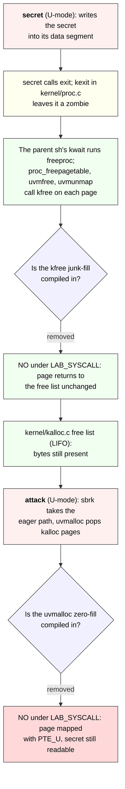
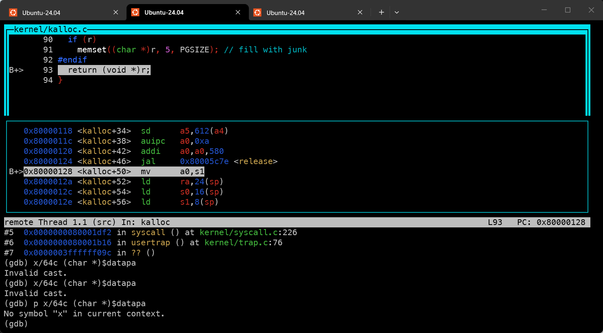

# Lab syscall: Deriving Attack xv6

Derive the memory-disclosure exercise from MIT's [2026 system-call lab](https://pdos.csail.mit.edu/6.1810/2026/labs/syscall.html). This lab deliberately removes three lines of defensive zeroing from the kernel; the exercise is to show that the removal leaks one process's data to the next. This guide explains the existing code and the page lifecycle, then asks the implementation questions. It leaves `user/attack.c` to you.

---

[toc]

---

## What the exercise asks: the attack contract

**Scope: read freed memory from user space only.** You write `user/attack.c` so that, after `secret` has run and exited, `attack` finds the secret string that `secret` left behind in physical memory and prints it on a line by itself. The leak exists because this lab omits the kernel's page-scrubbing; you exploit it without changing the kernel or `secret.c`.

| Aspect                   | Contract                                                                                                         | Authority                                                                                                |
| ------------------------ | ---------------------------------------------------------------------------------------------------------------- | -------------------------------------------------------------------------------------------------------- |
| **Target file**          | Add a few lines to `user/attack.c` only.                                                                         | Handout                                                                                                  |
| **No kernel edits**      | The attack must not depend on changes to the kernel or to `user/secret.c`; revert any experiment before grading. | Handout                                                                                                  |
| **Output**               | Print the recovered secret on a line by itself.                                                                  | Handout and grader regex                                                                                 |
| **Secret alphabet**      | Test secrets contain only digits and upper- and lower-case letters.                                              | Handout                                                                                                  |
| **Two attempts allowed** | The grader runs `attack` twice; either run printing the secret passes. You may need the second run.              | Handout and grader script                                                                                |
| **User-space mechanism** | Acquire memory through the ordinary user allocator and inspect it; you may not read kernel memory.               | Handout; enforced by `PTE_U` on user pages                                                               |
| **Build and C style**    | `attack` and `secret` are already registered; follow the house C style for the code you add.                     | Repository; see [program registration](../02-build-boot-and-usage.md#adding-and-running-a-user-exercise) |

### Grader assertions and their limits

**Read the test body in [`grade-lab-syscall`](../../grade-lab-syscall), not just its name.** The exercise's single test is `attack`, worth 14 points.

| Test         | Points | Guest commands                                                              | Positive assertion                                            | Negative assertions |
| ------------ | ------ | --------------------------------------------------------------------------- | ------------------------------------------------------------- | ------------------- |
| **`attack`** | 14     | `secret <random>`, then `attack`, then `attack` (secret is `random_str(8)`) | A line matching regex `^<secret>.*` appears in the transcript | None                |

| Evidence                 | Limit                                                                                                                                                                              |
| ------------------------ | ---------------------------------------------------------------------------------------------------------------------------------------------------------------------------------- |
| **Anchored prefix only** | The regex is `^<secret>.*`: the secret must start a line, but trailing bytes on that line are not checked. Printing the marker first, on the same line, would fail the `^` anchor. |
| **Either attempt**       | The transcript is scanned as a whole; a match from the first or the second `attack` passes. The grader does not assert which run matched or that both did.                         |
| **Random 8-char secret** | `random_str(8)` draws from `string.ascii_letters + string.digits`, so the secret is exactly 8 alphanumeric bytes with no spaces or newline inside it.                              |
| **No breakpoints**       | The test installs no `stop_breakpoint`; it proves only that the secret reached the console, not how your program found it.                                                         |

General grading mechanics and transcript handling belong to [the lab workflow](../03-lab-workflow.md#run-graders-and-interpret-failure-transcripts).

## Prerequisites and shared-document ownership

| When                       | Read                                                                                                                       | Use here                                                                                  |
| -------------------------- | -------------------------------------------------------------------------------------------------------------------------- | ----------------------------------------------------------------------------------------- |
| **Read first**             | [Chapter 3: Page tables](../book/ch03-page-tables.md) and its [process-layout figure](../book/ch03-page-tables.md#figures) | See where a user program's `data`/`bss` and heap live, and that user pages carry `PTE_U`. |
| **Read first**             | [Memory growth with `sbrk`](../05-syscall-reference.md#memory-growth-with-sbrk-sbrklazy-and-syssbrk)                       | Know what `sbrk` returns and that plain `sbrk()` is eager.                                |
| **Read first**             | [Chapter 2: OS organization](../book/ch02-operating-system-organization.md)                                                | Understand process isolation, which this bug breaks across time rather than space.        |
| **Consult for the ABI**    | [The sleep note's trap foundation](01-util-sleep.md#the-foundation-a-c-call-that-becomes-a-trap)                           | Recall how a user call reaches `sys_sbrk` through the trap path.                          |
| **Consult for allocation** | [Chapter 5: Page faults](../book/ch05-page-faults.md)                                                                      | Distinguish eager allocation from the lazy `vmfault` path, which still zeroes.            |

**Book-source reading:** Chapter 3's allocator and page-table material is in `../xv6-riscv-book/mem.tex`; the physical allocator is `kalloc`/`kfree` in `kernel/kalloc.c`. The Chapter 3 and Chapter 5 notes are placeholders; the OSTEP concordance and the sources cited below hold the mechanism on loan. This note owns only the attack decisions.

## Setup differences in this checkout

| Item                               | What to check                                                                                                                                                                                                                                                                                                                                                                                                                                                                                                               |
| ---------------------------------- | --------------------------------------------------------------------------------------------------------------------------------------------------------------------------------------------------------------------------------------------------------------------------------------------------------------------------------------------------------------------------------------------------------------------------------------------------------------------------------------------------------------------------- |
| **The three removed lines**        | `grep -rn LAB_SYSCALL kernel` shows the guards: a `memset(pa, 1, PGSIZE)` in `kfree`, a `memset((char *)r, 5, PGSIZE)` in `kalloc`, and a `memset(mem, 0, PGSIZE)` in `uvmalloc` are each compiled out when `LAB=syscall`.                                                                                                                                                                                                                                                                                                  |
| **Where `LAB_SYSCALL` comes from** | `conf/lab.mk` sets `LAB=syscall`; the Makefile's `ifdef LAB` block uppercases it and appends `-DSOL_SYSCALL -DLAB_SYSCALL` to `XCFLAGS`, which every kernel and user compile inherits. Changing `conf/lab.mk` and running `make clean` is the only switch. Confirm with `make -B -n kernel/vm.o \| grep -o -- '-DLAB_[A-Z]*'`; see [the lab switch](../03-lab-workflow.md#the-lab-switch-conflabmk) and [the Makefile tour's build variables](../08-makefile-tour.md#build-variables-lab-selection-objects-flags-and-qemu). |
| **Lazy path still zeroes**         | `vmfault` in `kernel/vm.c` keeps its `memset((void *)mem, 0, PGSIZE)`. Only the eager `sbrk`/`exec` path leaks. See the trap table below.                                                                                                                                                                                                                                                                                                                                                                                   |
| **Program registration**           | `user/attack.c` and `user/secret.c` exist and are already in `UPROGS` (`$U/_attack`, `$U/_secret` in the [Makefile](../../Makefile)). You only edit `attack.c`.                                                                                                                                                                                                                                                                                                                                                             |
| **Diagnostic routine**             | Kernel diagnostics use `printk` in `kernel/printk.c`, not `printf`.                                                                                                                                                                                                                                                                                                                                                                                                                                                         |

## Code to read first: each file's responsibility

| Source                                       | What to inspect                                                                                                                       | What it does not supply                            |
| -------------------------------------------- | ------------------------------------------------------------------------------------------------------------------------------------- | -------------------------------------------------- |
| [`user/secret.c`](../../user/secret.c)       | Where in its address space it stores the secret, what recognizable bytes sit near it, and that it `exit`s (freeing everything)        | The attacker's view; you may not change it         |
| [`user/attack.c`](../../user/attack.c)       | The starter `main` you fill in; it already includes `kernel/riscv.h` for `PGSIZE`                                                     | Any policy on which pages you receive              |
| [`kernel/kalloc.c`](../../kernel/kalloc.c)   | `kalloc`/`kfree` and the two `#ifndef LAB_SYSCALL` scrub lines; the free list is LIFO                                                 | Which virtual address a page maps to               |
| [`kernel/vm.c`](../../kernel/vm.c)           | `uvmalloc` (eager, scrub removed) versus `vmfault` (lazy, still zeroes)                                                               | The user-facing `sbrk` wrapper                     |
| [`kernel/sysproc.c`](../../kernel/sysproc.c) | `sys_sbrk`: `SBRK_EAGER` and negative `n` go through `growproc`                                                                       | The free-list ordering across processes            |
| [`kernel/proc.c`](../../kernel/proc.c)       | `kexit` makes the child a zombie; the parent's `kwait` then runs `freeproc` → `proc_freepagetable` → `uvmfree`, which frees its pages | A guarantee about which process reclaims them next |

## Existing function walkthrough: `uvmalloc`

**This is the page-allocation path that plain `sbrk()` and `exec` both use, and it is where the defensive zeroing was removed.** Quoted verbatim from [`kernel/vm.c`](../../kernel/vm.c):

```c
uint64
uvmalloc(pagetable_t pagetable, uint64 oldsz, uint64 newsz, int xperm)
{
  char *mem;
  uint64 a;

  if (newsz < oldsz)
    return oldsz;

  oldsz = PGROUNDUP(oldsz);
  for (a = oldsz; a < newsz; a += PGSIZE) {
    mem = kalloc();
    if (mem == 0) {
      uvmdealloc(pagetable, a, oldsz);
      return 0;
    }
#ifndef LAB_SYSCALL
    memset(mem, 0, PGSIZE);
#endif
    if (mappages(pagetable, a, PGSIZE, (uint64)mem, PTE_R | PTE_U | xperm) !=
        0) {
      kfree(mem);
      uvmdealloc(pagetable, a, oldsz);
      return 0;
    }
  }
  return newsz;
}
```

1. **`kalloc()` returns a page off the free list.** In `kernel/kalloc.c` the free list is a LIFO stack of `struct run`; `kfree` pushes onto the head and `kalloc` pops the head. Whatever bytes the page last held are still there.
2. **The `memset(mem, 0, PGSIZE)` is compiled out.** Under `LAB=syscall`, `LAB_SYSCALL` is defined, so the zeroing between allocation and mapping does not happen. The page is mapped into the caller with its previous contents intact.
3. **`PTE_U` is set.** The new page is a user page, readable from user mode. That is why the attacker can read it with an ordinary load and does not need the kernel's cooperation.

### The physical page's round trip

**A single physical page outlives the process that held it.** The frame travels from `secret` to the free list and back out to `attack`, carrying its bytes the whole way because nothing scrubs it.



_Palette: request `#fff0f0`, decision `#f0f0ff`, data movement `#f0fff0`, processing `#fffff0`, stall or failure `#ffd9d9`. The two diamonds are the two kernel edits this lab makes; if either scrub were present, the chain would break at that node._

## The concept underneath: allocation does not imply initialization

**Fresh memory is not blank memory.** On real hardware and in xv6, allocating a page gives you a frame that physically existed before; its contents are defined only if someone wrote them. Production kernels zero user pages on allocation precisely so a process cannot read another's leftovers. This lab removes that guarantee and asks you to demonstrate the consequence.

| Fact                                                 | Source                                                        | Portability note                                                                    |
| ---------------------------------------------------- | ------------------------------------------------------------- | ----------------------------------------------------------------------------------- |
| **`PGSIZE` is 4096**                                 | `kernel/riscv.h`; `user/attack.c` already includes it         | The attack reasons in page units; the page size is the granularity of reuse.        |
| **The free list is LIFO**                            | `kmem.freelist` push/pop in `kernel/kalloc.c`                 | Reuse order is last-freed-first-returned, not FIFO; this affects which run wins.    |
| **`kfree` overwrites a free page's first 8 bytes**   | `r->next = kmem.freelist` in `kernel/kalloc.c`                | Even without the junk-fill, bytes 0-7 of a freed page hold a list pointer.          |
| **Eager `sbrk` allocates now; lazy faults in later** | `sys_sbrk` in `kernel/sysproc.c`, `SBRK_EAGER` vs `SBRK_LAZY` | Only the eager path reaches the unscrubbed `uvmalloc`.                              |
| **`vmfault` still zeroes**                           | `memset((void *)mem, 0, PGSIZE)` in `kernel/vm.c`             | A lazily faulted page comes back blank, so it leaks nothing.                        |
| **`exec` allocates the new image before the heap**   | two `uvmalloc` calls in `kernel/exec.c`                       | `attack`'s own image load consumes free pages before your code runs; see the traps. |

> [!NOTE]
> The leak is a leak **across time**, not across the live isolation boundary. While `secret` runs, its pages are private and `PTE_U`-protected from everyone else. The window opens only after `secret` exits and the kernel hands the same frames to the next asker without wiping them.

## Deriving `user/attack.c`

Re-read [the contract](#what-the-exercise-asks-the-attack-contract), then answer these against the sources. Each question names the file that settles it; none prescribes your program's statements.

1. **Where is the secret?** Read [`user/secret.c`](../../user/secret.c). In which segment does it store the string, what fixed bytes does it place nearby, and at what byte offset from those bytes does the secret itself begin? This is what you search _for_ and how you locate the secret once you find the landmark.
2. **How much did `secret` leave behind?** Note the size of `secret`'s data buffer. How many pages' worth of freed memory could carry a copy, and does that argue for scanning more than one page?
3. **How do you get those pages?** From [`sys_sbrk`](../../kernel/sysproc.c) and [the sbrk reference](../05-syscall-reference.md#memory-growth-with-sbrk-sbrklazy-and-syssbrk): which call returns freshly mapped, _unzeroed_ pages, what does its return value point to, and why must it be the eager one?
4. **How do you recognize the secret among junk?** The secret is 8 arbitrary alphanumeric bytes with no fixed value, so you cannot match it directly. What stable landmark from question 1 can you match instead, and how does its offset give you the secret?
5. **Where does the matched line start?** The grader regex is anchored with `^`. What must be the first thing you `write`/`printf` on the secret's line, given that the landmark precedes the secret in memory?
6. **Why might one run miss?** Given the LIFO free list and that `exec` allocates `attack`'s own image from the same list (question in the trap table), why does the handout allow two attempts, and what does that imply about scanning a range rather than one exact address?

### Traps

| Trap                                         | Why it bites                                                                                                                                         | Where to look                             |
| -------------------------------------------- | ---------------------------------------------------------------------------------------------------------------------------------------------------- | ----------------------------------------- |
| **Using `sbrklazy` / lazy allocation**       | `vmfault` zeroes the page on first touch, so a lazily allocated page is blank and leaks nothing.                                                     | `vmfault` in `kernel/vm.c`                |
| **Scanning your own fresh buffer**           | A buffer in `attack`'s own `bss`/stack was set up by its `exec`, not reused from `secret`. The leak is in pages `sbrk` hands you _after_ start-up.   | `kernel/exec.c`, `kernel/vm.c`            |
| **Expecting a single deterministic address** | The free list is LIFO and `exec` consumes pages before your code runs, so the secret lands at an offset that shifts between runs. Scan a region.     | `kernel/kalloc.c`, `kernel/exec.c`        |
| **Printing the landmark first**              | The `^<secret>` anchor means the secret must begin the line. Emitting `"This may help."`-style context ahead of it on the same line fails the match. | `grade-lab-syscall` regex                 |
| **Reading past what you mapped**             | Only the bytes `sbrk` actually mapped are yours; dereferencing beyond the new break faults. Grow by a known amount and stay inside it.               | `sys_sbrk`, `growproc` in `kernel/proc.c` |
| **Leaving kernel edits in**                  | Any debugging change to `kernel/` or `secret.c` must be reverted; the grader builds the tree as submitted.                                           | Handout                                   |

## Verifying it

### Trace `secret`'s data page through `uvmalloc`, `kfree`, and `kalloc` in GDB

**Q: How can I watch `secret`'s page leave the process and come back out of the allocator before writing `attack.c`?** Stop in the kernel only: record the physical address `uvmalloc` maps at `secret`'s data page, then break on `kfree` and `kalloc` for that one address. No user symbols are needed, so the [reused-address problem](../09-debugging-xv6.md#break-source-versus-hbreak) does not arise.

| Stop                      | Breakpoint                                     | What it shows                                                            |
| ------------------------- | ---------------------------------------------- | ------------------------------------------------------------------------ |
| **`secret`'s exec**       | `kexec if $_streq(path, "secret")`             | Only `secret`'s exec stops; `$_streq` is evaluated by GDB, not the guest |
| **Each mapped page**      | `vm.c:270`, the `if (mem == 0)` after `kalloc` | Logs `va` and `pa`; saves the pa of user va `0x1000` in `$datapa`        |
| **Page freed**            | `kfree if (uint64)pa == $datapa`               | Who frees it, and that the bytes are still there                         |
| **Page handed out again** | `kalloc.c:93 if (uint64)r == $datapa`          | Who receives it next, via `bt`                                           |

User va `0x1000` is the first page of `secret`'s `.bss`, where `data` lives; check with `riscv64-linux-gnu-nm -n user/_secret`. Line numbers are this tree's; re-check them with `grep -n "mem = kalloc" kernel/vm.c` and `grep -n "return (void \*)r" kernel/kalloc.c` after any edit.

> [!IMPORTANT]
> **Terminal 1 accepts typing only while terminal 2 shows `Continuing.` and no `(gdb)` prompt.** Every `(gdb)` prompt means the whole machine is paused, so xv6 cannot read or echo keys. If terminal 1 seems frozen, look at terminal 2 first: it is waiting for `continue`. See [the two-terminal handoff](../09-debugging-xv6.md#the-two-terminal-handoff-which-terminal-acts-next).

Each step says what both terminals show when it ends, from a recorded run; "paused" means terminal 1 ignores keys until the next `continue`.

1. **Start both sides.** Terminal 1: `make CPUS=1 qemu-gdb`. Terminal 2: `gdb-multiarch -q -x .gdbinit kernel/kernel`. The `-x` matters; without it GDB never attaches, and terminal 1 stays blank (see below).
    - **Terminal 2:** `Remote debugging using 127.0.0.1:<port>`, then `(gdb)`.
    - **Terminal 1:** nothing yet, because `-S` halted QEMU.
2. **Terminal 2: stop on `secret`'s exec, and `continue` before typing anything in terminal 1.**

    ```gdb
    (gdb) break kexec if $_streq(path, "secret")
    (gdb) continue
    ```

    - **Terminal 2:** `Continuing.` and no prompt.
    - **Terminal 1:** the boot banner, then `$ `. Type `secret hello123` there.

3. **Terminal 2: log every page `uvmalloc` maps for `secret`, and stop when it exits.** GDB stops first with `Breakpoint 1, kexec (path=path@entry=0x3fffff9e80 "secret", ...)` while terminal 1 is paused. Paste this script at the `(gdb)` prompt as-is:

    ```gdb
    delete
    break vm.c:270
    commands
      silent
      printf "uvmalloc va=%#lx pa=%#lx\n", a, mem
      if a == 0x1000
        set $datapa = (uint64)mem
      end
      continue
    end
    break kexit
    continue
    ```

    | Line                           | What it does                                                                                                                        |
    | ------------------------------ | ----------------------------------------------------------------------------------------------------------------------------------- |
    | `delete`                       | Deletes every breakpoint, here the `kexec` one, so it cannot fire again; `.gdbinit`'s `set confirm off` skips the confirmation      |
    | `break vm.c:270`               | Stops in `uvmalloc` right after `kalloc` returns, where `a` is the user va and `mem` the physical page                              |
    | `commands` ... `end`           | Attaches the enclosed lines to the newest breakpoint, `vm.c:270`; GDB runs them at each of its hits instead of handing you a prompt |
    | `silent`                       | Suppresses the usual `Breakpoint 2, uvmalloc (...)` stop banner                                                                     |
    | `printf`, `if`, `set $datapa`  | Logs the page, and saves the pa of va `0x1000` in the GDB convenience variable `$datapa`                                            |
    | `continue` inside `commands`   | Resumes at once, turning the breakpoint into a log point                                                                            |
    | `break kexit`, then `continue` | Runs `secret` until it exits, so the full log is printed                                                                            |
    - **Terminal 2:** `uvmalloc va=... pa=...` lines from va `0x0` upward, then `kexit (status=0)` and `(gdb)`. Check `print/x $datapa`: it must print an address, not `void`.
    - **Terminal 1:** paused.

4. **Terminal 2: follow that one physical page.**

    ```gdb
    (gdb) delete
    (gdb) break kfree if (uint64)pa == $datapa
    (gdb) break kalloc.c:93 if (uint64)r == $datapa
    (gdb) continue
    ```

    - **Terminal 2:** `Breakpoint 4, kfree (pa=0x87f1e000)`, from `kwait` in pid 2, `sh`. Run `bt` and `x/64c (char *)$datapa`, then `continue`.
    - **Terminal 1:** paused with no `$ ` until that `continue`, then `$ `.

5. **Terminal 1: type `attack`.** GDB stops twice more, and terminal 1 stays paused at each stop until you `continue`:
    - `Breakpoint 5, kalloc () at kernel/kalloc.c:93`, pid 4 in `growproc`.
    - `Breakpoint 4, kfree (pa=0x87f1e000)`, from `kexec("attack")`.

    Run `bt` and `x/64c (char *)$datapa` at each.

> [!WARNING]
> **`Invalid cast.` from `x/64c (char *)$datapa` means `$datapa` was never set.** An unset convenience variable is `void`, so `print $datapa` shows `$1 = void`. Step 4's conditions then fail with `Error in testing condition for breakpoint N: Invalid type combination in equality test.`, and GDB stops at every `kfree` and `kalloc`. In a recorded test, the first such stop came from `kvmmake` during boot.
>
> - **Causes:** step 3 did not run in this GDB session, since convenience variables do not survive a GDB restart; `a == 0x1000` never matched; or the script was edited. GDB comments start with `#`, not `//`; `delete // note` silently deletes nothing.
> - **Recovery:** `delete`, then repeat steps 2 to 4 in the same GDB session.
> - **Separate mistake:** `p x/64c ...` fails with `No symbol "x" in current context.` because `x` is a command, not a print format. Use `x/64c (char *)$datapa`, or `p/x $datapa` for the address.



_The unset-`$datapa` symptoms: `x/64c` with the cast fails with `Invalid cast.`, and prefixing it with `p` makes GDB parse `x` as a symbol._

**Recorded run, starter `attack.c`.** The physical address varies; the sequence is what matters:

| Hop | Stop     | Caller seen in `bt`                                   | `myproc()`                    | Secret bytes still there? |
| --- | -------- | ----------------------------------------------------- | ----------------------------- | ------------------------- |
| 1   | `kalloc` | `uvmalloc` ← `kexec("secret")`                        | the child forked for `secret` | Not yet written           |
| 2   | `kfree`  | `uvmunmap` ← ... ← `freeproc` ← `kwait`               | pid 2, `sh`                   | Yes                       |
| 3   | `kalloc` | `uvmalloc` ← `growproc(65536)` ← `sys_sbrk`           | pid 4, `sh`                   | Yes                       |
| 4   | `kfree`  | `uvmunmap` ← `proc_freepagetable` ← `kexec("attack")` | pid 4, `attack`               | Yes                       |

**The first reclaimer is not `attack`.** Hop 3 is the shell's forked child running `malloc` in `user/umalloc.c`, which grows the heap by at least 64 KiB, before it execs `attack`. Hop 4 returns the page when that exec discards the child's old image, so the page is back on the free list, bytes intact, as `attack` starts; what `attack` asks for next decides whether it receives it. This is evidence for [derivation question 6](#deriving-userattackc).

**In VS Code**, use **xv6: debug (your breakpoints only)**, interrupt at the `$ ` prompt with the interrupt task, and send the same commands from the **Debug Console** with the `-exec` prefix, as in [the VS Code breakpoint guide](../09-debugging-xv6.md#vs-code-breakpoints-add-them-without-editing-launchjson). The multi-line `commands` block cannot be typed there: put step 3's script in a scratch file and run `-exec source <file>`. The VS Code variant was not recorded; the terminal run above was.

> [!WARNING]
> **A breakpoint on a `memset` line inside `#ifndef LAB_SYSCALL` cannot stop on that line, because the `LAB=syscall` build does not contain it.** GDB moves it to the next line that has code: `vm.c:275` to `uvmalloc` at line 277, `kalloc.c:91` to the `return` at line 93, and `kalloc.c:62` into `kfree`, which first fires during boot. Break on a line that exists, such as step 4's `kalloc.c:93`; see [breakpoints on lines the preprocessor removed](../09-debugging-xv6.md#breakpoints-on-lines-the-preprocessor-removed).

> [!WARNING]
> **If terminal 1 stays blank and will not accept `secret abcd`, GDB is not attached.** `make qemu-gdb` halts QEMU with `-S` until a debugger connects and continues. A GDB status line of `exec No process`, `The program is not being run.` after `c`, or `No hardware breakpoint support in the target.` after `hbreak` all mean GDB was started without `-x .gdbinit`; see [why `hbreak` fails](../09-debugging-xv6.md#hbreak-no-hardware-breakpoint-support).

### Run the grader's sequence by hand

```bash
make qemu            # build with LAB=syscall from conf/lab.mk
```

In the guest, reproduce the grader's sequence by hand first:

```text
$ secret hello123
$ attack
$ attack
```

A working `attack` prints `hello123` on its own line on at least one of the two runs. Then run the focused grader from the host:

```bash
./grade-lab-syscall attack
```

It supplies a fresh random 8-character secret, runs `secret`, then `attack` twice, and passes when a line matching `^<secret>.*` appears. Full transcript interpretation lives in [the lab workflow](../03-lab-workflow.md#run-graders-and-interpret-failure-transcripts).

> [!TIP]
> If the secret never appears, confirm you are on the right path before blaming your search: `grep -n LAB_SYSCALL kernel/vm.c kernel/kalloc.c` must show the three scrub lines guarded out, and `conf/lab.mk` must read `LAB=syscall`. A zeroed page means you are on the lazy path or a scrub survived.

## Questions

1. **Isolation in space vs. time.** While `secret` is still running, can `attack` read its secret through this bug? Explain using `PTE_U` and the free list in `kernel/kalloc.c`.
2. **Why eager, not lazy?** Trace a plain `sbrk(n)` and a `sbrklazy(n)` through `sys_sbrk`. Which one can return unscrubbed bytes, and which `memset` in `kernel/vm.c` makes the difference?
3. **The LIFO consequence.** `secret` frees many pages on exit. Using the push/pop in `kfree`/`kalloc`, explain why the secret's page may not be the very first one `attack` receives.
4. **Failure scenario — one run too few.** Construct a plausible reason the _first_ `attack` misses the secret but the second finds it, given that `exec` calls `uvmalloc` for `attack`'s own image before `main` runs.
5. **Failure scenario — blank pages.** Suppose someone rewrites `attack` to touch `sbrklazy` memory. What does it read and why, per `vmfault`?
6. **Locating without a value.** The secret is random, so you cannot match it directly. What property of `user/secret.c`'s layout makes the secret findable anyway, and what would break the attack if `secret` omitted it?
7. **Closing the hole.** Which single line, restored where, would make this attack fail for eagerly allocated pages, and why does restoring only the `kfree` junk-fill not suffice on its own?
